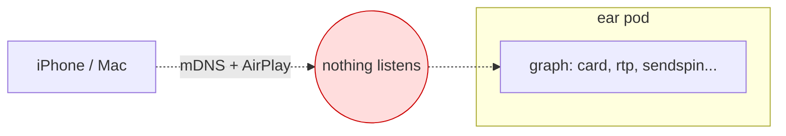
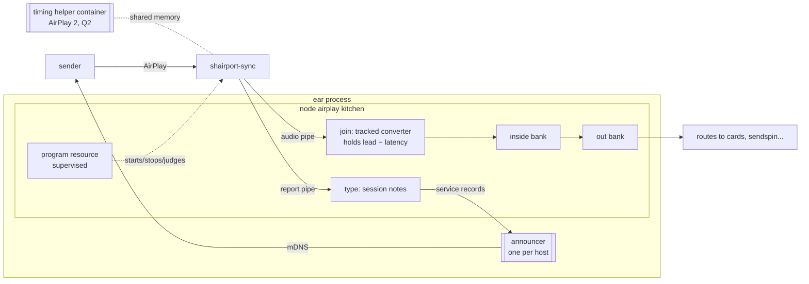

# AirPlay into ear: the `airplay` node type

**Status:** revision 2 for the owner's gate, 2026-11-14. This was a read-only run, so no files were changed.
**Layer:** Domain · **System (this page: the domain concepts it adds, plus its parts and their public interfaces)** · Service (skipped: ear is one process) · Module · Interfaces · Implementation
**What you are asked:** agree the shape, then answer the three questions below. The recommended shape is: each room plays on the sender's time, fed through a pipe.

| # | Question | Kind | Where |
|---|---|---|---|
| Q1 | Must every ear AirPlay room play within N ms of the moment the sender meant, so grouped rooms (ear's and Apple's) line up? | absolute requirement | §4 |
| Q2 | On Talos, may ear's pod join the node's own network, with AirPlay 2's timing helper running as a second container in that pod? | general guidance | §5 |
| Q3 | Should AirPlay 2 be in this plan, after a first version on the original AirPlay, or come later? | general guidance | §8 |

## What changed since your last look

- **Alignment.** v1 said a pipe could only be lined up by hand. That was wrong.
  - shairport-sync releases each frame a fixed **lead** before its play time, and it times that on the same raw clock ear ticks on.
  - So ear can hold exactly that lead and play **on time**. Grouped ear rooms and Apple speakers then line up as a consequence.
  - The part that holds the lead is the tracked converter, which TM8 already plans for AirPlay.
  - PipeWire's pipe module is dropped: its buffer is fixed at about 170 ms and cannot be steered.
- **mDNS.** shairport-sync's guide says one host has one announcer, and per-program announcers collide.
  - Each shairport-sync now hands its records to ear, and ear's one **announcer** (sendspin's, moved into the framework) publishes them.
  - Debian's package can only announce through Avahi, so the image builds shairport-sync from source for both AirPlay versions.
- **Timing helper.** It is no longer a program the nodes share inside ear. The recommendation is a second container in the pod (Q2).
- **Interfaces.**
  - The type makes one join call.
  - ear assigns each room's ports and claims speaker names.
  - Session events come from shairport-sync's metadata feed, not from log lines.
  - The identity store is deleted, because shairport-sync derives a speaker's identity from its name.
- **Questions.** v1's Q3 (volume slider, a second iPhone, a stopped node) became recommended defaults. `hostNetwork` moved into Q2.

---

## 1. Today



Missing today:
- AirPlay software in the image.
- A way for a node to run an outside program. Node code may not fork.
- A path for that program's audio into a bank.
- A shared announcer: mDNS lives inside `sendspin` today.
- The `airplay` type itself.
- A pod the iPhone can find, which needs the node's own network.

## 2. What the owner has said (no absolute requirement binds AirPlay yet)

Everything below is **guidance** under the 2026-11-06 rule.

| # | Your words | Date, source | Kind |
|---|---|---|---|
| G1 | "i will want multiple shairport instances" | 2026-10-29, memory | guidance |
| G2 | "an "airplay node" could launch the subprocess and wire everything up magically. but if thats untenable, then we would just have seperate containers pre-existing" | 2026-10-29, memory | guidance, with your own fallback |
| G3 | "the core will be "built into ear"" | 2026-10-29, programs.md R4 | guidance |
| G4 | "Pipe into a feed first" | 2026-11-07, programs.md Q7 | a pick, worded by the agent |
| G5 | "Nodes should not have direct access to stdout or stderr." | 2026-11-07, R9 | guidance (built) |
| G6 | Outputs on different devices sample-aligned: "yes"; its purpose: "seperate zones" | 2026-10-29, memory | guidance; Q1 asks whether it binds AirPlay |
| G7 | "under 10ms is obviously idea[l]" | 2026-10-29, memory | guidance |
| G8 | "Backoff, never gives up"; "Some node stopping/reconfiguring/failing does not effect the graph globally" | 2026-11-07 / 11-08, recovery.md | guidance |
| G9 | "ear will likely run on linux, inside a container, in my talos kubernetes cluster" | 2026-10-29, memory | guidance |
| G10 | rtp with no packets stays running and silent: "Agreed" | 2026-10-30, memory | guidance |
| G11 | AirPlay 1 vs 2: "irrelevant at this point; it can be decided later" | 2026-10-29, memory | a deferral, now due (Q3) |

TM8 ("AirPlay for tracked") is the brief's wording of your 2026-11-13 answer, not a quote, and this page keeps it as written.

**New terms**

| Term | Meaning | Not this | Could be |
|---|---|---|---|
| sender | The Apple device or app playing to ear | Music Assistant | the rtp docs' "sender" |
| speaker | How one `airplay` node shows in a sender's list, under its `name` | the engine name | the node |
| session | One sender playing to one speaker, from start to stop | the node's state | programs.md's "session started" |
| on time | A node plays each frame at the moment its sender stamped for it | low delay | "in sync" |
| lead | How far ahead of a frame's play time the program hands it to ear | ear's delay | shairport-sync's "desired buffer length" |
| join | The path a program's audio takes into the node's inside bank | a route | a converter companion |
| program | An outside process a node runs (shairport-sync) | a node | programs.md's term, kept |
| announcer | ear's one mDNS responder, which publishes records for every type | a program's own Avahi | sendspin's Advertiser, promoted |
| host helper | A per-machine program that no node owns: nqptp, the **timing helper** AirPlay 2 needs | a program | none |
| zone alignment | One source played on time across devices with different latencies | on time | cards-and-clock R7 |

## 3. The proposed shape (recommended: A, a pipe held on time)

One node runs one supervised shairport-sync.
- **Audio:** it goes through a pipe into a tracked converter, which holds the lead minus ear's own downstream latency, so each frame reaches the speaker at its stamped time.
- **Reports and records:** they arrive on a second pipe. The type turns them into session notes and into records for the announcer.



How a frame stays on time:

```
frame stamped to play at T
shairport-sync hands it over at T − lead ─▶ held in the join for (lead − L) ─▶ ear's downstream latency L ─▶ speaker at T
```

| Part | Owns | Never does |
|---|---|---|
| `airplay` type | Settings, the program's config, parsing its reports into sessions and service records | Parses AirPlay audio; names a pipe or port |
| Program resource (framework) | Start, stop, health (the process is alive), the pipes, stderr into the node's log | Judges sessions |
| Join (framework; T5's tracked converter) | Holding the lead, following the sender's pace, the latency it adds | Knows it is AirPlay |
| Announcer (framework) | mDNS on 5353 for every type | Belongs to a node |
| shairport-sync | The protocol, pairing, decoding, the lead | Sees ear's graph |
| Timing helper (outside ear, Q2) | UDP 319/320 for the machine | Belongs to ear or a node |

## 4. Design it twice: pipe held on time (A) vs program stream (B)

Both shapes share the program resource, the type, the announcer and the image. Only the join differs.

| | **A: pipe into the tracked converter** | **B: shairport-sync as a stream in ear's engine** |
|---|---|---|
| On time | yes, if ear holds the lead (above) | yes: shairport-sync reads the stream's delay and corrects itself ("full audio synchronisation") |
| Evidence | Read from source (`player.c` releases at timestamp − lead, on CLOCK_MONOTONIC_RAW). Upstream calls pipe output fit "where timing is not crucial", so **slice 0 must prove it** | upstream's supported mode [U: does ear's latency plan reach the delay it reads?] |
| Delay ear adds beyond the stamped time | none (target) | none (target) |
| Isolation (G8) | the program is outside ear's realtime cycle; its crash is its node's alone | the program runs inside ear's graph cycle [U: a late program delays every node] |
| What it breaks | nothing | ear's engine has no socket, and it names its nodes "safe only while no other client can connect" (engine.md). B serves one connection per program |
| Image | source build: pipe and metadata | source build plus PipeWire output |
| Fits | G4; TM5 and TM8 as written | programs.md §4 (undesigned) |

**Recommendation: A, with B as the fallback if slice 0 misses Q1's bound.** Switching to B changes three things:
- the join's kind, and the program's output arguments, in the type (a few lines);
- the engine, which would serve one connection per program;
- the build, which would add PipeWire output.

> **Q1. Must every ear AirPlay room play within N ms of the moment its sender meant it to?** *Absolute requirement*
> <details><summary>Background</summary>
>
> ```
> iPhone ──┬──▶ HomePod (living room)       all three play the frame stamped T at T,
>          ├──▶ ear "kitchen" ──▶ card A     so they line up with each other
>          └──▶ ear "porch"   ──▶ card B
> ```
> Each ear room has its own shairport-sync and its own join, so ear's graph does not line them up: each room must be on time by itself. Shape A is designed to do this, and B does it by upstream design. One room feeding two cards of different latency is a separate problem, zone alignment (cards-and-clock R7, not this page).
>
> | Answer | What follows | Cost |
> |---|---|---|
> | **Yes, N = 10 ms (recommended: your "yes" to aligned zones, and "under 10 ms ideal")** | slice 0 must meet N with A, or B replaces A's join | if A misses, B's engine change |
> | No (guidance) | ship what slice 0 measures | rooms may drift apart by an unbounded, unmeasured amount |
>
> The sentence that would bind: "Every `airplay` node plays each frame within N ms of the time its sender stamped for it." It rules out any join that cannot be steered, and it sets slice 0's pass mark.
> </details>

## 5. Canonical shape

**Domain.** The proposal adds:
- `airplay`, a **source** (TM2) with no inputs.
- Framework concepts:
  - the **program resource**;
  - the **announcer**, promoted from `sendspin`, with sendspin moved onto it in the same change;
  - **claims ear assigns**: a free TCP port, a UDP range, and a speaker name that is one per name across ear.
- The join, built as T5's **tracked converter**. No companion kind is added beyond T5's own.
- One type-local lifecycle, the **session**, kept apart from the node's states.

No session event changes the node's state. No sender means the node is running and silent (G10). The timing helper sits outside ear's domain.

```mermaid
stateDiagram-v2
  [*] --> idle
  idle --> playing: sender starts
  playing --> idle: stopped / gone / taken over / no timing
  note right of idle: the node stays running; a program exit is the node's 'lost'
```



**Patterns:**
- **Supervisor:** Erlang/OTP one-for-one, with its backoff coming from slice 8.
- **Sidecar process:** each room's program, run under its node.
- **Sidecar container:** the per-machine timing helper (Kubernetes pod pattern; Q2).
- **Adapter:** the converter companion, as the RTP receiver already is.
- **Single responder per host:** mDNS (RFC 6762 practice; shairport-sync's `mdns_backend = "metadata"`, in release 5.6.3).

The rest of this section is recommended as shown:
- The iPhone's volume slider is ignored until slice 6 gives the node a level.
- A second sender takes over: classic AirPlay needs `allow_session_interruption` switched on, and AirPlay 2 behaves this way itself [U].
- A stopped node stays announced and silent.
- Renaming a node shows iPhones a new speaker.

> **Q2. On Talos, may ear's pod run on the node's own network, with AirPlay 2's timing helper as a second container in that pod?** *General guidance*
> <details><summary>Background</summary>
>
> ```
> Talos node's network (where iPhones are)
>  └─ ear pod (hostNetwork)
>      ├─ ear container ........ 7777 editor, 5353 mDNS, each room's AirPlay ports
>      └─ helper container ..... 319/320 (AirPlay 2 only), allowed to bind low ports
> ```
> iPhones find speakers only by mDNS on the local network. A pod on the cluster network cannot be found.
>
> | Option | Gives | Costs | You would see |
> |---|---|---|---|
> | **hostNetwork + helper container (recommended)** | iPhones find ear. Only the helper may bind low ports. Kubernetes restarts the helper | 7777 (no login) on the node's network; a policy exception, as for multicast rtp. While the helper is down, AirPlay 2 rooms show running but sessions end "no timing" | ear and a small helper in one pod |
> | hostNetwork, ear starts the helper itself | one container, G2's "magically" | ear itself gains the low-port capability and supervises a program no node owns | one container |
> | no hostNetwork | nothing new exposed | iPhones cannot find ear at all | no AirPlay |
>
> Your answer sets the pod shape in slices 5 and 6.
> </details>

## 6. Design rules (design choices, not requirements)

1. **The program owns AirPlay; ear owns the graph and the time.** Health means the process is alive. Sessions are reports, never health. Being on time is the join's job.
2. **One join per node, from one value.** The type makes one call. Its format, rate and lead feed both the program's config and the converter. The type never names a pipe.
3. **Per-host things have one owner.** There is one announcer. Ports and speaker names are claimed and assigned across ear. The timing helper belongs to no node.

## 7. Public interfaces (sketch)

```ts
// ---- The airplay type: a source ----
interface AirplaySettings {
  name?: string;                   // the speaker name; default: the node's name; restarts the node
}
interface AirplayBanks {
  out: Output<2>;                  // public, graph rate
  fromAirplay: InsideInput<2>;     // the join delivers here; passed through to out
}

// ---- What configure asks for ----
interface CreateOf {
  program(shape: ProgramShape): ProgramHandle;   // new (slice 9)
  advertise(): Advertisement;                    // the announcer, shared with sendspin
  claim(c: Claim): Granted;                      // built; gains the kinds below
}

type Claim =
  | BuiltClaim                                   // TcpListen, Udp (one port each)
  | { kind: "anyTcp" }                           // ear picks a free port and grants it
  | { kind: "udpRange"; count: number }          // ear picks a free run (classic AirPlay)
  | { kind: "speakerName"; name: string };       // one speaker per name across ear

interface ProgramShape {
  executable: ProgramId;           // closed list the image ships: "shairport-sync"; never a path
  args: ProgramArg[];
  config: RuntimeFile;             // generated beneath the config folder; removed with the configuration
  audio: Join;                     // where its audio goes
}
type ProgramArg =
  | { text: CheckedText }                        // from a checked setting
  | { port: Granted }                            // a port ear granted
  | { path: "config" | "audio" | "reports" };    // files the framework makes; the type never names them

interface Join {
  into: InsideInput<2>;
  pcm: {
    format: "s16le" | "s32le";     // pinned, never "auto"
    rate: Hz;                      // 44100 (classic) or 48000 (AirPlay 2)
    channels: 2;
  };
  leadMs: number;                  // the program hands frames over this early; the join holds lead − downstream latency
}

/** Invariants:
 *  - starts with signals unblocked, descriptors above 2 closed, stdin null, stderr into the node's log only (R9)
 *  - dies with ear (parent-death signal); ear as PID 1 reaps it
 *  - stop: a signal, then a kill within the close deadline
 *  - its claims are released only after it is reaped
 *  - reports arrive on the node's loop, never after teardown */
interface ProgramHandle {
  onReport(handler: (text: string) => void): void;  // the report pipe (shairport-sync's metadata feed); the type parses it
}

interface Advertisement {
  publish(records: ServiceRecord[]): void;   // from the program's 'svrg' reports
  withdraw(): void;
}

// ---- Session (type-local, reported as notes) ----
type SessionEvent =
  | { kind: "started"; sender?: string }
  | { kind: "ended"; reason: "stopped" | "gone" | "taken-over" | "no-timing" };

// ---- How a node fails (existing codes) ----
type AirplayFailure =
  | { code: "start-failed"; detail: string }   // a claim refused (name taken), exec failed, a file not written, never announced
  | { code: "engine-refused"; detail: string } // the join never became ready
  | { code: "lost"; detail: string };          // the program exited; slice 8 retries with backoff
```

A name collision is refused before the program starts, so it can no longer become a crash loop. A speaker that never announces fails `start-failed`; it never sits running while invisible.

## 8. Tracer bullet, slices, AirPlay 2

**Tracer bullet.** One `airplay` node on classic AirPlay, running a source-built shairport-sync in the dev image. A system test plays a tone from a scripted classic sender (PipeWire's `raop-sink` or pyatv [U]).

What it proves:
- an mDNS browse finds the speaker, published by ear's announcer;
- the recording holds the tone;
- its offset from the stamped time is within N;
- a stop leaves nothing behind.

Non-goals: AirPlay 2, the helper, Talos, an iPhone, volume, recovery.

| # | Slice | Needs | Delivers |
|---|---|---|---|
| 0 | Spike, in three parts: (a) a pipe held at lead − latency, its offset measured against the sender's stamps on two receivers, pass mark Q1's N; (b) records over the metadata feed published by ear's announcer; (c) if Q3 is yes, one multi-client nqptp in a second container serving two instances | nothing | A or B; the announcer path |
| 1 | Program resource and supervisor, with assigned and name claims (wire, fixtures and editor in one commit) | slice 3c (built) | G2's "launch the subprocess" |
| 2 | Announcer moved out of `sendspin` into the framework, sendspin moved onto it | nothing | one responder (rule 3) |
| 3 | Join: T5's tracked converter fed from the program's pipe, its target following the latency plan | 1, 0, T4 (built) | on time |
| 4 | `airplay` type v1 (classic): settings, config, reports, sessions. **Tracer ends here** | 1-3 | G1 (N rooms, each found and on time) |
| 5 | Image and Talos: a source-build stage (as knobly's), `hostNetwork`, the image smoke check, the ear-on-talos skill | 4, Q2 | G9 |
| 6 | AirPlay 2: the build flag, the timing helper (Q2), an AirPlay 2 test sender | 5, Q3 | iPhone grouping |

Slice 8 (recovery) must land before slice 5 ships; until then a crashed program needs a `node.restart`. Compared with v1, the scope gains one slice (the announcer) and loses the identity store.

> **Q3. Should AirPlay 2 be in this plan, after the classic-AirPlay first version, or come later?** *General guidance*
> <details><summary>Background</summary>
>
> | | **In this plan, after classic (recommended)** | Later |
> |---|---|---|
> | iPhone | picks several ear rooms and HomePods at once | plays to one ear room at a time; a Mac's Music app can still group classic speakers |
> | Pod | adds the timing helper (Q2), on 319/320 | nothing more |
> | Tests | no scripted AirPlay 2 sender is known [U: OwnTone]; without one, its audio is proven only on hardware, against the repo's testing rule | classic is testable |
> | Size | slice 6 | slices 0-5 |
>
> Your answer sets whether slice 6 is in this plan.
> </details>

## 9. Costs and deferrals

**Costs:**
- **A new framework slice for spawning.** Process spawning has traps: SIGTERM is blocked in every thread and a child inherits that; ear holds descriptors; ear runs as PID 1 and must reap.
- **The announcer leaves `sendspin`.** It moves into the framework, and its mDNS library moves with it.
- **Source builds.** shairport-sync (and nqptp, if ear starts it) are built from source, which grows the image.
- **`hostNetwork` (Q2).** 7777, which has no login, lands on the node's network, and anyone on the LAN can play.
- **Unproven timing.** Upstream does not promise pipe timing; a miss costs B's engine change. Also, until R7, a room feeding devices of different latency is on time on its slowest path only.

**Deferred:** track information, ear sending AirPlay, passwords, Home app pairing, remote control, 96/192 kHz, multichannel, arm64.

**Not planned:**
- an in-process receiver (no maintained library; it would share ear's crash domain);
- a container per room (rooms stay ear's programs, as in G2's first preference);
- PipeWire's pipe-tunnel (fixed 8192 frames, about 170 ms, cannot be steered to stay on time).

## 10. Prior art considered

| Candidate | Verdict |
|---|---|
| shairport-sync 5.6.3 | used: the only Linux receiver with AirPlay 2 and multi-room; its `metadata` mDNS backend hands records to a host responder |
| nqptp | the per-machine timing helper; upstream's multi-instance guide calls it multi-client [U: which release] |
| Debian shairport-sync 4.3.7 | rejected: built with Avahi only, no AirPlay 2, depends on avahi-daemon |
| PipeWire module-pipe-tunnel | rejected: fixed target, cannot hold a lead |
| PipeWire raop-sink, pyatv, OwnTone | test senders [U] |
| UxPlay, RPiPlay, shairplay, libraop | mirroring only, AirPlay 1 only, unmaintained, or senders |

## 11. Reconcile with existing code

| Where | Change | Cost |
|---|---|---|
| `programs.md` | 2.2's paced source becomes the tracked join; 2.4's `advertise` resource is chosen; §3's "loses multi-room alignment" is wrong; line 5's "runtime files from slice 3c" is wrong | doc edits at slice 9 |
| `timing-model.md` T5 | `targetFrames` follows the latency plan, not a fixed value; TM8 kept | T5 gains a moving target |
| `claims.hpp`, writing-a-node-type#claims | claims that assign (TCP, UDP range) and a speaker-name kind; today a claim only grants or refuses | a new claim behaviour |
| `companions.hpp` `ResourceAdapters` | program and advertise adapters; readiness gains "announced" | wire, `test/protocol/`, `web/src/protocol.ts` in one commit |
| `sendspin` Advertiser, `cmake/SendspinDeps.cmake` | the responder and its library move to the framework; AGENTS.md's "only `ear_node_sendspin` sees them" changes | a move, with sendspin's tests unchanged |
| `docker/Dockerfile` | a source stage for shairport-sync (and nqptp); no Avahi or D-Bus | image size |

## For the code architects (parked)

- The lead's value; the pipe's kernel buffer and write granularity against the hold; who opens the pipe first.
- Whether shairport-sync stuffs or drops with no `delay()`, and so what drift the converter tracks; TM9's jump on a sender stall.
- The assigned-port race between ear's probe and the program's bind; mDNS name conflicts with other hosts on the LAN.
- Parsing the metadata feed, which item codes carry sessions and `svrg`, and detecting "no timing".
- AirPlay 2 pairing state files kept by shairport-sync, against one source of truth.
- B: a socketpair handed over through `pw_context_connect_fd` instead of a listening socket [U].
- Spawning: a pidfd on a loop, an environment allowlist, the working directory.

Not run: no spike, build or test. shairport-sync, nqptp and PipeWire behaviour was read from their source and docs only, and iPhone behaviour is unverified [U].

## Review answered

- *Premises suspicion (b), "metadata backend only on master":* release 5.6.3's `scripts/shairport-sync.conf` line 39 lists `"metadata"`.
- *Fit 3, "DaemonSet" as the helper's home:* a DaemonSet pod does not share ear's IPC namespace, which nqptp's shared memory needs (upstream's multi-instance guide, "Shared memory / IPC"); a container in the same pod does. So only the pod sidecar is offered.
- *Completeness 7, the rtp 100 ms precedent as slice 0's bar:* being on time adds no delay beyond the stamped time, so the bar is an offset (Q1's N), not a delay.
- *Fit 5, "no interface carries the path between packages that do not see each other":* that wiring is `main.cpp`'s, as for every adapter (architecture.md#packages); the contract is the one `Join` value, and the path is a framework-made `ProgramArg`.
- *Fit 1, "separate container asserted unworkable without evidence":* per-room programs stay ear's (G2's first preference); only the per-machine helper is offered as a container (Q2).

*History: v1 2026-11-14; v2 the same day, after the premises, fit and completeness reviews: on-time join, one announcer, timing helper outside ear, identity store deleted.*
