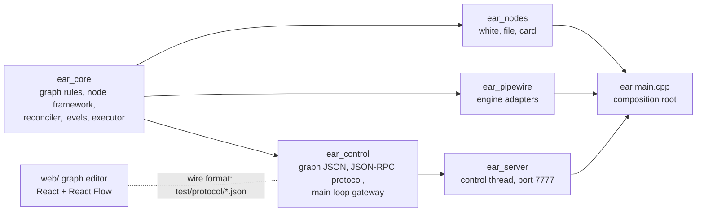

# Batch 2: run image, control port, graph UI, sound card

Status: scope answered by the owner on 2026-10-30; the module design and slice pages are below,
revised the same day after the adversarial design review (section 12 lists each finding and the
change). Built on branch `claude/batch2` the same day: section 13 records each slice's result,
section 11 the errata. The system design is `docs/design/pipewire-graph.md`.

## The owner's answers (chat, 2026-10-30)

The question page: https://claude.ai/artifact/DraHdKRyZDB4WwBWxDTn4k

| Question | His words | What it means here |
|---|---|---|
| Scope | "Ok" (to the recommended scope) | Run image, control port, web UI, sound card node. Sendspin (Music Assistant) is the next batch. |
| Web UI | "Graph view is the goal. Dynamically wiring up nodes and edges in a UI is the goal. I want to see all of the graph information in real time, like the audio levels per-channel / per edge" | A drawn graph editor: nodes as boxes, routes as wires added and removed in the UI, with live status and live audio levels per channel and per route. |
| Hardware | "Motu 24ao. Talos 1.13.x I think maybe 1.14.x" | A MOTU 24Ao (AVB series, USB class compliant). Talos 1.13 or later includes the USB audio driver (added in 1.12). |
| File node paths (review P0, after the cut) | He picked the option "confine file node paths to one recordings folder (a new --recordings-dir flag; reject anything outside it)" | A `file` node's path is relative to one folder given at boot; absolute paths, `..` and symlinks that lead out are refused (sections 4.4, 4.7, 11). |
| Threading | "The control port shouldn't run in the PipeWire context, because it will not be real time" | The control port's own work (sockets, messages, client queues) runs on its own thread, never on PipeWire's threads. The graph edits it asks for are applied on PipeWire's main loop, which is not realtime; only PipeWire's data thread is realtime, and nothing of the control port runs there. |

Not answered: the CPU of the Talos nodes. The image is built for amd64 until he says otherwise.

**Open question for the owner (does not block the cut):** graph edits from the control port are
applied on PipeWire's main loop. That loop is not realtime: it already makes the links and reads
the engine's events, and audio runs on a separate realtime thread. The control port's own work
stays on its own thread. Is that what you meant? If you meant that no control work may touch any
PipeWire thread at all, say so: every PipeWire call has to run on its main loop, so the edits
themselves cannot move.

## The ideas, as researched (2026-10-30)

- "build a docker container in GHA": a run image without compilers, published to ghcr.io on
  every merge to master and tagged by commit; versioned images only from an automated release
  flow.
- "add MOTU drivers to image": no MOTU driver exists or is needed. MOTU's USB interfaces use the
  kernel's USB audio class driver (`snd-usb-audio`), which is in the Talos kernel, not the image.
  The image already carries PipeWire's ALSA plugin. The work is a sound card node type, with the
  card driving the clock while it works.
- "support home assistant network audio as source + sink": Music Assistant's Sendspin protocol
  (deferred to the next batch).
- "add control socket": port 7777, JSON-RPC 2.0 over WebSocket (Snapcast's pattern).
- "add web UI": served by EAR on the same port.

## Design choices (current choices, revisable)

- A sound card drives the graph's clock only while it works. A card that fails or is lost
  leaves the clock at once and the dummy driver drives the graph (R2: "its always just
  'running'").
- Removing a node removes its routes, and status says so.
- New settings for a node restart its insides; its ports and routes stay. Changing ports is
  refused.
- Live edits are not saved; `ear.json` loads at boot.
- No login on port 7777 yet: anyone who can reach the port can edit the graph. It answers only
  requests addressed to an IP address, `localhost` or a name given with `--allowed-host`, and
  refuses browser pages from other sites. A `file` node writes only inside the recordings folder
  (the owner's pick, above); the folder's defaults, `recordings` beside where EAR starts and
  `/var/lib/ear/recordings` in the run image, are design choices.
- A sound card is named in `ear.json` by its ALSA card id (the name in `/proc/asound/cards`, for
  example `Pro24`), never by index and never by a raw ALSA device string.
- Stopping EAR first refuses graph edits (clients get "stopping"), then stops every node.
- The run image runs as an ordinary user. It gets realtime priority only when the pod grants
  it, and EAR reports whether it got it.

---

# Module design and slice pages (code architect, 2026-10-30)

Layer: module, beneath the agreed system design (`docs/design/pipewire-graph.md`) and the answers
above. Milestone 1's page (`docs/design/m1-white-to-file.md`) holds the M1 interfaces this batch
changes; every change is listed in section 4. [V] = verified in PipeWire's sources (1.4.2 unless
stated; fetched copies), [U] = unverified, so each [U] is an acceptance criterion of the slice
that meets it. Nothing here was compiled by the architect (NOT RUN).

## 1. Module map



| Package (dir) | Owns | Takes | Gives | Never |
|---|---|---|---|---|
| ear_core (src/core) | wanted nodes and routes and their checks; closing the graph to edits; each node's state machine and everything it made (port block, insides, handoffs, sound cards); route links; what a level is; the graph read | GraphControl calls; engine facts through its own interfaces | listener events; `GraphReader::read()`; `LevelMeter`; `CardId` | PipeWire, sockets, threads, files |
| ear_nodes (src/nodes) | the built-in types white, file, card | settings JSON, a NodeGrant | NodeConfig, AudioCode | PipeWire, ALSA (a card is asked for through the grant) |
| ear_pipewire (src/pipewire) | the in-process engine and its scheduling report; port blocks (with level metering); links; live ports; handoffs; sound cards (an ALSA adapter node plus its own links, leaving the clock when it fails); the main-loop executor | core interfaces to implement | engine events as core events; `LevelReader` | policy |
| ear_control (src/control) | ear.json; the one decoder and encoder of node and route JSON; the JSON-RPC protocol (envelope, commands, events, sessions, subscriptions); `MainLoopGateway`, the one crossing between the main loop and the control thread | text messages; graph events; levels | encoded responses and notifications | sockets; holding the graph on the control thread (the hub sees only `GraphGateway`) |
| ear_server (src/server, new) | the control thread; port 7777: HTTP for the UI's files, WebSocket at `/rpc`, Host and Origin checks, per-client queues, the level bell | settings; a `GraphGateway`; levels | bytes on sockets | graph state; PipeWire |
| ear (src/main.cpp) | wiring; boot and stop order | flags, ear.json | exit status | computing anything |
| web/ (new) | the graph editor | the wire format | JSON-RPC calls | graph rules (the server is the one source of truth) |

Dependencies: ear_core (nlohmann/json only) ← ear_nodes (sndfile), ear_pipewire (libpipewire-0.3),
ear_control ← ear_server (Boost.Beast and Boost.Asio, header-only, PRIVATE: no Asio type in a
public header) ← ear. The web UI shares no code with C++; its contract is the wire format and the
fixtures in `test/protocol/`, which both sides test against (section 6).

## 2. Threads: who runs what

The owner (2026-10-30): "The control port shouldn't run in the PipeWire context, because it will
not be real time". So the control port's code runs on its own thread. Of its path, only the graph
call runs on the main loop (typed in, typed out, inside `MainLoopGateway`). The main loop is not
realtime (the open question at the top asks him to confirm this reading).

| Thread | Runs | Owns | Never |
|---|---|---|---|
| Realtime (PipeWire data loop) | `AudioCode::process`; port-block level metering; `RtWriter::write`; publishing a level window and ringing the bell | each block's meters and its level mailbox's write side | locks, allocation, waiting; system calls other than one eventfd write |
| Main loop (PipeWire, the main thread) | Engine, DesiredGraph, NodeHost, Reconciler, LiveGraph, Links, FilterPortBlocks, AlsaSoundCards, GraphStatus, MainLoopGateway's main-loop side (its listener calls and the commands it posts there) | every piece of graph state | sockets, JSON-RPC text, waiting on the control thread |
| Control (ear_server's `ControlThread`, one `io_context`, one thread) | Beast HTTP and WebSocket, ControlHub and sessions, JSON-RPC decode and encode, per-client queues, reading levels when the bell rings | connections, subscriptions, queues | holding GraphControl, GraphReader or any core object (it holds only `GraphGateway`); waiting on the main loop |
| Handoff threads (one per handoff, M1) | `HandoffConsumer::consume` | the file node's writer | unchanged |

Crossings (each event-driven; no thread polls another):

| From → to | How | Bounded by |
|---|---|---|
| control → main | `GraphGateway::run` → `MainLoopExecutor::post` (mutex-guarded queue plus a `pw_loop` event source) | one message in flight per connection: its next message is read only after its replies are queued |
| main → control | `MainLoopGateway` posts replies and events to `ControlThread` (`asio::post`; one thread, post order kept) | events are small and human-rate; per-client queues bound what waits for a socket |
| realtime → control | per-block level mailbox (triple buffer) + `LevelBell` (non-blocking eventfd, rung at most once until answered) → control thread reads `LevelReader::latestLevels()` | latest value per block; every levels message is a complete snapshot, so replacing an unsent one loses nothing |

Why a mutex queue and not `pw_loop_invoke` for control → main: both are equivalent crossings; the
queue owns each posted function, so work left when EAR stops is destroyed rather than leaked, and
it has no "queue full" failure. The main loop is not realtime, so a mutex there costs nothing.
`ControlThread` is started after `Engine::create`, so it inherits the blocked SIGINT and SIGTERM
(pipewire-engine skill, "Traps").

```mermaid
sequenceDiagram
  participant UI as browser
  participant C as control thread
  participant M as main loop
  participant RT as realtime thread
  UI->>C: {"method":"route.add",...}
  C->>C: parseMessage, decodeCommand
  C->>M: gateway.run([AddRoute])
  M->>M: DesiredGraph.addRoute → observers (gateway: route.added) → Reconciler → createLink
  M->>C: post(event route.added), post(reply)
  C->>UI: notification, then response
  M-->>C: later: post(event route.status linked)
  RT->>RT: meter ports; at each window boundary of the graph clock, publish
  RT->>C: bell (eventfd)
  C->>C: latestLevels, encode once
  C->>UI: "levels" (a complete snapshot; the newest replaces an unsent one)
```

## 3. Design rules for this batch (design choices)

1. **The port block is the node's ports, always.** It is made when the node is added and goes only
   when the node is removed. Insides (the type's code, its handoffs, its sound cards) start,
   restart and fail behind it; the block keeps processing (silent when no code drives it), so
   routes stay linked and levels keep flowing (system design rule 3, R2).
2. **A sound card is in the graph's clock only while it works.** It runs alone until its PCM is
   running, then its own links join it to its port block, and through the block's graph group it
   drives every block. When it fails, it destroys its engine node and links before it reports the
   loss, so a failed card never holds the graph (R2). One owner: the card adapter (section 5).
3. **The main loop owns every piece of graph state; the control thread holds only a gateway.**
   Commands and reads cross as typed values through `GraphGateway`; nothing on the control thread
   caches the graph or can reach it. A client's view is a snapshot plus the events after it, in
   one ordered stream.
4. **One event order, frozen in `DesiredGraph`.** Observers (the gateway) hear each change before
   any subscriber acts on it, so a change's notification always comes before the statuses it
   causes (`node.added` before `node.state`, `node.removed` before `node.stopped`).
5. **Stopping closes the graph to edits first.** `DesiredGraph::close()` returns the proof
   `NodeHost::stopAll` requires, so no edit can reach the node framework once it is stopping.
6. **Levels are a latest-value signal measured on the graph clock.** Each port block measures its
   public ports every cycle; every block publishes at the same clock positions (window boundaries
   of the graph clock), and a levels message carries every block's latest window. Nothing between
   the realtime thread and a browser queues levels.

## 4. Frozen interfaces

C++23 as M1. Stateful classes keep a private Impl pointer. Bodies are not part of the page.

### 4.1 Changed M1 headers (each change; s0 makes them compile)

| Header | Change |
|---|---|
| `core/command_error.hpp` | + `InvalidName`, `PortsChanged`, `UnknownRoute`, `Stopping` (codes "invalid-name", "ports-changed", "unknown-route", "stopping") |
| `core/node_type.hpp` | `Ports` + `insideInputs`, `insideOutputs`; `AudioCode::process` spans include inside ports; `NodeGrant::soundCard`; includes the new `core/sound_card.hpp` |
| `core/node_catalogue.hpp` | + `names()` |
| `core/desired_graph.hpp` | listeners take `NodeSpec` and `std::shared_ptr<const NodeConfig>`; + `nodeUpdated`, `nodeRemoved`, `routeRemoved`; + `observe()` (told before subscribers); + `close()` and `GraphClosed`; `GraphControl` + `updateNode`, `removeNode`, `removeRoute`; `DesiredGraph` + `nodes()`, `routes()`; + `WantedNode` |
| `core/node_lifecycle.hpp` | `refused` splits into `portBlockLost` (final) and `insidesFailed`; + `insidesReady`, `restartRequested`, `blockLost()`; running needs both readiness facts |
| `core/node_host.hpp` | `PortBlock::drive`; `PortBlockFactory::make` loses `AudioCode&`; + `SoundCard`, `SoundCardEvents`, `SoundCardFactory`; `NodeHost` ctor + cards; + `nodeUpdated`, `nodeRemoved`; `stopAll` takes `GraphClosed` |
| `core/reconciler.hpp` | + `routeRemoved`; `portGone` acts only on the port whose live id it is |
| `pipewire/engine.hpp` | + `Scheduling`, `dataThreadScheduling()`; `create` makes a permitted CAP_SYS_NICE effective |
| `pipewire/port_blocks.hpp` | ctor takes `LevelWake&`; implements `LevelReader`; new `make` |
| `nodes/builtin.hpp` | + `makeCardNodeType`; `builtinNodeTypes()` adds card; `makeFileNodeType` and `builtinNodeTypes` take the recordings folder (section 4.4, erratum in section 11) |
| `pipewire/links.cpp` (not a header) | its link proxy moves to the private `src/pipewire/link_proxy.hpp`, shared with sound cards (s0, behaviour unchanged) |
| unchanged | `graph_spec.hpp`, `links.hpp`, `live_graph.hpp`, `handoffs.hpp`, `graph_file.hpp`, `status_log.hpp` |

Every frozen header's first line points at this page from s0 on (section 4 of this page, Errata
in section 11).

```cpp
// ===== core/command_error.hpp (additions) =====
struct InvalidName  { NodeName node; };   // not 1-64 characters of [A-Za-z0-9_-]
struct PortsChanged { NodeName node; };   // updateNode: the new settings would change its ports
struct UnknownRoute { Route route; };     // removeRoute: the route is not wanted
struct Stopping     {};                   // EAR is stopping: the graph takes no more edits
using CommandError = std::variant<UnknownNodeType, InvalidSettings, DuplicateNode, UnknownNode,
                                  UnknownPort, WrongDirection, InvalidName, PortsChanged,
                                  UnknownRoute, Stopping>;
/// describe(): "invalid-name <n>", "ports-changed <n>", "unknown-route <a>:<p> -> <b>:<q>",
/// "stopping".

// ===== core/sound_card.hpp (new; s0 writes it whole) =====
#pragma once
#include <optional>
#include <string>
#include <string_view>
#include <vector>
#include "ear/core/graph_spec.hpp"
namespace ear {
/// An ALSA card id, the name in /proc/asound/cards (e.g. "Pro24"): 1-15 characters of
/// [A-Za-z0-9_-]. The only way anything names a sound card, so no user text ever reaches
/// alsa-lib's device-name parser, whose plugins open files and run commands
/// (the `file` plugin's "|command" form).
class CardId {
public:
  static std::optional<CardId> parse(std::string_view text);   // nullopt outside the grammar
  const std::string& text() const noexcept;
  friend bool operator==(const CardId&, const CardId&) = default;
private:
  explicit CardId(std::string text);
  std::string text_;
};
enum class CardDirection { playback, capture };
struct SoundCardRequest {
  CardId card;
  CardDirection direction;
  std::vector<PortName> blockPorts;  // channel i <-> blockPorts[i]: insideOutputs (playback)
                                     // or insideInputs (capture) of this node
};
}

// ===== core/node_type.hpp (changes) =====
/// Public ports are routable. Inside ports belong to the port block only; nothing but the node's
/// own sound cards reaches them. Invariant: the four lists' names are unique together
/// (DesiredGraph::addNode throws std::logic_error otherwise: a type bug).
struct Ports {
  std::vector<PortName> inputs;
  std::vector<PortName> outputs;
  std::vector<PortName> insideInputs = {};
  std::vector<PortName> insideOutputs = {};
};
// AudioCode::process: `inputs` = inputs then insideInputs, `outputs` = outputs then insideOutputs,
// each in declaration order. Everything else in AudioCode is unchanged.
class NodeGrant {
public:
  virtual AudioFormat format() const = 0;
  virtual RtWriter& handoff(std::uint32_t channels, std::uint32_t capacityFrames,
                            HandoffConsumer& consumer) = 0;
  /// Main thread, inside start() only (else std::logic_error). The framework opens the card at
  /// format().rate with blockPorts.size() channels and joins its channels to blockPorts. The
  /// node runs once every card it asked for is ready, and fails (engine-refused) when one is
  /// lost. Cards go with the insides, before the insides are destroyed.
  virtual void soundCard(const SoundCardRequest& request) = 0;
protected:
  ~NodeGrant() = default;
};

// ===== core/node_catalogue.hpp (addition) =====
  std::vector<std::string_view> names() const;   // every type's name, sorted

// ===== core/desired_graph.hpp (whole) =====
#pragma once
#include <expected>
#include <memory>
#include <vector>
#include "ear/core/node_catalogue.hpp"
namespace ear {
struct WantedNode { NodeSpec spec; Ports ports; };
class DesiredNodeListener {
public:
  /// After the node is recorded. The listener may keep `config` for as long as it needs it
  /// (the node framework keeps it until the insides it started are destroyed).
  virtual void nodeAdded(const NodeSpec& node, std::shared_ptr<const NodeConfig> config) = 0;
  /// New settings recorded (ports unchanged).
  virtual void nodeUpdated(const NodeSpec& node, std::shared_ptr<const NodeConfig> config) = 0;
  /// After routeRemoved for each of its routes.
  virtual void nodeRemoved(const NodeName& node) = 0;
protected:
  ~DesiredNodeListener() = default;
};
class DesiredRouteListener {
public:
  virtual void routeAdded(const Route& route) = 0;
  virtual void routeRemoved(const Route& route) = 0;
protected:
  ~DesiredRouteListener() = default;
};
/// Proof that the graph takes no more edits. Only DesiredGraph::close() makes one.
class GraphClosed {
  friend class DesiredGraph;
  GraphClosed() = default;
};
/// The control calls: one per question. Main thread only. After close(), every one returns
/// Stopping and changes nothing.
class GraphControl {
public:
  virtual ~GraphControl() = default;
  /// Same spec again: succeeds, no event. Errors: InvalidName, UnknownNodeType, InvalidSettings,
  /// DuplicateNode.
  virtual std::expected<void, CommandError> addNode(const NodeSpec& node) = 0;
  /// Same settings: succeeds, no event. Errors: UnknownNode, InvalidSettings, PortsChanged.
  /// Success: nodeUpdated; the node's insides restart, its port block and routes stay.
  virtual std::expected<void, CommandError> updateNode(const NodeName& node,
                                                       const NodeSettings& settings) = 0;
  /// Errors: UnknownNode. Success: routeRemoved for every route naming it, then nodeRemoved.
  virtual std::expected<void, CommandError> removeNode(const NodeName& node) = 0;
  /// Existing route: succeeds, no event. Errors: UnknownNode, UnknownPort, WrongDirection.
  virtual std::expected<void, CommandError> addRoute(const Route& route) = 0;
  /// Errors: UnknownRoute. Success: routeRemoved.
  virtual std::expected<void, CommandError> removeRoute(const Route& route) = 0;
};
class DesiredGraph final : public GraphControl {
public:
  explicit DesiredGraph(const NodeCatalogue& catalogue);
  ~DesiredGraph() override;
  /// Each change is told to every observer (in observe order), then to every subscriber (in
  /// subscribe order). Observers record and report; they never act on the graph or call back.
  /// Subscribers act (the node framework, the reconciler). Register before the first call.
  void observe(DesiredNodeListener& listener);
  void observe(DesiredRouteListener& listener);
  void subscribe(DesiredNodeListener& listener);
  void subscribe(DesiredRouteListener& listener);
  std::expected<void, CommandError> addNode(const NodeSpec& node) override;
  std::expected<void, CommandError> updateNode(const NodeName& node,
                                               const NodeSettings& settings) override;
  std::expected<void, CommandError> removeNode(const NodeName& node) override;
  std::expected<void, CommandError> addRoute(const Route& route) override;
  std::expected<void, CommandError> removeRoute(const Route& route) override;
  /// Main thread. From now on every edit returns Stopping; nodes() and routes() still answer.
  /// Calling it again returns another proof and changes nothing.
  GraphClosed close();
  std::vector<WantedNode> nodes() const;   // name order; ports as the config declares them
  std::vector<Route> routes() const;       // Route order
private:
  struct Impl; std::unique_ptr<Impl> impl_;
};
}
// The name rule's reason: a node's sound cards are engine nodes named "<node>.playback" and
// "<node>.capture" (NodeHost, the one home of that form); '.' is never in a user's node name, so
// they cannot collide. The rule lives in desired_graph.cpp only.

// ===== core/node_lifecycle.hpp (class) =====
/// running = the port block is ready AND the insides are ready. A lost port block is final: it
/// is never remade, so the node stays failed with the block's reason until it is removed. Each
/// fact returns true when the state or its reason changed. No transitions after gone().
class NodeLifecycle {
public:
  NodeLifecycle() noexcept;                      // starting; nothing ready
  NodeState state() const noexcept;
  const std::optional<FailureReason>& reason() const noexcept;   // set only while failed
  bool gone() const noexcept;
  bool blockLost() const noexcept;
  bool portBlockReady() noexcept;                // starting -> running if insides ready
  bool portBlockLost(FailureReason reason);      // starting|running|failed -> failed, this
                                                 // reason (it replaces an insides reason)
  bool insidesReady() noexcept;                  // starting -> running if block ready;
                                                 // nothing once the block is lost
  bool insidesFailed(FailureReason reason);      // starting|running -> failed; nothing once
                                                 // the block is lost
  bool restartRequested() noexcept;              // block not lost: starting|running|failed ->
                                                 // starting, insides not ready, reason cleared;
                                                 // block lost: nothing
  bool stopRequested() noexcept;                 // starting|running|failed -> stopping
  bool stopped() noexcept;                       // stopping -> gone
private:
  NodeState state_; std::optional<FailureReason> reason_;
  bool blockReady_; bool blockLost_; bool insidesReady_; bool gone_;
};

// ===== core/node_host.hpp (changed and new parts) =====
/// Engine side of a port block. Destroying it removes its ports and their links; after the
/// destructor returns, no process() of any code is running or will run.
class PortBlock {
public:
  virtual ~PortBlock() = default;
  /// Main thread. The realtime thread runs `code` from its next cycle; nullptr silences every
  /// output. Returns only when the realtime thread can no longer be inside a process() of the
  /// code it ran before: a blocking barrier with the block's data loop. On a block the engine
  /// refused or lost that has no data loop, nothing can run, so it returns at once; the barrier
  /// holds either way. `code` must outlive the next drive() or the block.
  virtual void drive(AudioCode* code) = 0;
};
class PortBlockFactory {
public:
  /// Main thread. One engine node named `node` with one 32-bit float mono port per name in
  /// `ports` (public and inside), in EAR's graph group, always processing, silent until drive().
  /// Its public ports' levels are published through the factory's LevelReader. Refusal is told
  /// via events.lost later, never thrown or told inside this call. events outlives the block.
  virtual std::unique_ptr<PortBlock> make(const NodeName& node, const Ports& ports,
      const AudioFormat& format, PortBlockEvents& events) = 0;
protected:
  ~PortBlockFactory() = default;
};
/// A sound card opened through the engine: its engine node plus the links joining its channels
/// to its port block. Destroying it (main thread) removes both.
class SoundCard {
public:
  virtual ~SoundCard() = default;
};
class SoundCardEvents {   // main thread
public:
  /// The card's PCM runs and every channel is linked to its block port; at most once.
  virtual void ready() = 0;
  /// At most once, never inside make(). When it is told, the card's engine node and links are
  /// already destroyed, so the card no longer clocks or holds any part of the graph.
  virtual void lost(std::string detail) = 0;
protected:
  ~SoundCardEvents() = default;
};
class SoundCardFactory {
public:
  /// Main thread; only once port block `blockNode` is ready (its ports exist). One engine node
  /// named `engineNode` for request.card with request.blockPorts.size() channels at format.rate.
  /// It joins the graph's clock only through its links to `blockNode`, made once its PCM runs.
  virtual std::unique_ptr<SoundCard> make(const NodeName& engineNode, const NodeName& blockNode,
      const SoundCardRequest& request, const AudioFormat& format, SoundCardEvents& events) = 0;
protected:
  ~SoundCardFactory() = default;
};
class NodeHost final : public DesiredNodeListener {
public:
  NodeHost(AudioFormat format, PortBlockFactory& blocks, HandoffFactory& handoffs,
           SoundCardFactory& cards);
  ~NodeHost();   // precondition: stopAll completed (or no node was ever added)
  void subscribe(NodeStatusListener& listener);
  /// starting; port block made; config.start(grant); code.prepare; block.drive(&code); the cards
  /// the type asked for are made once the block is ready; insides ready when every card is
  /// ready (at once with none). A failure fails the node; its port block stays.
  void nodeAdded(const NodeSpec& node, std::shared_ptr<const NodeConfig> config) override;
  /// Restart: drive(nullptr), release(), cards destroyed, handoffs closed, insides destroyed and
  /// then their config let go, then started from `config` as in nodeAdded. The port block and
  /// routes stay. An update arriving during a restart replaces the config to start. If the
  /// block was lost: the old insides are torn down, nothing starts, the node stays failed.
  void nodeUpdated(const NodeSpec& node, std::shared_ptr<const NodeConfig> config) override;
  /// stopping; port block destroyed; then as the restart's teardown; nodeGone. Others untouched.
  void nodeRemoved(const NodeName& node) override;
  /// `closed` proves the graph takes no more edits, so no nodeAdded, nodeUpdated or nodeRemoved
  /// can follow (one would throw std::logic_error: a wiring bug). Every node: stopping; torn
  /// down; gone. `allGone` runs once on the main thread after the last (at once if none).
  void stopAll(GraphClosed closed, std::move_only_function<void()> allGone);
  /// Nodes not gone, in arrival order (a removed node still stopping comes before a newer node
  /// of the same name).
  std::vector<NodeStatus> status() const;
private:
  struct Impl; std::unique_ptr<Impl> impl_;
};

// ===== core/reconciler.hpp (additions) =====
  /// Destroys the route's link if any; no status event for a route no longer wanted.
  void routeRemoved(const Route& route) override;
  // portGone(id): affects only the port whose live id is `id`; a port of the same name may
  // already have reappeared with a newer id (a node removed and re-added).
```

### 4.2 New core headers

```cpp
// ===== core/executor.hpp (s0 writes it whole) =====
#pragma once
#include <functional>
namespace ear {
/// Runs work on one thread, one item at a time, in post order.
class Executor {
public:
  /// Any thread. Never runs `work` inside this call, never waits for it. Work posted after the
  /// executor stopped is destroyed unrun.
  virtual void post(std::move_only_function<void()> work) = 0;
protected:
  ~Executor() = default;
};
}

// ===== core/levels.hpp =====
#pragma once
#include <cstdint>
#include <span>
#include <vector>
#include "ear/core/graph_spec.hpp"
namespace ear {
/// One port over one window, linear (1.0 = full scale): sample peak and RMS.
struct Level { float peak; float rms; };
struct PortLevel { PortName port; Level level; };
/// One port block's latest window: its public ports, inputs then outputs, declaration order.
/// windowEnd: the graph clock position (frames) where the window ended. Every block's windows
/// end at the same positions (multiples of levelWindowFrames), so one snapshot is one window.
struct NodeLevels { NodeName node; std::uint64_t windowEnd; std::vector<PortLevel> ports; };
/// Windows per second (the one home). A stated display rate: meters are read by eye, browsers
/// paint at 60 Hz, and 30 is the common meter refresh; at 48 kHz a window is 1600 frames
/// (6.25 cycles of 256: a block publishes in the cycle that crosses a boundary). About 20 bytes
/// per port per window per client.
inline constexpr std::uint32_t levelWindowsPerSecond = 30;
/// ceil(rate / levelWindowsPerSecond).
std::uint32_t levelWindowFrames(std::uint32_t rate) noexcept;
/// One port's accumulator. Realtime-safe: no locks, allocation or system calls.
class LevelMeter {
public:
  void add(std::span<const float> samples) noexcept;
  /// The level since the last take() ({0, 0} if no samples); starts a new window.
  Level take() noexcept;
private:
  float peak_ = 0.0F; double sumSquares_ = 0.0; std::uint64_t frames_ = 0;
};
/// Realtime end: a port block published a window. Realtime-safe; never blocks.
class LevelWake {
public:
  virtual void levelsPublished() noexcept = 0;
protected:
  ~LevelWake() = default;
};
/// Ordinary-thread end. Thread-safe; never blocks the realtime thread.
class LevelReader {
public:
  /// A complete snapshot: the latest window of every port block that exists and has published
  /// one. A block that has gone is absent (levels are a latest-value signal).
  virtual std::vector<NodeLevels> latestLevels() = 0;
protected:
  ~LevelReader() = default;
};
}

// ===== core/graph_view.hpp =====
#pragma once
#include <optional>
#include <string>
#include <vector>
#include "ear/core/desired_graph.hpp"
#include "ear/core/node_host.hpp"
#include "ear/core/reconciler.hpp"
namespace ear {
/// Engine facts fixed at boot.
struct EngineView {
  AudioFormat format;          // rate = graphFrequency, maxBlock = blockSize
  bool realtime;               // the data thread got realtime priority
  std::string scheduling;      // e.g. "SCHED_FIFO 88", "SCHED_OTHER"
};
struct NodeView {
  NodeSpec spec;
  Ports ports;                               // public only (inside lists empty)
  NodeState state;
  std::optional<FailureReason> reason;
};
struct GraphView {
  EngineView engine;
  std::vector<std::string> types;            // sorted
  std::vector<NodeView> nodes;               // wanted nodes, name order
  std::vector<RouteStatus> routes;           // wanted routes, Route order
};
class GraphReader {
public:
  virtual GraphView read() const = 0;        // main thread
protected:
  ~GraphReader() = default;
};
/// The join of the desired graph, the node framework and the reconciler. A wanted node's state
/// is that of NodeHost's last status entry of its name.
class GraphStatus final : public GraphReader {
public:
  GraphStatus(EngineView engine, const NodeCatalogue& catalogue, const DesiredGraph& desired,
              const NodeHost& nodes, const Reconciler& routes);   // all outlive it
  GraphView read() const override;
private:
  EngineView engine_; const NodeCatalogue& catalogue_; const DesiredGraph& desired_;
  const NodeHost& nodes_; const Reconciler& routes_;
};
}
```

### 4.3 ear_pipewire

```cpp
// ===== pipewire/engine.hpp (additions) =====
struct Scheduling { bool realtime; std::string detail; };   // detail: "SCHED_FIFO 88" etc.
  /// create(): if CAP_SYS_NICE is in the process's permitted set, it is made effective before
  /// the context loads its modules (so module-rt can raise the data thread); absent: no error.
  /// Main thread. How the thread that runs the port blocks' process() is scheduled.
  Scheduling dataThreadScheduling() const;

// ===== pipewire/port_blocks.hpp =====
namespace ear::pipewire {
/// One pw_filter per block, node.always-process=true, node.group = graphGroup, one DSP port per
/// name (public and inside). Meters the public ports every cycle; in the cycle whose clock
/// position crosses a window boundary (position / levelWindowFrames changes) it publishes into
/// the block's mailbox and rings `wake`.
class FilterPortBlocks final : public PortBlockFactory, public LevelReader {
public:
  FilterPortBlocks(Engine& engine, LevelWake& wake);   // both outlive it
  ~FilterPortBlocks();
  std::unique_ptr<PortBlock> make(const NodeName& node, const Ports& ports,
      const AudioFormat& format, PortBlockEvents& events) override;
  std::vector<NodeLevels> latestLevels() override;     // any thread
private:
  struct Impl; std::unique_ptr<Impl> impl_;
};
}
// drive(): pw_loop_invoke(pw_filter_get_data_loop(filter), ..., block=true) when the filter has
// a data loop [V: filter.h:231, filter.c:1994; the pointer is set only by a successful connect,
// filter.c:1677, and cleared on disconnect, filter.c:1552]; no filter or no data loop: store
// the pointer and return.
// Window position: spa_io_position.clock.position, the driver's frame count, the same for every
// block of one driver [U: E1 checks that blocks made at different cycles publish equal windowEnd].
// Mailbox: a private header, src/pipewire/level_mailbox.hpp (triple buffer, fixed size per
// block, allocated in make()). The block registry that latestLevels walks is guarded by a mutex
// taken on the main loop (make, destroy) and the control thread (latestLevels), never on the
// realtime thread. A block leaves the registry after pw_filter_destroy returns.
// The bell: an atomic flag set by the first block to publish; only that block writes the
// eventfd; the control thread clears the flag before it reads (at most a few wakes per window).

// ===== pipewire/main_loop_executor.hpp (new) =====
namespace ear::pipewire {
class MainLoopExecutor final : public Executor {
public:
  explicit MainLoopExecutor(Engine& engine);
  ~MainLoopExecutor();   // main thread; queued work is destroyed unrun
  void post(std::move_only_function<void()> work) override;   // any thread
private:
  struct Impl; std::unique_ptr<Impl> impl_;
};
}

// ===== pipewire/sound_cards.hpp (new) =====
namespace ear::pipewire {
/// One card = pw_core_create_object("adapter") with factory.name api.alsa.pcm.sink (playback) or
/// api.alsa.pcm.source (capture), api.alsa.path = "hw:CARD=<id>,DEV=0" (built here from the
/// CardId: the one home of that form), audio.channels, audio.rate = format.rate, audio.position
/// AUX0.., node.name = engineNode, node.always-process = true, priority.driver = cardPriority,
/// no node.group, adapter.auto-port-config = { mode = dsp monitor = false control = false
/// position = aux } [V 1.0.5 docs: pwsrc/props.md:886, "useful (only) for minimal
/// configurations without a session manager"; U on 1.4.2].
/// Its state machine (one owner of "is this card in the clock"):
///   opening --node info RUNNING--> linking: one link per channel through link-factory, by
///     node and port name (link.output.node/port, link.input.node/port) [V module-link-factory.c
///     361-440, 478-496], owned by EAR's connection (link_proxy.hpp)
///   linking --every link ACTIVE--> ready (events.ready)
///   any state --node ERROR, proxy error, node removed, a link failed or gone--> destroy the
///     links, destroy the adapter proxy (no linger: the node goes, module-adapter.c 67-75), then
///     events.lost(detail)
/// channelPorts: "playback_AUX<i>" / "capture_AUX<i>" [U: read from the registry in E2's test].
class AlsaSoundCards final : public SoundCardFactory {
public:
  explicit AlsaSoundCards(Engine& engine);
  std::unique_ptr<SoundCard> make(const NodeName& engineNode, const NodeName& blockNode,
      const SoundCardRequest& request, const AudioFormat& format,
      SoundCardEvents& events) override;
private:
  Engine& engine_;
};
}
// src/pipewire/engine_names.hpp (private, s0 writes it whole):
//   inline constexpr char graphGroup[] = "ear.graph";      // port_blocks.cpp
//   inline constexpr int cardPriority = 1;                  // sound_cards.cpp; must stay below
//                                                           // engine.conf's Dummy-Driver 200000
// src/pipewire/link_proxy.hpp (private, s0 moves it out of links.cpp unchanged): one link's
//   proxy and its active / failed / gone events; used by links.cpp and sound_cards.cpp.
```

Why the card never holds a stalled graph [V, PipeWire 1.4.2]: `pw_context_recalc_graph` walks
every driver and `collect_nodes` pulls in, from each node it reaches, its linked peers and every
active node sharing a `node.group`, with no check of the driver's state (context.c 1257-1273,
1556-1563). An ALSA error sets the node to ERROR and takes it out of the realtime graph but not
out of the driver list (impl-node.c 450-455, 1931-1934), so a failed card kept in place would hold
every block it collected. Hence rule 2: the card has no group and no links until its PCM runs (so
it collects nothing), and it destroys its node and links before reporting a loss. Destroying a
node recalculates the graph, and the blocks, still in their group, go to the dummy: unassigned
nodes go to the first driver with active followers, else the first active driver by
`priority.driver` (context.c 1580-1640; the driver list is sorted by priority, impl-node.c
760-777). The card's priority is below the dummy's, so a card running alone is never that
fallback. Two working cards: one drives, the other follows with PipeWire's rate matching (the
system design's "drift correction is enough").

engine.conf (E2): context.spa-libs + `api.alsa.* = alsa/libspa-alsa`,
`audio.convert.* = audioconvert/libspa-audioconvert`; context.modules +
`libpipewire-module-adapter` [U: names on 1.4.2; the Debian package holding libspa-alsa].

### 4.4 ear_nodes

```cpp
// ===== nodes/recordings.hpp (new, erratum 2026-10-30: the recordings folder) =====
/// The one folder "file" nodes write into (--recordings-dir), held open as a directory for
/// EAR's life, so no client-given path can name a file outside it.
class RecordingsFolder {
public:
  /// Creates the directory `path` if it is missing (never its parents) and opens it. The error
  /// is a sentence naming `path` and the reason.
  static std::expected<RecordingsFolder, std::string> open(const std::filesystem::path& path);
  RecordingsFolder(RecordingsFolder&&) noexcept;              // move-only; closes on destruction
  /// Opens `relative` beneath the folder for writing: created (mode 0644) or truncated. The
  /// kernel resolves it inside the folder only (openat2 RESOLVE_BENEATH |
  /// RESOLVE_NO_MAGICLINKS), so an absolute path, a ".." or a symlink that leads out is
  /// refused. A descriptor the caller owns (O_CLOEXEC), or the reason it was refused.
  std::expected<int, std::string> create(const std::string& relative) const;
  const std::filesystem::path& path() const noexcept;
};

// ===== nodes/builtin.hpp (changes) =====
/// "file": inputs "FL", "FR"; settings {"path": a path relative to `recordings`}: non-empty,
/// not absolute, no ".." component (else invalid). Opened beneath the folder only
/// (RecordingsFolder::create), truncated at start; 32-bit float stereo WAV at the graph
/// frequency; complete once the node is gone. A path the folder refuses or cannot open: start
/// fails with startFailed. Ring: 2 s at the graph frequency.
std::unique_ptr<const NodeType> makeFileNodeType(std::shared_ptr<const RecordingsFolder> recordings);
/// "card": a sound card. Settings: {"card": a CardId (required), "playback": channels 0-64
/// (default 0), "capture": channels 0-64 (default 0)}; at least one above 0; unknown keys
/// invalid; a "card" outside CardId's grammar is invalid. Ports: inputs
/// "playback_1".."playback_N", outputs "capture_1".."capture_M"; inside outputs "to_card_1"..,
/// inside inputs "from_card_1"... Audio passes straight through (playback_i -> to_card_i,
/// from_card_j -> capture_j). Start asks the grant for one card per direction used. The rate is
/// the graph frequency (R5), never a setting.
std::unique_ptr<const NodeType> makeCardNodeType();
/// white, file (writing into `recordings`), card.
std::vector<std::unique_ptr<const NodeType>> builtinNodeTypes(std::shared_ptr<const RecordingsFolder> recordings);
```

The folder is opened once, by `main.cpp`, and shared by the `file` type and every config it
makes (a config can outlive a settings change). The settings check refuses absolute paths and
`..` so the mistake is an invalid-settings error before anything starts; the open is what makes
leaving the folder impossible, symlinks included (openat2(2), Linux 5.6; Debian 13's and
Talos's kernels qualify). libsndfile writes to the descriptor (`sf_open_fd`, told not to close
it); the node closes it after `sf_close`.

### 4.5 ear_control (pure; nlohmann/json and ear_core only)

```cpp
// ===== control/graph_json.hpp: the one home of node and route JSON =====
namespace ear::control {
using JsonPointer = nlohmann::json::json_pointer;
struct JsonError { std::string detail; };   // "<JSON pointer>: <problem>"; "the document" at root
/// An object whose keys are all in `keys`.
std::expected<void, JsonError> requireObject(const nlohmann::json& value, const JsonPointer& at,
                                             std::initializer_list<std::string_view> keys);
std::expected<const nlohmann::json*, JsonError> requireMember(const nlohmann::json& object,
    const JsonPointer& at, const std::string& key);   // "<at>/<key>: missing"
std::expected<std::string, JsonError> requireName(const nlohmann::json& object,
    const JsonPointer& at, const std::string& key);   // a non-empty string
/// {"name", "type", "settings"?}; settings defaults to {}.
std::expected<NodeSpec, JsonError> decodeNodeSpec(const nlohmann::json& value, const JsonPointer& at);
/// {"from": {"node", "port"}, "to": {"node", "port"}}.
std::expected<Route, JsonError> decodeRoute(const nlohmann::json& value, const JsonPointer& at);
nlohmann::json encodePortRef(const PortRef& port);   // {"node", "port"}
nlohmann::json encodeRoute(const Route& route);      // {"from", "to"}
}
// graph_file.cpp is rewritten on these (R1); its error texts and graph_file.hpp stay as they are.

// ===== control/rpc.hpp: the JSON-RPC 2.0 envelope =====
namespace ear::control {
using RpcId = nlohmann::json;              // number or string; null when unreadable
struct RpcError { int code; std::string message; nlohmann::json data; };   // data null: absent
inline constexpr int parseError = -32700, invalidRequest = -32600, methodNotFound = -32601,
                     invalidParams = -32602, commandRefused = -32000;
struct RpcRequest { std::optional<RpcId> id; std::string method; nlohmann::json params; };
/// One received text: a request or a batch. Each entry is a request, or the encoded error
/// response for an entry that is not one. A request without id is a notification: no response.
struct RpcMessage { bool batch; std::vector<std::variant<RpcRequest, std::string>> entries; };
RpcMessage parseMessage(std::string_view text);
std::string encodeResult(const RpcId& id, const nlohmann::json& result);
std::string encodeError(const RpcId& id, const RpcError& error);
std::string encodeNotification(std::string_view method, const nlohmann::json& params);
/// A batch's responses as one array; no responses: "" (nothing is sent).
std::string encodeBatch(std::span<const std::string> responses);
}

// ===== control/commands.hpp =====
namespace ear::control {
struct GetGraph {};                                        // graph.get, graph.subscribe
struct AddNode { NodeSpec node; };
struct UpdateNode { NodeName node; NodeSettings settings; };
struct RemoveNode { NodeName node; };
struct AddRoute { Route route; };
struct RemoveRoute { Route route; };
using Command = std::variant<GetGraph, AddNode, UpdateNode, RemoveNode, AddRoute, RemoveRoute>;
using CommandResult = std::variant<GraphView, std::expected<void, CommandError>>;
/// Control thread. Named params only, decoded with graph_json. Unknown method: methodNotFound;
/// a missing, extra or mistyped key: invalidParams whose message is the JsonError
/// ("/from/port: missing").
std::expected<Command, RpcError> decodeCommand(std::string_view method,
                                               const nlohmann::json& params);
/// Main thread; called only by MainLoopGateway.
CommandResult runCommand(const Command& command, GraphControl& control,
                         const GraphReader& reader);
/// Control thread. GraphView -> encodeGraph; success -> {}; CommandError ->
/// RpcError{commandRefused, describe(e), {"code": errorCode(e)}}.
std::expected<nlohmann::json, RpcError> encodeCommandResult(const CommandResult& result);
nlohmann::json encodeGraph(const GraphView& view);
}

// ===== control/events.hpp =====
namespace ear::control {
struct NodeAdded { NodeSpec node; Ports ports; };          // public ports only
struct NodeUpdated { NodeName node; NodeSettings settings; };
struct NodeRemoved { NodeName node; };
struct NodeChanged { NodeStatus status; };
struct NodeStopped { NodeName node; std::uint64_t droppedFrames; };
struct RouteAdded { Route route; };
struct RouteRemoved { Route route; };
struct RouteChanged { RouteStatus status; };
using GraphEvent = std::variant<NodeAdded, NodeUpdated, NodeRemoved, NodeChanged, NodeStopped,
                                RouteAdded, RouteRemoved, RouteChanged>;
class EventSink {   // control thread
public:
  virtual void graphChanged(GraphEvent event) = 0;
protected:
  ~EventSink() = default;
};
std::string encodeEvent(const GraphEvent& event);              // one notification
std::string encodeLevels(std::span<const NodeLevels> levels);  // one "levels" notification
}

// ===== control/gateway.hpp: the graph as the control thread sees it =====
namespace ear::control {
class GraphGateway {
public:
  /// Any thread. Runs `commands` in order in one main-loop turn, then runs `done` on the control
  /// executor with one result per command, in order. Never runs anything inline.
  virtual void run(std::vector<Command> commands,
                   std::move_only_function<void(std::vector<CommandResult>)> done) = 0;
  /// Any thread, before the first run(). Takes effect in a main-loop turn; every graph event
  /// after that reaches `sink` on the control executor. Events and run()'s replies arrive in the
  /// order they happened on the main loop. `sink` outlives the gateway's control executor.
  virtual void watch(EventSink& sink) = 0;
protected:
  ~GraphGateway() = default;
};
/// The one object that crosses between the main loop and the control thread, both ways, so
/// replies and events share one ordered stream. Main-loop side: an observer of DesiredGraph and
/// a listener of NodeHost and the Reconciler (each call copies the event and posts it; never
/// calls the sink inline). It touches `graph` and `reader` only inside work it posts to
/// `mainLoop`.
class MainLoopGateway final : public GraphGateway, public DesiredNodeListener,
                              public DesiredRouteListener, public NodeStatusListener,
                              public RouteStatusListener {
public:
  MainLoopGateway(Executor& mainLoop, Executor& control, GraphControl& graph,
                  const GraphReader& reader);   // all outlive it
  ~MainLoopGateway();
  void run(std::vector<Command> commands,
           std::move_only_function<void(std::vector<CommandResult>)> done) override;
  void watch(EventSink& sink) override;
  void nodeAdded(const NodeSpec& node, std::shared_ptr<const NodeConfig> config) override;
  void nodeUpdated(const NodeSpec& node, std::shared_ptr<const NodeConfig> config) override;
  void nodeRemoved(const NodeName& node) override;
  void routeAdded(const Route& route) override;
  void routeRemoved(const Route& route) override;
  void nodeChanged(const NodeStatus& status) override;
  void nodeGone(const NodeName& node, std::uint64_t droppedFrames) override;
  void routeChanged(const RouteStatus& status) override;
private:
  struct Impl; std::unique_ptr<Impl> impl_;
};
}

// ===== control/session.hpp: the protocol per connection (control thread only) =====
namespace ear::control {
using Message = std::shared_ptr<const std::string>;   // encoded once, shared by every client
/// Implemented by the transport.
class Outbox {
public:
  /// A response or a graph notification, in order. The transport closes a connection whose
  /// queue is full (section 6).
  virtual void send(Message message) = 0;
  /// A complete levels snapshot. Replaces one not yet written (it holds every block, so
  /// nothing is lost).
  virtual void sendLevels(Message message) = 0;
protected:
  ~Outbox() = default;
};
class ControlHub;
class ControlSession {
public:
  ControlSession(ControlHub& hub, Outbox& out);   // attaches
  ~ControlSession();                              // detaches; later replies for it are dropped
  /// One text message. Its commands go to the gateway in one run(); `done` runs once all its
  /// responses are queued (the transport reads the next message only then).
  void received(std::string text, std::move_only_function<void()> done);
private:
  struct Impl; std::unique_ptr<Impl> impl_;
};
/// Sessions, subscriptions, the event stream and levels. Control thread only, construction
/// included. graph.subscribe: the session gets events after its snapshot, never before.
/// levels.subscribe is answered here, without the main loop.
class ControlHub final : public EventSink {
public:
  ControlHub(GraphGateway& graph, LevelReader& levels);   // calls graph.watch(*this)
  ~ControlHub();
  void graphChanged(GraphEvent event) override;   // encoded once, to subscribed sessions
  void levelsPublished();                         // latestLevels(), encode once, sendLevels
private:
  struct Impl; std::unique_ptr<Impl> impl_;
};
}
```

### 4.6 ear_server

```cpp
// ===== server/control_thread.hpp (no Boost type in it) =====
namespace ear::server {
/// The control thread: one io_context run by one thread. Start it after Engine::create (it
/// inherits the blocked stop signals).
class ControlThread final : public Executor {
public:
  ControlThread();                       // starts the thread
  ~ControlThread();                      // stop()
  void post(std::move_only_function<void()> work) override;   // any thread; post order kept
  /// Any thread but this one; idempotent. Joins; queued and later work is destroyed unrun.
  void stop();
private:
  struct Impl; std::unique_ptr<Impl> impl_;
};
}

// ===== server/control_port.hpp (no Boost type in it) =====
namespace ear::server {
struct ControlPortSettings {
  std::string address;                     // --control-address, default "0.0.0.0"
  std::uint16_t port;                      // --control-port, default 7777; 0: any free port
  std::filesystem::path webRoot;           // --web-root, default <directory of ear>/web
  std::vector<std::string> allowedHosts;   // --allowed-host (repeatable): DNS names Host may use
};
struct ControlPortError { std::string detail; };
/// Realtime-safe bell: a non-blocking eventfd, rung at most once until the control thread
/// answers it. Made before the port blocks, which ring it.
class LevelBell final : public LevelWake {
public:
  LevelBell();                                  // throws std::system_error
  ~LevelBell();
  void levelsPublished() noexcept override;
  int fd() const noexcept;
private:
  struct Impl; std::unique_ptr<Impl> impl_;
};
/// Port 7777 on the control thread. Every request: its Host's name must be an IP literal,
/// "localhost" or one of allowedHosts (case-insensitive), else 403 (DNS rebinding: a name the
/// operator did not give cannot reach the port). GET/HEAD files from webRoot ("/" is
/// index.html; ".." refused; 404; other methods 405). WebSocket JSON-RPC at /rpc: Origin absent
/// or its host[:port] equal to Host's, else 403 without upgrade. Max message 64 KiB.
class ControlPort final {
public:
  /// Binds and listens, then makes the hub and starts accepting on `thread`. All arguments
  /// outlive the port.
  static std::expected<std::unique_ptr<ControlPort>, ControlPortError> start(
      const ControlPortSettings& settings, ControlThread& thread, control::GraphGateway& graph,
      LevelReader& levels, LevelBell& bell);
  ~ControlPort();                           // stop()
  std::uint16_t port() const noexcept;      // the bound port
  /// Any thread but the control thread; idempotent. On the control thread: closes the listener
  /// and every connection (WebSocket close 1001), destroys the hub; waits for that.
  void stop();
private:
  struct Impl; std::unique_ptr<Impl> impl_;
  explicit ControlPort(std::unique_ptr<Impl> impl);
};
}
```

Prior art: Beast's `advanced_server` example (HTTP and WebSocket on one port, upgrade detected
with `websocket::is_upgrade`) and its `websocket-chat-multi` example (a per-session queue of
shared messages); Snapcast's control server (JSON-RPC 2.0 over WebSocket beside HTTP on one port);
the Host allowlist of Vite (`server.allowedHosts`, CVE-2025-24010) and Transmission
(`rpc-host-whitelist`, CVE-2018-5702) against DNS rebinding; the gateway is the Active Object
pattern (calls cross to the thread that owns the state, results come back as messages).
Not used: the vendored jsonrpccxx (`vendor/jsonrpccxx`), whose server answers synchronously
(`HandleRequest(string) -> string`) while EAR's answers come back later from the main loop; and
the vendored jsonrpcpp (`vendor/jsonrpc`, Snapcast's own), which carries its own copy of
nlohmann/json beside `vendor/json`. The envelope is the spec's four shapes, tested against the
spec's own examples.

### 4.7 main.cpp (J): boot and stop order

Flags: `--config`, `--help` (M1), `--control-address`, `--control-port`, `--web-root`,
`--allowed-host` (repeatable), `--recordings-dir` (default `recordings`; erratum 2026-10-30).
Boot: readGraphFile → RecordingsFolder::open (error: print, exit 1) → Engine::create → print `engine: realtime
<detail>` or `engine: not realtime (<detail>)` → MainLoopExecutor → ControlThread → LevelBell →
FilterPortBlocks(engine, bell), ThreadHandoffs, AlsaSoundCards, Links, LiveGraph → catalogue
(builtinNodeTypes(the recordings folder)), DesiredGraph, Reconciler(links), NodeHost(format, blocks, handoffs, cards), GraphStatus(engine
view, …) → MainLoopGateway(mainLoop, control, graph, status) → wiring: graph.observe(gateway)
(both kinds); graph.subscribe(nodes), graph.subscribe(reconciler); nodes → log, gateway;
reconciler → log, gateway; live → reconciler; links → reconciler → ControlPort::start (error:
print, exit 1) → print `control listening on <address>:<port>` → replay → onStopSignal(stop) →
run.

Stop, one function on the stop event: `nodes.stopAll(graph.close(), [&] { port->stop();
control.stop(); engine->quit(); })`. Between `close()` and `port->stop()` (while files finish),
every edit a client sends is answered -32000 with `data.code` "stopping"; `graph.get` still
answers and events (node.state stopping, node.stopped) still arrive; then the socket closes with
1001. Declaration order makes destruction run port, gateway, core, adapters, control thread,
main-loop executor, engine.

## 5. Sound cards and the clock

- A `card` node is a port block (its public ports, metered) plus, inside, one ALSA adapter node
  per direction with its own links to the block's inside ports. The card is one engine resource
  owned by the node framework: its health (PCM running and every channel link active) is the
  node's insides readiness, so the node's state and the UI show it.
- Clock (rule 2): a card runs alone until its PCM runs, then links to its block and through the
  block's graph group drives every block. A card that fails (refused at open, a rate the kernel
  refuses, unplugged, a link that breaks) destroys its node and links before it is reported
  lost: the node becomes failed (`engine-refused: <detail>`), the port block stays, its routes
  stay linked, the dummy drives (R2). No retry: `node.update` restarts it; hotplug is not planned
  (R10: "hotplug 'is not my main concern'").
- The MOTU case the review raised: the kernel validates every MOTU rate, and the rate is set in
  MOTU's web app, so a graph frequency the card is not set to fails the card at open. That fails
  the card node only; every other node keeps running.
- CI has no sound hardware. E2 starts with a spike: a test ALSA configuration
  (`ALSA_CONFIG_PATH`) that defines `pcm.hw` so `hw:CARD=Test` is alsa-lib's `file` PCM over its
  `null` PCM (what the card is sent lands in a file). If the override or the null PCM's clock
  fails, E2 says so in its commit and section 11; the card-drives and channel criteria are then
  checked only on the hardware (docs task), and CI keeps the others (a missing card, the card
  type's checks). Result: the spike passed (section 13), so CI checks them all.
- MOTU 24Ao on Talos: section 7 (what the image and pod must give) and the `ear-on-talos` skill
  (`.claude/skills/ear-on-talos/SKILL.md`).

## 6. Control port protocol (the wire format)

JSON-RPC 2.0 over WebSocket at `ws://<host>:7777/rpc`, named params only.

| Method | Params | Result | Errors (`data.code`) |
|---|---|---|---|
| `graph.get` | none | Graph | none |
| `graph.subscribe` | none | Graph; afterwards this connection gets every graph notification | none |
| `levels.subscribe` | none | `{"windowsPerSecond": 30}`; afterwards `levels` notifications | none |
| `node.add` | `{"name", "type", "settings"?}` | `{}` | invalid-name, unknown-node-type, invalid-settings, duplicate-node, stopping |
| `node.update` | `{"name", "settings"}` | `{}` | unknown-node, invalid-settings, ports-changed, stopping |
| `node.remove` | `{"name"}` | `{}` | unknown-node, stopping |
| `route.add` | `{"from": {"node", "port"}, "to": {...}}` | `{}` | unknown-node, unknown-port, wrong-direction, stopping |
| `route.remove` | `{"from", "to"}` | `{}` | unknown-route, stopping |

Graph:
```json
{
  "graphFrequency": 48000,
  "blockSize": 256,
  "realtime": false,
  "scheduling": "SCHED_OTHER",
  "types": ["card", "file", "white"],
  "nodes": [
    {"name": "noise", "type": "white", "settings": {}, "inputs": [], "outputs": ["MONO"],
     "state": "running"},
    {"name": "rec", "type": "file", "settings": {"path": "x.wav"}, "inputs": ["FL", "FR"],
     "outputs": [], "state": "failed", "reason": {"code": "start-failed", "detail": "..."}}
  ],
  "routes": [
    {"from": {"node": "noise", "port": "MONO"}, "to": {"node": "rec", "port": "FL"},
     "status": "linked"}
  ]
}
```

| Notification | Params | From |
|---|---|---|
| `node.added` | `{"name", "type", "settings", "inputs", "outputs"}` (state starts as "starting") | DesiredGraph |
| `node.updated` | `{"name", "settings"}` | DesiredGraph |
| `node.removed` | `{"name"}` (after `route.removed` for its routes) | DesiredGraph |
| `node.state` | `{"name", "state", "reason"?}` | NodeHost |
| `node.stopped` | `{"name", "droppedFrames"}` (everything it made is gone) | NodeHost |
| `route.added` / `route.removed` | `{"from", "to"}` | DesiredGraph |
| `route.status` | `{"from", "to", "status", "detail"?}` | Reconciler |
| `levels` | `{"nodes": {"<node>": {"<port>": [peak, rms]}}}`, linear, 4 decimals; every block that has a window | port blocks |

- Order (rule 4): a DesiredGraph notification comes before every status it causes. Adding:
  `node.added`, `node.state` starting, then running or failed. Removing: `route.removed` for each
  route, `node.removed`, `node.state` stopping, `node.stopped`. A client ignores events naming a
  node it does not know.
- A route carries one mono channel, so **a route's level is its source port's level**: the
  server sends port levels only, and the UI draws each wire with its `from` port's level. An
  input port's level is what arrives there, which is the sum when several routes mix into it.
- Each `levels` notification is a complete snapshot: a node missing from it has no level (gone,
  or not yet measured).
- Errors: code -32000, message `describe(error)`, `data: {"code": errorCode(error)}`; -32602
  names the JSON pointer; -32700, -32600, -32601 per the spec. A batch runs in order in one
  crossing.
- Per client: one message in flight; at most 256 queued responses and notifications (one constant
  in ear_server); a full queue closes the connection with WebSocket code 1008, and the client
  reconnects and subscribes again (a fresh snapshot: the list-then-watch pattern). Levels never
  queue: the newest snapshot replaces the unsent one.
- Requests whose Host is a DNS name not given with `--allowed-host` get 403, as do WebSocket
  upgrades from another site's page. No login yet (cost, section 10).
- Conformance: `test/protocol/*.json` (s0 writes them from this section). Each file is
  `{"description", "messages": [server texts as JSON, in order], "graph": <Graph after applying
  them>}`: snapshot, edits (add, update, remove, statuses), levels, errors (including stopping).
  ear_control's tests check its encoders produce exactly those messages; the UI's tests check its
  reducer turns them into exactly that graph.

## 7. Run image, CI, releases, realtime and devices

- `docker/Dockerfile` targets: `dev` (today's image plus Node.js 24 LTS copied from the official
  `node` image pinned by digest; used by scripts/dev.sh and CI), `build` (from dev: `make
  release` and the UI's `npm ci && npm run build`), `run` (debian:trixie-slim pinned by digest:
  PipeWire, SPA modules, libsndfile, alsa-lib at run time, no compiler; `/opt/ear/{ear,
  engine.conf, web/}`; `setcap cap_sys_nice=p /opt/ear/ear` in the run stage, with libcap2-bin
  installed and purged in the same step; user `ear` uid 10001; `EXPOSE 7777`; entrypoint
  `/opt/ear/ear`, default `--config /etc/ear/ear.json --recordings-dir /var/lib/ear/recordings`,
  that folder owned by `ear` and a `VOLUME`; erratum 2026-10-30). amd64 only until the owner names the
  Talos nodes' CPU.
- Realtime for uid 10001: a capability added in a pod spec does not reach a non-root process
  (execve clears it without file or ambient capabilities; capabilities(7); kubernetes#56374), so
  the binary carries the file capability. It is permitted-only (`=p`): a binary marked effective
  (`=ep`) fails to start with EPERM wherever SYS_NICE is not allowed (capabilities(7), "safety
  checking for capability-dumb binaries"), which would break `docker run` and CI. EAR makes it
  effective at boot (`Engine::create`). It works only if the pod adds SYS_NICE and does not set
  `allowPrivilegeEscalation: false` (no_new_privs ignores file capabilities). Whatever the pod
  allows, EAR prints its scheduling at boot and `graph.get` carries `realtime` and `scheduling`,
  so a missing realtime priority is visible, not silent (module-rt stays `nofail`).
- Devices: the pod needs `/dev/snd` (a device plugin such as squat/generic-device-plugin, or a
  privileged container) and the host's audio group in `supplementalGroups`. Talos enforces Pod
  Security "baseline" by default, which forbids adding SYS_NICE and hostPath, so EAR's namespace
  must be labelled `privileged`. That widens what a compromised EAR could do, which is why the
  card setting takes only a card id and the port checks Host (sections 4.4, 4.6). Written up in
  the `ear-on-talos` skill.
- `.github/workflows/test.yml` on every pull request: job `test` (as today), job `web` (`make
  web-test` in the dev image: npm ci, typecheck, vitest, build), job `image` (build target `run`,
  load, `scripts/image-smoke.sh ear:ci`). Jobs run in parallel.
- `.github/workflows/image.yml` on push to master and `workflow_dispatch`, `concurrency: {group:
  image-${{ github.ref }}, cancel-in-progress: false}` (a publish run is never cancelled):
  release-please (googleapis/release-please-action, pinned by SHA; config
  `release-please-config.json`, `.release-please-manifest.json`, release type `simple`, the
  version in `CMakeLists.txt` marked `x-release-please-version`), then build `run` and push
  `ghcr.io/mcurcio/ear` tagged `master` and `sha-<short>` (docker/metadata-action), plus one
  version tag per `v*` tag pointing at the built commit (`scripts/version-tags.sh`, which reads
  `git tag --points-at HEAD`, never `release_created`). So a rerun of a failed or interrupted run
  publishes the version: release-please made the tag the first time, and the tag is still on the
  commit. The version push lives in this workflow because a release made with GITHUB_TOKEN starts
  no other workflow.
- Owner actions after merge (not design choices): allow GitHub Actions to create pull requests
  (Settings, Actions), so release-please can open its release PR; the ghcr package is private
  until he changes it, so the cluster needs a pull secret or a public package.

## 8. Graph editor (web/)

| Module | Job | Tested by |
|---|---|---|
| `src/protocol.ts` (s0) | the wire types from section 6; the one home on the UI side | typecheck |
| `src/rpc.ts` | WebSocket JSON-RPC client: ids, replies, notifications; on close, reconnect after a growing wait (1 s doubling to 30 s: a stated retry rate, not a schedule) and subscribe again | vitest, fake socket |
| `src/graph.ts` | reducer: (graph, server message) → graph; a snapshot replaces everything; events for unknown nodes are ignored | vitest, `test/protocol` fixtures |
| `src/levels.ts` | level store outside React state: each `levels` message replaces it; per-port listeners, so only the meters re-render at 30 Hz; dBFS clamp at -60 | vitest |
| `src/connect.ts` | React Flow connection ↔ `route.add`/`route.remove` params; only output → input | vitest |
| `src/layout.ts` | first placement of unplaced nodes (@dagrejs/dagre, the layout React Flow's docs use); dragged positions kept in the browser only | vitest |
| `src/App.tsx`, `src/components/*` | canvas (@xyflow/react): node boxes with port handles and meters, wires coloured by status and drawn by level, add-node panel (type list, JSON settings), settings edit, delete key removes the selected wire or node, error banner, a "not realtime" badge from the graph | build only |

- Library: React Flow (@xyflow/react), the established node-editor library (MIT, maintained,
  custom nodes and edges, handles per port). Rete.js and LiteGraph were weighed: Rete brings its
  own editor framework and LiteGraph draws on a canvas, which makes per-port meters custom work.
- The UI never draws an edge or node the server has not announced: the server is the one source
  of truth (an edge appears on `route.added`).
- Tooling: Vite, TypeScript, Vitest; `web/.nvmrc` 24; `package-lock.json`; `npm run dev` proxies
  `/rpc` to a running ear (the proxy sends Host `localhost`).
- No browser test runner in this batch. A Playwright leg costs about 150 MB of browsers and a
  minute or two per CI run; the logic sits in the reducer, client and connection rules, which
  vitest covers against the same fixtures the server is tested with, and J's system tests prove
  ear serves the page and the socket answers. Rendering is checked by eye. Revisit if UI bugs
  escape.

## 9. Slice cut

Order: B2 (serial) → s0 (serial) → four lanes in parallel worktrees → J (join) → D (docs).
Lanes: **core** C1; **engine** E1 → E2; **control** R1 → R2; **web** W1. Ten slices, one over the
target of nine: the control port splits on its package seam (pure protocol | sockets) because
together they would exceed one slice's ceiling.

Land command (each slice, paths from its owned list): `git add -A -- <owned> && git commit -m
'<msg>' -- <owned> && git pull --rebase origin claude/batch2 && git push origin
HEAD:claude/batch2`. Each worktree has its own `out/`; ccache is shared; Boost is shared with
`CMAKE_ARGS=-DFETCHCONTENT_SOURCE_DIR_BOOST=<main checkout>/.cache/deps/boost-src`;
`web/node_modules` and `web/dist` are written only by B2, s0 (protocol typecheck) and W1. A slice
that needs a file outside its list, a new dependency or a signature change appends to section 11
(Errata) and stops.

| Slice | Goal | Owned files | Size |
|---|---|---|---|
| B2 build base | Node in the dev image; Boost.Beast; web toolchain; run image with the file capability; CI jobs; publish and release workflows | `docker/Dockerfile`, `.dockerignore` (allowlist: sources in, `.cache`, `out`, `web/node_modules`, `web/dist`, `.git` out), `CMakeLists.txt` (`BOOST_INCLUDE_LIBRARIES program_options;beast`, configure fails if `Boost::beast` is missing; `x-release-please-version` marker), `Makefile` (`web`, `web-test`), `scripts/dev.sh` (`npm_config_cache` in `.cache/npm`; `EAR_DEV_PUBLISH` adds `--publish`), `scripts/image-smoke.sh`, `scripts/version-tags.sh`, `.gitignore`, `.github/workflows/{test,image}.yml`, `release-please-config.json`, `.release-please-manifest.json`, `web/{package.json,package-lock.json,tsconfig.json,vite.config.ts,.nvmrc,index.html,src/main.tsx}` (placeholder page; deps: react, react-dom, @xyflow/react, @dagrejs/dagre; dev: typescript, vite, @vitejs/plugin-react, vitest, @types/react, @types/react-dom) | 4-6 h |
| s0 interfaces | section 4 compiles; every new target and placeholder test; fixtures; M1 behaviour kept | headers: `src/core/include/ear/core/{command_error,sound_card,node_type,node_catalogue,desired_graph,node_lifecycle,node_host,reconciler,executor,levels,graph_view}.hpp`, `src/pipewire/include/ear/pipewire/{engine,port_blocks,main_loop_executor,sound_cards}.hpp`, `src/nodes/include/ear/nodes/builtin.hpp`, `src/control/include/ear/control/{graph_json,rpc,commands,events,gateway,session}.hpp`, `src/server/include/ear/server/{control_thread,control_port}.hpp`; `src/{core,nodes,pipewire,control,server}/CMakeLists.txt`, `src/CMakeLists.txt`, `test/CMakeLists.txt` (INTERFACE target `ear_ws_client`: `test/support`, Boost::beast), `test/system/CMakeLists.txt` (+ `control_port_test.cpp`, Boost::beast); `src/core/command_error.cpp` (new arms, complete); `src/pipewire/{engine_names,link_proxy}.hpp`, `src/pipewire/links.cpp` (proxy moved out, unchanged behaviour); stubs: `src/core/{levels,graph_status,sound_card}.cpp`, `src/pipewire/{main_loop_executor,sound_cards}.cpp`, `src/nodes/card.cpp`, `src/control/{graph_json,rpc,commands,events,gateway,session}.cpp`, `src/server/{control_thread,control_port,level_bell}.cpp`; mechanical edits keeping M1 green: `src/core/{desired_graph,node_host,node_lifecycle,reconciler,node_catalogue}.cpp`, `src/pipewire/port_blocks.cpp` (drive stores the pointer, null silences; latestLevels returns {}), `src/pipewire/engine.cpp` (dataThreadScheduling returns {false, "unknown"}), `src/main.cpp`, `src/core/tests/{desired_graph,node_host,node_lifecycle,reconciler}_test.cpp`, `src/nodes/tests/{file,white}_test.cpp`, `src/pipewire/tests/engine_test.cpp`; placeholders: `src/core/tests/{levels,graph_status,sound_card}_test.cpp`, `src/pipewire/tests/{port_block,main_loop_executor,sound_card}_test.cpp`, `src/nodes/tests/card_test.cpp`, `src/control/tests/{graph_json,rpc,commands,events,gateway,session}_test.cpp`, `src/server/tests/control_port_test.cpp`, `test/system/control_port_test.cpp`; `test/protocol/{snapshot,edits,levels,errors}.json`; `web/src/protocol.ts`, `web/src/protocol.test.ts` (fixture coverage check; W1 owns it afterwards); test compile definitions `EAR_PROTOCOL_DIR` (control tests) and `EAR_ALSA_TEST_DIR` (pipewire tests) | 4-5 h |
| C1 graph edits and node framework | remove/update nodes and routes; observers first; close; block-first node framework with restart, removal, sound cards; final block loss; GraphStatus; CardId | `src/core/{desired_graph,node_catalogue,node_host,node_lifecycle,reconciler,graph_status,sound_card}.cpp`, `src/core/tests/{desired_graph,node_host,node_lifecycle,reconciler,graph_status,sound_card}_test.cpp` | 6-8 h |
| E1 port blocks, crossings, scheduling (tracer of the engine lane) | drive barrier, inside ports, graph group, clock-aligned level windows, main-loop executor, CAP_SYS_NICE and the scheduling report | `src/core/levels.cpp`, `src/core/tests/levels_test.cpp`, `src/pipewire/{port_blocks,main_loop_executor,engine}.cpp`, `src/pipewire/level_mailbox.hpp`, `src/pipewire/tests/{port_block,main_loop_executor,engine}_test.cpp` | 5-7 h |
| E2 sound card | ALSA spike, AlsaSoundCards and its state machine, engine.conf, the card type | `src/pipewire/{sound_cards.cpp,engine.conf}`, `src/pipewire/tests/sound_card_test.cpp`, `src/pipewire/tests/alsa/**`, `src/nodes/{card,builtin}.cpp`, `src/nodes/tests/card_test.cpp` | 6-8 h |
| R1 protocol (tracer of the control lane) | graph JSON (graph_file moved onto it), envelope, commands, events, gateway, sessions and hub, all pure | `src/control/{graph_json,graph_file,rpc,commands,events,gateway,session}.cpp`, `src/control/tests/{graph_json,graph_file,rpc,commands,events,gateway,session}_test.cpp` | 6-7 h |
| R2 control port | Beast on the control thread: files, Host and Origin checks, `/rpc`, queues, bell, stop | `src/server/{control_thread,control_port,level_bell}.cpp`, `src/server/*.hpp` (private), `src/server/tests/control_port_test.cpp`, `test/support/ws_client.hpp` | 5-6 h |
| W1 graph editor | section 8 | `web/src/**` except `web/src/protocol.ts`; derived `web/node_modules`, `web/dist` | 6-8 h |
| J join | wiring, flags, stop order, end-to-end through the real ear and the real image | `src/main.cpp`, `test/system/control_port_test.cpp`, `scripts/image-smoke.sh`, `scripts/rpc-call.mjs` | 4-5 h |
| D docs | AGENTS.md (control port, flags, UI, image, releases); skills: pipewire-engine (cards and the clock, graph group, adapter auto-port-config, link-factory by name, drive barrier, levels, CAP_SYS_NICE), new `control-port` skill (talking to it, Host rule, traps); Talos and MOTU 24Ao notes (written as the new `ear-on-talos` skill); design records and this page's results (sections 11 and 13) | `AGENTS.md`, `.claude/skills/**`, `docs/**` | 2-3 h |

### Acceptance criteria and mutation probes

Every test waits for events; a deadline only fails a test. One probe per criterion.

**B2.** (1) `scripts/dev.sh make test` and `scripts/dev.sh make web-test` pass; the latter leaves
`web/dist/index.html`. Probe: a type error in `web/src/main.tsx` fails web-test. (2) The run
image has no compiler (`command -v cc c++ g++ gcc cmake` finds none) and `scripts/image-smoke.sh`
runs `/opt/ear/ear --help` as uid 10001 and finds `/opt/ear/engine.conf` and
`/opt/ear/web/index.html`. Probe: build `run` from `dev` → the compiler check fails. (3)
`/opt/ear/ear --help` exits 0 both without and with `--cap-add SYS_NICE` (the capability is
permitted-only). Probe: `setcap cap_sys_nice=ep` → the run without cap-add fails with EPERM [U].
(4) Configure fails naming Boost.Beast when it is not built. Probe: drop `beast` from the list.
(5) `scripts/version-tags.sh` in a scratch clone: with `v0.0.0-test` on HEAD it prints
`ghcr.io/mcurcio/ear:0.0.0-test`; with no `v*` tag on HEAD it prints nothing. Probe: derive the
tag from a `RELEASE_CREATED` variable → the rerun case (tag on HEAD, no release made) prints
nothing. (6) CI's three jobs pass on the PR; `image.yml` passes actionlint (run in a container)
and sets `cancel-in-progress: false`; its push, tag and release steps are NOT RUN before merge
and are checked on master's first run. Probe: misspell a release-please output → actionlint
flags it [U]. Report the image job's cold and warm times.

**s0.** (1) Every header compiles alone (header-set verify) and `make test` passes with all M1
tests unchanged in behaviour, including `ear_system_tests` and the link tests after the proxy
moves. Probe: drop `#include <functional>` from executor.hpp → verify fails. (2) `web` typecheck
passes with protocol.ts, and every notification, method and error code in section 6 appears in a
fixture. Probe: delete `route.status` from edits.json → the coverage check in
`web/src/protocol.test.ts` fails.

**C1.** (1) removeRoute: routeRemoved once; again → UnknownRoute; the Reconciler destroys the link
once and tells no status. Probe: Reconciler keeps the link. (2) removeNode: routeRemoved for each
of its routes before nodeRemoved; unknown → UnknownNode; the name can be added again. Probe: tell
nodeRemoved first. (3) updateNode: same settings no event; InvalidSettings; PortsChanged when the
parsed ports differ; success nodeUpdated. Probe: skip the ports comparison. (4) Names: "", 65
characters, "a.b", "a b" → InvalidName; "noise-1_A" accepted. Probe: allow '.'. (5) Observers
first: an observer registered after a subscriber is still told every change (add, update,
remove, route add and remove) before it. Probe: tell everyone in registration order. (6) close():
every edit afterwards returns Stopping and tells nobody; nodes() and routes() still answer.
Probe: close() leaves updateNode open. (7) NodeHost with fakes: make, start, prepare,
drive(&code) in that order; running only after block ready and insides ready; a failed start
leaves the block in place (failed start-failed). Probe: destroy the block on a failed start.
(8) Restart: drive(nullptr) before release(); handoffs closed and old insides destroyed before the
new start; the old config is let go only after the old insides are destroyed (a fake config and
insides record the order); the block is never destroyed or remade; two updates during one restart
start only the latest config. Probe: drop the old config before its insides. (9) Cards:
soundCard outside start → logic_error; no card is made before the block is ready; then one make
per request named "<node>.playback"/".capture" with blockNode = the node and blockPorts in order;
running only after every card is ready; lost → failed engine-refused with the card's detail;
teardown destroys the cards before the insides. Probe: make the cards inside start, before the
block is ready. (10) Block lost: the node stays failed with the block's reason through
node.update (old insides torn down, none started, no starting status) and through a later
insidesFailed; removal still ends with nodeGone. Probe: restartRequested clears a lost block's
failure. (11) nodeRemoved stops only that node and ends with nodeGone. Probe: stop every node.
(12) The lifecycle's full state × fact table, block loss included. Probe: insidesReady → running
while the block is not ready. (13) A port reappearing with a new id before the old id's portGone
stays linked. Probe: erase by port name. (14) GraphStatus: the join; a removed node still
stopping is absent; a re-added name shows the new node's state; types sorted; the engine view as
given. Probe: take the first status entry of a name. (15) CardId: "Pro24", "M24_ao-2" accepted;
"", 16 characters, "hw:0", "file:'|touch x'", "a,b", "a b", "a=b" refused. Probe: allow ':'.

**E1.** (1) LevelMeter: constant 0.5 → {0.5, 0.5}; full-scale sine → rms 0.7071 ± 1e-4; take()
resets; levelWindowFrames(48000) = 1600, (44100) = 1470. Probe: rms without the square root.
(2) Real engine at 48000/256: a block driven by constant 0.25 on "OUT" linked to a block's "IN":
after the wake, latestLevels has OUT and IN at {0.25, 0.25} and an unlinked input at {0, 0}.
Probe: report an input with its block's output level. (3) Windows on the clock: three blocks made
in different cycles publish windows with equal `windowEnd`, each a multiple of 1600, and a
snapshot never holds two different `windowEnd` values once all three have published. Probe:
count each block's window from its own first cycle. (4) latestLevels is a snapshot: a destroyed
block is absent from the next call, a block with no window yet is absent; process and publish
allocate nothing (operator new counter on the realtime thread, as M1's S4). Probe: allocate in
publish. (5) drive: after drive(&b) returns, a's process count stays fixed over 3 later cycles;
drive(nullptr) → the linked sink reads exact zeros. Probe: drive keeps the old code. (6) drive on
a lost block: after the test destroys a block's engine node through the registry and lost is
told, drive(&code) and drive(nullptr) return and `code` is never called. Probe: invoke on the
filter's data loop without checking it → the test crashes or hangs to its deadline. (7) Inside
ports: a block with input IN and inside output TO, driven by a pass-through: LiveGraph reports TO;
linked TO → sink carries a ramp sample for sample; levels list IN only. Probe: meter inside ports
too. (8) Every block's node info has `node.group` = "ear.graph" and blocks still process with only
the dummy driver [U on 1.4.2]. Probe: omit node.group. (9) MainLoopExecutor: 4 threads × 1000
posts run on the main-loop thread in each thread's order; a post from the loop thread runs after
post() returns; queued work at destruction is destroyed unrun. Probe: run inline when already on
the loop thread. (10) dataThreadScheduling() matches what a test AudioCode reads with
`sched_getscheduler(0)` inside process() (test code may make that call); in the dev container it
is not realtime. Probe: always report realtime.

**E2.** (1) Spike first, its result in the commit message and section 11: with the test ALSA
configuration (`ALSA_CONFIG_PATH` in `src/pipewire/tests/alsa/`), a playback card `Test` becomes
ready, and then every port block's `node.driver-id` is the card's node id [U]. If it cannot, say
so and mark (1), (2), (3) and (5) hardware-only. Probe: no inside links → driver-id stays the
dummy's. (2) Before ready, the blocks stay on the dummy: from make until ready, every block's
driver-id is the dummy's, and the card's node has no `node.group`. Probe: give the card
`priority.driver` above the dummy's → a block's driver-id shows the card before ready.
(3) Playback through the file PCM (float, over null): a ramp routed to `to_card_2` lands on
channel 2 sample for sample, other channels exactly zero. Probe: map channel i to AUX(i+1).
(4) A card that cannot open (`Absent`: no such card): lost(detail) after make returns, never
inside; when lost is told the card's engine node is already gone from the registry; every block's
process count keeps rising throughout. Probe: tell lost before destroying the engine node.
(5) A lost card that nobody destroyed: with a ready card driving every block, the test removes one
of its links through the registry; the card is lost, its engine node is gone before lost is told,
and while the SoundCard object still exists every block's driver-id returns to the dummy's and
every process count keeps rising. Probe: on loss keep the engine node → the counts stop and the
deadline fails. (6) The card type: settings rules of section 4.4 (`{"card": "file:'|touch x'"}`
and `{"device": "hw:0"}` → InvalidSettings); port names exact; start asks one card per direction
with blockPorts in order; pass-through copies sample for sample. Probe: off-by-one in the channel
mapping. (7) builtinNodeTypes() is white, file, card. Probe: drop card.

**R1.** (1) parseMessage and encoders reproduce the JSON-RPC 2.0 spec's section 7 examples that
use named params (positional params → -32602); notifications get no response; an empty batch →
one -32600. Probe: answer a notification. (2) graph_json and decodeCommand: every method and every
missing, extra and mistyped key, with the pointer in the message; the same bad node JSON gives
the same text through `parseGraphFile` and `node.add`; graph_file's M1 tests pass unchanged.
Probe: accept extra keys. (3) encodeEvent, encodeGraph, encodeLevels and error results equal
`test/protocol` exactly. Probe: rename "status". (4) MainLoopGateway with queue executors: run()
runs its commands in one main-loop turn and calls `done` on the control executor; the fake
GraphControl and GraphReader are only ever called from the main-loop executor; each listener call
posts one event and never calls the sink inline. Probe: run a GetGraph inline on the caller's
thread. (5) A session gets no event posted before its snapshot and every one after, in order;
responses keep request order; `done` runs after the message's responses are queued. Probe: mark
subscribed when the request arrives. (6) Levels: one notification per levels-subscribed session
per bell, holding every node latestLevels returned; an unsent one is replaced by the next. Probe:
queue levels. (7) A session closed while its command is on the main loop: the reply is dropped,
nothing crashes. Probe: hold a raw session pointer.

**R2.** Real sockets on 127.0.0.1:0, a thread-backed fake main loop and a fake gateway. (1) GET /
→ index.html, `text/html`; HEAD; a ".." path never leaves the root; POST → 405. Probe: skip the
".." check. (2) Host: `127.0.0.1:<port>`, `[::1]:<port>`, `localhost:<port>` and an
`--allowed-host` name are served; `Host: attacker.example:<port>` with `Origin:
http://attacker.example:<port>` → 403 on GET / and on /rpc, no upgrade. Probe: skip the Host
check. (3) /rpc upgrades with no Origin and with a same-host Origin; a foreign Origin with a good
Host → 403 and no upgrade. Probe: skip the Origin check. (4) graph.get round trip; two clients
both get every event. Probe: send events to the first session only. (5) A client that never reads
is closed with 1008 once its queue is full; the other client still gets every event. Probe:
unbounded queue. (6) A client that resets mid-write leaves ear running (Asio sends with
MSG_NOSIGNAL [U]). Probe: write with ::write on the native socket instead of Asio's send →
SIGPIPE ends the test process. (7) stop() with clients connected and a request on the main loop
returns, the clients see close 1001, and work posted afterwards is dropped; ControlThread::stop
then joins. Probe: join before closing sessions → the test's deadline fails.

**W1.** (1) The reducer turns every fixture's messages into its `graph` exactly; unknown-node
events are ignored; a snapshot replaces the state. Probe: route.removed leaves the edge. (2) The
client with a fake socket: ids matched; errors reject with code and message; notifications
dispatched; after close it reconnects and subscribes again, and the snapshot replaces the state.
Probe: no resubscribe. (3) Connections: an output → input drag gives route.add's params; input →
input refused. Probe: swap from and to. (4) Levels: dBFS conversion and clamp; a wire's level is
its from port's; a port update notifies only that port's listeners; a node missing from the next
message reads silent. Probe: merge messages instead of replacing (a removed node's meter stays
lit). (5) `npm run typecheck`, `npm test`, `npm run build` pass. Probe: a type error.

**J.** System tests through the real out/ear (`--control-address 127.0.0.1 --control-port 0
--web-root <tmp>`). (1) It prints its scheduling line and `control listening on
127.0.0.1:<port>`, and GET / returns the temp index.html. Probe: ignore --web-root.
(2) graph.subscribe's snapshot matches ear.json (white → file:FL); node.add white "n2" and
route.add n2:MONO → rec:FR give, in this order, node.added, node.state starting, node.state
running, route.added, route.status linked; after SIGTERM the WAV's FR is noise. Probe: register
the gateway with `subscribe` after NodeHost instead of `observe` → node.state comes before
node.added. (3) levels.subscribe → a levels notification with noise:MONO rms 0.577 ± 0.05.
Probe: give FilterPortBlocks a bell nobody watches. (4) node.remove noise → route.removed,
node.removed, node.state stopping, node.stopped; route.add to rec:FX → -32000 with data.code
unknown-port. Probe: send every error as -32603. (5) Stop with edits in flight: with a file node
whose drain is slow (a large ring), the test sends SIGTERM and then node.add and node.update;
each gets -32000 data.code "stopping" or the socket closes with 1001; ear exits 0, prints no
"terminate", and the WAV is finished. Probe: stop the port after quit → hangs to the deadline.
(6) `scripts/image-smoke.sh` also starts the run image as uid 10001 on a sample graph, fetches /
(the built UI) and gets graph.get's answer through `scripts/rpc-call.mjs` run with the dev image's
Node; with `--cap-add SYS_NICE` the answer has `"realtime": true`, without it `false` and ear
still runs [U: the GitHub runner allows SCHED_FIFO in a container; if not, that half is NOT RUN
and reported]. Probe: Engine::create does not raise the capability → false with cap-add.
(7) If E2's spike passed: a card `Test` in ear.json (test ALSA configuration) runs and its route
is linked. Probe: AlsaSoundCards never tells ready → the node stays starting and the deadline
fails.

**D.** Docs only; a doc finding never fails a code slice. The Talos and MOTU notes cover:
snd-usb-audio loaded as a module (Talos 1.12 and later, machine config); the namespace labelled
Pod Security `privileged`; `/dev/snd` through a device plugin (or a privileged container) and the
host's audio group in `supplementalGroups`; `capabilities.add: [SYS_NICE]` with
`allowPrivilegeEscalation` not false; checking `realtime` in graph.get; the card's rate and USB
channel count set in MOTU's web app to the graph frequency (class-compliant mode reports at most
24 channels per direction; the kernel validates MOTU rates); the card id from
`/proc/asound/cards`; the card-drives and latency checks on the hardware (R4). Written in
`.claude/skills/ear-on-talos/SKILL.md`; nothing in it has run on the hardware, and each step
still to confirm there is marked [check].

## 10. Tests, risks and costs

| Suite | Isolation | Speed |
|---|---|---|
| ear_core_tests, ear_control_tests, ear_nodes_tests | pure; fakes for every interface; control tests against `test/protocol` | ms |
| ear_pipewire_tests | in-process engine, no daemon or hardware; ALSA null and file PCMs through a test ALSA configuration | about 1 s each |
| ear_server_tests | real sockets on 127.0.0.1:0; fake main loop and gateway | under 1 s each |
| ear_system_tests | the real out/ear | about 1.5 s each, parallel |
| web vitest | reducer and client against the same fixtures; no browser | seconds |
| image smoke (CI) | the real run image | two container starts |

Conformance boundaries: the wire format (`test/protocol`, both sides); every core interface is
exercised through fakes in core and through the real engine in ear_pipewire.

Risks: the adapter's auto port config and its port names are read from 1.0.5 docs, not 1.4.2
(E2 tests them); PipeWire 1.7 moves scheduling into `module-scheduler-v1` (pipewire-engine
skill's bump procedure), so rule 2's reasoning must be re-checked on a bump. The test ALSA
configuration or the null PCM may not let a card run in CI (E2's spike); then the card-drives and
channel tests are hardware-only. Card links find the block by `node.name` (link-factory also
matches nick, description and object path, module-link-factory.c 408-433): a node a user names
like another engine node (only `Dummy-Driver` today) gets card links that fail, so its card is
lost with the link-factory's error. The image job compiles EAR from scratch on every PR whose sources
changed (B2 measures). npm dependencies drift; the lockfile pins them. GitHub's runners may refuse
SCHED_FIFO in a container (J(6)).

Costs: node names are now limited to letters, digits, '-' and '_' (an ear.json with other
characters is refused); a card is named only by card id, so ALSA's other device forms (a PCM
other than device 0, plugins) are out of reach; a card's link change moves every block from one
driver to the other (a brief glitch when a card becomes ready or is lost); one copy per card
channel per cycle (the pass-through) and per-port metering on the realtime thread; a levels
message carries every block, about 20 bytes per port 30 times a second per client; port 7777 has
no login and listens on every interface by default; on Talos the namespace must be privileged;
node positions in the editor live in the browser only; live edits are lost on restart (agreed).
Deferred: login, saving live edits, card retry and hotplug, settings forms per node type (the
editor takes settings as JSON), a browser test runner, arm64 images, removing the unused
`vendor/jsonrpc`, `vendor/libjsonrpc` and `vendor/jsonrpccxx`.

Findings against the brief: (1) "channel count and rate from settings": the rate is the graph
frequency, not a setting, because R5 has endpoints "proactively configured to match the 'graph
frequency'"; the MOTU's rate is set to match in its web app. (2) The publish of versioned images
must sit in the release workflow itself (GITHUB_TOKEN releases trigger nothing). (3) Ten slices,
not nine (section 9). (4) "the card drives the graph clock while present" becomes "while it
works": a present card that fails must leave the clock (section 5). (5) "card chosen by name
(hw:CARD=...)": the setting is the card id alone, because a raw ALSA device name can run commands.
(6) "CAP_SYS_NICE" alone does not give a non-root process realtime priority; the image carries a
file capability (section 7).

## New terms

| Term | Meaning | Why needed | Could be |
|---|---|---|---|
| Control thread | ear_server's one thread for port 7777 | the owner's threading answer | — |
| Executor | something that runs posted work on one thread, in order | the two thread crossings | Asio's executor (same idea) |
| Gateway (`GraphGateway`) | the control thread's only handle on the graph: it sends commands to the main loop and gets replies and events back in one ordered stream | so the control thread can never touch graph state | Active Object pattern |
| Observer (of the desired graph) | a listener told of each change before the ones that act on it | one fixed event order | — |
| Graph closed | the state after stopping began: edits are refused with "stopping" | a clean stop with clients connected | — |
| Card id | the ALSA name of a sound card in `/proc/asound/cards` | the only way to name a card | "card name" |
| Inside ports | port-block ports no route can name; a card's links join them | a card behind a port block | system design's "inside links" (same) |
| Sound card / card node | type `card`: a port block plus ALSA adapter nodes | the owner's MOTU | "sound card node" on this page's top |
| Level window | the stretch of audio one level covers (1/30 s of the graph clock) | stated display rate | — |
| Level bell | the eventfd the realtime thread rings when levels are ready | event-driven levels | M1's handoff wake (same mechanism) |
| Graph snapshot | `graph.get`'s result; `graph.subscribe` = snapshot + later events | consistent client view | — |
| Graph group | `node.group = ear.graph` on every port block | one clock for all blocks | — |
| Scheduling report | how the audio thread is scheduled (`realtime`, `scheduling`) | realtime priority visible | — |

## 11. Errata

- **J, 2026-10-30: J needed `test/system/white_to_file_test.cpp`, which was not in its owned
  files.** With the control port wired, `ear` listens on 7777 by default, and M1's system tests
  started it without `--control-port`; under `ctest --parallel` they collided on the port. J
  passed `"--control-port", "0"` in both `ChildProcess` calls, under its brief.
- **J, 2026-10-30: section 4.3 (the level bell): "the control thread clears the flag before it
  reads" loses wake-ups.** `ControlHub::levelsPublished` skips `latestLevels` when no session has
  subscribed to levels, so the flag the realtime side set was never cleared and the bell went
  silent for good (seen as levels that sometimes never arrived under parallel load). Now the
  flag is the window last rung for (`rungFor` in `port_blocks.cpp`), set only on the realtime
  side: one ring per window, and no reader has to answer it.
- **J, 2026-10-30: sections 4.6 and 4.7 (R2): stop must wait for each close handshake, not only
  for the close frame to be written.** Closing a socket whose client data is unread sends a TCP
  reset, and the Beast client reports that instead of 1001 (J(5) failed about 19 runs in 20).
  `ControlPort::stop` now returns once every connection's `async_close` handler has run (it
  reads the client's close reply). Cost: a client that never answers the close holds stop, and
  so ear's exit, until it goes. Beast's usual remedy is a close timeout (a timer), which is the
  owner's call.
- **J, 2026-10-30: J(5) as written cannot be built.** The file node has no ring setting (its
  ring is fixed at 2 s), so "a large ring" cannot be asked for. Its probe ("stop the port after
  quit hangs") does not hang, because `stop()` on a stopped control thread returns at once. The
  probe used instead: `stop()` stops waiting for the close handshakes, which turns J(5) red.
- **E2, 2026-10-30: section 10's risk came true: `adapter.auto-port-config` fails on PipeWire
  1.4.2** (one unconfigured port whose PCM fails to start with EINVAL). The card sends a dsp
  `PortConfig` with AUX positions itself; its ports are `playback_AUX<n>` and `capture_AUX<n>`.
  Also, 1.4.2 tells no client when a node's `node.driver-id` changes, so the tests bind the node
  again to read it. (From E2's commit message; its report listed no errata.)
- **D, 2026-10-30: `web/vite.config.ts` has a stale comment** ("Until the first test file
  lands, an empty run passes", beside `passWithNoTests`): the tests have landed. Not in D's
  owned files; left for the next change to `web/`.
- **Review fix, 2026-10-30: E1(6)'s probe cannot turn red, and no test can reach drive()'s
  no-data-loop branch.** In PipeWire 1.4.2's filter.c the data loop is set by
  `pw_filter_connect` (from the node it creates) and cleared only by `node_event_destroy`, which
  runs when the filter itself disconnects or is destroyed (EAR does that only in the block's
  destructor). `pw_filter_connect` fails before that only when an allocation fails
  (`ensure_loop` logs and goes on), and an engine node destroyed through the registry keeps its
  data loop (section 13). So the branch is a guard with no test; E1(6) proves the reachable
  case (a block lost through the registry: drive returns and the code never runs).
- **Review fix, 2026-10-30, closed: a `file` node wrote wherever the client said.** Section 4.4
  froze "file": settings {"path": any non-empty string}, truncated at start, so with no login on
  port 7777 anyone who reached the port could truncate or overwrite any file the ear process
  could write. The owner picked (2026-10-30) "confine file node paths to one recordings folder (a
  new --recordings-dir flag; reject anything outside it)". Section 4.4 now has
  `nodes/recordings.hpp`, and `makeFileNodeType` and `builtinNodeTypes` take the folder; section
  4.7 has the flag (default `recordings`) and opens the folder before the engine; the run image
  passes `/var/lib/ear/recordings`, a volume owned by `ear` (section 7). The path is relative to
  the folder: an absolute path or a `..` component is invalid settings, and the file is opened
  with openat2 `RESOLVE_BENEATH | RESOLVE_NO_MAGICLINKS` on the folder's descriptor, so a
  symlink that leads out fails the node's start. Fixtures in `test/protocol` use relative paths.
  Cost: a subfolder named in a path must already exist (none is made), and a container started
  with its own arguments must pass `--recordings-dir` again. Still open and related:
  `--control-address` defaults to 0.0.0.0 (section 4.6), so by default the whole LAN can edit the
  graph; the design records that as a revisable choice, not as the owner's word.
- **Review fix, 2026-10-30: J(5) as built accepts a 1001 close without one "stopping" refusal**
  (the criterion allows it: "each gets ... "stopping" or the socket closes with 1001"). Making a
  refusal certain needs a node held in stopping by a test event, which no node type offers; the
  refusal itself is checked through the real session against `test/protocol/errors.json`. The
  flake fixed here: when both edits were refused before the close, the test stopped reading and
  ear waited for its close reply until the deadline.
- **Review fix, 2026-10-30: E2(3) saw one block of silence on the card about 1 run in 10**, mid
  stream, with no sample lost (the ramp goes on where it stopped): a cycle in which the card got
  no block in time, in a container without realtime scheduling. The test now requires every ramp
  sample once and in order, and allows only whole silent blocks. Whether this happens with
  realtime scheduling is checked on the hardware.
- **Review fix, 2026-10-30: a full descriptor table made the control port spin.** Accepting
  again at once after EMFILE or ENFILE retried forever. Now the port frees a spare descriptor,
  accepts and closes the waiting connection, and waits for the next one. Still open (the owner's
  call, like J's close timeout): no cap on connections and no idle timeout, so a peer holding
  about a thousand idle connections still locks other clients out.
- **Review fix, 2026-10-30: no test drives the built editor in a browser.** A headless-browser
  smoke (load the page from `out/ear`, see the nodes, drag a wire, see it linked) needs a new
  test dependency (Playwright or similar, and a browser in the dev image). Not added here.

## 12. Design review, 2026-10-30: findings and changes

| Finding | Change |
|---|---|
| P0 ×2: a failed card kept in place still drives the whole group, so every node stops (R2) | Rule 2 and section 5: the card has no group; it runs alone until its PCM runs, joins through its own links, and destroys its node and links before it reports a loss. E2(2), (4), (5) test before-ready, a card that cannot open, and a lost card nobody destroyed. Verified in 1.4.2 context.c and impl-node.c. |
| P1 ×2: edits during stopAll throw on the main loop | `DesiredGraph::close()` returns `GraphClosed`, which `stopAll` requires; edits after it get `Stopping`; section 4.7 says what clients see; J(5) sends edits during the drain. |
| P1: levels, latest-wins per message drops nodes | Windows sit on the graph clock (equal `windowEnd`), `latestLevels()` is a complete snapshot, so replacing an unsent message loses nothing; E1(3), (4), R1(6), W1(4). |
| P1: the threading answer restated two ways | The answers table and section 2 now say the same; the open question at the top asks the owner to confirm. |
| P1: drive on a refused or lost block | The contract covers it (returns at once without a data loop); `pw_filter_get_data_loop` is [V] on 1.4.2; E1(6). |
| P1: listener order puts node.state before node.added | `DesiredGraph::observe()`: observers are told before subscribers, frozen in the interface; C1(5), J(2) with the probe of the old wiring. |
| P1: inside links owned by a second Reconciler, health lost | The card owns its links (link-factory by node and port name); its readiness requires them, so a broken link fails the node. The second Reconciler and Links are gone. |
| P1: a lost block plus node.update leaves "starting" forever | A lost block is final in the lifecycle; restart tears down and starts nothing; C1(10), (12). |
| P1: config lifetime shorter than the insides | Listeners get `std::shared_ptr<const NodeConfig>`; NodeHost lets it go after the insides; C1(8). |
| P1: the control thread holds `GraphControl&` by convention | `GraphGateway` is all the hub and port see; `MainLoopGateway` alone holds the graph; R1(4). |
| P1: decodeCommand duplicates graph_file's decoding | `control/graph_json.hpp` is the one decoder; graph_file moves onto it (R1); R1(2). |
| P1: card device string runs commands through ALSA's file plugin | `CardId` with a closed grammar is the only way to name a card; the PCM name is built in one place; C1(15), E2(6). |
| P1: Origin == Host does not stop DNS rebinding | Host must be an IP literal, localhost or an `--allowed-host` name; R2(2). |
| P1: CAP_SYS_NICE does not reach uid 10001; Talos baseline; silent non-realtime | File capability `=p` raised at boot; scheduling reported at boot and in graph.get; Talos needs a privileged namespace (section 7, D); B2(3), E1(10), J(6). |
| P1: a failed release cannot be republished; publish runs could be cancelled | Version tags come from `git tag --points-at HEAD` (`scripts/version-tags.sh`); `cancel-in-progress: false`; B2(5), (6). |

No finding was refuted. One was narrowed: E2 cannot make an ALSA PCM fail on its own while it is
running in CI, so the "lost but not destroyed" case is driven by removing one of the card's links
(the same loss path as an ALSA error, one handler in the card's state machine). The ALSA-error
trigger itself is checked on the hardware.

## 13. Results (2026-10-30)

Each slice landed on `claude/batch2`; its commit message says what it built. CI on pull request 9
passed all three jobs (test, web, image) on J's commit.

| Slice | Commit | Result |
|---|---|---|
| B2 | cc244b9501 | Dev image with Node.js 24, Boost.Beast, web toolchain, run image with the file capability, the three CI jobs, `image.yml` with release-please. Its push, tag and release steps run only on master: not yet seen |
| s0 | 859459b2c8 | Section 4 compiles as stubs; fixtures in `test/protocol` |
| R1 | 68fe260163 | Every fixture replays through the real session, hub and gateway |
| R2 | d60b2cfc20 | Port 7777 as section 4.6 (stop later changed by J, section 11) |
| W1 | 7a25a551fd | The graph editor of section 8 |
| E1 | 3d76e9bb81 | Graph group, `drive` barrier, level windows on the clock, main-loop executor, CAP_SYS_NICE and the scheduling report. A block whose engine node is destroyed through the registry keeps its data loop |
| C1 | 9883c77c64 | Edits, observers first, `close()`, block-first node framework, `GraphStatus`, `CardId` |
| E2a | 43b32600e5 | The spike passed: the test ALSA card (hw, then plug, file and null PCMs) runs, drives every block and gets each channel sample for sample, so CI checks E2(1) to (5). Auto port config replaced (section 11) |
| E2b | fc864f33c7 | The `card` type; `builtinNodeTypes` is white, file, card |
| J | 39e44fb951 | Wiring, flags, stop order; system tests through `out/ear`, J(7) included (a card in ear.json runs and its route links); the image smoke shows `graph.get` with `"realtime": true` under `--cap-add SYS_NICE` and `false` without it on GitHub's runner; J(5) passed 20 runs of 20 |
| D | this commit | AGENTS.md; skills `pipewire-engine` (updated), `control-port` and `ear-on-talos` (new); the system design's progress line |

Not done: every check on the MOTU 24Ao and the Talos cluster (the `ear-on-talos` skill lists
them), the first run of `image.yml` on master, and the owner's two settings after merge
(section 7). The open question at the top (edits applied on PipeWire's main loop) is still
unanswered.
