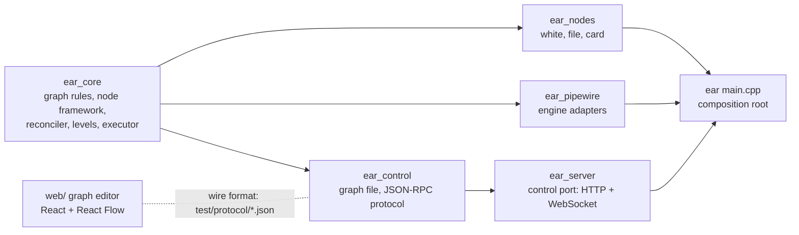

# Batch 2: run image, control port, graph UI, sound card

Status: scope answered by the owner on 2026-10-30; the module design and slice pages are added
below by the batch's code architect. The system design is `docs/design/pipewire-graph.md`.

## The owner's answers (chat, 2026-10-30)

The question page: https://claude.ai/artifact/DraHdKRyZDB4WwBWxDTn4k

| Question | His words | What it means here |
|---|---|---|
| Scope | "Ok" (to the recommended scope) | Run image, control port, web UI, sound card node. Sendspin (Music Assistant) is the next batch. |
| Web UI | "Graph view is the goal. Dynamically wiring up nodes and edges in a UI is the goal. I want to see all of the graph information in real time, like the audio levels per-channel / per edge" | A drawn graph editor: nodes as boxes, routes as wires added and removed in the UI, with live status and live audio levels per channel and per route. |
| Hardware | "Motu 24ao. Talos 1.13.x I think maybe 1.14.x" | A MOTU 24Ao (AVB series, USB class compliant). Talos 1.13 or later includes the USB audio driver (added in 1.12). |
| Threading | "The control port shouldn't run in the PipeWire context, because it will not be real time" | The control port runs on its own thread, never on PipeWire's threads. |

Not answered: the CPU of the Talos nodes. The image is built for amd64 until he says otherwise.

Note on the threading answer: in EAR today audio runs on PipeWire's realtime data thread, and
graph edits and link events run on PipeWire's main loop, which is not realtime. The control port
still gets its own thread, so a slow or stuck client never delays graph edits or link events.

## The ideas, as researched (2026-10-30)

- "build a docker container in GHA": a run image without compilers, published to ghcr.io on
  every merge to master and tagged by commit; versioned images only from an automated release
  flow.
- "add MOTU drivers to image": no MOTU driver exists or is needed. MOTU's USB interfaces use the
  kernel's USB audio class driver (`snd-usb-audio`), which is in the Talos kernel, not the image.
  The image already carries PipeWire's ALSA plugin. The work is a sound card node type, with the
  card driving the clock while present.
- "support home assistant network audio as source + sink": Music Assistant's Sendspin protocol
  (deferred to the next batch).
- "add control socket": port 7777, JSON-RPC 2.0 over WebSocket (Snapcast's pattern).
- "add web UI": served by EAR on the same port.

## Design choices (current choices, revisable)

- The sound card drives the clock while present; the dummy driver stays as a fallback so the
  graph keeps running without it (R2).
- Removing a node removes its routes, and status says so.
- New settings for a node restart its insides; its ports and routes stay. Changing ports is
  refused.
- Live edits are not saved; `ear.json` loads at boot.
- No login on port 7777 yet; it refuses browser pages from other origins. Keep it in the cluster.
- A sound card is named in `ear.json` by card name (for example `hw:CARD=...`), never by index.

---

# Module design and slice pages (code architect, 2026-10-30)

Layer: module, beneath the agreed system design (`docs/design/pipewire-graph.md`) and the answers
above. Milestone 1's page (`docs/design/m1-white-to-file.md`) holds the M1 interfaces this batch
changes; every change is listed in section 4. [V] = verified in PipeWire's sources or docs
(fetched copies cited), [U] = unverified, so each [U] is an acceptance criterion of the slice that
meets it. Nothing here was compiled by the architect (NOT RUN).

## 1. Module map



| Package (dir) | Owns | Takes | Gives | Never |
|---|---|---|---|---|
| ear_core (src/core) | wanted nodes and routes and their checks; each node's state machine and everything it made (port block, insides, handoffs, sound cards, inside links); route links; what a level is; the graph read | GraphControl calls; engine facts through its own interfaces | listener events; `GraphReader::read()`; `LevelMeter` | PipeWire, sockets, threads, files |
| ear_nodes (src/nodes) | the built-in types white, file, card | settings JSON, a NodeGrant | NodeConfig, AudioCode | PipeWire (a card is asked for through the grant) |
| ear_pipewire (src/pipewire) | the in-process engine; port blocks (with level metering), links, live ports, handoffs, sound cards (ALSA adapter nodes), the main-loop executor | core interfaces to implement | engine events as core events; `LevelReader` | policy |
| ear_control (src/control) | ear.json; the JSON-RPC protocol: envelope, commands, events, sessions, subscriptions | text messages; GraphEvents; levels | encoded responses and notifications; `runCommand` for the main loop | sockets; calling the graph from any thread but the main loop |
| ear_server (src/server, new) | port 7777: HTTP for the UI's files, WebSocket at `/rpc`, Origin check, per-client queues, the control thread, the level bell | settings; executors; ear_control | bytes on sockets | graph state; PipeWire |
| ear (src/main.cpp) | wiring and boot/stop order | flags, ear.json | exit status | computing anything |
| web/ (new) | the graph editor | the wire format | JSON-RPC calls | graph rules (the server is the one source of truth) |

Dependencies: ear_core (nlohmann/json only) ← ear_nodes (sndfile), ear_pipewire (libpipewire-0.3),
ear_control ← ear_server (Boost.Beast and Boost.Asio, header-only, PRIVATE: no Asio type in a
public header) ← ear. The web UI shares no code with C++; its contract is the wire format and the
fixtures in `test/protocol/`, which both sides test against (section 6).

## 2. Threads: who runs what

The owner (2026-10-30): "The control port shouldn't run in the PipeWire context, because it will
not be real time". So the control port's code runs on its own thread; the only thing of its path
that runs on the main loop is the graph call itself (typed in, typed out: `runCommand`).

| Thread | Runs | Owns | Never |
|---|---|---|---|
| Realtime (PipeWire data loop) | `AudioCode::process`; port-block level metering; `RtWriter::write`; publishing a level window and ringing the bell | each block's meters and its level mailbox's write side | locks, allocation, waiting; system calls other than one eventfd write |
| Main loop (PipeWire, the main thread) | Engine, DesiredGraph, NodeHost, both Reconcilers, LiveGraph, both Links, FilterPortBlocks, AlsaSoundCards, GraphStatus, EventBridge, `runCommand` | every piece of graph state | sockets, JSON-RPC text, waiting on the control thread |
| Control (ear_server, one `io_context`, one strand) | Beast HTTP and WebSocket, ControlHub and sessions, JSON-RPC decode and encode, per-client queues, reading levels when the bell rings | connections, subscriptions, queues | calling GraphControl, GraphReader or any core object directly; waiting on the main loop |
| Handoff threads (one per handoff, M1) | `HandoffConsumer::consume` | the file node's writer | unchanged |

Crossings (each one event-driven; no thread polls another):

| From → to | How | Bounded by |
|---|---|---|
| control → main | `MainLoopExecutor::post` (mutex-guarded queue plus a `pw_loop` event source) | one message in flight per connection: its next message is read only after its replies are queued |
| main → control | `ControlPort::executor().post` (`asio::post` on the strand: posts run in post order) | events are small and human-rate; per-client queues bound what waits for a socket |
| realtime → control | per-block level mailbox (triple buffer) + `LevelBell` (non-blocking eventfd, rung at most once until answered) → control thread calls `LevelReader::takeLevels()` | latest-value: an unread window is replaced, never queued |

Why a mutex queue and not `pw_loop_invoke` for control → main: both are equivalent crossings; the
queue owns each posted function, so work left when EAR stops is destroyed rather than leaked, and
it has no "queue full" failure. The main loop is not realtime, so a mutex there costs nothing.
The control thread is started after `Engine::create`, so it inherits the blocked SIGINT and
SIGTERM (pipewire-engine skill, "Traps").

```mermaid
sequenceDiagram
  participant UI as browser
  participant C as control thread
  participant M as main loop
  participant RT as realtime thread
  UI->>C: {"method":"route.add",...}
  C->>C: parseMessage, decodeCommand
  C->>M: post(runCommand(AddRoute))
  M->>M: DesiredGraph.addRoute → Reconciler → createLink
  M->>C: post(reply) then post(event route.added)
  C->>UI: response, then notification
  M-->>C: later: post(event route.status linked)
  RT->>RT: meter ports; every 1/30 s publish window
  RT->>C: bell (eventfd)
  C->>C: takeLevels, encode once
  C->>UI: "levels" (latest wins per client)
```

## 3. Design rules for this batch (design choices)

1. **The port block is the node's ports, always.** It is made when the node is added and goes only
   when the node is removed. Insides (the type's code, its handoffs, its sound cards) start,
   restart and fail behind it; the block keeps processing (silent when no code drives it), so
   routes stay linked and levels keep flowing (system design rule 3, R2).
2. **The main loop owns every piece of graph state; the control thread owns only connections.**
   Commands and reads cross as typed values; nothing on the control thread caches the graph. A
   client's view is a snapshot plus the events after it, in one ordered stream.
3. **Levels are a latest-value signal measured on the audio clock.** Each port block measures its
   own public ports every cycle and publishes once per window (`levelWindowsPerSecond`, one
   home); nothing between the realtime thread and a browser queues levels.

## 4. Frozen interfaces

C++23 as M1. Stateful classes keep a private Impl pointer. Bodies are not part of the page.

### 4.1 Changed M1 headers (each change; s0 makes them compile)

| Header | Change |
|---|---|
| `core/command_error.hpp` | + `InvalidName`, `PortsChanged`, `UnknownRoute` (codes "invalid-name", "ports-changed", "unknown-route") |
| `core/node_type.hpp` | `Ports` + `insideInputs`, `insideOutputs`; `AudioCode::process` spans include inside ports; + `CardDirection`, `SoundCardRequest`; `NodeGrant::soundCard` |
| `core/node_catalogue.hpp` | + `names()` |
| `core/desired_graph.hpp` | listeners take `NodeSpec`; + `nodeUpdated`, `nodeRemoved`, `routeRemoved`; `GraphControl` + `updateNode`, `removeNode`, `removeRoute`; `DesiredGraph` + `nodes()`, `routes()`; + `WantedNode` |
| `core/node_lifecycle.hpp` | `refused` splits into `portBlockLost` and `insidesFailed`; + `insidesReady`, `restartRequested`; running needs both readiness facts |
| `core/node_host.hpp` | `PortBlock::drive`; `PortBlockFactory::make` loses `AudioCode&`; + `SoundCard`, `SoundCardEvents`, `SoundCardFactory`; `NodeHost` ctor + cards and inside links; + `nodeUpdated`, `nodeRemoved` |
| `core/reconciler.hpp` | + `routeRemoved`; `portGone` acts only on the port whose live id it is |
| `pipewire/port_blocks.hpp` | ctor takes `LevelWake&`; implements `LevelReader`; new `make` |
| `nodes/builtin.hpp` | + `makeCardNodeType`; `builtinNodeTypes()` adds card |
| unchanged | `graph_spec.hpp`, `engine.hpp`, `links.hpp`, `live_graph.hpp`, `handoffs.hpp`, `graph_file.hpp`, `status_log.hpp` |

Every frozen header's first line points at this page from s0 on (section 4 of this page, Errata
in section 11).

```cpp
// ===== core/command_error.hpp (additions) =====
struct InvalidName  { NodeName node; };   // not 1-64 characters of [A-Za-z0-9_-]
struct PortsChanged { NodeName node; };   // updateNode: the new settings would change its ports
struct UnknownRoute { Route route; };     // removeRoute: the route is not wanted
using CommandError = std::variant<UnknownNodeType, InvalidSettings, DuplicateNode, UnknownNode,
                                  UnknownPort, WrongDirection, InvalidName, PortsChanged,
                                  UnknownRoute>;
/// describe(): "invalid-name <n>", "ports-changed <n>", "unknown-route <a>:<p> -> <b>:<q>".

// ===== core/node_type.hpp (changes) =====
/// Public ports are routable. Inside ports belong to the port block only; nothing but the node's
/// own inside links reaches them (a card's channels). Invariant: the four lists' names are unique
/// together (DesiredGraph::addNode throws std::logic_error otherwise: a type bug).
struct Ports {
  std::vector<PortName> inputs;
  std::vector<PortName> outputs;
  std::vector<PortName> insideInputs = {};
  std::vector<PortName> insideOutputs = {};
};
// AudioCode::process: `inputs` = inputs then insideInputs, `outputs` = outputs then insideOutputs,
// each in declaration order. Everything else in AudioCode is unchanged.
enum class CardDirection { playback, capture };
struct SoundCardRequest {
  std::string device;                // ALSA PCM name, e.g. "hw:CARD=Pro24"; the type checks it
  CardDirection direction;
  std::vector<PortName> blockPorts;  // channel i <-> blockPorts[i]: insideOutputs (playback)
                                     // or insideInputs (capture) of this node
};
class NodeGrant {
public:
  virtual AudioFormat format() const = 0;
  virtual RtWriter& handoff(std::uint32_t channels, std::uint32_t capacityFrames,
                            HandoffConsumer& consumer) = 0;
  /// Main thread, inside start() only (else std::logic_error). The framework opens the card at
  /// format().rate with blockPorts.size() channels and links its channels to blockPorts. The
  /// node runs once every card it asked for is ready, and fails (engine-refused) when one is
  /// lost. Cards and their inside links go with the insides, before the insides are destroyed.
  virtual void soundCard(const SoundCardRequest& request) = 0;
protected:
  ~NodeGrant() = default;
};

// ===== core/node_catalogue.hpp (addition) =====
  std::vector<std::string_view> names() const;   // every type's name, sorted

// ===== core/desired_graph.hpp (whole) =====
#pragma once
#include <expected>
#include <memory>
#include <vector>
#include "ear/core/node_catalogue.hpp"
namespace ear {
struct WantedNode { NodeSpec spec; Ports ports; };
class DesiredNodeListener {
public:
  /// After the node is recorded. `config` stays valid until nodeUpdated or nodeRemoved for this
  /// node returns.
  virtual void nodeAdded(const NodeSpec& node, const NodeConfig& config) = 0;
  /// New settings recorded (ports unchanged). The previous config stays valid until this returns.
  virtual void nodeUpdated(const NodeSpec& node, const NodeConfig& config) = 0;
  /// After routeRemoved for each of its routes. Its config stays valid until this returns.
  virtual void nodeRemoved(const NodeName& node) = 0;
protected:
  ~DesiredNodeListener() = default;
};
class DesiredRouteListener {
public:
  virtual void routeAdded(const Route& route) = 0;
  virtual void routeRemoved(const Route& route) = 0;
protected:
  ~DesiredRouteListener() = default;
};
/// The control calls: one per question. Main thread only.
class GraphControl {
public:
  virtual ~GraphControl() = default;
  /// Same spec again: succeeds, no event. Errors: InvalidName, UnknownNodeType, InvalidSettings,
  /// DuplicateNode.
  virtual std::expected<void, CommandError> addNode(const NodeSpec& node) = 0;
  /// Same settings: succeeds, no event. Errors: UnknownNode, InvalidSettings, PortsChanged.
  /// Success: nodeUpdated; the node's insides restart, its port block and routes stay.
  virtual std::expected<void, CommandError> updateNode(const NodeName& node,
                                                       const NodeSettings& settings) = 0;
  /// Errors: UnknownNode. Success: routeRemoved for every route naming it, then nodeRemoved.
  virtual std::expected<void, CommandError> removeNode(const NodeName& node) = 0;
  /// Existing route: succeeds, no event. Errors: UnknownNode, UnknownPort, WrongDirection.
  virtual std::expected<void, CommandError> addRoute(const Route& route) = 0;
  /// Errors: UnknownRoute. Success: routeRemoved.
  virtual std::expected<void, CommandError> removeRoute(const Route& route) = 0;
};
class DesiredGraph final : public GraphControl {
public:
  explicit DesiredGraph(const NodeCatalogue& catalogue);
  ~DesiredGraph() override;
  void subscribe(DesiredNodeListener& listener);   // before the first call
  void subscribe(DesiredRouteListener& listener);
  std::expected<void, CommandError> addNode(const NodeSpec& node) override;
  std::expected<void, CommandError> updateNode(const NodeName& node,
                                               const NodeSettings& settings) override;
  std::expected<void, CommandError> removeNode(const NodeName& node) override;
  std::expected<void, CommandError> addRoute(const Route& route) override;
  std::expected<void, CommandError> removeRoute(const Route& route) override;
  std::vector<WantedNode> nodes() const;   // name order; ports as the config declares them
  std::vector<Route> routes() const;       // Route order
private:
  struct Impl; std::unique_ptr<Impl> impl_;
};
}
// The name rule's reason: a node's sound cards are engine nodes named "<node>.playback" and
// "<node>.capture" (NodeHost, the one home of that form); '.' is never in a user's node name, so
// they cannot collide. The rule lives in desired_graph.cpp only.

// ===== core/node_lifecycle.hpp (class) =====
/// running = the port block is ready AND the insides are ready. Each fact records itself and
/// returns true only when the state changed. No transitions after gone().
class NodeLifecycle {
public:
  NodeLifecycle() noexcept;                      // starting; nothing ready
  NodeState state() const noexcept;
  const std::optional<FailureReason>& reason() const noexcept;   // set only while failed
  bool gone() const noexcept;
  bool portBlockReady() noexcept;                // starting -> running if insides ready
  bool portBlockLost(FailureReason reason);      // block not ready; starting|running -> failed
  bool insidesReady() noexcept;                  // starting -> running if block ready
  bool insidesFailed(FailureReason reason);      // insides not ready; starting|running -> failed
  bool restartRequested() noexcept;              // starting|running|failed -> starting; insides
                                                 // not ready; block readiness kept; reason cleared
  bool stopRequested() noexcept;                 // starting|running|failed -> stopping
  bool stopped() noexcept;                       // stopping -> gone
private:
  NodeState state_; std::optional<FailureReason> reason_;
  bool blockReady_; bool insidesReady_; bool gone_;
};

// ===== core/node_host.hpp (changed and new parts) =====
/// Engine side of a port block. Destroying it removes its ports and their links; after the
/// destructor returns, no process() of any code is running or will run.
class PortBlock {
public:
  virtual ~PortBlock() = default;
  /// Main thread. The realtime thread runs `code` from its next cycle; nullptr silences every
  /// output. Returns only when the realtime thread can no longer be inside a process() of the
  /// code it ran before (a blocking barrier with the data loop, as pw_filter_destroy is).
  /// `code` must outlive the next drive() or the block.
  virtual void drive(AudioCode* code) = 0;
};
class PortBlockFactory {
public:
  /// Main thread. One engine node named `node` with one 32-bit float mono port per name in
  /// `ports` (public and inside), in EAR's graph group, always processing, silent until drive().
  /// Its public ports' levels are published through the factory's LevelReader. Refusal is told
  /// via events.lost later, never thrown or told inside this call. events outlives the block.
  virtual std::unique_ptr<PortBlock> make(const NodeName& node, const Ports& ports,
      const AudioFormat& format, PortBlockEvents& events) = 0;
protected:
  ~PortBlockFactory() = default;
};
/// A sound card opened through the engine. Destroying it (main thread) removes its engine node.
class SoundCard {
public:
  virtual ~SoundCard() = default;
  virtual const std::vector<PortName>& channelPorts() const noexcept = 0;   // channel order
};
class SoundCardEvents {   // main thread
public:
  virtual void ready() = 0;                    // the card is open and processing; at most once
  virtual void lost(std::string detail) = 0;   // refused or dropped by the engine; at most once
protected:
  ~SoundCardEvents() = default;
};
class SoundCardFactory {
public:
  /// Main thread. Opens request.device as one engine node named `engineNode`, with
  /// request.blockPorts.size() channels at format.rate, in EAR's graph group (so while it runs
  /// it drives every port block). Refusal is told via events.lost later, never thrown or told
  /// inside this call.
  virtual std::unique_ptr<SoundCard> make(const NodeName& engineNode,
      const SoundCardRequest& request, const AudioFormat& format, SoundCardEvents& events) = 0;
protected:
  ~SoundCardFactory() = default;
};
class NodeHost final : public DesiredNodeListener {
public:
  /// `insideLinks`: where a node's card links are wanted and unwanted (a second Reconciler).
  NodeHost(AudioFormat format, PortBlockFactory& blocks, HandoffFactory& handoffs,
           SoundCardFactory& cards, DesiredRouteListener& insideLinks);
  ~NodeHost();   // precondition: stopAll completed (or no node was ever added)
  void subscribe(NodeStatusListener& listener);
  /// starting; port block made; config.start(grant); code.prepare; block.drive(&code); cards
  /// made and their inside links wanted; insides ready when every card is ready. A failure
  /// fails the node; its port block stays.
  void nodeAdded(const NodeSpec& node, const NodeConfig& config) override;
  /// Restarts the insides: drive(nullptr), release(), inside links unwanted, cards destroyed,
  /// handoffs closed, insides destroyed, then started from `config` as in nodeAdded. The port
  /// block and routes stay. An update arriving during a restart replaces the config to start.
  void nodeUpdated(const NodeSpec& node, const NodeConfig& config) override;
  /// stopping; port block destroyed; then as the restart's teardown; nodeGone. Others untouched.
  void nodeRemoved(const NodeName& node) override;
  void stopAll(std::move_only_function<void()> allGone);
  /// Nodes not gone, in arrival order (a removed node still stopping comes before a newer node
  /// of the same name).
  std::vector<NodeStatus> status() const;
private:
  struct Impl; std::unique_ptr<Impl> impl_;
};
// Inside links: playback Route{{node, blockPorts[i]}, {"<node>.playback", channelPorts()[i]}},
// capture Route{{"<node>.capture", channelPorts()[i]}, {node, blockPorts[i]}}.

// ===== core/reconciler.hpp (additions) =====
  /// Destroys the route's link if any; no status event for a route no longer wanted.
  void routeRemoved(const Route& route) override;
  // portGone(id): affects only the port whose live id is `id`; a port of the same name may
  // already have reappeared with a newer id (a node removed and re-added).
```

### 4.2 New core headers

```cpp
// ===== core/executor.hpp (s0 writes it whole) =====
#pragma once
#include <functional>
namespace ear {
/// Runs work on one thread, one item at a time, in post order.
class Executor {
public:
  /// Any thread. Never runs `work` inside this call, never waits for it. Work posted after the
  /// executor stopped is destroyed unrun.
  virtual void post(std::move_only_function<void()> work) = 0;
protected:
  ~Executor() = default;
};
}

// ===== core/levels.hpp =====
#pragma once
#include <cstdint>
#include <span>
#include <vector>
#include "ear/core/graph_spec.hpp"
namespace ear {
/// One port over one window, linear (1.0 = full scale): sample peak and RMS.
struct Level { float peak; float rms; };
struct PortLevel { PortName port; Level level; };
/// One port block's latest window: its public ports, inputs then outputs, declaration order.
struct NodeLevels { NodeName node; std::vector<PortLevel> ports; };
/// Windows per second (the one home). A stated display rate: meters are read by eye, browsers
/// paint at 60 Hz, and 30 is the common meter refresh; at 48 kHz and 256-frame blocks a window
/// is 7 cycles (37 ms, about 27 per second). About 20 bytes per port per window per client.
inline constexpr std::uint32_t levelWindowsPerSecond = 30;
/// ceil(rate / levelWindowsPerSecond). A block publishes at the end of the cycle that completes it.
std::uint32_t levelWindowFrames(std::uint32_t rate) noexcept;
/// One port's accumulator. Realtime-safe: no locks, allocation or system calls.
class LevelMeter {
public:
  void add(std::span<const float> samples) noexcept;
  /// The level since the last take() ({0, 0} if no samples); starts a new window.
  Level take() noexcept;
private:
  float peak_ = 0.0F; double sumSquares_ = 0.0; std::uint64_t frames_ = 0;
};
/// Realtime end: a port block published a window. Realtime-safe; never blocks.
class LevelWake {
public:
  virtual void levelsPublished() noexcept = 0;
protected:
  ~LevelWake() = default;
};
/// Ordinary-thread end. Thread-safe; never blocks the realtime thread.
class LevelReader {
public:
  /// The latest window of every block that published since the last call; older windows are
  /// gone (levels are a latest-value signal).
  virtual std::vector<NodeLevels> takeLevels() = 0;
protected:
  ~LevelReader() = default;
};
}

// ===== core/graph_view.hpp =====
#pragma once
#include <optional>
#include <string>
#include <vector>
#include "ear/core/desired_graph.hpp"
#include "ear/core/node_host.hpp"
#include "ear/core/reconciler.hpp"
namespace ear {
struct NodeView {
  NodeSpec spec;
  Ports ports;                               // public only (inside lists empty)
  NodeState state;
  std::optional<FailureReason> reason;
};
struct GraphView {
  AudioFormat format;                        // rate = graphFrequency, maxBlock = blockSize
  std::vector<std::string> types;            // sorted
  std::vector<NodeView> nodes;               // wanted nodes, name order
  std::vector<RouteStatus> routes;           // wanted routes, Route order
};
class GraphReader {
public:
  virtual GraphView read() const = 0;        // main thread
protected:
  ~GraphReader() = default;
};
/// The join of the desired graph, the node framework and the reconciler. A wanted node's state
/// is that of NodeHost's last status entry of its name.
class GraphStatus final : public GraphReader {
public:
  GraphStatus(AudioFormat format, const NodeCatalogue& catalogue, const DesiredGraph& desired,
              const NodeHost& nodes, const Reconciler& routes);   // all outlive it
  GraphView read() const override;
private:
  AudioFormat format_; const NodeCatalogue& catalogue_; const DesiredGraph& desired_;
  const NodeHost& nodes_; const Reconciler& routes_;
};
}
```

### 4.3 ear_pipewire

```cpp
// ===== pipewire/port_blocks.hpp =====
namespace ear::pipewire {
/// One pw_filter per block, node.always-process=true, node.group = graphGroup, one DSP port per
/// name (public and inside). Meters the public ports every cycle; at each window's end
/// publishes into the block's mailbox and rings `wake` (at most once per cycle).
class FilterPortBlocks final : public PortBlockFactory, public LevelReader {
public:
  FilterPortBlocks(Engine& engine, LevelWake& wake);   // both outlive it
  ~FilterPortBlocks();
  std::unique_ptr<PortBlock> make(const NodeName& node, const Ports& ports,
      const AudioFormat& format, PortBlockEvents& events) override;
  std::vector<NodeLevels> takeLevels() override;       // any thread
private:
  struct Impl; std::unique_ptr<Impl> impl_;
};
}
// drive(): pw_loop_invoke(pw_filter_get_data_loop(filter), ..., block=true) [V
// pw_filter_get_data_loop: filter.c:2016 of the fetched source; U on 1.4.2].
// Mailbox: a private header, src/pipewire/level_mailbox.hpp (triple buffer, fixed size per
// block, allocated in make()). The block registry that takeLevels walks is guarded by a mutex
// taken on the main loop (make, destroy) and the control thread (takeLevels), never on the
// realtime thread. A block leaves the registry after pw_filter_destroy returns.

// ===== pipewire/main_loop_executor.hpp (new) =====
namespace ear::pipewire {
class MainLoopExecutor final : public Executor {
public:
  explicit MainLoopExecutor(Engine& engine);
  ~MainLoopExecutor();   // main thread; queued work is destroyed unrun
  void post(std::move_only_function<void()> work) override;   // any thread
private:
  struct Impl; std::unique_ptr<Impl> impl_;
};
}

// ===== pipewire/sound_cards.hpp (new) =====
namespace ear::pipewire {
/// A card is pw_core_create_object("adapter") with factory.name api.alsa.pcm.sink (playback) or
/// api.alsa.pcm.source (capture), api.alsa.path = device, audio.channels, audio.rate =
/// format.rate, audio.position AUX0.., node.name = engineNode, node.group = graphGroup, and
/// adapter.auto-port-config = { mode = dsp monitor = false control = false position = aux }
/// [V: pwsrc/props.md:886, "useful (only) for minimal configurations without a session
/// manager"]. ready: node info state RUNNING [U]; lost: ERROR, proxy error or removal.
/// channelPorts: "playback_AUX<i>" / "capture_AUX<i>" [U: read from the registry in the test].
class AlsaSoundCards final : public SoundCardFactory {
public:
  explicit AlsaSoundCards(Engine& engine);
  std::unique_ptr<SoundCard> make(const NodeName& engineNode, const SoundCardRequest& request,
      const AudioFormat& format, SoundCardEvents& events) override;
private:
  Engine& engine_;
};
}
// src/pipewire/engine_names.hpp (private, s0 writes it whole):
//   inline constexpr char graphGroup[] = "ear.graph";   // used by port_blocks.cpp, sound_cards.cpp
```

Why `node.group` [V, PipeWire 1.0.5 `context.c` 945-960 and 1236-1320]: the scheduler starts
from each driver, collects its linked nodes plus every node sharing a `node.group`, and moves them
to that driver; nodes no driver collected go to the first driver that has followers, which is the
dummy. With every port block and card in one group, a running card drives every block; with no
card, the group has no driver and the always-processing blocks go to the dummy (R2). Two cards in
the group: one drives, the other follows with PipeWire's rate matching (the system design's
"drift correction is enough"). [U] on 1.4.2: E1 and E2 criteria.

engine.conf (E2): context.spa-libs + `api.alsa.* = alsa/libspa-alsa`,
`audio.convert.* = audioconvert/libspa-audioconvert`; context.modules +
`libpipewire-module-adapter` [U: names on 1.4.2; the Debian package holding libspa-alsa].

### 4.4 ear_nodes

```cpp
// ===== nodes/builtin.hpp (additions) =====
/// "card": a sound card. Settings: {"device": ALSA PCM name, required (index forms "hw:<n>",
/// "plughw:<n>" are invalid: name the card, "hw:CARD=<id>"), "playback": channels 0-64
/// (default 0), "capture": channels 0-64 (default 0)}; at least one above 0; unknown keys
/// invalid. Ports: inputs "playback_1".."playback_N", outputs "capture_1".."capture_M"; inside
/// outputs "to_card_1".., inside inputs "from_card_1"... Audio passes straight through
/// (playback_i -> to_card_i, from_card_j -> capture_j). Start asks the grant for one card per
/// direction used. The rate is the graph frequency (R5), never a setting.
std::unique_ptr<const NodeType> makeCardNodeType();
std::vector<std::unique_ptr<const NodeType>> builtinNodeTypes();   // white, file, card
```

### 4.5 ear_control (pure; nlohmann/json and ear_core only)

```cpp
// ===== control/rpc.hpp: the JSON-RPC 2.0 envelope =====
namespace ear::control {
using RpcId = nlohmann::json;              // number or string; null when unreadable
struct RpcError { int code; std::string message; nlohmann::json data; };   // data null: absent
inline constexpr int parseError = -32700, invalidRequest = -32600, methodNotFound = -32601,
                     invalidParams = -32602, commandRefused = -32000;
struct RpcRequest { std::optional<RpcId> id; std::string method; nlohmann::json params; };
/// One received text: a request or a batch. Each entry is a request, or the encoded error
/// response for an entry that is not one. A request without id is a notification: no response.
struct RpcMessage { bool batch; std::vector<std::variant<RpcRequest, std::string>> entries; };
RpcMessage parseMessage(std::string_view text);
std::string encodeResult(const RpcId& id, const nlohmann::json& result);
std::string encodeError(const RpcId& id, const RpcError& error);
std::string encodeNotification(std::string_view method, const nlohmann::json& params);
/// A batch's responses as one array; no responses: "" (nothing is sent).
std::string encodeBatch(std::span<const std::string> responses);
}

// ===== control/commands.hpp =====
namespace ear::control {
struct GetGraph {};                                        // graph.get, graph.subscribe
struct AddNode { NodeSpec node; };
struct UpdateNode { NodeName node; NodeSettings settings; };
struct RemoveNode { NodeName node; };
struct AddRoute { Route route; };
struct RemoveRoute { Route route; };
using Command = std::variant<GetGraph, AddNode, UpdateNode, RemoveNode, AddRoute, RemoveRoute>;
using CommandResult = std::variant<GraphView, std::expected<void, CommandError>>;
/// Control thread. Named params only. Unknown method: methodNotFound; a missing, extra or
/// mistyped key: invalidParams whose message names the JSON pointer ("/from/port: missing").
std::expected<Command, RpcError> decodeCommand(std::string_view method,
                                               const nlohmann::json& params);
/// Main thread: the only step of a request that runs there.
CommandResult runCommand(const Command& command, GraphControl& control,
                         const GraphReader& reader);
/// Control thread. GraphView -> encodeGraph; success -> {}; CommandError ->
/// RpcError{commandRefused, describe(e), {"code": errorCode(e)}}.
std::expected<nlohmann::json, RpcError> encodeCommandResult(const CommandResult& result);
nlohmann::json encodeGraph(const GraphView& view);
}

// ===== control/events.hpp =====
namespace ear::control {
struct NodeAdded { NodeSpec node; Ports ports; };          // public ports only
struct NodeUpdated { NodeName node; NodeSettings settings; };
struct NodeRemoved { NodeName node; };
struct NodeChanged { NodeStatus status; };
struct NodeStopped { NodeName node; std::uint64_t droppedFrames; };
struct RouteAdded { Route route; };
struct RouteRemoved { Route route; };
struct RouteChanged { RouteStatus status; };
using GraphEvent = std::variant<NodeAdded, NodeUpdated, NodeRemoved, NodeChanged, NodeStopped,
                                RouteAdded, RouteRemoved, RouteChanged>;
class EventSink {   // control thread
public:
  virtual void graphChanged(GraphEvent event) = 0;
protected:
  ~EventSink() = default;
};
/// Main thread: copies each event and posts it to `sink` through `control`. Never calls the
/// sink inline; does nothing else.
class EventBridge final : public DesiredNodeListener, public DesiredRouteListener,
                          public NodeStatusListener, public RouteStatusListener {
public:
  EventBridge(Executor& control, EventSink& sink);
  void nodeAdded(const NodeSpec& node, const NodeConfig& config) override;
  void nodeUpdated(const NodeSpec& node, const NodeConfig& config) override;
  void nodeRemoved(const NodeName& node) override;
  void routeAdded(const Route& route) override;
  void routeRemoved(const Route& route) override;
  void nodeChanged(const NodeStatus& status) override;
  void nodeGone(const NodeName& node, std::uint64_t droppedFrames) override;
  void routeChanged(const RouteStatus& status) override;
private:
  Executor& control_; EventSink& sink_;
};
std::string encodeEvent(const GraphEvent& event);              // one notification
std::string encodeLevels(std::span<const NodeLevels> levels);  // one "levels" notification
}

// ===== control/session.hpp: the protocol per connection (control thread only) =====
namespace ear::control {
using Message = std::shared_ptr<const std::string>;   // encoded once, shared by every client
/// Implemented by the transport.
class Outbox {
public:
  /// A response or a graph notification, in order. The transport closes a connection whose
  /// queue is full (section 6).
  virtual void send(Message message) = 0;
  /// Replaces any levels not yet written (latest wins).
  virtual void sendLevels(Message message) = 0;
protected:
  ~Outbox() = default;
};
class ControlHub;
class ControlSession {
public:
  ControlSession(ControlHub& hub, Outbox& out);   // attaches
  ~ControlSession();                              // detaches; later replies for it are dropped
  /// One text message. Its commands run on the main loop in one post; `done` runs once all its
  /// responses are queued (the transport reads the next message only then).
  void received(std::string text, std::move_only_function<void()> done);
private:
  struct Impl; std::unique_ptr<Impl> impl_;
};
/// Sessions, subscriptions, the event stream and levels. graph.subscribe: the session gets
/// events posted after its snapshot, never before. levels.subscribe is answered here, without
/// the main loop.
class ControlHub final : public EventSink {
public:
  ControlHub(Executor& mainLoop, Executor& control, GraphControl& graph,
             const GraphReader& reader, LevelReader& levels);   // graph, reader: main loop only
  ~ControlHub();
  void graphChanged(GraphEvent event) override;   // encoded once, to subscribed sessions
  void levelsPublished();                         // takeLevels(), encode once, sendLevels
private:
  struct Impl; std::unique_ptr<Impl> impl_;
};
}
```

### 4.6 ear_server

```cpp
// ===== server/control_port.hpp (no Boost type in it) =====
namespace ear::server {
struct ControlPortSettings {
  std::string address;               // --control-address, default "0.0.0.0"
  std::uint16_t port;                // --control-port, default 7777; 0: any free port
  std::filesystem::path webRoot;     // --web-root, default <directory of ear>/web
};
struct ControlPortError { std::string detail; };
/// Realtime-safe bell: a non-blocking eventfd, rung at most once until the control thread
/// answers it. Made before the port blocks, which ring it.
class LevelBell final : public LevelWake {
public:
  LevelBell();                                  // throws std::system_error
  ~LevelBell();
  void levelsPublished() noexcept override;
  int fd() const noexcept;
private:
  struct Impl; std::unique_ptr<Impl> impl_;
};
/// Port 7777 on its own thread: GET/HEAD files from webRoot ("/" is index.html; ".." refused;
/// 404; other methods 405), WebSocket JSON-RPC at /rpc. Origin: absent, or its host[:port]
/// equals the Host header; anything else 403 without upgrade. Max message 64 KiB.
class ControlPort final {
public:
  /// Binds and listens, then starts the control thread. `graph` and `reader` are used only
  /// inside work posted to `mainLoop`. All arguments outlive the port.
  static std::expected<std::unique_ptr<ControlPort>, ControlPortError> start(
      const ControlPortSettings& settings, Executor& mainLoop, GraphControl& graph,
      const GraphReader& reader, LevelReader& levels, LevelBell& bell);
  ~ControlPort();                           // stop()
  std::uint16_t port() const noexcept;      // the bound port
  Executor& executor() noexcept;            // the control thread, post order kept
  control::EventSink& events() noexcept;    // for EventBridge
  /// Any thread but the control thread; idempotent. Closes every connection, joins the
  /// thread; work posted to executor() afterwards is destroyed unrun.
  void stop();
private:
  struct Impl; std::unique_ptr<Impl> impl_;
  explicit ControlPort(std::unique_ptr<Impl> impl);
};
}
```

Prior art: Beast's `advanced_server` example (HTTP and WebSocket on one port, upgrade detected
with `websocket::is_upgrade`) and its `websocket-chat-multi` example (a per-session queue of
shared messages); Snapcast's control server (JSON-RPC 2.0 over WebSocket beside HTTP on one port).
Not used: the vendored jsonrpccxx (`vendor/jsonrpccxx`), whose server answers synchronously
(`HandleRequest(string) -> string`) while EAR's answers come back later from the main loop; and
the vendored jsonrpcpp (`vendor/jsonrpc`, Snapcast's own), which carries its own copy of
nlohmann/json beside `vendor/json`. The envelope is the spec's four shapes, tested against the
spec's own examples.

### 4.7 main.cpp (J): boot and stop order

Flags: `--config`, `--help` (M1), `--control-address`, `--control-port`, `--web-root`. Boot:
readGraphFile → Engine::create → MainLoopExecutor → LevelBell → FilterPortBlocks(engine, bell),
ThreadHandoffs, AlsaSoundCards, Links ×2, LiveGraph → catalogue, DesiredGraph, Reconciler routes
(Links 1), Reconciler insideLinks (Links 2), NodeHost(…, cards, insideLinks), GraphStatus →
ControlPort::start (error: print, exit 1) → print `control listening on <address>:<port>` →
EventBridge(port.executor(), port.events()) → subscriptions (graph → nodes, routes, bridge;
nodes → log, bridge; routes → log, bridge; insideLinks → log; live → routes, insideLinks;
links 1 → routes; links 2 → insideLinks) → replay → onStopSignal → run. Stop: stopAll → allGone →
port.stop() → quit. Declaration order makes destruction run port, core, adapters, executor,
engine.

## 5. Sound cards

- A `card` node is a port block (its public ports, metered) plus, inside, one ALSA adapter node
  per direction, joined by inside links. The card failing or being absent fails the node with
  `engine-refused: <detail>`; the block stays, its routes stay linked, the dummy drives (R2). No
  retry: `node.update` restarts it, and hotplug is not planned (R10).
- Clock: while a card runs it drives every block (`node.group`, section 4.3); the dummy driver
  stays in engine.conf as the fallback.
- CI has no sound hardware. E2 starts with a spike: alsa-lib's `null` PCM, and its `file` PCM
  over `null` (writes what the card is sent to a file), defined in a test asoundrc. If the null
  PCM cannot drive the graph, E2 says so in its commit and the page's Errata; the card-drives
  criterion is then checked only on the hardware (docs task), and CI keeps the others.
- MOTU 24Ao on Talos (docs slice): snd-usb-audio loaded as a module (Talos 1.12 and later, via
  the machine config), `/dev/snd` given to the pod, CAP_SYS_NICE for realtime priority, the
  card's rate and USB channel count set in MOTU's web app (class-compliant mode reports at most 24
  channels per direction; the kernel validates MOTU rates), named `hw:CARD=<id>` from
  `/proc/asound/cards`.

## 6. Control port protocol (the wire format)

JSON-RPC 2.0 over WebSocket at `ws://<host>:7777/rpc`, named params only.

| Method | Params | Result | Errors (`data.code`) |
|---|---|---|---|
| `graph.get` | none | Graph | none |
| `graph.subscribe` | none | Graph; afterwards this connection gets every graph notification | none |
| `levels.subscribe` | none | `{"windowsPerSecond": 30}`; afterwards `levels` notifications | none |
| `node.add` | `{"name", "type", "settings"?}` | `{}` | invalid-name, unknown-node-type, invalid-settings, duplicate-node |
| `node.update` | `{"name", "settings"}` | `{}` | unknown-node, invalid-settings, ports-changed |
| `node.remove` | `{"name"}` | `{}` | unknown-node |
| `route.add` | `{"from": {"node", "port"}, "to": {...}}` | `{}` | unknown-node, unknown-port, wrong-direction |
| `route.remove` | `{"from", "to"}` | `{}` | unknown-route |

Graph:
```json
{
  "graphFrequency": 48000,
  "blockSize": 256,
  "types": ["card", "file", "white"],
  "nodes": [
    {"name": "noise", "type": "white", "settings": {}, "inputs": [], "outputs": ["MONO"],
     "state": "running"},
    {"name": "rec", "type": "file", "settings": {"path": "/x.wav"}, "inputs": ["FL", "FR"],
     "outputs": [], "state": "failed", "reason": {"code": "start-failed", "detail": "..."}}
  ],
  "routes": [
    {"from": {"node": "noise", "port": "MONO"}, "to": {"node": "rec", "port": "FL"},
     "status": "linked"}
  ]
}
```

| Notification | Params | From |
|---|---|---|
| `node.added` | `{"name", "type", "settings", "inputs", "outputs"}` (state starts as "starting") | DesiredGraph |
| `node.updated` | `{"name", "settings"}` | DesiredGraph |
| `node.removed` | `{"name"}` (after `route.removed` for its routes) | DesiredGraph |
| `node.state` | `{"name", "state", "reason"?}` | NodeHost |
| `node.stopped` | `{"name", "droppedFrames"}` (everything it made is gone) | NodeHost |
| `route.added` / `route.removed` | `{"from", "to"}` | DesiredGraph |
| `route.status` | `{"from", "to", "status", "detail"?}` | Reconciler |
| `levels` | `{"nodes": {"<node>": {"<port>": [peak, rms]}}}`, linear, 4 decimals | port blocks |

- A route carries one mono channel, so **a route's level is its source port's level**: the
  server sends port levels only, and the UI draws each wire with its `from` port's level. An
  input port's level is what arrives there, which is the sum when several routes mix into it.
- Errors: code -32000, message `describe(error)`, `data: {"code": errorCode(error)}`; -32602
  names the JSON pointer; -32700, -32600, -32601 per the spec. A batch runs in order in one
  crossing.
- Per client: one message in flight; at most 256 queued responses and notifications (one constant
  in ear_server); a full queue closes the connection with WebSocket code 1008, and the client
  reconnects and subscribes again (a fresh snapshot: the list-then-watch pattern). Levels never
  queue: the newest replaces the unsent one.
- No login yet; the default address is every interface, for the cluster (cost, section 10).
- Conformance: `test/protocol/*.json` (s0 writes them from this section). Each file is
  `{"description", "messages": [server texts as JSON, in order], "graph": <Graph after applying
  them>}`: snapshot, edits (add, update, remove, statuses), levels, errors. ear_control's tests
  check its encoders produce exactly those messages; the UI's tests check its reducer turns them
  into exactly that graph.

## 7. Run image, CI and releases

- `docker/Dockerfile` targets: `dev` (today's image plus Node.js 24 LTS copied from the official
  `node` image pinned by digest; used by scripts/dev.sh and CI), `build` (from dev: `make
  release` and the UI's `npm ci && npm run build`), `run` (debian:trixie-slim pinned by digest:
  PipeWire, SPA modules, libsndfile, alsa-lib at run time, no compiler; `/opt/ear/{ear,
  engine.conf, web/}`; user `ear` uid 10001; `EXPOSE 7777`; entrypoint `/opt/ear/ear`, default
  `--config /etc/ear/ear.json`). amd64 only until the owner names the Talos nodes' CPU.
- `.github/workflows/test.yml` on every pull request: job `test` (as today), job `web` (`make
  web-test` in the dev image: npm ci, typecheck, vitest, build), job `image` (build target `run`,
  load, `scripts/image-smoke.sh ear:ci`). Jobs run in parallel.
- `.github/workflows/image.yml` on push to master: release-please (googleapis/release-please-
  action, pinned by SHA; config `release-please-config.json`, `.release-please-manifest.json`,
  release type `simple`, the version in `CMakeLists.txt` marked `x-release-please-version`), then
  build `run` and push `ghcr.io/mcurcio/ear` tagged `master` and `sha-<short>` (docker/metadata-
  action), and the version tag when release-please created a release. The version push lives in
  this workflow because a release made with GITHUB_TOKEN starts no other workflow.
- Owner actions after merge (not design choices): allow GitHub Actions to create pull requests
  (Settings, Actions), so release-please can open its release PR; the ghcr package is private
  until he changes it, so the cluster needs a pull secret or a public package.

## 8. Graph editor (web/)

| Module | Job | Tested by |
|---|---|---|
| `src/protocol.ts` (s0) | the wire types from section 6; the one home on the UI side | typecheck |
| `src/rpc.ts` | WebSocket JSON-RPC client: ids, replies, notifications; on close, reconnect after a growing wait (1 s doubling to 30 s: a stated retry rate, not a schedule) and subscribe again | vitest, fake socket |
| `src/graph.ts` | reducer: (graph, server message) → graph; a snapshot replaces everything; events for unknown nodes are ignored | vitest, `test/protocol` fixtures |
| `src/levels.ts` | level store outside React state: per-port listeners, so only the meters re-render at 30 Hz; dBFS clamp at -60 | vitest |
| `src/connect.ts` | React Flow connection ↔ `route.add`/`route.remove` params; only output → input | vitest |
| `src/layout.ts` | first placement of unplaced nodes (@dagrejs/dagre, the layout React Flow's docs use); dragged positions kept in the browser only | vitest |
| `src/App.tsx`, `src/components/*` | canvas (@xyflow/react): node boxes with port handles and meters, wires coloured by status and drawn by level, add-node panel (type list, JSON settings), settings edit, delete key removes the selected wire or node, error banner | build only |

- Library: React Flow (@xyflow/react), the established node-editor library (MIT, maintained,
  custom nodes and edges, handles per port). Rete.js and LiteGraph were weighed: Rete brings its
  own editor framework and LiteGraph draws on a canvas, which makes per-port meters custom work.
- The UI never draws an edge or node the server has not announced: the server is the one source
  of truth (an edge appears on `route.added`).
- Tooling: Vite, TypeScript, Vitest; `web/.nvmrc` 24; `package-lock.json`; `npm run dev` proxies
  `/rpc` to a running ear.
- No browser test runner in this batch. A Playwright leg costs about 150 MB of browsers and a
  minute or two per CI run; the logic sits in the reducer, client and connection rules, which
  vitest covers against the same fixtures the server is tested with, and J's system tests prove
  ear serves the page and the socket answers. Rendering is checked by eye. Revisit if UI bugs
  escape.

## 9. Slice cut

Order: B2 (serial) → s0 (serial) → four lanes in parallel worktrees → J (join) → D (docs).
Lanes: **core** C1; **engine** E1 → E2; **control** R1 → R2; **web** W1. Ten slices, one over the
target of nine: the control port splits on its package seam (pure protocol | sockets) because
together they would exceed one slice's ceiling.

Land command (each slice, paths from its owned list): `git add -A -- <owned> && git commit -m
'<msg>' -- <owned> && git pull --rebase origin claude/batch2 && git push origin
HEAD:claude/batch2`. Each worktree has its own `out/`; ccache is shared; Boost is shared with
`CMAKE_ARGS=-DFETCHCONTENT_SOURCE_DIR_BOOST=<main checkout>/.cache/deps/boost-src`;
`web/node_modules` and `web/dist` are written only by B2, s0 (protocol typecheck) and W1. A slice
that needs a file outside its list, a new dependency or a signature change appends to section 11
(Errata) and stops.

| Slice | Goal | Owned files | Size |
|---|---|---|---|
| B2 build base | Node in the dev image; Boost.Beast; web toolchain; run image; CI jobs; publish and release workflows | `docker/Dockerfile`, `.dockerignore` (allowlist: sources in, `.cache`, `out`, `web/node_modules`, `web/dist`, `.git` out), `CMakeLists.txt` (`BOOST_INCLUDE_LIBRARIES program_options;beast`, configure fails if `Boost::beast` is missing; `x-release-please-version` marker), `Makefile` (`web`, `web-test`), `scripts/dev.sh` (`npm_config_cache` in `.cache/npm`; `EAR_DEV_PUBLISH` adds `--publish`), `scripts/image-smoke.sh`, `.gitignore`, `.github/workflows/{test,image}.yml`, `release-please-config.json`, `.release-please-manifest.json`, `web/{package.json,package-lock.json,tsconfig.json,vite.config.ts,.nvmrc,index.html,src/main.tsx}` (placeholder page; deps: react, react-dom, @xyflow/react, @dagrejs/dagre; dev: typescript, vite, @vitejs/plugin-react, vitest, @types/react, @types/react-dom) | 4-6 h |
| s0 interfaces | section 4 compiles; every new target and placeholder test; fixtures; M1 behaviour kept | every header in section 4; `src/{core,nodes,pipewire,control,server}/CMakeLists.txt`, `src/CMakeLists.txt`, `test/CMakeLists.txt` (INTERFACE target `ear_ws_client`: `test/support`, Boost::beast), `test/system/CMakeLists.txt` (+ `control_port_test.cpp`, Boost::beast); `src/core/command_error.cpp` (new arms, complete); `src/pipewire/engine_names.hpp`; stubs: `src/core/{levels,graph_status}.cpp`, `src/pipewire/{main_loop_executor,sound_cards}.cpp`, `src/nodes/card.cpp`, `src/control/{rpc,commands,events,session}.cpp`, `src/server/{control_port,level_bell}.cpp`; mechanical edits keeping M1 green: `src/core/{desired_graph,node_host,node_lifecycle,reconciler,node_catalogue}.cpp`, `src/pipewire/port_blocks.cpp` (drive stores the pointer, null silences; takeLevels returns {}), `src/main.cpp`, `src/core/tests/{desired_graph,node_host,node_lifecycle,reconciler}_test.cpp`, `src/nodes/tests/{file,white}_test.cpp`, `src/pipewire/tests/engine_test.cpp`; placeholders: `src/core/tests/{levels,graph_status}_test.cpp`, `src/pipewire/tests/{port_block,main_loop_executor,sound_card}_test.cpp`, `src/nodes/tests/card_test.cpp`, `src/control/tests/{rpc,commands,events,session}_test.cpp`, `src/server/tests/control_port_test.cpp`, `test/system/control_port_test.cpp`; `test/protocol/{snapshot,edits,levels,errors}.json`; `web/src/protocol.ts`, `web/src/protocol.test.ts` (fixture coverage check; W1 owns it afterwards); test compile definitions `EAR_PROTOCOL_DIR` (control tests) and `EAR_ALSA_TEST_DIR` (pipewire tests) | 4-5 h |
| C1 graph edits and node framework | remove/update nodes and routes; block-first node framework with restart, removal, sound-card power and inside links; GraphStatus | `src/core/{desired_graph,node_catalogue,node_host,node_lifecycle,reconciler,graph_status}.cpp`, `src/core/tests/{desired_graph,node_host,node_lifecycle,reconciler,graph_status}_test.cpp` | 6-8 h |
| E1 port blocks and crossings (tracer of the engine lane) | drive barrier, inside ports, graph group, level metering and reading, main-loop executor | `src/core/levels.cpp`, `src/core/tests/levels_test.cpp`, `src/pipewire/{port_blocks,main_loop_executor}.cpp`, `src/pipewire/level_mailbox.hpp`, `src/pipewire/tests/{port_block,main_loop_executor}_test.cpp` | 5-6 h |
| E2 sound card | ALSA spike, AlsaSoundCards, engine.conf, the card type | `src/pipewire/{sound_cards.cpp,engine.conf}`, `src/pipewire/tests/sound_card_test.cpp`, `src/pipewire/tests/alsa/**`, `src/nodes/{card,builtin}.cpp`, `src/nodes/tests/card_test.cpp` | 5-7 h |
| R1 protocol (tracer of the control lane) | envelope, commands, events, bridge, sessions and hub, all pure | `src/control/{rpc,commands,events,session}.cpp`, `src/control/tests/{rpc,commands,events,session}_test.cpp` | 5-6 h |
| R2 control port | Beast on its own thread: files, `/rpc`, Origin, queues, bell, stop | `src/server/{control_port,level_bell}.cpp`, `src/server/*.hpp` (private), `src/server/tests/control_port_test.cpp`, `test/support/ws_client.hpp` | 5-6 h |
| W1 graph editor | section 8 | `web/src/**` except `web/src/protocol.ts`; derived `web/node_modules`, `web/dist` | 6-8 h |
| J join | wiring, flags, end-to-end through the real ear and the real image | `src/main.cpp`, `test/system/control_port_test.cpp`, `scripts/image-smoke.sh`, `scripts/rpc-call.mjs` | 4-5 h |
| D docs | AGENTS.md (control port, flags, UI, image, releases); skills: pipewire-engine (cards, graph group, adapter auto-port-config, drive barrier, levels), new `control-port` skill (talking to it, traps); Talos and MOTU 24Ao notes; design records and this page's results | `AGENTS.md`, `.claude/skills/**`, `docs/**` | 2-3 h |

### Acceptance criteria and mutation probes

Every test waits for events; a deadline only fails a test. One probe per criterion.

**B2.** (1) `scripts/dev.sh make test` and `scripts/dev.sh make web-test` pass; the latter leaves
`web/dist/index.html`. Probe: a type error in `web/src/main.tsx` fails web-test. (2) The run
image has no compiler (`command -v cc c++ g++ gcc cmake` finds none) and `scripts/image-smoke.sh`
runs `/opt/ear/ear --help` and finds `/opt/ear/engine.conf` and `/opt/ear/web/index.html`. Probe:
build `run` from `dev` → the compiler check fails. (3) Configure fails naming Boost.Beast when it
is not built. Probe: drop `beast` from the list. (4) CI's three jobs pass on the PR; `image.yml`
passes actionlint (run in a container); its push, tag and release steps are NOT RUN before merge
and are checked on master's first run. Probe: misspell `release_created` → actionlint flags it
[U]. Report the image job's cold and warm times.

**s0.** (1) Every header compiles alone (header-set verify) and `make test` passes with all M1
tests unchanged in behaviour, including `ear_system_tests`. Probe: drop `#include <functional>`
from executor.hpp → verify fails. (2) `web` typecheck passes with protocol.ts, and every
notification and method in section 6 appears in a fixture. Probe: delete `route.status` from
edits.json → the coverage check in `web/src/protocol.test.ts` fails.

**C1.** (1) removeRoute: routeRemoved once; again → UnknownRoute; the Reconciler destroys the link
once and tells no status. Probe: Reconciler keeps the link. (2) removeNode: routeRemoved for each
of its routes before nodeRemoved; unknown → UnknownNode; the name can be added again. Probe: tell
nodeRemoved first. (3) updateNode: same settings no event; InvalidSettings; PortsChanged when the
parsed ports differ; success nodeUpdated. Probe: skip the ports comparison. (4) Names: "", 65
characters, "a.b", "a b" → InvalidName; "noise-1_A" accepted. Probe: allow '.'. (5) NodeHost
with fakes: make, start, prepare, drive(&code) in that order; running only after block ready and
insides ready; a failed start leaves the block in place (failed start-failed). Probe: destroy the
block on a failed start. (6) Restart: drive(nullptr) before release(); handoffs closed and old
insides destroyed before the new start; the block is never destroyed or remade; two updates during
one restart start only the latest config. Probe: start the new insides before the old are
destroyed. (7) soundCard outside start → logic_error; inside: one make per request named
"<node>.playback"/".capture", inside links wanted in channel order and direction; running only
after every card is ready; lost → failed engine-refused; teardown unwants the links and destroys
the cards before the insides. Probe: swap a capture link's direction. (8) nodeRemoved stops only
that node and ends with nodeGone. Probe: stop every node. (9) The lifecycle's full state × fact
table. Probe: insidesReady → running while the block is not ready. (10) A port reappearing with a
new id before the old id's portGone stays linked. Probe: erase by port name. (11) GraphStatus:
the join; a removed node still stopping is absent; a re-added name shows the new node's state;
types sorted. Probe: take the first status entry of a name.

**E1.** (1) LevelMeter: constant 0.5 → {0.5, 0.5}; full-scale sine → rms 0.7071 ± 1e-4; take()
resets; levelWindowFrames(48000) = 1600, (44100) = 1470. Probe: rms without the square root.
(2) Real engine at 48000/256: a block driven by constant 0.25 on "OUT" linked to a block's "IN":
after the wake, takeLevels has OUT and IN at {0.25, 0.25}, an unlinked input at {0, 0}; wakes
come once per 7 cycles. Probe: publish every cycle. (3) takeLevels returns only blocks with a new
window, latest only; process and publish allocate nothing (operator new counter on the realtime
thread, as M1's S4). Probe: allocate in publish. (4) drive: after drive(&b) returns, a's process
count stays fixed over 3 later cycles; drive(nullptr) → the linked sink reads exact zeros. Probe:
drive keeps the old code. (5) Inside ports: a block with input IN and inside output TO, driven by
a pass-through: LiveGraph reports TO; linked TO → sink carries a ramp sample for sample; levels
list IN only. Probe: meter inside ports too. (6) Every block's node info has `node.group` =
"ear.graph" and blocks still process with only the dummy driver [U on 1.4.2]. Probe: omit
node.group. (7) MainLoopExecutor: 4 threads × 1000 posts run on the main-loop thread in each
thread's order; a post from the loop thread runs after post() returns; queued work at destruction
is destroyed unrun. Probe: run inline when already on the loop thread.

**E2.** (1) Spike first, its result in the commit message and section 11: with a test asoundrc
(`HOME` pointed at `src/pipewire/tests/alsa/`), a playback card on the null PCM becomes ready
and every port block's `node.driver-id` is the card's node id [U]; if the null PCM cannot drive,
say so and mark this criterion hardware-only. Probe: AlsaSoundCards omits node.group → driver-id
is the dummy's. (2) Playback through the file PCM (float, over null): a ramp routed to
`to_card_2` lands on channel 2 sample for sample, other channels exactly zero. Probe: map
channel i to AUX(i+1). (3) Destroying the card → blocks keep processing (dummy). Probe: remove the
dummy from engine.conf. (4) An undefined device → lost(detail) after make returns, never inside.
Probe: tell lost inside make. (5) The card type: settings rules of section 4.4; port names exact;
start asks one card per direction with blockPorts in order; pass-through copies sample for sample.
Probe: off-by-one in the channel mapping. (6) builtinNodeTypes() is white, file, card. Probe:
drop card.

**R1.** (1) parseMessage and encoders reproduce the JSON-RPC 2.0 spec's section 7 examples that
use named params (positional params → -32602); notifications get no response; an empty batch →
one -32600. Probe: answer a notification. (2) decodeCommand: every method and every missing,
extra and mistyped key, with the pointer in the message. Probe: accept extra keys. (3) encodeEvent,
encodeGraph, encodeLevels and error results equal `test/protocol` exactly. Probe: rename
"status". (4) EventBridge posts one event per listener call through the executor and never calls
the sink inline. Probe: call the sink inline. (5) With queue executors: a session gets no event
posted before its snapshot and every one after, in order; responses keep request order; `done`
runs after the message's responses are queued. Probe: mark subscribed when the request arrives.
(6) Levels: one notification per levels-subscribed session per bell; an unsent one is replaced.
Probe: queue levels. (7) A session closed while its command is on the main loop: the reply is
dropped, nothing crashes. Probe: hold a raw session pointer.

**R2.** Real sockets on 127.0.0.1:0, a thread-backed fake main loop and a fake graph. (1) GET /
→ index.html, `text/html`; HEAD; a ".." path never leaves the root; POST → 405. Probe: skip the
".." check. (2) /rpc upgrades with no Origin and with a same-host Origin; a foreign Origin → 403
and no upgrade. Probe: skip the Origin check. (3) graph.get round trip; two clients both get
every event. Probe: send events to the first session only. (4) A client that never reads is
closed with 1008 once its queue is full; the other client still gets every event. Probe:
unbounded queue. (5) A client that resets mid-write leaves ear running (Asio sends with
MSG_NOSIGNAL [U]). Probe: write with ::write on the native socket instead of Asio's send →
SIGPIPE ends the test process. (6) stop() with clients connected and a request on the main loop
returns, and later posts are dropped. Probe: join before closing sessions → the test's deadline
fails.

**W1.** (1) The reducer turns every fixture's messages into its `graph` exactly; unknown-node
events are ignored; a snapshot replaces the state. Probe: route.removed leaves the edge. (2) The
client with a fake socket: ids matched; errors reject with code and message; notifications
dispatched; after close it reconnects and subscribes again, and the snapshot replaces the state.
Probe: no resubscribe. (3) Connections: an output → input drag gives route.add's params; input →
input refused. Probe: swap from and to. (4) Levels: dBFS conversion and clamp; a wire's level is
its from port's; a port update notifies only that port's listeners. Probe: use the to port's
level. (5) `npm run typecheck`, `npm test`, `npm run build` pass. Probe: a type error.

**J.** System tests through the real out/ear (`--control-address 127.0.0.1 --control-port 0
--web-root <tmp>`). (1) It prints `control listening on 127.0.0.1:<port>` and GET / returns the
temp index.html. Probe: ignore --web-root. (2) graph.subscribe's snapshot matches ear.json (white
→ file:FL); node.add white "n2" and route.add n2:MONO → rec:FR give node.added, node.state
running, route.added, route.status linked, and after SIGTERM the WAV's FR is noise. Probe: don't
subscribe the bridge to the reconciler. (3) levels.subscribe → a levels notification with
noise:MONO rms 0.577 ± 0.05. Probe: give FilterPortBlocks a bell nobody watches. (4) node.remove
noise → route.removed, node.removed, then node.stopped; route.add to rec:FX → -32000 with
data.code unknown-port. Probe: send every error as -32603. (5) SIGTERM with a client connected
exits 0 and the WAV is finished. Probe: stop the port after quit (hangs to the deadline).
(6) `scripts/image-smoke.sh` also starts the run image on a sample graph, fetches / (the built
UI) and gets graph.get's answer through `scripts/rpc-call.mjs` run with the dev image's Node.
Probe: the run stage without web/dist. (7) If E2's spike passed: a card on the null PCM in
ear.json runs and its route is linked. Probe: AlsaSoundCards never tells ready → the node stays starting
and the deadline fails.

**D.** Docs only; a doc finding never fails a code slice.

## 10. Tests, risks and costs

| Suite | Isolation | Speed |
|---|---|---|
| ear_core_tests, ear_control_tests, ear_nodes_tests | pure; fakes for every interface; control tests against `test/protocol` | ms |
| ear_pipewire_tests | in-process engine, no daemon or hardware; ALSA null and file PCMs | about 1 s each |
| ear_server_tests | real sockets on 127.0.0.1:0; fake main loop and graph | under 1 s each |
| ear_system_tests | the real out/ear | about 1.5 s each, parallel |
| web vitest | reducer and client against the same fixtures; no browser | seconds |
| image smoke (CI) | the real run image | one container start |

Conformance boundaries: the wire format (`test/protocol`, both sides); every core interface is
exercised through fakes in core and through the real engine in ear_pipewire.

Risks: `node.group` scheduling and the adapter's auto port config are verified on 1.0.5 sources
and docs, not 1.4.2 (E1, E2 test them); PipeWire 1.7 moves scheduling into
`module-scheduler-v1` (pipewire-engine skill's bump procedure). The null PCM may not drive the
graph in CI (E2's spike). The image job compiles EAR from scratch on every PR whose sources
changed (B2 measures). npm dependencies drift; the lockfile pins them. Inside links reuse the
Reconciler, so a refused inside link shows only in the status lines, not in the node's state.

Costs: node names are now limited to letters, digits, '-' and '_' (an ear.json with other
characters is refused); one copy per card channel per cycle (the pass-through) and per-port
metering on the realtime thread; port 7777 has no login and listens on every interface by default;
node positions in the editor live in the browser only; live edits are lost on restart (agreed).
Deferred: login, saving live edits, card retry and hotplug, settings forms per node type (the
editor takes settings as JSON), a browser test runner, arm64 images, removing the unused
`vendor/jsonrpc`, `vendor/libjsonrpc` and `vendor/jsonrpccxx`.

Findings against the brief: (1) "channel count and rate from settings": the rate is the graph
frequency, not a setting, because R5 has endpoints "proactively configured to match the 'graph
frequency'"; the MOTU's rate is set to match in its web app. (2) The publish of versioned images
must sit in the release workflow itself (GITHUB_TOKEN releases trigger nothing). (3) Ten slices,
not nine (section 9).

## New terms

| Term | Meaning | Why needed | Could be |
|---|---|---|---|
| Control thread | ear_server's one thread for port 7777 | the owner's threading answer | — |
| Executor | something that runs posted work on one thread, in order | the two thread crossings | Asio's executor (same idea) |
| Inside ports, inside links | port-block ports no route can name, and the links joining them to a node's own engine nodes | a card behind a port block | system design's "inside links" (same) |
| Sound card / card node | type `card`: a port block plus ALSA adapter nodes | the owner's MOTU | "sound card node" on this page's top |
| Level window | the stretch of audio one level covers (1/30 s, rounded up to whole cycles) | stated display rate | — |
| Level bell | the eventfd the realtime thread rings when levels are ready | event-driven levels | M1's handoff wake (same mechanism) |
| Graph snapshot | `graph.get`'s result; `graph.subscribe` = snapshot + later events | consistent client view | — |
| Graph group | `node.group = ear.graph` on everything EAR makes | one driver for all blocks | — |

## 11. Errata

(none yet)
