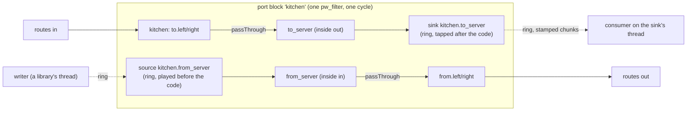

# Companions: slice 3b of the node framework

Status: steps 3b.0 to 3b.7 built (8.10; 3b.6, the wire, and 3b.7, the editor's badges, on 2026-11-14), the words to come; module
design in section 8 (2026-11-09), its headers landed as declarations. Slice 3b follows
slice 3a (the lifecycle, built 2026-11-09) and comes before slice 3c (node primitives, `node-primitives.md`), because
companions remove two of 3c's would-be primitives (feeds and late handoffs) and a third's use (sendspin's bell). The
built system this page changes is described in `docs/architecture.md`, `docs/engine.md`,
`docs/writing-a-node-type.md`, `docs/control-port.md` and `docs/output-records.md`; this page cites them for what exists
and says only what 3b adds or changes.

[V] = verified in the code or PipeWire source named, as of this page's writing (2026-11-09); [U] = unverified, with the
test that checks it.

## 1. The owner's words that bind this slice

The R numbers are the register the node framework's design used (kept so commits and code comments still resolve).

| # | The owner's words | Date | What it means here |
|---|---|---|---|
| R6 | "in a general purpose sources-and-sinks graph, its always just 'running'" | 2026-10-29 | A companion never makes a block stop processing; the block runs from creation, with or without companions |
| R14 | "G4 is asking the wrong question. The node audio threads should be concerned with reading inputs and writing outputs. The framework should provide the necessary primitives to connect inputs/outputs across nodes AND anytime a node needs to cross inputs/outputs to non-realtime code (eg pipe outputs through a mailbox?)" | 2026-11-08 | A type's realtime code reads `Io` inputs and writes `Io` outputs, nothing else; every crossing to or from non-realtime code is the framework's |
| R16 | "I like the basic shape of the state machine proposal. And most importantly: it should be per-node. Some node stopping/reconfiguring/failing does not effect the graph globally" | 2026-11-08 | A companion's failure fails only its node; its barrier is its own |
| R18 | "crossing to a non-rat [non-realtime] thread could be managed by allowing a node to internally pipe its inputs/outputs to a hidden node, to maintain the integrity and consistency of the processing graph" | 2026-11-08 | Companions: hidden helpers on a node's inside banks, owned by the framework. Cards and RTP receivers are hidden engine nodes; a sink or a source is served by the node's own block in its cycle (3.4 says why) |
| Q-3b1 | Asked whether a sink or source should be its own hidden PipeWire node, as first designed, or a hidden helper its node's block serves in its own cycle: "Served by the node (Recommended)" | 2026-11-09 | 3.4 and D-3b1: the reading of R18 below is the owner's |
| Q28 (gate C2) | Asked what the editor shows of a node's hidden helpers: "(a)", as recommended: small badges in the node's box, one per helper, its kind and a dot for ready, its drop count on hover | 2026-11-08 | 3.7 |

## 2. What slice 3a left

Slice 3a built the lifecycle with exact interim calls for everything 3b makes real ([V], `lifecycle.hpp`, `sink.hpp`,
`node_host.cpp`, `port_blocks.cpp`, `handoffs.cpp`):

| Interim, as built | Where | What 3b does |
|---|---|---|
| The sink's realtime side is inside the block: the block writes each sink's inside output bank into a `FrameRing` after the code, from `SinkBinding`s carried in the drive request (`DriveRequest::sinks`), and `ThreadSinks` (`handoffs.cpp`, a `pw_thread_loop` per sink) drains it | `port_blocks.cpp`, `handoffs.cpp` | keeps it (3.4): this is the ring companions' shape. The source joins it, played by the block before the code (`DriveRequest::sources`) |
| Every drive and silence is applied inside its data-loop invoke, between two cycles, and the block publishes `takenAt`, the next expected position | `PortBlock::drive`, `takenAt()` | unchanged: ring companions are bound and unbound in that same invoke (3.4) |
| `Chunk::upstreamFrames` is always 0 | `sink.hpp` | the upstream latency the block tells on the sink's bank, sampled per cycle |
| `cx.soundCard(bank, SoundCardRequest)` and `cx.rtpReceiver(bank, RtpReceiverRequest)`, the bank filled from the handle; the legacy `StartContext` can acquire both too (only `node_host_test.cpp` does) | `lifecycle.hpp`, `node_type.hpp` | take shapes (`SoundCardShape`, `RtpReceiverShape`) and become companion kinds; the legacy acquires go |
| `rtp` declares `latencyMs` itself with `cx.declareLatency(fromRtp, stream, ...)` | `src/nodes/rtp/rtp_spec.hpp` | the framework declares it upstream of the receiver's bank (`LatencyPlan::beyond`); `rtp`'s line goes |
| A card whose PCM never runs, or an RTP receiver on a port another program holds, leaves its node `configuring` for good (`waitingFor` `companion` after 2 s) | `NodeHost` | each kind gets a readiness deadline; missing it fails the node |
| No source: `sendspin`'s feed, mailboxes and bell are its own realtime code, and its `to` bank goes out through a legacy handoff, all behind the legacy adapter | `src/nodes/sendspin/` | the source is built and tested here; `sendspin` moves onto it and onto a sink in 3c |
| A barrier overdue at 5 s marks the data loop wedged at once (a barrier is applied in its invoke, so an unapplied one means the invoke never ran) | `NodeHost` 5 s bound | unchanged: nothing is deferred to a cycle, so the one-stage judgement still holds |
| `quantum-limit` is `max(block, 8192)`; nothing keeps an engine companion from carrying `node.force-quantum` and friends | `engine.cpp` | the limit at the block size; force properties never set (3.6) |
| Companions are invisible on the wire and in the editor | `ear_control`, `web/` | feature `companions` (3.7) |
| The outside nodes' interfaces are `OutsideNode`, `OutsideNodeEvents`, `OutsideTarget`, `OutsideAdapter<Request>`, joined by `joinOutsideNode` | `node_host.hpp`, `outside_nodes.hpp` | renamed engine companions (`companions.hpp`, section 8) |

## 3. The design

### 3.1 The rule

A type's realtime code reads `io[input]` and writes `io[output]` (R14). When audio must leave the realtime thread (to a
file, a network library) or come in from a non-realtime thread (a decoder, a program), the type declares an inside
bank and asks in `configure` for a **companion** on it. The type's code is a `passThrough` between its public banks
and its inside banks (or its own code for audio it makes or changes); it never touches a ring, a wake or a device.

There are two families. An **engine companion** (a sound card, an RTP receiver) is a hidden PipeWire node, linked to
the bank's ports channel for channel; it is built (slice 2's outside nodes) and 3b renames it and gives it a deadline.
A **ring companion** (a sink, a source) is a ring between the block and an ordinary thread, which the block itself
serves in its own cycle: it plays a source into the bank's input spans before the code and taps a sink's bank after
it. Both are hidden (never in the desired graph, never routed, never metered), both are the framework's, and both
appear under their node on the wire.



### 3.2 The kinds, a closed list

A kind changes what the framework promises, so the list is closed (`CompanionKind`, `companions.hpp`); each kind has one
adapter in `ear_pipewire`.

| Kind | Family | Joins | Name | Realtime side | Non-realtime side | Ring | Drops | Latency it adds beyond its bank | Asked by |
|---|---|---|---|---|---|---|---|---|---|
| Sound card playback, capture | engine | an inside output (playback) or input (capture) bank | `<node>.playback`, `<node>.capture` (its engine node) | PipeWire's ALSA adapter | the card | the card's buffer | the card's | what the adapter reports | `cx.soundCard(bank, SoundCardShape{card})` |
| RTP receiver | engine | an inside input bank | `<node>.rtp` (its engine node) | `libpipewire-module-rtp-source` | the network | rtp-source's | rtp-source's | `latencyMs` (rtp-source's ports report zero) | `cx.rtpReceiver(bank, RtpReceiverShape{...})` |
| Sink | ring | an inside output bank | `<node>.<bank>` (its thread's) | the block, after the code: copies the bank into its ring with the cycle's stamp | a `SinkConsumer` on the sink's own thread, which may block on I/O | frames the type gives (`file`: 2 s) | a full ring drops frames and counts them (the node's `dropped=`) | none | `cx.sink(bank, SinkShape{frames}).consumedBy(...)` (unchanged from 3a) |
| Source | ring | an inside input bank | `<node>.<bank>` | the block, before the code: plays its ring into the bank, zeros when empty | a `SourceWriter` held by a loop's state or a library's thread; it may wait for room | frames the type gives | an empty ring plays zeros and counts the frames short (`shortfall`) | `[0, capacity]` | `cx.source(bank, SourceShape{frames})` |

Later kinds, each designed with its slice: the paced source (`programs.md`, slice 9: a source with a resampler, a ring
kind), an RTP sender and a PipeWire-socket program's nodes (engine kinds, not designed).

- **Names.** Engine companions by kind, ring companions by their inside bank. A node's name has no `.`, so a companion's
  name never equals a node's, and `LiveGraph`'s lookups by node name for routes never match one. One configuration
  names each companion once (built: `NodeHost` checks it), and from 3b a bank has at most one companion (a second on
  a bank is a `std::logic_error`, as every broken configure rule).
- **Hidden, not secret.** A companion is never in the desired graph, never named by a route, and not metered (only
  public ports are). The wire lists it under its node (3.7).
- **An engine companion's lifecycle** (built as `joinOutsideNode`, `outside_nodes.cpp`): asked for in `configure`, made
  once the block is ready, running alone until its body says it runs, then one link per channel joins it by global id
  to the block's inside ports; ready once every link is active; on any failure its links and node are torn down before
  it is reported lost, so the node fails `engine-refused: <detail>` and keeps its block and wires.
- **A ring companion's lifecycle**: made at once in `configure` (a sink's thread starts; a source has no thread),
  ready when its sink's consumer began (built) or at once (a source), bound to the block by every drive of its
  configuration and unbound by the silence that follows, freed with the configuration.
- **Teardown** (the built order, `docs/architecture.md#teardown-by-dependency`, with companions where outside nodes
  are now): at step 1 every source's writer is closed and the barrier unbinds every ring companion; at step 2 engine
  companions are destroyed; at step 3 each sink drains its ring to its consumer and calls `finish` on its own thread;
  at step 5, on the main loop, the sinks and sources are freed after the instance (whose threads may hold a writer).

### 3.3 The ring companions' contract

**A sink delivers stamped chunks.** The consumer API is 3a's and does not change (`sink.hpp`, [V]):

```cpp
struct Chunk { std::span<const float> interleaved; std::uint32_t frames; std::uint64_t position;
               std::int64_t startNs; std::int64_t startRawNs; std::uint32_t upstreamFrames; bool discontinuity; };
class SinkConsumer { public: virtual ~SinkConsumer() = default; virtual void begin() {}
                     virtual void consume(const Chunk&) = 0; virtual void finish() = 0; };
```

From 3b `upstreamFrames` is real: the most upstream (capture) latency the block tells on the sink's bank, which is what
reaches the input banks paired with it plus what the configuration declared on it, read in the cycle the chunk was
taken. So a consumer dates what it got without a mailbox: the instant the chunk's first frame entered the graph is
`startRawNs - upstreamFrames * 1e9 / rate`, for each call of a chunk split at the ring's end too (the second call's
start times are advanced with its position; found building 3b.1, 8.3). `discontinuity` keeps its built meaning (the first cycle after any drive,
a new driver, a position jump, or a cycle too large to run); a consumer that must tell a real gap from a re-drive
compares `position` with the last chunk's end. `begin` runs once on the sink's thread before the node is `configured`
(built, readiness step 4').

*Reversed in part (2026-11-13):* by the owner's timing model a source keeps no time: "keeping time" and "says what
played" below (D-C4, D-3b3) are replaced by the source's own clock (`timing-model.md` 4.1 and 4.2); the ring, its fades,
closing and stop stand.

**A source plays what its writer gives, and keeps time.** Its writer is the framework's (3c's loops and library threads
call it); `source.hpp` is its home (section 8 lists it): `SourceShape{frames}`, `Played{totalFrames, heardRawNs}`,
`Wake` (`ring`, `descriptor`, `answer`), and `SourceWriter` (`write(interleaved, frames, patience)`,
`idle(patience)`, `clear()`, `closed()`, `capacityFrames()`, `played()`, `playedWake()`).

- **Keeping time** (decided, D-C4). On a cycle whose position jumped ahead of the last one's end by no more than its
  capacity, a source skips that many frames and counts them played, so the audio moves on with the graph (sendspin's
  rule today, `sendspin_code.cpp`). A larger jump is a new clock, not a skip. Since `engine.conf`'s `resync.ms`
  (2026-11-09) the position never steps back; a stall's catch-up skips whole blocks forward, which this rule absorbs. A
  cycle an xrun cut short before the block ran is one such jump at the next cycle.
- **Fades at its edges, without a lookahead** (D-R11). It keeps no audio back, so the latency it adds stays
  `[0, capacity]`. After `clear` it plays the next 5 ms of what its ring holds, faded to zero, counts those frames
  played, and drops the rest. At an underrun (the ring dry, the writer not idle) it decays from the last sample it
  played to zero over 5 ms. When audio comes back it fades in over 5 ms. So sendspin's stream ending (`clear` on
  `on_stream_end`) fades out, in framework code (R14).
- **Says what played.** After each cycle that played or skipped frames it publishes `Played{totalFrames, heardRawNs}`,
  `heardRawNs` being the cycle's `startRawNs` plus the frames it played and the most downstream latency of the output
  banks its bank is paired with, and rings its played wake, at most once until answered. The downstream latency is what
  the block's pass-through carries back from the node's public bank: a following card's buffer reaches sendspin's
  dating with no code of sendspin's. **`Played` says the graph's clock moved past those frames** (D-C4), not that a
  device sounded them: a cycle an xrun cuts short after the block and before the card loses frames the block played,
  and no node can see that (3.4).
- **Closing.** The framework closes the writer at the teardown's first step. A `write` or `idle` already waiting wakes
  and returns 0 at once; one that begins after the close accepts nothing and waits out its whole patience, so a library
  thread that calls in a loop (sendspin-cpp's sync thread, 20 ms) sleeps between calls and never spins. The wait is a
  `poll` on an eventfd nothing writes after the close.
- **Stopped.** A stop's silence unbinds the source; once it completed the framework drops what its ring holds (counted
  dropped, not played), so a start never plays audio written before it; its writer waits for room or idles as at a
  full ring.
- **Wakes.** A sink wakes its thread when its ring holds frames, at most once per cycle (`pw_loop_signal_event`, as
  built); a source wakes a writer waiting for room (an eventfd write, only when one waits). `Wake` is declared in core
  in 3b; its eventfd implementation lives with the source in `ear_pipewire` until 3c's `ear_runtime` has `EventWake`
  and `Loop::onWake` to watch it. No type uses a source before `sendspin` moves in 3c, so only tests watch the played
  wake in 3b (by `poll` on its descriptor).
- **The sink's thread stays where it is.** `ThreadSinks`' `pw_thread_loop` per sink (`ear_pipewire`) keeps draining
  the ring. `ear_runtime` arrives with 3c's loops, and the source's eventfd moves there then.

### 3.4 Ring companions are served by their block (decided)

**The open point.** The design proposed until now made a ring companion an engine node of its own (a hidden
`pw_filter` linked to the inside bank) and armed it by graph position: the block would defer every change to a cycle
it published, and each companion would compare its own cycle's position with the block's. 3a's spike S2 found (step
L-0, 2026-11-08, `src/pipewire/tests/spikes_test.cpp`) that in every cycle a block, its upstream and its downstream all
ran, they saw one position and ran in link order, but **a cycle an xrun cuts short is run by an upstream prefix of the
graph only** (1 to 17 cycles a run on an idle host, 500 to 4,600 on a loaded one). A sink downstream of its block never
runs a cycle its block skipped; a source upstream of its block can. The page proposed "provisional play" (a source
counts a chunk played only once it sees the block ran that position) with the fallback D-L25 (the ring companions'
realtime side stays inside the block), to be settled by a spike.

**Decision: the fallback, adopted as the design (D-3b1).** A ring companion's realtime side is the block's own code:
the block plays each bound source into its inside input bank before the code and taps each bound sink after the code
(the sink as 3a built it), and both are bound by the drive's invoke with the code itself. Why, against provisional play:

- **It is exact by construction.** The source, the code and the sink run in one `process`, at one position, and are
  swapped together between two cycles by the invoke 3a already proved (S1, S2). A cycle the block does not run, none of
  them runs; the next cycle's position jump is the keep-time skip. There is no position arming, no deferred take-up, no
  one-cycle start penalty, and no second stage for the wedge judgement (D-L30 is withdrawn: a pending barrier still
  means the loop ran no invoke).
- **Provisional play would not buy what it was for.** Its aim was that no frame nobody heard is counted played. But
  under D-C4 a skipped frame is counted played anyway, and a cycle cut short after the block and before a following
  card loses frames the block played, which no node can see. So `Played` can only mean "the graph's clock moved past
  these frames" (3.3), which the block-served source gives exactly. What provisional play would add is a one-cycle
  delay in `Played` and a per-block "last position run" word.
- **It is unproven, and its unknowns are PipeWire's.** Besides the prefix, nobody has measured what a node reads after
  its upstream ran a cycle it did not: the upstream's frames of the cut cycle (a stale buffer still marked as data, so a
  lasting one-cycle shift) or the current cycle's. An engine-node source would depend on the answer; a block-served one
  does not.
- **It is cheaper.** No engine node, eventfd wake or graph recalculation per crossing: a stereo copy (about 1 µs at
  48 kHz and 256 frames) per ring companion per cycle. `file` stays one engine node and `sendspin` will be one too.
- **Nobody sees the difference.** The API is the same (`cx.sink`, `cx.source`, `SinkConsumer`, `SourceWriter`), the
  wire lists the same entries with the same names (`rec.writer`), and the editor the same badges. ear runs PipeWire
  in-process with no external tools, so whether a ring companion is its own engine node is invisible outside ear's
  code. R18's aim ("maintain the integrity and consistency of the processing graph") holds: the type's code still reads
  and writes only its banks, and the crossing is the framework's.
- **It leaves 3d simpler.** A make-before-break replacement of a ring companion is a new binding handed over in the
  commit point's invoke with the code (`reconfigure.md` 5), never two sources mixing into one bank.

**The spike, S5** (3b's first step, 3b.0; `spikes_test.cpp` on S2's harness, tagged `[s2]` so it runs serial, kept as a
regression). Its method: S2's three filters U (upstream probe), B and D (downstream probe), linked U → B → D at a
64-frame block, under S2's invoke storm and beside one busy thread per core. It makes its own cut-short cycles: U
sleeps one and a half cycles inside its `process` in every 16th of its cycles, and B in every 16th of its own, half a
period out of step, 200 times each. The driver's timeout then expires before the sleeper returns, the data loop
dispatches the timer before the next node's wake (it became ready first), and the driver's next cycle resets that
node: the cycle is cut short straight after U, or straight after B, on any host. The test requires every overrun to
have cut its cycle with that shape, so at least 200 of each (about 5 s; a 30 s deadline fails it naming the counts),
and takes the host's own cut-short cycles, and those the driver cuts catching up after an overrun, as they come.
Counting on the host to cut cycles short did not hold: a first form waited for 500 beside the busy threads, met in 8
to 20 s on a workstation, and GitHub's runner cut 9 in 60 s. B is a test-only filter that plays a position-stamped
ramp from a ring of its own (2,048 frames, sendspin's feed at 48 kHz) before its code, keeping time as 3.3 says, and
counts `totalFrames` as a source would; U writes each cycle's position into every frame it outputs.

**Result (2026-11-09): A passes, B reads "current".** The first form, on cycles the host cut short: ten idle runs,
800 (704 after U, 96 after B) in 200 s; ten loaded, 5,032 (3,227 after U, 1,805 after B); no drift in 242,228 cycles
B ran, D exact in all 240,327 both ran, and all 3,491 reads after a cut current. The overrun form, ten runs of 4.8 to
5.3 s on a 4-core workstation: every one of the 2,000 overruns of U cut its cycle after U and every one of B's 2,000
after B, with 1,191 and 281 other cycles cut short besides; also with the data loop and the busy threads on one core
(10.6 and 10.8 s, about 2,000 other cycles cut after U a run) and with no busy threads (4.6 s, the overruns' shapes
alike). B's 3,605 position jumps were all forward, whole cycles, at most 768 frames (960 on one core), so within its
capacity: no new clock and no drift of `totalFrames - (position - firstPosition)` in 32,004 cycles B ran, and D
heard B's ramp frame of its position in all 29,723 cycles both ran. In all 2,833 cycles B ran straight after one cut
before it (1,909 after an overrun of U, 924 after another cut), it read U's frames of its own cycle. Cycles cut by an
overrun behaved as the host's own did in every count. So 3b.2 builds the source as designed, and the counting rule
stays a sum.

- **A, the gate: `Played` keeps to the clock.** Across every cycle B ran, `totalFrames - (position - firstPosition)`
  stays constant (no drift across a cut-short cycle), and every frame D received after a cycle both B and D ran is the
  ramp frame of that position. Pass: both hold, across both shapes of cut-short cycle. On a pass, 3b.2 builds the source as designed and
  repeats A on the real block (`port_block_test.cpp`). On a fail (drift: a position jump larger than the capacity, or
  one not a whole number of cycles, after a cut-short cycle), the source re-anchors `totalFrames` at every
  discontinuity instead of summing frames (a change inside `SourceRing` only, written into 3.3's keeping time), and A
  is rerun with that rule; nothing else in the design moves.
- **B, recorded: what a downstream node reads after a cut-short cycle.** In each cycle that U ran and B did not, record
  the position stamped in the frames B reads at its next cycle. "Current" (U's frames of the cycle B runs) or "stale"
  (U's frames of the cut cycle, a lasting one-cycle shift). Either result is written into
  `docs/engine.md#the-one-data-loop-and-invokes`; "stale" also goes into `docs/engine.md#known-limits` as a limit of
  routes between blocks after an xrun. Neither changes 3b. B only says whether an engine-node ring companion could
  ever be revisited for a later kind ("current": possible, with provisional play; "stale": ruled out).

### 3.5 Engine companions: shapes and readiness deadlines

- `cx.soundCard(bank, SoundCardShape{.card})` and `cx.rtpReceiver(bank, RtpReceiverShape{...})` replace 3a's calls over
  the requests. The bank handle names the bank (as built), and its direction is the card's: an inside output bank takes
  playback, an inside input bank capture or a receiver, checked at compile time; a companion on a public bank does not
  compile (as built).
- **Readiness deadlines** (I3, "never ready, never lost" cannot last; D-R12), each from the request, on the main
  loop's timers: a sound card 10 s, an RTP receiver 5 s, a sink's consumer 5 s (`cardReadinessBound` and friends,
  `companions.hpp`); a source is ready at once. Past it, an engine companion is destroyed and the node fails
  `engine-refused`: `the RTP receiver never ran (UDP port 5004 held?)`, `the card never started: <card id>`; a sink
  whose consumer has not begun fails it `start-failed: the sink <bank>'s consumer did not begin within 5 s` (its
  `begin` is the type's code). The `waitingFor` members `companion` and `consumer` (built) show the wait meanwhile.
  This turns `docs/node-types.md#rtp`'s "a port another program holds leaves the node configuring for good" into a
  failure after 5 s (a better reason for a held port comes with 3c's UDP claim and probe).
- **Latency.** A companion's latency beyond its bank enters the configuration's latency plan as `LatencyPlan::beyond`,
  added in series beyond what the bank's ports' peers report: an RTP receiver's `latencyMs`, a source's
  `[0, capacity]`. A card reports its own through its links, as built. The block's pass-through carries each to
  the public bank. `cx.declareLatency` is left for a type's own code (a delay line); `rtp`'s call goes.

### 3.6 The quantum guard

The graph has one quantum and one rate, the driver's. The engine pins `min-quantum` = `max-quantum` = the block size
already; 3b also sets `quantum-limit` to the block size (built: `max(block, 8192)`, `engine.cpp`), and no engine
companion carries `node.force-quantum`, `node.force-rate`, `node.lock-quantum` or `node.lock-rate`: ear builds every
property it gives one from closed grammars and sets none of these, and the card adapter's test seam (`extra`
properties) refuses them. So no node can change `clock.duration` for every block (whose `frames > maxBlock` path would
write zeros) (D-R10). [U: that cards and rtp-source run with `quantum-limit` at the block size, a 44.1 kHz sender
included; 3b.4's tests. If not, the limit stays and the absent properties are the guard.]

### 3.7 On the wire and in the editor

The wire's frame (protocol 1, `features`) is built (`docs/control-port.md`). 3b adds the feature `companions`:

- **Each node** in snapshots and `node.added` carries `companions: [...]` (`[]` before it is configuring, or for a type
  with none, and for a legacy type: `sendspin` until 3c). An entry: `name`, `kind` (an open set: `card-playback`,
  `card-capture`, `rtp-receiver`, `sink`, `source`; slice 9 adds `paced-source`), `bank` (the inside bank it joins;
  inside banks appear nowhere else on the wire), `ready`, and by kind `dropped` (a sink: frames its ring had no room for
  since this configuration was made) or `shortfall` (a source: frames played as zeros while its writer was not idle).
  3d adds `retiring`.
- **`node.companionsChanged {name, companions}`**, the whole list, whenever an entry is added or removed or its `ready`
  changes, and when a counter changed, sampled at most once a second per node (K1). Order: a list that shows a
  companion ready precedes the `node.state` its readiness allowed; a `node.state` is never held back for it (a failure is
  told at once); the empty list of a teardown follows the `node.state` that began it.
- **Never**: a route naming a companion is refused (`invalid-name`, as built for a name with `.`); levels never carry
  one; `graph.get`'s `nodes` never lists one.
- **Standard output** has no record per companion: a lost one fails its node, whose `node` record names it in the
  failure's detail. Two new observation diagnostics (`diagnostic` records; on the wire only once slice 5 adds
  `node.diagnostic`): `ear.sink-dropped` (detail names the companion, fields `frames` since the last, `totalFrames`) and
  `ear.source-shortfall` (the same), each at most once per 10 s per companion while it drops (K2). The `removed`
  record's `dropped=` stays the sum over the node's sinks (built).
- **The editor** (the owner's Q28): a badge per companion along the box's bottom edge, its kind as a short word (`card
  out`, `card in`, `rtp`, `sink`, `source`; an unknown kind its own text) and a dot filled when `ready`, hollow when not,
  with "ready" or "not ready" as its accessible text; the tooltip and panel give the name, the bank and the counter
  ("rec.writer: 4096 frames dropped since it was made"), and a counter above zero puts a small warning mark on the
  badge. No companions, no strip (`white`). A failed or disabled node's strip is empty (its configuration was torn
  down); a stopped node's stays (it keeps its companions). Companions never take part in selection, dragging, deletion
  or route-making.

## 4. What it changes in the built system

| Built piece | Change |
|---|---|
| `PortBlock` (`node_host.hpp`), `FilterPortBlocks` | `DriveRequest::sources`, played before the code each cycle; each sink's stamp carries its bank's upstream latency; `LatencyPlan::beyond`; the interface and the take-up are otherwise unchanged |
| `SinkTap`, `SinkBinding`, `ChunkStamp`, `Sink` (`sink.hpp`) | kept; `ChunkStamp::upstreamFrames`, `Sink::droppedFrames()`; `Chunk`, `SinkConsumer`, `SinkShape`, `cx.sink`, `consumedBy` unchanged |
| `ThreadSinks` (`handoffs.cpp`) | fills `upstreamFrames`, counts drops readable at any time; its thread and drain stay |
| `OutsideAdapter`, `OutsideNode`, `OutsideNodeEvents`, `OutsideTarget`, `joinOutsideNode`, `AlsaSoundCards`, `RtpReceivers` | renamed engine companions over shapes (`companions.hpp`); the join's code kept |
| `SoundCardRequest`, `RtpReceiverRequest`, the legacy card and receiver acquires | removed |
| `ResourceRegistry` | engine companion adapters over shapes; gains the source adapter |
| `NodeHost` | sources; readiness deadlines per kind; companions' lists for the wire; counters sampled and their diagnostics |
| `card`, `rtp` | their `configure` calls change (shapes); `rtp`'s `declareLatency` line goes. `file` and `white` do not change |
| `engine.cpp` | `quantum-limit` at the block size |
| `TypeHarness` | the companion fake gains a source (`h.feed(bank, interleaved)`, `h.played(bank)`), readiness deadlines on the harness's clock; sinks' chunks carry `upstreamFrames` |
| `ear_control`, `web/` | feature `companions`; `companions` on nodes, `node.companionsChanged`; badges |
| `sendspin` | unchanged: it stays on the legacy adapter until 3c moves it onto a source and a sink |

## 5. Tests

The test plan is section 8.9, per executable.

## 6. Decisions already taken

| # | Decision | Why |
|---|---|---|
| D-R3 | Ring companions are bound by the drive's invoke with the code, never by a separate invoke (restated by D-3b1: there is no arming by position) | An invoke can land between a block and another node within one cycle; inside one `process` nothing can |
| D-R4 | Every output the code writes is faded before a planned silence, inside banks feeding an engine companion included (built in 3a); a sink's bank is never faded, a recording is cut by the drive | A card's own speaker never clicks; a recording keeps exact samples |
| D-R10 | `quantum-limit` at the block size; no force properties on companions | One node's forced quantum would change every block's cycle |
| D-R11 | A source fades without a lookahead | No standing latency; `Played` stays the frames actually played |
| D-R12 | Readiness deadlines: card 10 s, RTP receiver 5 s, a sink's consumer 5 s | I3: a node never waits for good on something that will never be ready |
| ~~D-C4~~ | Reversed (2026-11-13, the owner's timing model): the framework keeps no audio time for a source; a source with a clock of its own gives the ring a `SourceClock` (`timing-model.md` 4.2). Was: a source keeps time by default (skips what a stalled graph missed, counting it played) | — |
| D-L25 | Ring companions' realtime side stays inside the block: adopted as the design (D-3b1), no longer a fallback | 3.4 |
| ~~D-L30~~ | Withdrawn: the wedge stays judged in one stage | Nothing is deferred to a cycle (3.4) |
| K1 | `companions` under each node, `node.companionsChanged`, counters sampled once a second; no framework status fields | Counts belong to the crossing that drops |
| K2 | `ear.sink-dropped`, `ear.source-shortfall` at most once per 10 s per companion | The operator learns of drops while they happen, at a bounded rate |
| C2 (owner, Q28) | Badges in the box, never boxes or handles | The owner's answer |
| new | The sink's thread stays `ThreadSinks`' `pw_thread_loop` in `ear_pipewire`; `ear_runtime` starts with 3c | It works as built; a package with one thread in it is not worth a slice of its own |

The module design's own decisions are in 8.11.

## 7. Open questions and risks

- **Cards and rtp-source at `quantum-limit` = block size** (3.6): proven on the test card and on receivers at 44.1 and
  96 kHz (3b.4); a real USB card at that limit is still to be checked on the hardware, and the fallback keeps the
  limit.
- **What a node reads after a cut-short cycle** (S5's part B): answered, the upstream's frames of the cycle it runs
  (`docs/engine.md#the-one-data-loop-and-invokes`); nothing for 3b to fix.
- **The readiness deadlines** are first choices: a USB card that takes longer than 10 s to start fails, and is retried
  only by `node.start`, `node.restart` or a change until slice 8's recovery.
- **Churn of the rename** (step 3b.3): mechanical, but it touches every outside-node test; done in one step of its own.

## 8. Module design

How 3b is built, module by module: what changes where, on which thread, behind which declarations. The new headers are
landed as declarations (they compile under `VERIFY_INTERFACE_HEADER_SETS` and nothing calls them yet); each is the text
of record for its declarations and their contracts, and 8.2 lists them. Changes to existing headers are old → new
tables (8.3), applied by the step that builds them (8.10).

### 8.1 Module map

| Package | File | What | Thread | Calls / called by |
|---|---|---|---|---|
| `ear_core` | `ear/core/source.hpp` (new, landed) | `SourceShape`, `Played`, `Wake`, `SourceWriter`; `SourceCycle`, `SourceTap`, `SourceBinding`, `Source`, `SourceAdapter` | writer: the type's thread; tap: realtime; `Source`: main | the type → `SourceWriter`; the block → `SourceTap`; `NodeHost` → `Source`, `SourceAdapter` |
| `ear_core` | `ear/core/source_ring.hpp`, `source_ring.cpp` (new; header landed) | `SourceRing`: every source rule, pure | realtime (`play`), writer (`offer`, `markIdle`), main (`dropForStop`, `close`), any (counters) | wrapped by `EventSources` and the harness's fake source |
| `ear_core` | `ear/core/companions.hpp`, `companions.cpp` (new; header landed) | the shapes, `CompanionKind`, the readiness bounds, `CompanionView`, `NodeCompanionsListener`, `EngineCompanion*`, `CompanionTarget` | main | `NodeHost` → engine adapters; `NodeHost` → listeners |
| `ear_core` | `sink.hpp` (changed) | `ChunkStamp::upstreamFrames`, `Sink::droppedFrames()` | as built | the block, `ThreadSinks`, `NodeHost` |
| `ear_core` | `lifecycle.hpp` (changed) | `CreateContext`/`CreateOf`: `soundCard` and `rtpReceiver` on shapes, `source` | main, inside `configure` | the type → `NodeHost` |
| `ear_core` | `node_type.hpp`, `sound_card.hpp`, `rtp_receiver.hpp` (changed) | the requests and the legacy card and receiver acquires go | — | — |
| `ear_core` | `node_host.hpp`, `node_host.cpp` (changed) | `DriveRequest::sources`, `LatencyPlan::beyond`, the `Outside*` interfaces go, `ResourceRegistry`, `NodeHost::subscribeCompanions` and `companionsOf`; inside: companion slots, readiness timers, counter sampling, drop diagnostics | main | the aggregate's actions → adapters, the block, listeners |
| `ear_core` | `graph_view.hpp`, `graph_status.cpp` (changed) | `NodeView::companions` | main | `GraphStatus::read` → `NodeHost::companionsOf` |
| `ear_type_harness` | `node_harness.hpp`, `type_harness.hpp`, `node_harness.cpp` (changed) | the companion fake over shapes, a fake source over `SourceRing`, deadlines on the fake clock | the test's | a type's tests |
| `ear_pipewire` | `port_blocks.cpp` (changed) | plays bound sources before the code; stamps sinks with upstream latency; tells `beyond`; publishes each port's told latency for the realtime side | realtime, main | `NodeHost` → `PortBlock`; the block → `SourceTap`, `SinkTap` |
| `ear_pipewire` | `ear/pipewire/sources.hpp`, `sources.cpp` (new; header landed) | `EventSources`: `SourceRing` plus the room eventfd and the played `Wake` | as `Source`'s | `NodeHost` via `ResourceRegistry` |
| `ear_pipewire` | `handoffs.hpp`, `handoffs.cpp` (changed) | `ThreadSink`: `upstreamFrames` into each `Chunk`; `droppedFrames()` | as built | as built |
| `ear_pipewire` | `outside_nodes.*` → `engine_companions.hpp`, `engine_companions.cpp` (private, renamed) | `joinEngineCompanion`, `CompanionJoin`, `CompanionBody`, `CompanionBodyEvents` | main | `AlsaSoundCards`, `RtpReceivers` |
| `ear_pipewire` | `sound_cards.*`, `rtp_receivers.*` (changed) | adapters over `SoundCardShape`, `RtpReceiverShape`; the seam refuses force properties | main | `NodeHost` via `ResourceRegistry` |
| `ear_pipewire` | `engine.cpp` (changed) | `default.clock.quantum-limit` = the block size | main, at boot | — |
| `ear_control` | `ear/control/companions_wire.hpp` (new, landed), `events.*`, `graph_json.cpp`, `commands.hpp`, `gateway.*` (changed) | `NodeCompanionsChanged`, the encoders, `wireFeatures` gains `companions`, `MainLoopGateway` hears companions | main (gateway's listener side), control (encoders) | `NodeHost` → gateway → sessions |
| `ear` | `src/main.cpp` (changed) | `EventSources` into the registry; the gateway subscribed to companions | main | — |
| `web` | `protocol.ts`, `graph.ts`, `companions.ts` (new), `components/EarNode.tsx`, `components/Panels.tsx` | the types, the reducer, the badges | browser | — |
| nodes | `card_spec.hpp`, `rtp_spec.hpp` (changed) | shapes; `rtp`'s `declareLatency` goes | main | — |

Dependencies keep `docs/architecture.md#packages`' rules: `source_ring.cpp` and `companions.cpp` are pure core; only
`ear_pipewire` makes descriptors; no PipeWire, Boost or knobly type appears in any header above.

### 8.2 The new headers (landed)

Each declaration's contract, thread and errors are its header's comment; this is the list.

`src/core/include/ear/core/source.hpp`:

```cpp
struct SourceShape { std::uint32_t frames; };
struct Played { std::uint64_t totalFrames = 0; std::int64_t heardRawNs = 0; };
class Wake { public: virtual void ring() noexcept = 0;               // any thread, realtime included
                     virtual int descriptor() const noexcept = 0;    // the one watcher
                     virtual void answer() noexcept = 0;             // the watcher: drain, then clear
             protected: ~Wake() = default; };
class SourceWriter { public:
	virtual std::uint32_t write(std::span<const float> interleaved, std::uint32_t frames,
	                            std::chrono::milliseconds patience) = 0;   // one writing thread
	virtual void idle(std::chrono::milliseconds patience) = 0;            // the writing thread
	virtual void clear() noexcept = 0;                                    // any ordinary thread
	virtual bool closed() const noexcept = 0;                             // any thread
	virtual std::uint32_t capacityFrames() const noexcept = 0;            // any thread
	virtual Played played() const noexcept = 0;                           // any thread
	virtual Wake& playedWake() noexcept = 0;                              // the one watcher
protected: ~SourceWriter() = default; };
struct SourceCycle { std::uint64_t position; std::uint32_t frames; std::int64_t startRawNs; bool discontinuity;
                     Latency downstream; };
class SourceTap { public: virtual void play(std::span<const std::span<float>> bank,
                                            const SourceCycle& cycle) noexcept = 0;   // realtime only
                  protected: ~SourceTap() = default; };
struct SourceBinding { SourceTap* tap; std::size_t firstInput; std::size_t channels; };
class Source { public: virtual ~Source() = default;                  // main, teardown step 5
	virtual SourceWriter& writer() noexcept = 0;  virtual SourceTap& tap() noexcept = 0;
	virtual void stopped() noexcept = 0;          virtual void close() noexcept = 0;            // main
	virtual std::uint64_t shortfallFrames() const noexcept = 0;
	virtual std::uint64_t droppedFrames() const noexcept = 0; };                              // any thread
class SourceAdapter { public:
	virtual std::unique_ptr<Source> make(const NodeName& node, std::string_view bank, std::uint32_t channels,
	                                     std::uint32_t capacityFrames, std::uint32_t rate) = 0;    // main
protected: ~SourceAdapter() = default; };
```

`src/core/include/ear/core/source_ring.hpp`: `class SourceRing final : public SourceTap` with
`Signals { roomFreed() noexcept; playedChanged() noexcept; }` (called inside `play`), the constructor
`(channels, capacityFrames, rate, Signals&)`, `play`, `offer(interleaved, frames) noexcept` (never waits),
`markIdle()`, `clear()`, `dropForStop()`, `close()`, and the counters `closed()`, `capacityFrames()`, `played()`,
`shortfallFrames()`, `droppedFrames()`; its state behind a pointer made at construction, so `play` allocates nothing.

`src/core/include/ear/core/companions.hpp`:

```cpp
struct SoundCardShape { CardId card; };
struct RtpReceiverShape { RtpAddress address; std::uint16_t port; RtpEncoding encoding; std::uint32_t rate;
                          std::uint32_t latencyMs; };
using EngineCompanionShape = std::variant<SoundCardShape, RtpReceiverShape>;
enum class CompanionKind { cardPlayback, cardCapture, rtpReceiver, sink, source };
std::string_view companionKindName(CompanionKind kind) noexcept;
constexpr bool isEngineKind(CompanionKind kind) noexcept;
inline constexpr std::chrono::milliseconds cardReadinessBound{10'000}, rtpReceiverReadinessBound{5'000},
                                           sinkReadinessBound{5'000};          // three declarations in the header
std::optional<std::chrono::milliseconds> readinessBound(CompanionKind kind) noexcept;   // nullopt: a source
inline constexpr std::chrono::milliseconds companionCounterPace{1'000}, companionDropDiagnosticPace{10'000};
struct CompanionView { NodeName name; CompanionKind kind; std::string bank; bool ready = false;
                       std::optional<std::uint64_t> dropped{}; std::optional<std::uint64_t> shortfall{}; };
class NodeCompanionsListener { public:
	virtual void companionsChanged(const NodeName& node, std::span<const CompanionView> companions) = 0;  // main
protected: ~NodeCompanionsListener() = default; };
class EngineCompanion { public: virtual ~EngineCompanion() = default; };               // was OutsideNode
class EngineCompanionEvents { public: virtual void ready() = 0; virtual void lost(std::string detail) = 0;
                              protected: ~EngineCompanionEvents() = default; };      // was OutsideNodeEvents
struct CompanionTarget { NodeName engineNode; NodeName blockNode; Direction bank; std::vector<PortName> blockPorts;
                         AudioFormat format; std::uint32_t blockId = 0xFFFFFFFFU; };   // was OutsideTarget
template <class Shape> class EngineCompanionAdapter { public:
	virtual std::unique_ptr<EngineCompanion> make(const CompanionTarget& target, const Shape& shape,
	                                              EngineCompanionEvents& events) = 0;   // main, in the flush
protected: ~EngineCompanionAdapter() = default; };                                     // was OutsideAdapter
using SoundCardCompanions = EngineCompanionAdapter<SoundCardShape>;
using RtpReceiverCompanions = EngineCompanionAdapter<RtpReceiverShape>;
```

`src/pipewire/include/ear/pipewire/sources.hpp`: `class EventSources final : public SourceAdapter` with
`make(node, bank, channels, capacityFrames, rate)`, throwing `std::system_error` when it cannot make an eventfd.

`src/control/include/ear/control/companions_wire.hpp`: `companionsFeature = "companions"`,
`struct NodeCompanionsChanged { NodeName node; std::vector<CompanionView> companions; }`,
`nlohmann::json encodeCompanion(const CompanionView&)`, `nlohmann::json encodeCompanions(std::span<const CompanionView>)`.

What implementers replace: the step that builds each header removes what it supersedes (8.3): `companions.hpp`'s
engine interfaces replace `node_host.hpp`'s `OutsideNode`, `OutsideNodeEvents`, `OutsideTarget`, `OutsideAdapter`,
`SoundCardAdapter` and `RtpReceiverAdapter` (3b.3); the shapes replace `SoundCardRequest` and `RtpReceiverRequest`
(3b.3); `companions_wire.hpp`'s struct joins `GraphEvent` (3b.6). Until then both sets compile side by side.

### 8.3 Changes to existing headers, old → new

**`ear/core/sink.hpp`** (3b.1)

| Old | New |
|---|---|
| `struct ChunkStamp { std::uint64_t position; std::int64_t startNs; std::int64_t startRawNs; bool discontinuity; };` | `struct ChunkStamp { std::uint64_t position; std::int64_t startNs; std::int64_t startRawNs; bool discontinuity; std::uint32_t upstreamFrames; };` the most upstream latency the block tells on the sink's bank in that cycle |
| `Chunk::upstreamFrames`: "always 0 until slice 3b" | the stamp's `upstreamFrames` (3.3) |
| `class Sink` (no counter) | adds `virtual std::uint64_t droppedFrames() const noexcept = 0;` any thread: frames the tap refused since the sink was made |
| `SinkTap`, `SinkBinding`, `SinkAdapter`, `SinkConsumer`, `SinkShape` | unchanged (but see the note below) |

**Found building 3b.1.** `SinkAdapter::make(node, bank, channels, capacityFrames)` becomes `make(node, bank, channels,
capacityFrames, std::uint32_t rate)` (NodeHost passes the graph's rate), as `SourceAdapter::make` already has it. Why:
a chunk that wraps the ring's end is handed in two calls, and the second kept its cycle's `startNs` and `startRawNs`
while its `position` moved on, so 3.3's dating rule dated that call's first frame early by the first call's frames.
`ThreadSink` now advances both start times by `done * 1e9 / rate` with the position, so every `Chunk`'s start times
are its own first frame's. The harness's sink never splits a chunk and ignores the rate. Also: `LatencyPlan::beyond`
has a `{}` default member initializer, so the existing two-member `LatencyPlan{pairs, internal}` still compiles; and
`carryLatency` does not check `beyond`'s bank names (it is framework-filled; a name matching no bank adds nothing).

**Found building 3b.2.** The source is built as declared, with these changes and readings (the rules are now
`docs/writing-a-node-type.md#sources`, the block's cycle `docs/engine.md#sources`):

- `FrameRing` gains `readPosition()` (any thread, acquire). Why: a clear asked at the writer's position must play the
  next 5 ms of what was written *before* it and drop the rest exactly, so the reader must know how many frames lie
  before that position; `writePosition()` alone cannot say.
- A writer starts idle (an empty ring before the first write is no shortfall), and a stop's silence leaves it idle;
  the first cycle after a stop counts no shortfall either (the writer was held back until it). Underrun decay frames
  count as shortfall (they are not the writer's); a clear's fade does not.
- "Stopped: waits for room as at a full ring" is `SourceRing::offer` accepting nothing from `dropForStop` until the
  next cycle plays, which wakes a waiting writer and drops whatever a writer slipped in meanwhile (counted). The
  keep-time state restarts at that cycle, so the stop's position jump is no skip.
- `Source::droppedFrames` counts frames dropped by a clear as well as a stop ("written and never played").
- `beyond` gets `{bank, {0, capacityFrames()}}`, the ring's real capacity (`SourceShape::frames` rounded up to a power
  of two), since that is the most its frames can wait.
- `NodeHost` tells every source `stopped()` on any silence's completion that is still its configuration's current
  barrier (a teardown's too: harmless, the writer is closed), never when a later request was posted, since the block
  may then play it again.
- Teardown step 1's close is at the first of the type's `stop()`, the fade, the silence or the teardown proper, on any
  intent but a stop (and at a failed configure); all idempotent.
- One companion per bank is checked for sources against outside nodes by the request's bank name (3b.3's reshape
  keeps it).
- The harness's `CompanionFake` gains `Kind::source` and `SourceShape` in its variant (3b.3 reshapes it as 8.3 says);
  its fake source plays into the test's own input buffers of the bank, so `input(port)` shows what played.
- After review (2026-11-09):
  - An input bank's told playback latency adds each paired output's declared (internal) latency, the most across
    the pairs: `declareLatency` lands on the output, so without it a source's `Played` was dated early by the code's
    own delay (PipeWire adds a node's process latency both ways). The harness's `toldDownstream` mirrors it.
  - Keeping time is exact: a jump past what the ring holds leaves a debt, the next frames written dropped up to it,
    counted played at the jump (a clear forgets the debt of the stream it ends).
  - `Source::stopping()` (new, main thread): the writer counts as idle from the start of a stop or teardown (before
    the type's `stop()`, and at the fade), so stopping the writer's thread is no shortfall.
  - `maxSourceFrames` (2^24, `source.hpp`): `SourceShape::frames` above it is a rule broken, as 0 is.
  - `EventSources` clamps a patience to a year (no overflow for `milliseconds::max()`) and the poll timeout to
    `INT_MAX`; `Wake::answer` clears pending with an acq_rel exchange, so the watcher synchronises with the publish.
- S5's part A on the real block is `source_test.cpp`'s, not `port_block_test.cpp`'s: an upstream probe sleeping 12 ms
  past the quantum every 50th cycle cuts that cycle short after itself (the block never runs it), so the test meets
  cut-short cycles at will instead of by load.

**Found building 3b.3.** The engine companions are built on the declared interfaces with no declaration changed
(what lasts is `docs/engine.md#engine-companions` and `docs/writing-a-node-type.md#engine-companions`):

- `CompanionTarget` named the bank's direction and ports but not its name, which the one-companion check and
  `beyond`'s key need, so `NodeHost` kept the name beside each asked companion and the harness's fake found its bank
  by the target's ports. Root classes R7 moved the name into the target (`CompanionTarget::insideBank`), which the
  harness reads ([root-classes.md](root-classes.md#73-found-building-r7)).
- D-3b14 is checked for every kind against every kind (it was a source against an outside node only): an engine
  companion, a sink or a source on a bank that already has one is `a second companion on bank <bank>`, the built
  one-name check first (so two receivers on one bank still read `a second resource named <node>.rtp ...`).
- With no direction in the shape, a card's refusals are one: a routable bank is `a sound card joins an inside bank,
  not "<bank>"` (the 3a texts "a playback card joins an inside output bank" and "a sound card's request names bank"
  cannot arise).
- The legacy check "a legacy type with a recipe may ask for no outside node" went with the legacy acquires (D-3b9):
  no legacy start can ask for an engine companion, so it could not be reached. `node_host_test.cpp`'s card and
  receiver configs are classes: a `TestConfig` with cards or receivers makes an instance whose `configure` runs the
  same start (its handoffs, failure and code) and then asks for the companions through `CreateContext`.
- An RTP receiver's `beyond` is `latencyMs * rate / 1000` frames, both bounds, at the drive (as `rtp` declared it on
  `stream`).
- After review: `beyond` is **added in series** beyond the bank's peers, not combined with them as one more peer
  (D-3b6 and 3.5 reworded). rtp-source's output ports do report a latency, of zero (`PIPEWIRE_DEBUG=4`: "set output
  latency 0-0"), so as a parallel peer the receiver's buffer read `{0, B}` on `stream` once it was linked (the
  least of the leasts), where `rtp`'s 3a declaration told `{B, B}`. `port_blocks.cpp`'s `combined()` now finishes
  the peers' combination and then adds the entry's least and most; the harness has no peers, so its model is
  unchanged. A source's bank has no peers, so a source's `[0, capacity]` is told as before. A real receiver's test
  (`rtp_receiver_test.cpp`) reads the told capture latency on `stream` from the engine.
- The flush's activity names follow the vocabulary: `make engine companion`, `destroy engine companion` (were
  `... outside node`), the one text an operator can see change (`ear.main-loop-stalled`'s `in`, while a flush item
  runs).

**Found building 3b.4.** The deadlines and the guard are built on the declared interfaces with no declaration of
`companions.hpp` changed (what lasts is `docs/engine.md#readiness-deadlines` and `docs/engine.md#the-quantum-guard`):

- The deadlines are armed at configure's applied return, after each sink's `begin` is handed over (8.6's create step
  5), so an engine companion's wait counts the time its block took to be ready too: an RTP receiver whose block never
  became ready fails at 5 s like one made and never run. Each timer is an input of its own and judges then (current
  generation, not `tearing`, not failed, readying, the companion not ready); a companion's readiness resets its timer,
  and the teardown clears them all.
- A sink's expiry is fed as `lc::Fact::consumerNeverBegan` (3a's unused `consumerLost`, renamed after review: it
  maps to `start-failed` in every phase). An engine companion's is `Fact::engine`; it is not "marked lost": the
  teardown destroys it in the flush, and destroying it tells nothing (8.6 reworded).
- After review: one engine companion never made, because its block was not ready by the deadline, does not get its
  kind's text (which would blame the card or the port): it fails `engine-refused: <engine node> was never made: the
  node's block was not ready within <n> s`. A departure from 3.5's texts, which assumed the companion was made.
- After review: a deadline timer that fires more than 250 ms past due (NodeHost's `lateSlack`, a stalled main loop)
  posts its judgement to the main loop once more, so a ready held back by the stall and dispatched behind the timer
  lands first (as the bounds' grace does for a barrier).
- After review: `quantum-floor` is the block size too (it was `min(block, 4)`, and a forced quantum is clamped to
  `[floor, limit]`, so a node could force a shorter cycle); `AlsaSoundCards`' `extra` refuses `priority.driver`,
  `node.driver`, `node.group` and `node.link-group` as well (they would take driving from the internal clock).
- After review: with the limit at the block size, `module-adapter` hands a card `clock.quantum-limit` = the block, and
  alsa-pcm.c caps a card's buffer at 4 x that when no period count is set: 1024 frames at a 256 block, where it was
  `min(hw max, 32768)`. Each card is now made with `api.alsa.period-size` = the block and `api.alsa.period-num` =
  `cardPeriods(block)` (`sound_cards.hpp`): a batch (USB) card gets its old buffer, period and headroom back exactly;
  one that is not batch gets block-sized periods and twice the old buffer, capped by the hardware (no single count
  gives both their old buffers, since ALSA halves only a batch card's period). Restoring the old limit for adapters
  alone through the context's properties after creation did not work on 1.4.2 (the property stayed the block size).
- The texts are 3.5's with the shape's values: `the card never started: <card id>` (one text for either direction,
  since a card's id is the same on both banks), `the RTP receiver never ran (UDP port <port> held?)`, `the sink
  <bank>'s consumer did not begin within 5 s` (the seconds from `sinkReadinessBound`).
- `companions.cpp` is new with `readinessBound` and `companionKindName` (the second is 3b.5's and 3b.6's, built here
  because it is one switch beside the first).
- The harness needed a way to hold a sink's `begin`, else the consumer deadline could not be reached in a type's tests:
  `HarnessOptions::holdSinks` (consumers begin only at `ready(bank)`). `ready(bank)` now takes any companion's bank:
  a held sink begins, a sink that began or a source is ready already (nothing happens); `lose(bank)` on a sink or a
  source is a `std::logic_error` (the framework never loses a ring companion: its type's code says lost through the
  handle). `advance` already ran every timer NodeHost arms, so the deadlines needed nothing more there.
- 3.6's [U] is answered yes: with `quantum-limit` at the block size the test card plays its ramp bit-exact and
  follows, and receivers fed at 44.1 kHz and at 96 kHz into a 48 kHz graph are resampled (a sender faster than the
  graph needs more input than one block a cycle, so it was added to 3.6's 44.1 kHz case). `engine_test.cpp` forces a
  quantum four blocks long on a node in the group: with the old limit (8192) every block stopped running, with the
  limit at the block size every cycle stays one block. A real card (a USB MOTU) at that limit is the `ear-on-talos`
  skill's check, not run; the fallback stays 3.6's (the limit back to `max(block, 8192)`, the refusal kept).

**3b.5 as built against today's code** (written before building it, 2026-11-13). 3b.5 was planned before the cycle
facts' counters (`docs/engine.md#reporting-the-counters`), the timing model's T1 to T4 and root classes R7. Against the
code as they left it:

- **Already done.** `CompanionView`, `NodeCompanionsListener`, `companionKindName`, `companionCounterPace` and
  `companionDropDiagnosticPace` are landed in `companions.hpp` (the name function built in 3b.4); `Sink::droppedFrames`
  and `Source::shortfallFrames` are atomics any thread reads (3b.1, 3b.2; T3 kept the shortfall as a transport
  counter, `timing-model.md` 4.1); `CompanionTarget::insideBank` (R7) names an engine companion's bank and
  `EngineCompanionEvents::ready` its readiness (3b.3, `joinEngineCompanion`). The module-run converter base (T4) changes
  nothing here: RTP keeps `CompanionKind::rtpReceiver`, `<node>.rtp` (D-TM11). `SourceClock` changes nothing either: its
  reports are the type's, never a companion entry's.
- **What 3b.5 adds, in core.** NodeHost keeps each configuration's companions in request order and tells the list
  (`NodeHost::subscribeCompanions`, `companionsOf`) whenever an entry is added or removed or its `ready` changes: at
  configure's applied return (sources ready, the rest not); before the readiness check a companion's `ready` or a sink's
  `begun` feeds (D-3b10: before the health it allows); empty from teardown step 1, after the `node.state` that began it;
  kept across a stop. Only the node a client holds tells (neither a superseded node nor the silent older node of a
  port-caused replace), as the wire keys health by name.
- **Changed: the counters are sampled by `CounterWatch`, not a timer of NodeHost's.** Since cycle facts D2 the one pacer
  of counters is `CounterWatch` at the main loop's 100 ms heartbeat, for the reason `docs/engine.md#reporting-the-counters`
  gives (a timer of their own would wake the loop again for what the heartbeat already gives). 8.6's per-configuration
  1 s timer would be a second pacer beside it. So `NodeCounterSource` gains `spanCompanions(span)` (the span's newest
  node's list, counters read then), and at each beat `CounterWatch`:
  - re-tells a node's list to its `NodeCompanionsListener`s when a sink's `dropped` or a source's `shortfall` moved,
    at most once per `companionCounterPace` per node, only for the node a client holds (K1; the list's structure stays
    NodeHost's to tell);
  - writes `ear.sink-dropped` and `ear.source-shortfall` through `CounterListener::companionFramesLost`, paced as
    `ear.node-missed-cycles` is (once the count held still a beat or kept moving 10 s, at most once per
    `companionDropDiagnosticPace` per companion: K2), and at once, pace waived, at the configuration's end, which
    NodeHost tells with the final counts (`NodeCountsListener::companionsEnded`, at teardown step 5 or a leak), so the
    records' sums are each configuration's totals.
  These records go through `CounterListener` (StatusLog already is one), not `NodeDiagnosticListener` as 8.3 planned:
  a paced counter's record is `CounterWatch`'s, as `ear.node-missed-cycles` is.
- **Obsolete.** 8.6's "Counters" timer, "the timer is cancelled at the teardown's start", and 8.3's
  `NodeDiagnosticListener` codes row. The harness keeps no `CounterWatch` (a type's tests read `h.shortfall` and the
  sink's counts directly), so 8.3's "`advance(ms)` also fires ... the counter sampling" goes; `companionList()` reads
  NodeHost's list fresh rather than keeping the last one told.
- **No owner question.** The behaviour an operator or client sees is 3.7's K1 and K2; only which class paces it moves.

**`ear/core/lifecycle.hpp`** (3b.2 for `source`, 3b.3 for the shapes)

| Old | New |
|---|---|
| `virtual void soundCard(std::string_view bank, SoundCardRequest request) = 0;` (CreateContext) | `virtual void soundCard(std::string_view bank, SoundCardShape shape) = 0;` playback on an inside output bank, capture on an inside input bank (NodeHost re-checks the reach and direction, a std::logic_error naming the bank otherwise) |
| `virtual void rtpReceiver(std::string_view bank, RtpReceiverRequest request) = 0;` | `virtual void rtpReceiver(std::string_view bank, RtpReceiverShape shape) = 0;` and its `latencyMs` into `LatencyPlan::beyond` |
| — | `virtual SourceWriter& source(std::string_view bank, SourceShape shape) = 0;` main, inside configure: a source on an inside input bank, made at once; `beyond` gets `{bank, {0, capacity}}`; a second companion on the bank, `frames == 0`, or a call outside configure is a std::logic_error; the adapter's throw fails the node start-failed |
| `template <class Bank> void soundCard(Bank, SoundCardRequest request)` (CreateOf) | `template <class Bank> void soundCard(Bank, SoundCardShape shape)`: `static_assert(ownBank<Bank>)`, `static_assert(Bank::reach == PortBank::Reach::inside, "a sound card joins an inside bank of the spec")` |
| `template <class Bank> void rtpReceiver(Bank, RtpReceiverRequest request)` | `template <class Bank> void rtpReceiver(Bank, RtpReceiverShape shape)`, the same asserts as built |
| — | `template <class Bank> SourceWriter& source(Bank, SourceShape shape)`: `static_assert(ownBank<Bank>)`, `static_assert(Bank::reach == PortBank::Reach::inside && Bank::direction == Direction::input, "a source plays into an inside input bank of the spec")`; returns `context_->source(Bank::name, shape)` |
| `#include "ear/core/sink.hpp"` | adds `ear/core/companions.hpp`, `ear/core/source.hpp` |

**`ear/core/node_type.hpp`, `sound_card.hpp`, `rtp_receiver.hpp`** (3b.3)

| Old | New |
|---|---|
| `using ResourceRequest = std::variant<SoundCardRequest, RtpReceiverRequest, HandoffRequest, RecordingRequest>;` | `using ResourceRequest = std::variant<HandoffRequest, RecordingRequest>;` (until 3c removes the legacy SPI) |
| `StartContext::acquire(const SoundCardRequest&)`, `acquire(const RtpReceiverRequest&)` | removed (no legacy type uses them; `node_host_test.cpp`'s legacy card and receiver configs become classes) |
| `struct SoundCardRequest`, `enum class CardDirection` | removed: `SoundCardShape` and the bank's `Direction` |
| `struct RtpReceiverRequest` | removed: `RtpReceiverShape` |

**`ear/core/node_host.hpp`** (the step in brackets)

| Old | New |
|---|---|
| `struct DriveRequest { AudioCode* code; std::span<const bool> faded; std::span<const SinkBinding> sinks{}; };` | adds `std::span<const SourceBinding> sources{};` [3b.2]: bound in the invoke that applies the request, with the code and the sinks; each cycle the code runs the block plays each into its bank before the code; unbound by the next request's invoke (a silence binds none). Outlives the completion or the block |
| `struct LatencyPlan { std::vector<BankPair> pairs; std::vector<std::pair<std::string, Latency>> internal; };` | adds `std::vector<std::pair<std::string, Latency>> beyond;` [3b.1]: what a companion adds beyond an inside bank, added in series beyond the bank's peers (3b.3's review); at most once per bank |
| `PortBlock` | unchanged; its `drive` comment names sources beside sinks [3b.2] |
| `class OutsideNode`, `OutsideNodeEvents`, `struct OutsideTarget`, `template <typename Request> class OutsideAdapter`, `SoundCardAdapter`, `RtpReceiverAdapter` | removed: `companions.hpp`'s [3b.3] |
| `ResourceRegistry(SoundCardAdapter&, RtpReceiverAdapter&, HandoffAdapter&, SinkAdapter&, RecordingAdapter&)` and the four-argument form | `ResourceRegistry(SoundCardCompanions& cards, RtpReceiverCompanions& receivers, HandoffAdapter& handoffs, SinkAdapter& sinks, SourceAdapter& sources, RecordingAdapter& recordings) noexcept` and the form without recordings [3b.2 adds `sources`; 3b.3 the engine adapters] |
| `adapterFor(const SoundCardRequest&)`, `adapterFor(const RtpReceiverRequest&)` | `SoundCardCompanions& adapterFor(const SoundCardShape&) const noexcept`, `RtpReceiverCompanions& adapterFor(const RtpReceiverShape&) const noexcept` [3b.3]; adds `SourceAdapter& sources() const noexcept` [3b.2] |
| `NodeHost` | adds `void subscribeCompanions(NodeCompanionsListener& listener);` (main, before the first node) and `std::vector<CompanionView> companionsOf(const NodeName& node) const;` (main: the newest node of the name's list, empty when none or not configured) [3b.5] |
| ~~`NodeDiagnosticListener`'s codes~~ | Superseded in 3b.5: `ear.sink-dropped` and `ear.source-shortfall` are `CounterListener::companionFramesLost`'s (see "3b.5 as built" above) |
| `WaitingFor` | unchanged: `companion` names an engine companion, `consumer` a sink's consumer |

**`ear/core/graph_view.hpp`** (3b.6): `NodeView` adds `std::vector<CompanionView> companions{};`, filled by
`GraphStatus::read` from `NodeHost::companionsOf`.

**`ear/pipewire/sound_cards.hpp`, `rtp_receivers.hpp`** (3b.3)

| Old | New |
|---|---|
| `class AlsaSoundCards final : public SoundCardAdapter` / `make(const OutsideTarget&, const SoundCardRequest&, OutsideNodeEvents&)` | `: public SoundCardCompanions` / `std::unique_ptr<EngineCompanion> make(const CompanionTarget& target, const SoundCardShape& shape, EngineCompanionEvents& events) override;` playback when `target.bank` is output |
| `explicit AlsaSoundCards(Engine& engine, Properties extra = {});` | the same; throws `std::invalid_argument` when `extra` names `node.force-quantum`, `node.force-rate`, `node.lock-quantum` or `node.lock-rate` |
| `class RtpReceivers final : public RtpReceiverAdapter` / `make(const OutsideTarget&, const RtpReceiverRequest&, OutsideNodeEvents&)` | `: public RtpReceiverCompanions` / `std::unique_ptr<EngineCompanion> make(const CompanionTarget&, const RtpReceiverShape&, EngineCompanionEvents&) override;` |

**`src/pipewire/outside_nodes.hpp`** (private, 3b.3): renamed `engine_companions.hpp`; `OutsideJoin` →
`CompanionJoin`, `OutsideBodyEvents` → `CompanionBodyEvents`, `OutsideBody` → `CompanionBody`, `OutsideBodyMaker` →
`CompanionBodyMaker`, `joinOutsideNode(Engine&, OutsideJoin, OutsideNodeEvents&, OutsideBodyMaker)` →
`std::unique_ptr<EngineCompanion> joinEngineCompanion(Engine& engine, CompanionJoin join, EngineCompanionEvents& events,
CompanionBodyMaker makeBody);` `ChannelFlow` stays, worked out from `CompanionTarget::bank`. Behaviour unchanged.

**`ear/pipewire/handoffs.hpp`**: no declaration changes; `ThreadSink` implements `Sink::droppedFrames` and passes the
stamp's `upstreamFrames` into each `Chunk` [3b.1]. **`ear/pipewire/port_blocks.hpp`**: no declaration changes.

**`ear/control/events.hpp`, `commands.hpp`, `gateway.hpp`** (3b.6)

| Old | New |
|---|---|
| `using GraphEvent = std::variant<NodeAdded, ..., RouteChanged>;` | adds `NodeCompanionsChanged` (`companions_wire.hpp`); `encodeEvent` writes `node.companionsChanged` |
| `struct NodeAdded { NodeSpec node; Ports ports; NodeHealth health; ... since; }` | ~~adds `std::vector<CompanionView> companions;`~~ Dropped in 3b.6: unchanged, the encoder writes `"companions": []` (always empty at an add) |
| `inline constexpr std::array<std::string_view, 1> wireFeatures{"lifecycle"};` | `inline constexpr std::array<std::string_view, 2> wireFeatures{"lifecycle", companionsFeature};` |
| `class MainLoopGateway final : public GraphGateway, ..., public SnapshotStamp` | adds `public NodeCompanionsListener` and `void companionsChanged(const NodeName& node, std::span<const CompanionView> companions) override;` (main: copies and posts `NodeCompanionsChanged`, in order with health) |
| `encodeGraph`: each node with its health | each node also `"companions": encodeCompanions(view.companions)` |

**`ear/testing/node_harness.hpp`, `type_harness.hpp`** (3b.2, 3b.3, 3b.4)

| Old | New |
|---|---|
| `struct CompanionFake { enum class Kind { soundCard, rtpReceiver, sink }; Kind kind; ...; std::variant<SoundCardRequest, RtpReceiverRequest, SinkShape> request; ... }` | `struct CompanionFake { CompanionKind kind; std::string bank; NodeName name; std::variant<SoundCardShape, RtpReceiverShape, SinkShape, SourceShape> shape; bool made; bool ready; bool destroyed; std::vector<SeenChunk> chunks; }` (`engineName` becomes `name`) |
| — | `void feed(std::string_view bank, std::span<const float> interleaved);` the source's writer, never waiting (what fits is taken); `Played played(std::string_view bank) const;` `std::uint64_t shortfall(std::string_view bank) const;` `const std::vector<CompanionView>& companionList() const noexcept;` the last list told; `TypeHarness` adds `feed(Bank, ...)`, `played(Bank)`, `shortfall(Bank)` for inside input banks |
| `process()` | plays each bound fake source (a real `SourceRing`) into its bank before the code, with a `SourceCycle` from the harness's cycle and the plan's latency; each sink chunk's stamp carries the upstream latency the plan gives its bank |
| `advance(ms)` | also fires the readiness deadlines and the counter sampling |

### 8.4 Threads

| Thread | What it may call |
|---|---|
| main loop | every `NodeHost`, `Source` (but its counters), `Sink`, adapter and `PortBlock` call; `SourceRing::dropForStop`, `close` |
| data loop (realtime) | `SourceTap::play` (the block, before the code), `SinkTap::write` (after it), the codes; nothing that blocks, locks or allocates; at most an eventfd write per wake |
| a source's writing thread (a library's or 3c's loop) | `SourceWriter::write`, `idle`; any ordinary thread `clear`; any thread `closed`, `capacityFrames`, `played` |
| a sink's thread (`ThreadSinks`' `pw_thread_loop`) | `SinkConsumer::begin`, `consume`, `finish` (as built) |
| the watcher of a played wake (tests in 3b; 3c's loop) | `Wake::descriptor`, `answer` |
| control thread | the encoders in `companions_wire.hpp` |

### 8.5 The block's cycle

`FilterPortBlock::processCycle` from 3b (data loop; additions marked new):

1. Input spans from PipeWire, zeros for a port with no buffer (built).
2. New: for each bound source, its bank's input spans are replaced by the block's own scratch (one `maxBlock` buffer
   per inside input port, made at the block's making), and `tap->play(scratch spans, SourceCycle{position, frames,
   startRawNs, discontinuity, downstream})` fills them, `downstream` being the latency the block last told on the
   source's bank as playback latency (beyond its paired outputs, plus what the configuration declared on it), published
   by the main loop's `retell()` per input port as one packed atomic, as `downstream_` is per output.
3. The code, or zeros when none is driven (built).
4. The fade on the faded outputs (built).
5. Each bound sink's tap, with `ChunkStamp{position, startNs, startRawNs, discontinuity, upstreamFrames}`, new
   `upstreamFrames` being the latency the block last told on the sink's bank as capture latency, published per output
   port likewise.
6. Metering of the public ports (built).

A cycle too large to run plays no source and taps no sink (built for sinks): the next cycle's position jump is a skip
the source keeps time over. The storage for bindings is sized at the block's making: one source per inside input bank,
one sink per inside output bank. `retell()` also combines each bank's `beyond` entry with its peers (new), so a source's
`[0, capacity]` and a receiver's `latencyMs` reach the paired public bank.

### 8.6 Call sequences

Threads: [M] main loop, [D] data loop, [S] a sink's thread, [W] a source's writer, [T] a timer on the main loop.

**Create** (T2, inside `configure`):

1. [M] `NodeHost` makes the instance and calls `configure(CreateOf&)`.
2. [M] `cx.source(bank, shape)` → `CreateContext::source`: checks configuring and that the bank has no companion yet,
   `resources.sources().make(node, bank, channels, frames, rate)` → `Source`; the slot keeps it with
   `SourceBinding{&tap, bank.first, size}`; `beyond += {bank, {0, capacity}}`; returns `source.writer()`.
3. [M] `cx.sink(bank, shape)`: as built (its thread starts).
4. [M] `cx.soundCard(bank, shape)` / `cx.rtpReceiver(bank, shape)`: recorded with its `CompanionTarget` (the bank's
   direction, ports, engine name); a receiver's `latencyMs * rate / 1000` into `beyond`.
5. [M] `configure` returns `applied`: the built checks; each sink's consumer handed over (`Sink::begin`, [S] runs
   `begin`); a readiness timer armed per engine companion and per sink (`readinessBound`); the companions' list told
   (`companionsChanged`: sources ready, the rest not), before the health of `configuring` is told further.

**Ready**:

1. [M] the block is ready (built) → the turn's flush makes each engine companion (`adapterFor(shape).make(target,
   shape, slot)`), in request order.
2. [M] an engine companion's `ready()`, or a sink's `begun` posted from [S]: its slot ready, its timer cancelled, the
   list told, then readiness judged (`checkReady`); all ready → `resourcesReady` (T3) → prepare → drive.

**Drive** (T5, and every start after a stop):

1. [M] `carryLatency(LatencyPlan{pairs, internal, beyond})`; `drive(DriveRequest{code, faded, sinks, sources}, done)`.
2. [D] the invoke binds the code, the sink taps and the source taps into storage sized at making, between two cycles;
   from the next cycle 8.5 runs with them.
3. [M] `done(P)` → `driven` → `start()` (built).

**Stop**: [M] `stop()`; fade; silence `drive(DriveRequest{nullptr})`. [D] the invoke unbinds everything. [M] its
completion: each source's `stopped()` (its ring dropped and counted), then the aggregate hears `silencedForStop`. The
companions and their list stay (a stopped node keeps them). [W] a writer meanwhile waits for room or idles.

**Start** after a stop: the drive above, with the same bindings; the source fades in as audio arrives.

**Restart, disable, failure** (a teardown, built order):

1. [M] the `node.state` that begins it (`stopping`, or `failed`) is told; then every source's `close()` ([W] a waiting
   `write` or `idle` returns 0 at once), the channel closing (built), the companions' list told empty.
2. [M] `stop()` if started; the fade; the barrier (a silence: [D] unbinds every ring companion); `release`.
3. [M] the flush destroys each engine companion (step 2); each sink's `close` ([S] drains, `finish`, posts `closed`).
4. [M] the legacy close (step 4); then the code, the instance, the sinks and sources, the recordings, the config
   (step 5). A restart then configures afresh, telling a new list.

**Remove**: as a teardown, then the block's destruction (built). `nodeGone`'s dropped frames sum every configuration's
sinks (built).

**An engine companion lost** (before or after ready): [M] its `lost(detail)` (built) → the node fails
`engine-refused: <detail>` → a teardown, as above.

**Readiness deadline expiry**: [T] the companion's timer fires; if its configuration is current, still readying and
the companion not ready: the aggregate hears the fault `engine-refused` with an engine companion's
kind's text (3.5); a sink's, the fault `start-failed` with its text. The teardown destroys the engine companion in the
flush (its `lost` is never told: destroying it tells nothing) and closes the sink (a `begin` still running finishes
first; the close deadline, 10 s, covers a `begin` that never returns, leaking the configuration as built). A companion
ready in the same turn the timer fired wins: the timer checks readiness when it runs, never before.

**Counters** (as built in 3b.5, in place of a timer of NodeHost's): at each heartbeat `CounterWatch` reads each span's
list (`spanCompanions`), re-tells it when a counter moved and writes the two records, paced
(`docs/engine.md#reporting-the-counters`); at teardown step 5 NodeHost tells the final counts (`companionsEnded`).

**A cycle an xrun cuts short**: [D] the block either runs the cycle (its sources played, code run, sinks tapped) or does
not (none of them). If not, the next cycle's position jumped: each source skips up to its capacity, counted played; each
sink's next chunk has `discontinuity` set and a gap in `position` (built). Engine companions are other nodes: a capture
card or a receiver upstream may have run the cycle, as any route's upstream (S5's part B: the block reads that
upstream's frames of the cycle it runs, never the cut one's). Nothing reaches the main loop.

**Wedge**: unchanged from 3a. A barrier overdue at 5 s is `ear.barrier-overdue` and `ear.data-loop-wedged`; a leaked
configuration keeps its sources and sinks (the block may still play or tap them) and its engine companions are leaked
with their links; its writer stays closed, so a library thread calling `write` sleeps through its patience. 3b adds no
PipeWire call that could reach a wedged loop: sources and sinks make none, and the companions' list and counters are
main-loop state.

### 8.7 The wire, and the editor's signatures

**3b.6 as built against today's code** (written before building it, 2026-11-14). 3.7 and this section were written
before the feature `counters` (cycle facts D2: `counters` on every node, `counters.changed` once a second) and before
3b.5 moved the counters' pacing to `CounterWatch`. Against the wire and the code as they left it:

- **The feature is `companions`** (`companionsFeature`, landed), the third: `"features": ["lifecycle", "counters",
  "companions"]`. Additive; protocol stays 1.
- **Where the list appears.** A member, `companions`, on every node of a snapshot and of `node.added`, beside
  `counters`; and one notification, `node.companionsChanged {name, companions}`, the whole list. Not a member of
  `node.state`: health and the list change for different reasons, and a member there would re-send the list with every
  health change (and `node.state` replaces every health member, so the list would have to ride every one). The
  snapshot reads `NodeHost::companionsOf` through `GraphStatus` (`NodeView::companions`), counters read then.
  `node.added` always carries `[]`: the gateway hears a node added before NodeHost configures it, a port-caused
  replace's newer node included (its configuration is new, its companions count from zero). So `NodeAdded` needs no
  member of its own (8.3's row is dropped): the encoder writes the constant `[]`.
- **Against `counters.changed`: disjoint facts, never the same one twice.** `counters.changed` carries the graph's and
  each node's cycle counters; a companion's `dropped` and `shortfall` ride only in its entry of the list. They cannot
  share a carrier anyway: a node's counters run from its add and never step back or reset, a companion's per
  configuration (D-3b11), restarting from zero with the next configuration's companion of the same name. `node.gone`'s
  `droppedFrames` stays what it is, the node's lifetime sum at its end. Two tellers feed the one notification
  (NodeHost for the list's structure and readiness, `CounterWatch` for a counter's move), and each compares only with
  what it told itself (NodeHost ignores counters, `CounterWatch` compares with its own last list), so a list NodeHost
  told with a moved counter would be told again by `CounterWatch` at the next beat. **The gateway sends a node's list
  only when it differs from the last it sent for that node** (`[]` after its `node.added`), the same rule it keeps for
  `node.state`; that is what makes "never twice" hold on the wire, whoever tells.
- **Pacing.** A change of structure or readiness goes at once, in order with the node's health (D-3b10, as built in
  3b.5); a counter's move alone at most once a second per node (`companionCounterPace`, at the 100 ms heartbeat: at most
  1.1 s behind) and never when nothing moved. Its pace is its own, not `counters.changed`'s: the two are about
  different objects, and each is at most once a second.
- **A client holding an older node.** There is no per-client negotiation (as with `counters`): every client gets the
  member and the notification, so 8.7's "a client without the feature never sees" is moot. A client that does not know
  the feature ignores both (members ear sends may grow; an unknown notification is ignored). A node held without a
  `companions` member (from an ear without the feature) has no list to show. `node.companionsChanged` replaces the
  whole list of the node of that name the client holds, and is ignored for a name it does not hold. The older node of
  a name never tells (NodeHost tells only the node a client holds: neither a superseded node nor the silent older node
  of a port-caused replace), so a list never names an older node's companions; a removed node's teardown tells nothing
  after its `node.removed` (the gateway forgets the name there, and an empty list after it equals the nothing it then
  holds), and a node added again under the name starts from `node.added`'s `[]`.
- **Open sets.** `kind` is an open string (`paced-source` in slice 9, a converter's kind in the timing model's T5 may
  follow); a client draws an unknown kind by its own text. An entry's members may grow (3d's `retiring`); a client
  ignores a member it does not know. The counter members are by kind: `dropped` on a sink, `shortfall` on a source,
  absent on the engine kinds. `test/protocol/unknown-values.json` gains an entry of an unknown kind with an unknown
  member.
- **No owner question.** What an operator or client sees is 3.7's K1 and the owner's Q28 badges (3b.7); the dedup and
  the constant `[]` are how, not what.

The shapes (3.7), in `test/protocol/companions.json` (3b.6):

```json
{"jsonrpc": "2.0", "method": "node.companionsChanged", "params": {"name": "rec", "companions": [
  {"name": "rec.writer", "kind": "sink", "bank": "writer", "ready": true, "dropped": 0}]}}
{"jsonrpc": "2.0", "method": "node.companionsChanged", "params": {"name": "desk", "companions": [
  {"name": "desk.playback", "kind": "card-playback", "bank": "to_card", "ready": true},
  {"name": "desk.capture", "kind": "card-capture", "bank": "from_card", "ready": false}]}}
{"jsonrpc": "2.0", "method": "node.companionsChanged", "params": {"name": "fpp", "companions": [
  {"name": "fpp.rtp", "kind": "rtp-receiver", "bank": "from_rtp", "ready": true}]}}
```

A node in a snapshot or `node.added` carries `"companions": [...]` beside its health members. The fixture holds: a
snapshot with every kind (a source through a test type in the system test only, since no shipped type has one in 3b);
`rec`'s life (`node.added` with `[]`, `configuring`, the list with `rec.writer` not ready, then ready, then
`configured`, `starting`, `running`); a counter moving (`dropped` 0 then 4096); a stop and a start (no list change); a
restart (`stopping`, `[]`, then the list again); a failure after a deadline (`failed`, then `[]`); `unknown-values.json`
gains an unknown `kind`. A client without the feature never sees `companions` or the notification.

`web/src/protocol.ts` (3b.6, with the fixture):

```ts
export type CompanionKind = "card-playback" | "card-capture" | "rtp-receiver" | "sink" | "source" | (string & {});
/** A node's hidden helper (feature companions). */
export interface Companion {
  name: string;
  kind: CompanionKind;
  /** The inside bank it joins. */
  bank: string;
  ready: boolean;
  /** A sink: frames its ring had no room for, this configuration. */
  dropped?: number;
  /** A source: frames played as zeros while its writer was not idle. */
  shortfall?: number;
}
// GraphNode gains:  companions?: Companion[];   (feature companions)
// Notifications gains:  "node.companionsChanged": { name: string; companions: Companion[] };
```

`web/src/graph.ts`: `reduce` replaces the named node's `companions` on `node.companionsChanged` (ignored for a node it
does not hold). `web/src/companions.ts` (3b.7, new):

```ts
export interface CompanionBadge {
  key: string;            // the companion's name
  label: string;          // "card out" | "card in" | "rtp" | "sink" | "source" | the kind's own text
  ready: boolean;
  readyText: "ready" | "not ready";
  warning: boolean;       // dropped or shortfall above 0
  title: string;          // companionDetail
}
export function companionLabel(kind: CompanionKind): string;
/** "rec.writer (sink on writer): ready; 4096 frames dropped since it was made". */
export function companionDetail(companion: Companion): string;
/** In list order; [] for a node with none, or failed or disabled. */
export function companionBadges(node: GraphNode): CompanionBadge[];
```

`EarNode.tsx` draws the strip from `companionBadges` along the box's bottom edge, outside every handle and drag area;
`Panels.tsx` lists `companionDetail` per companion in the node's panel.

**3b.7 as built against today's code** (written before building it, 2026-11-14). 3.7's look and the signatures above
were written before the owner answered Q-CF4 for counters (`cycle-facts.md` 8.5: "panel plus recent": the side panel
always holds the totals, a canvas mark shows only while something happened in the last minute). Against that answer,
the wire as 3b.6 left it (`docs/control-port.md#companions`) and the editor as it is:

- **What each kind shows.** One badge per entry, in list order, along the box's bottom edge under the ports: its kind
  as a short word (`card-playback` "card out", `card-capture` "card in", `rtp-receiver` "rtp", `sink` "sink",
  `source` "source") followed by the readiness dot. The tooltip (Q28's hover) and the node panel's "Companions" list
  give `companionDetail`: the name, the word and the bank, the readiness, and the counter the entry carries, as a
  total ("rec.writer (sink on writer): ready; 4096 frames dropped since it was made"; a source "... frames played
  short since it was made"). An engine kind carries no counter and its detail names none. No list, or an empty one,
  draws no strip (`white`, `sendspin`, a node from an ear without the feature).
- **Ready versus not ready.** A filled dot (●) when `ready`, a hollow one (○) and the badge's text dimmed when not:
  shape, not only colour. Under the order rules a running node never shows a hollow dot; it is seen while
  `configuring`, or for good before a readiness deadline fails the node.
- **Failed and disabled draw no strip** whatever list is held (their configuration was torn down; ear sends `[]`
  after the `node.state`, and the editor does not draw a list in the gap between the two). A stopped node keeps its
  strip (a stop keeps the configuration). An unknown phase draws the list it holds.
- **Dropped and shortfall: recent movement marks, the total is in words** (Q-CF4's rule, applied to the companions'
  counters too, replacing 3.7's "a counter above zero puts a warning mark"). The badge carries the warning mark (a
  small "!" in a circle) only while its `dropped` or `shortfall` rose in the last minute, on the browser's clock, from
  what the editor last held for that companion; the tooltip and the panel always give the total. Why: the counters
  count per configuration, so 3.7's lifetime mark would stay on a recording that dropped once until its next restart,
  the "always shown" Q-CF4 turned down; and D3's node mark (`cycle-facts.md` 8.5) uses the same glyph, the same
  minute and the same browser clock, so the two read alike. What is a rise: a value above the one held for the same
  node and companion name. Not a rise: the first value seen (a snapshot or a new list's first entry: when it moved is
  unknown, its total is still in words), a value below the held one (a new configuration seen without its `[]`, as
  after a reconnect's snapshot), and an entry seen again after its list dropped it (a restart's companion counts from
  zero, and what was held is forgotten with the entry). The mark leaves on its own once the minute passes (the box
  redraws then). The movement is kept by `CompanionMoves`, beside the graph store and fed by it, outside React: the
  reducer keeps only what ear sent, so the browser's times stay out of it.
- **Unknown kinds** are drawn by their own text, neutrally (the same badge style as a known kind, never a fault
  style), with the same dot; a counter member the editor knows (`dropped`, `shortfall`) is shown and marked whatever
  the kind, and a member it does not know (`unknown-values.json`'s `lagFrames`) is ignored.
- **Accessibility.** Every state is in text: the dot is `aria-hidden` beside visually hidden "ready" or "not ready",
  the mark beside visually hidden "dropped frames in the last minute" ("played short in the last minute"); the
  badge's `title` is its detail; the strip is a list labelled "companions". The panel's lines are plain text.
- **Not part of editing.** The strip is no handle and no node; clicking it selects its node as any part of the box
  does, and dragging it moves the box. Nothing in it sends a request.

Signatures, as built (`web/src/companions.ts`; 8.7's `companionBadges(node)` gains the moves and the time, and the
badge its mark's text):

```ts
export const recentMarkMs = 60_000;
export interface CompanionBadge {
  key: string; label: string; ready: boolean; readyText: "ready" | "not ready";
  warning: boolean; warningText: string; title: string;
}
export function companionLabel(kind: CompanionKind): string;
export function companionDetail(companion: Companion): string;
/** Each companion's last counter value and when it last rose, per node; told by the graph store first. */
export class CompanionMoves { note(graph: GraphState, now: number): void; movedAt(node: string, companion: string): number | undefined; nextExpiry(node: GraphNode, now: number): number | undefined; attach(store: GraphStore): () => void; }
export function companionBadges(node: GraphNode, moves: CompanionMoves, now: number): CompanionBadge[];
```

No owner question: the words and the dot are Q28's, the recent mark is Q-CF4's rule, and the rest is how.

### 8.8 The types

- **`file`** (sink): no code change. Its sink is listed as `rec.writer` (kind `sink`, bank `writer`); its chunks carry
  `upstreamFrames` (the latency upstream of `record`, which `WavWriter` ignores); its consumer's `begin` has 5 s
  (`sf_open_fd` on a descriptor the framework already opened). Its exact-samples test now also checks `upstreamFrames`.
- **`card`**: `cx.soundCard(toCard, SoundCardShape{.card = s.get<cardRow>()})` and the same on `fromCard`.
- **`rtp`**: `cx.rtpReceiver(fromRtp, RtpReceiverShape{...})`; its `declareLatency` line goes (the plan's `beyond`
  carries `latencyMs` to `stream`, with the same value its tests check now).
- **`sendspin`** (source, still on the legacy adapter until 3c): nothing changes in what it does or shows; its wire
  list is `[]` (a legacy run's feed and handoff are not companions). What 3b gives it for 3c, tested in 3b without it:
  `SourceRing` holds `SendspinCode::missedFrames`' keep-time rule and `PlayProgress`'s dating
  (`heardRawNs` = start + (played + downstream max) × 1e9 / rate, as `sendspin_code.cpp` computes it today), so
  `code_test.cpp`'s and `feed_test.cpp`'s skip and dating cases move to `source_ring_test.cpp` in 3c; `SourceWriter`
  replaces `Feed`'s writer side (`write` with 20 ms patience from the sync thread, `clear` on stream end); `Played` and
  `playedWake()` replace `Mailbox<PlayProgress>` and the bell; a sink's `upstreamFrames` replaces `CaptureAnchor`.

### 8.9 Test plan, per executable

| Executable | New or changed tests |
|---|---|
| `ear_core_tests` | new `source_ring_test.cpp`: a ramp played exactly; a jump of at most the capacity skipped and counted played, a larger one a new clock; the fades at a clear, an underrun and a return, sample for sample; shortfall only while not idle; `dropForStop` counts and plays nothing; `Played` dated by downstream latency; a closed ring accepts nothing; positions wrapping 2^32 in the ring. `node_host_test.cpp`: sources bound in every drive and none in a silence; a stop drops the ring; teardown closes the writer at step 1 and frees the source after the instance; readiness deadlines per kind on the fake clock (texts and codes; a companion ready in the same turn wins); the list told before the health its readiness allowed, empty after the `node.state` that began a teardown, kept across a stop; counters sampled once a second and `ear.sink-dropped` once per 10 s; `companionsOf`; `beyond` for a receiver and a source; one companion per bank. `graph_status_test.cpp`: `NodeView::companions`. `compile_fail/type_spec_bad.cpp`: a source on an output bank, on a routable bank; an RTP receiver on an output bank (and the built card cases on shapes). |
| `ear_pipewire_tests` | new `source_test.cpp` (`EventSources` on real threads): a write waits for room and is woken by play; idle waits its patience; a close wakes a waiting write at once and a later one sleeps its whole patience (under 1% of a core over 2 s); the played wake rings once until answered. `port_block_test.cpp`: a bound source's ramp reaches the public output in the same cycle (no offset in position); unbound after a silence; no allocation on the data thread (`allocation_count`); `beyond` told on the paired output; the published downstream reaches the tap; S5's part A on the real block. `sink_test.cpp`: `upstreamFrames` equals what the block tells; `droppedFrames()` read while running. `spikes_test.cpp`: S5. `sound_card_test.cpp`, `rtp_receiver_test.cpp`: shapes; each companion's info carries no force property; both run at `quantum-limit` = the block size, a 44.1 kHz sender included. `engine_test.cpp`: the limit. |
| `ear_control_tests` | `events_test.cpp`: `node.companionsChanged`, `companions` on `node.added`. `graph_json_test.cpp`: a snapshot's `companions`. `gateway_test.cpp`: the order rules. `commands_test.cpp`: `features`. The fixture tests over `companions.json`. `status_log_test.cpp`: the two diagnostics' records. |
| nodes' tests (`ear_node_card_tests`, `ear_node_rtp_tests`, `ear_node_file_tests`) | the shapes in the harness; `rtp`'s plan has `beyond` and no `internal`; `file`'s chunks carry `upstreamFrames` |
| `ear_system_tests` | an `rtp` node on a UDP port another socket holds fails `engine-refused` after 5 s; `graph.get` lists `rec.writer` ready while `rec` records; a route naming `rec.writer` is refused; the list across a stop and a start |
| web (vitest) | `protocol.test.ts` over `companions.json`; `graph.test.ts`: the reducer; new `companions.test.ts`: labels, readiness text, the warning mark, an unknown kind drawn neutrally, no strip for failed or disabled |

Kept, unchanged: `file`'s exact-samples test, `sink_test.cpp`'s ramp across a stop and a start, S1 to S3.

### 8.10 Build steps

Each step is one mergeable change, green on every test and on `make format-check`, and changes the library pages it
makes stale (the rule in `AGENTS.md`).

| Step | What | Risk |
|---|---|---|
| **3b.0 Spike S5** | `spikes_test.cpp` only (3.4), and the result of its part B in `docs/engine.md` | Low: test-only. A fail of part A changes `SourceRing`'s counting rule before 3b.2 |
| **3b.1 Sinks' upstream, `beyond`, drop counts** | `ChunkStamp::upstreamFrames`; the block publishes each port's told latency for the realtime side and combines `LatencyPlan::beyond`; `Sink::droppedFrames`; `ThreadSink` fills `upstreamFrames`; the harness stamps from the plan; `docs/engine.md#sinks`, `docs/writing-a-node-type.md#sinks` | Low |
| **3b.2 The source** | `source.hpp`, `source_ring.*`, `sources.*`; `DriveRequest::sources`; the block plays sources (8.5); `CreateContext::source`, `CreateOf::source`; `NodeHost`'s source slots (bind, `stopped`, `close` at step 1, freed at step 5, `beyond`); `ResourceRegistry::sources` (main.cpp, the harness, tests' registries); the harness's `feed`, `played`, `shortfall`; `docs/writing-a-node-type.md` gains Sources | Medium: realtime code. No type uses it yet; S5 part A on the real block gates it |
| **3b.3 Engine companions on shapes** | `companions.hpp`'s engine interfaces replace the `Outside*` ones; shapes replace requests; the legacy acquires go (`node_host_test.cpp`'s legacy card and receiver configs become classes); `engine_companions.*`; `AlsaSoundCards`, `RtpReceivers`; `card`, `rtp`; `docs/engine.md`'s Outside nodes section becomes Engine companions, `docs/writing-a-node-type.md` | Churn: mechanical, but every card and receiver test moves |
| **3b.4 Readiness deadlines, the quantum guard** | `NodeHost`'s timers per kind and their texts; the harness's clock; `quantum-limit` at the block size; the card seam's refusal; `docs/node-types.md#rtp` (a held port fails after 5 s), `docs/engine.md` | The [U] of 3.6: if cards or rtp-source will not run at the limit, the limit stays `max(block, 8192)` and the step keeps only the refusal |
| **3b.5 Companions in core's view** (done, 2026-11-13) | `CompanionView`, `NodeCompanionsListener`, `subscribeCompanions`, `companionsOf`, the counter sampling, the two diagnostics through `StatusLog`; `docs/output-records.md#diagnostic` and `output-records.json`. Found building: below the table | Low |
| **3b.6 The wire** (done, 2026-11-14) | feature `companions`; `companions_wire.cpp`; `GraphEvent`, `NodeAdded`, `encodeGraph`, the gateway, `GraphStatus`; `docs/control-port.md`, `test/protocol/companions.json`, `web/src/protocol.ts` in this one commit. Found building: below the table | Low; the order rules are the subtle part (`gateway_test.cpp`) |
| **3b.7 The editor's badges** (done, 2026-11-14) | `companions.ts`, `CompanionStrip.tsx`, `EarNode.tsx`, `Panels.tsx`, `editor.ts`; `docs/editor.md#companions`. Found building: below the table | Low |
| **3b.8 Words** | what lasts of this page moved into the library docs (most already moved step by step), the `pipewire-engine` and `control-port` skills updated, this page deleted and `docs/design/README.md`'s row removed | — |

**Found building 3b.5** (what lasts is `docs/engine.md#companions-in-a-nodes-list` and
`#reporting-the-counters`, `docs/output-records.md#diagnostic`). Built as "3b.5 as built against today's code" (8.3)
says, with these settled in the building:

- **The list follows `configuring`, it does not precede it.** The node's aggregate returns a batch's actions before
  its health, so `configure` runs before the `configuring` it is told in; a list told inside `configure` reached a
  client while the node still showed `added`. NodeHost tells every structural change at the end of the input's batch
  (beside `refreshWaiting`), and only a companion's readiness is told early, before the readiness check, so 8.7's
  order (`configuring`, the list, then the health readiness allows) holds.
- **Teardown step 1 is where the list empties**: the flag is set where sources are closed (`closeSources`, the one
  place step 1 begins for every intent but a stop), so a list never outlives its sources' writers.
- **A list's equality, for NodeHost, ignores the counters**: else every input would re-tell a list whose sink had
  dropped since, unpaced; counters are `CounterWatch`'s alone.
- **`CounterListener::companionFramesLost`** carries the companion's whole entry (its kind picks the code) and its
  record a `companion` field naming it, beyond 3.7's `frames` and `totalFrames`, since one node may have a sink and a
  source; the detail reads `<companion> dropped <n> frames its ring had no room for; <total> since it was made`, a
  source `<companion> played <n> frames short while its writer was not idle; ...`.
- **`NodeCountsListener::companionsEnded`** is told at teardown step 5 and at a leak (the leaked sinks and sources still
  answer their counts), for every node, a superseded one and the silent older node of a port-caused replace included:
  records are standard output's, which hears every node. `CounterWatch` then forgets those names, in its records and in
  what the wire last named, so the next configuration's companions of the same names start from zero.
- The harness's `companionList()` reads `NodeHost::companionsOf` (no `CounterWatch` in the harness; a type's tests read
  the counters directly). 3b.6's gateway subscribes to both `NodeHost::subscribeCompanions` and
  `CounterWatch::subscribeCompanions` with one `NodeCompanionsListener`; until then only the records reach anyone.

**Found building 3b.6** (what lasts is `docs/control-port.md#companions`; `docs/engine.md#companions-in-a-nodes-list`
names the gateway as the tellers' one listener). Built as "3b.6 as built against today's code" (8.7) says, with these
settled in the building:

- **The order rules needed no code in the gateway.** NodeHost already tells the list in its order against the health
  (3b.5), and the gateway posts both, list and health, in the order it hears them on the main loop. What the gateway
  adds is only the comparison with the last list sent; the order proofs are the session replay of `companions.json`
  and the system test, not `gateway_test.cpp`.
- **The gateway sends lists only for names a client holds**: `node.added` holds the name with `[]`, `node.removed`
  lets it go, and a list for a name not held is dropped whatever it says, so nothing about a removed node's companions
  follows its `node.removed` by construction, not by teardown's order. The comparison with the last list sent is
  whole-entry, counters included; a node added again under the name starts from `[]`, so its first list is sent even
  when it equals the older node's last (`session_test.cpp`).
- **A counter reaching the wire is not proved end to end** (`docs/testing.md`, `ear_system_tests`): no system test can
  hold a file node's consumer back, as libsndfile refuses to write a WAV into a FIFO.
- **`NodeAdded` gained no member**, its encoder writes `[]` (8.3's row dropped): a member always empty would be
  dead weight on every `node.added` the gateway builds.
- **Every fixture's snapshot and `node.added` carry `companions`**, and `features` the third name; `snapshot.json`'s
  running `rec` lists its sink, so the main snapshot fixture shows the shape. No fixture holds a source (no shipped type
  has one); its encoding is `commands_test.cpp`'s.
- **The system test** (`control_port_test.cpp`) proves the snapshot's list through `GraphStatus` (`rec.writer` ready
  once `rec` runs), no list across a stop and a start, and a restart's `[]` after its `stopping` and the ready list
  before its `configured`. 8.9's other system cases (a held UDP port, a route naming `rec.writer`) were already proved
  by 3b.4 and by the name rule; they are not repeated.
- **The editor's reducer** keeps a node's `companions` as sent and replaces it on `node.companionsChanged` (`graph.ts`),
  enough for the fixtures; `companions.ts` and the badges are 3b.7's.

**Found building 3b.7** (what lasts is `docs/editor.md#companions`). Built as "3b.7 as built against today's code"
(8.7) says, with these settled in the building:

- **`graph.ts` did not change**: 3b.6's reducer already keeps the list. What 3b.7 adds beside it is `CompanionMoves`,
  attached in `Editor`'s constructor as the graph store's first listener; a test proves a listener subscribed after
  it (as React's are) reads the new graph's moves. `attach` takes the clock (`Date.now` by default) so its tests run
  on their own times; `useCompanionBadges` (`hooks.ts`) reads `Date.now()` per draw and sets one timer for
  `nextExpiry`, the earliest shown mark's end.
- **The drawing is one component file**, `CompanionStrip.tsx`: the box's strip and the panel's list, both from
  `companionBadges`, so the panel's lines are the badges' titles (detail, and the mark's words while it shows).
- **A kind named like an `Object` prototype member** (`toString`) is an unknown kind drawn by its own text: the word
  table is read with `Object.hasOwn`, not by indexing.
- **The fixture replay shows the gap rule**: in `companions.json` `fpp`'s strip empties at its `failed` `node.state`,
  one message before its `[]` arrives, and `rec`'s mark from its 0 to 4096 rise stays across its stop and goes with
  the restart's `[]`.
- **Rendering is still checked by eye** (no browser test runner, `docs/editor.md#developing-it`): the screenshot taken
  while building it used the machine's own Playwright against `web/dist` with a faked socket, and is not committed.

### 8.11 Decided

- **D-3b1** Ring companions are served by their block (D-L25 adopted; provisional play dropped): exact by construction,
  cheaper, unproven alternatives avoided, and nobody outside ear's code sees the difference (3.4).
- **D-3b2** No arming by position and no deferred take-up; D-L30 withdrawn: the drive's invoke binds ring companions
  with the code, so the built one-stage wedge judgement still holds.
- ~~**D-3b3**~~ Reversed with D-C4 (2026-11-13): `Played` goes (`timing-model.md` 4.1). Was: `Played` means the
  graph's clock moved past the frames, not that a device sounded them.
- **D-3b4** Every source rule lives in core's pure `SourceRing`; `EventSources` and the harness only wrap it: a type's
  tests and the engine cannot disagree.
- **D-3b5** `SoundCardShape` has no direction: the bank's is it, checked at compile time; `CardDirection` goes.
- **D-3b6** A companion's latency enters the plan as `LatencyPlan::beyond`, added in series beyond the bank's peers:
  one mechanism for the receiver and the source, and `rtp` declares nothing.
- **D-3b7** A sink whose consumer misses its 5 s fails `start-failed`, not `engine-refused`: `begin` is the type's code.
- **D-3b8** The outside-node interfaces are renamed engine companions, and their private join with them: one concept,
  one vocabulary, done in one step of its own (3b.3).
- **D-3b9** The legacy `StartContext` loses its card and receiver acquires: no legacy type uses them.
- **D-3b10** Order: a list showing readiness precedes the health it allowed; a teardown's empty list follows the
  `node.state` that began it: a client never sees a running node with companions it believes not ready, and never
  waits for the list to learn of a failure.
- **D-3b11** Counters count per configuration; `node.gone`'s `droppedFrames` stays the node's sum.
- **D-3b12** No companion carries a force property: ear sets none and the card's test seam refuses them, rather than
  stripping after the fact.
- **D-3b13** Ring banks keep their engine ports (unlinked): no change to `Ports` or the block's port list; the block
  plays a source into scratch of its own.
- **D-3b14** One companion per inside bank (a new check beside the built one-name check): one source per inside input
  bank, one sink per inside output bank, so binding storage is sized at the block's making; 3d's replacements are
  handed over in one invoke, never held two at once.
- **D-3b15** A legacy run's handoff and feed are not companions: `sendspin`'s list is `[]` until 3c.
- **D-3b16** The spike is S5 (S4 is `reconfigure.md`'s).

### 8.12 Questions for the owner

None open. The one this design raised, the reading of R18, was put to the owner on 2026-11-09: a sink or a source as
its own hidden PipeWire node, or a hidden helper served by the node's own block. The answer, "Served by the node
(Recommended)", is Q-3b1 in section 1 and confirms D-3b1. Cards and receivers stay hidden engine nodes.
