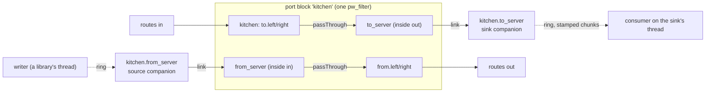

# Companions: slice 3b of the node framework

Status: design, not built. Slice 3b follows slice 3a (the lifecycle, built 2026-11-09) and comes before slice 3c (node
primitives, `node-primitives.md`), because companions remove two of 3c's would-be primitives (feeds and late handoffs)
and a third's use (sendspin's bell). The built system this page changes is described in `docs/architecture.md`,
`docs/engine.md`, `docs/writing-a-node-type.md`, `docs/control-port.md` and `docs/output-records.md`; this page cites
them for what exists and says only what 3b adds or changes.

[V] = verified in the code or PipeWire source named, as of this page's writing (2026-11-09); [U] = unverified, with the
test that checks it.

## 1. The owner's words that bind this slice

The R numbers are the register the node framework's design used (kept so commits and code comments still resolve).

| # | The owner's words | Date | What it means here |
|---|---|---|---|
| R6 | "in a general purpose sources-and-sinks graph, its always just 'running'" | 2026-10-29 | A companion never makes a block stop processing; every ring companion processes from creation, linked or not |
| R14 | "G4 is asking the wrong question. The node audio threads should be concerned with reading inputs and writing outputs. The framework should provide the necessary primitives to connect inputs/outputs across nodes AND anytime a node needs to cross inputs/outputs to non-realtime code (eg pipe outputs through a mailbox?)" | 2026-11-08 | A type's realtime code reads `Io` inputs and writes `Io` outputs, nothing else; every crossing to or from non-realtime code is the framework's |
| R16 | "I like the basic shape of the state machine proposal. And most importantly: it should be per-node. Some node stopping/reconfiguring/failing does not effect the graph globally" | 2026-11-08 | A companion's failure fails only its node; its barrier is its own |
| R18 | "crossing to a non-rat [non-realtime] thread could be managed by allowing a node to internally pipe its inputs/outputs to a hidden node, to maintain the integrity and consistency of the processing graph" | 2026-11-08 | Companions: hidden engine nodes linked to a node's inside banks |
| Q28 (gate C2) | Asked what the editor shows of a node's hidden helpers: "(a)", as recommended: small badges in the node's box, one per helper, its kind and a dot for ready, its drop count on hover | 2026-11-08 | 3.8 |

## 2. What slice 3a left

Slice 3a built the lifecycle with exact interim calls for everything 3b makes real ([V], `lifecycle.hpp`, `sink.hpp`,
`node_host.cpp`, `port_blocks.cpp`, `handoffs.cpp`):

| Interim, as built | Where | What 3b does |
|---|---|---|
| The sink's realtime side is inside the block: the block writes each sink's inside output bank into a `FrameRing` after the code, from `SinkTap`s carried in the drive request (`DriveRequest::sinks`) | `port_blocks.cpp`, `ThreadSinks` (`handoffs.cpp`, a `pw_thread_loop` per sink) | moves behind a ring companion's own `pw_filter`; `DriveRequest` loses `sinks` |
| Every drive and silence is applied inside its data-loop invoke, between two cycles, and the block publishes `takenAt`, the next expected position | `PortBlock::drive`, `takenAt()` | a block with a companion defers take-up to a published cycle (3.4) |
| `Chunk::upstreamFrames` is always 0 | `sink.hpp` | sampled from the block's carried latency |
| `cx.soundCard(bank, SoundCardRequest)` and `cx.rtpReceiver(bank, RtpReceiverRequest)`, the bank filled from the handle | `lifecycle.hpp` | take shapes (`SoundCardShape`, `RtpReceiverShape`) and become companion kinds |
| `rtp` declares `latencyMs` itself with `cx.declareLatency(fromRtp, stream, ...)` | `src/nodes/rtp/rtp.cpp` | the receiver kind declares it on its link; `rtp`'s line goes |
| A card whose PCM never runs, or an RTP receiver on a port another program holds, leaves its node `configuring` for good (`waitingFor` `companion` after 2 s, a `still` record every 10 s) | `NodeHost` | each engine companion kind gets a readiness deadline; missing it is a loss |
| No source companion: `sendspin`'s feed, mailboxes and bell are its own realtime code, behind the legacy adapter | `src/nodes/sendspin/` | the source companion is built and tested here; `sendspin` moves onto it in 3c |
| A barrier overdue at 5 s marks the data loop wedged at once (a barrier is applied in its invoke, so an unapplied one means the invoke never ran) | `NodeHost` 5 s bound | with take-up deferred to a cycle, a barrier can be pending without the loop being stuck: a no-op probe invoke confirms the wedge (3.4) |
| `quantum-limit` is `max(block, 8192)` and companions may carry `node.force-quantum` and friends | `engine.cpp` | the limit at the block size; force properties stripped (3.6) |
| Companions are invisible on the wire and in the editor | `ear_control`, `web/` | feature `companions` (3.7) |

## 3. The design

### 3.1 The rule

A type's realtime code reads `io[input]` and writes `io[output]` (R14). When audio must leave the realtime thread (to a
file, a network library) or come in from a non-realtime thread (a decoder, a program), the type declares an inside
bank and asks in `configure` for a **companion** on it. The framework makes a hidden engine node, links it to that
bank's ports channel for channel, inside the processing graph, and owns its realtime side, its ring and its wakes. The
type's code is a `passThrough` between its public banks and its inside banks (or its own code for audio it makes or
changes); it never touches a ring. Cards and RTP receivers already work this way since slice 2 (the framework's
pass-through between inside and public banks); 3b makes them, the sink and the new source one concept with one join.



### 3.2 The kinds, a closed list

A kind changes what the framework promises, so the list is a closed `std::variant` in core; each kind has one adapter
in `ear_pipewire`.

| Kind | Family | Joins | Engine name | Realtime side | Non-realtime side | Ring | Drops | Latency it declares on its link | Asked by |
|---|---|---|---|---|---|---|---|---|---|
| Sound card playback, capture | engine | an inside output (playback) or input (capture) bank | `<node>.playback`, `<node>.capture` | PipeWire's ALSA adapter | the card | the card's buffer | the card's | what the adapter reports | `cx.soundCard(bank, SoundCardShape{card, direction})` |
| RTP receiver | engine | an inside input bank | `<node>.rtp` | `libpipewire-module-rtp-source` | the network | rtp-source's | rtp-source's | `latencyMs` (rtp-source reports none) | `cx.rtpReceiver(bank, RtpReceiverShape{...})` |
| Sink | ring | an inside output bank | `<node>.<bank>` | ear's `pw_filter`: copies each cycle into its ring, interleaved, with the cycle's stamp | a `SinkConsumer` on the sink's own thread, which may block on I/O | frames the type gives (`file`: 2 s) | a full ring drops frames and counts them (the node's `dropped=`) | none | `cx.sink(bank, SinkShape{frames}).consumedBy(...)` (unchanged from 3a) |
| Source | ring | an inside input bank | `<node>.<bank>` | ear's `pw_filter`: plays its ring into its output, zeros when empty | a `SourceWriter` held by a loop's state or a library's thread; it may wait for room | frames the type gives | an empty ring plays zeros and counts the frames short (`shortfall`) | `[0, capacity]` | `cx.source(bank, SourceShape{frames})` |

Later kinds, each designed with its slice: the paced source (`programs.md`, slice 9), an RTP sender and a
PipeWire-socket program's nodes (engine companions, not designed).

- **Names.** Engine companions by kind, ring companions by their inside bank. A node's name has no `.`, so a companion's
  name never equals a node's, and `LiveGraph`'s lookups by node name for routes never match one. One configuration
  names each engine object once (built: `NodeHost` checks it).
- **Hidden, not secret.** A companion is never in the desired graph, never named by a route, and not metered (only
  public ports are). The wire lists it under its node (3.7).
- **One lifecycle for every kind** (built for cards and receivers as `joinOutsideNode`, `outside_nodes.cpp`): asked
  for in `configure`, made once the block is ready, running alone until its body says it runs, then one link per
  channel joins it by global id to the block's inside ports; ready once every link is active; on any failure its links
  and node are torn down before it is reported lost, so the node fails `engine-refused: <detail>` and keeps its block
  and wires. A ring companion's `pw_filter` is made as a block is (in `ear.graph`, always processing), so the dummy
  driver drives it from creation and it reaches RUNNING unlinked, which is what lets the one join join it [U: 3.9's
  test].
- **Teardown.** Destroyed at the teardown's second step (after the barrier, which disarms it by position, 3.4); a sink
  then drains its ring to its consumer and calls `finish` on its own thread (third step); its ring is freed on the main
  loop last. The order is the built teardown's (`docs/architecture.md`), with companions where outside nodes are now.

### 3.3 The ring companions' contract

**A sink delivers stamped chunks.** The consumer API is 3a's and does not change (`sink.hpp`, [V]):

```cpp
struct Chunk { std::span<const float> interleaved; std::uint32_t frames; std::uint64_t position;
               std::int64_t startNs; std::int64_t startRawNs; std::uint32_t upstreamFrames; bool discontinuity; };
class SinkConsumer { public: virtual ~SinkConsumer() = default; virtual void begin() {}
                     virtual void consume(const Chunk&) = 0; virtual void finish() = 0; };
```

From 3b `upstreamFrames` is real: the latency upstream of the node's public input bank that feeds the sink, which the
block already carries per bank pair, sampled per cycle. So a consumer dates what it got without a mailbox: the instant
the chunk's first frame entered the graph is `startRawNs - upstreamFrames * 1e9 / rate`. `discontinuity` keeps its
built meaning (the first cycle after any drive, a new driver, a position jump, or a cycle too large to run); a
consumer that must tell a real gap from a re-drive compares `position` with the last chunk's end. `begin` runs once on
the sink's thread before the node is `configured` (built, readiness step 4').

**A source plays what its writer gives, and keeps time.** Its writer is the framework's (3c's loops and library threads
call it); this page is its home:

```cpp
// ear/core/source.hpp (3b)
struct SourceShape { std::uint32_t frames; };
struct Played { std::uint64_t totalFrames; std::int64_t heardRawNs; };
class Wake { public: virtual void ring() noexcept = 0; protected: ~Wake() = default; };   // 3c's loops watch it
class SourceWriter {
public:
	/// One writing thread at a time (3c's hand-over rule): a dedicated loop or a library's thread, never a strand. Up to
	/// `frames` frames; with no room waits up to `patience`. Returns frames accepted.
	virtual std::uint32_t write(std::span<const float> interleaved, std::uint32_t frames,
	                            std::chrono::milliseconds patience) = 0;
	/// The same thread: waits `patience`, accepting nothing (a writer with nothing to give that must not spin).
	virtual void idle(std::chrono::milliseconds patience) = 0;
	/// Any ordinary thread: what was written so far is gone at the next cycle, not counted played.
	virtual void clear() noexcept = 0;
	virtual bool closed() const noexcept = 0;
	virtual std::uint32_t capacityFrames() const noexcept = 0;
	virtual Played played() const noexcept = 0;
	virtual Wake& playedWake() noexcept = 0;
protected:
	~SourceWriter() = default;
};
```

- **Keeping time** (decided, D-C4). On a cycle whose position jumped ahead of the last one's end by no more than its
  capacity, a source skips that many frames and counts them played, so the audio moves on with the graph (sendspin's
  rule today, `sendspin_code.cpp`). A larger jump is a new clock, not a skip. Since `engine.conf`'s `resync.ms`
  (2026-11-09) the position never steps back; a stall's catch-up skips whole blocks forward, which this rule absorbs.
- **Fades at its edges, without a lookahead** (D-R11). It keeps no audio back, so its declared latency stays
  `[0, capacity]`. After `clear` it plays the next 5 ms of what its ring holds, faded to zero, counts those frames
  played, and drops the rest. At an underrun (the ring dry, the writer not idle) it decays from the last sample it
  played to zero over 5 ms. When audio comes back it fades in over 5 ms. So sendspin's stream ending (`clear` on
  `on_stream_end`) fades out, in framework code (R14).
- **Says what played.** After each cycle that played or skipped frames it publishes `Played{totalFrames, heardRawNs}`,
  `heardRawNs` being the cycle's `startRawNs` plus the frames it played and the most downstream latency of its link,
  and rings its played wake, at most once until answered. The downstream latency is what the block's pass-through
  carries back from the node's public bank: a following card's buffer reaches sendspin's dating with no code of
  sendspin's. See 3.4 for when a cycle counts as played.
- **Closing.** The framework closes the writer at the teardown's first step. A `write` or `idle` already waiting wakes
  and returns 0 at once; one that begins after the close accepts nothing and waits out its whole patience, so a library
  thread that calls in a loop (sendspin-cpp's sync thread, 20 ms) sleeps between calls and never spins. The wait is a
  `poll` on an eventfd nothing writes after the close.
- **Stopped.** A stop disarms the source (3.4) and clears its ring (counted as dropped), so a start never plays audio
  written before it; its writer waits for room or idles as at a full ring.
- **Wakes.** A sink wakes its thread when its ring holds frames, at most once per cycle (`pw_loop_signal_event`, as
  built); a source wakes a writer waiting for room. `Wake` is declared in core in 3b; its eventfd implementation lives
  with the source in `ear_pipewire` until 3c's `ear_runtime` has `EventWake` and `Loop::onWake` to watch it. No type
  uses a source before `sendspin` moves in 3c, so the played wake needs no interim descriptor.
- **The sink's thread stays where it is.** `ThreadSinks`' `pw_thread_loop` per sink (`ear_pipewire`) keeps draining
  the ring; only the writing side moves into the companion's `pw_filter`. (The framework design put the sink's thread
  in a new `ear_runtime` package from 3b; as built the thread is a `pw_thread_loop` and works, so 3b does not create the
  package. `ear_runtime` arrives with 3c's loops, and the source's eventfd moves there then.)

### 3.4 Arming by graph position

A cycle is not one dispatch: each client-node follower is woken by its own eventfd, so an invoke can run after the
block processed a cycle and before its sink did. So no invoke arms a companion (D-R3). Instead the block takes up every
change of what it drives (a code at a start, a swap in 3d, a silence at a stop or a teardown) one cycle after it sees
it: seeing it while processing the cycle at position `P - 1`, it publishes `P` (one atomic word per block, written
after its `process`) and applies the change at `P`. Every companion compares its own cycle's `clock.position` with
what the block published:

- a **sink**, which runs after the block, takes a cycle's frames only when the block drove that position (`drivenAt`,
  published per cycle); at a swap (3d) the replaced sink takes positions below the swap's `P`, its replacement those
  from it;
- a **source**, which runs before the block, plays and reports `Played` only for positions inside the window the block
  published (`armedFrom`, `armedUntil`); outside it, it consumes nothing, plays zeros and says nothing played.

So a sink records exactly the cycles the code drove (no leading loss, no trailing zeros), and a time filter is never
told of frames nobody heard. A start costs one cycle more than 3a's in-invoke take-up, about 5 ms.

**What 3a's spike S2 found, and the rule it forces** (step L-0, 2026-11-08, `src/pipewire/tests/spikes_test.cpp`):
in every cycle that a block, its upstream and its downstream all ran, they saw one position and ran in link order; the
take-up was exact sample for sample under an invoke storm of about 490,000 a second. But **a cycle an xrun cuts short
is run by an upstream prefix of the graph only**: 1 to 17 cycles a run on an idle host, 500 to 4,600 on a loaded one,
were run by the upstream probe alone, or by it and the block, never by a downstream node without its upstream. A sink
is downstream of its block, so it is safe: it never runs a cycle its block skipped. **A source is upstream of its
block, so it can run a cycle its block never runs.** 3b therefore either:

1. **(proposed)** makes a source's play provisional: it plays cycle `P` and holds `P`'s frame count; it commits them
   to `Played` (and rings its wake) only once it sees, in a later cycle, that the block ran `P` (the block publishes the
   last position it ran, one more atomic word); if the block did not, those frames were heard by nobody and are
   counted as skipped, not played. The time filter is then never told of a cycle the block dropped, at the cost of one
   cycle's delay in `Played`; or
2. takes the fallback D-L25: ring companions keep their realtime side inside the block (the sink as 3a built it, the
   source as framework code inside the block's `process`), and arming by position is dropped. The API does not change.

3b's first step is a spike of (1) on S2's harness (a source's ramp under an invoke storm and on a loaded host, every
cycle its block did not run counted as skipped); if it fails, (2).

The second fact S2 found, `clock.position` stepping back after the dummy driver's reset, is settled: `engine.conf`'s
`resync.ms` keeps the driver from resetting, so the position only ever moves forward. A pause of tens of seconds or
more still slews the graph for minutes (`docs/engine.md`), which this slice does not change.

**From 3b, take-up is deferred for a block with a companion.** Its drive's invoke records the request and the next
`process` publishes `P` and applies at `P`. A block leaving STREAMING with a change deferred applies it at once by an
invoke the main loop posts on that transition, so no request waits for a cycle that never comes (3a's guarantee kept).
And because a barrier can now be pending without its invoke having failed to run, the wedge is judged in two stages:
a barrier overdue at 5 s posts a no-op probe invoke, and the loop is wedged only if the probe has not run within a
further 1 s (D-L30). Every bound still calls `PortBlock::settle()` first. `PortBlock`'s interface does not change.

### 3.5 Engine companions: shapes and readiness deadlines

- `cx.soundCard(bank, SoundCardShape{.card, .direction})` and `cx.rtpReceiver(bank, RtpReceiverShape{...})` replace
  3a's calls over the requests. The bank handle names the bank (as built), the direction is checked against the bank's
  at compile time (an inside output bank takes playback, an inside input bank capture or a receiver), and a companion
  on a public bank does not compile (as built).
- **Readiness deadlines** (I3, "never ready, never lost" cannot last; D-R12): a sound card 10 s, an RTP receiver 5 s, a
  ring companion 5 s, each from its request. A companion past it is lost with its kind's reason, and the node fails
  `engine-refused`: `the RTP receiver never ran (port 5004 held?)`, `the card never started: <card id>`, `the sink
  <bank> never became ready`. The `waitingFor` `companion` member (built) shows the wait meanwhile. This turns AGENTS'
  "an `rtp` node on a held port stays configuring for good" into a failure after 5 s (a better reason for a held port
  comes with 3c's UDP claim and probe).
- **Latency.** Each companion declares its own latency on its link (the receiver its `latencyMs`, a source
  `[0, capacity]`, a card what its adapter reports), and the block's pass-through carries it to the public bank, as a
  card's is carried today. `cx.declareLatency` is left for a type's own code (a delay line). `rtp`'s call goes.

### 3.6 The quantum guard

The graph has one quantum and one rate, the driver's. The engine pins `min-quantum` = `max-quantum` = the block size
already; 3b also sets `quantum-limit` to the block size (built: `max(block, 8192)`, `engine.cpp`), and the companion
adapters strip `node.force-quantum`, `node.force-rate`, `node.lock-quantum` and `node.lock-rate` from every companion's
properties, so no node can change `clock.duration` for every block (whose `frames > maxBlock` path would write zeros)
(D-R10). [U: that cards and rtp-source run with `quantum-limit` at the block size; 3.9. If not, the limit stays and the
stripped properties are the guard.]

### 3.7 On the wire and in the editor (feature `companions`)

The wire's frame (protocol 1, `features`) is built (`docs/control-port.md`). 3b adds the feature `companions`:

- **Each node** in snapshots and `node.added` carries `companions: [...]` (`[]` before it is configuring, or for a
  type with none). An entry: `name` (the engine node's), `kind` (an open set: `card-playback`, `card-capture`,
  `rtp-receiver`, `sink`, `source`; slice 9 adds `paced-source`), `bank` (the inside bank it joins; inside banks appear
  nowhere else on the wire), `ready`, and by kind `dropped` (a sink: frames its ring had no room for since the node was
  configured) or `shortfall` (a source: frames played as zeros while its writer was not idle). 3d adds `retiring`.
- **`node.companionsChanged {name, companions}`**, the whole list, whenever an entry is added or removed or its `ready`
  changes, and when a counter changed, sampled at most once a second per node (K1). A teardown empties the list. Order:
  a list that shows a companion ready precedes the `node.state` its readiness allowed; a `node.state` is never held
  back for it (a failure is told at once).
- **Never**: a route naming a companion is refused (`invalid-name`, as built for a name with `.`); levels never carry
  one; `graph.get`'s `nodes` never lists one.
- **Standard output** has no record per companion: a lost one fails its node, whose `node` record names it in the
  failure's detail. Two new observation diagnostics (`diagnostic` records; on the wire only once slice 5 adds
  `node.diagnostic`): `ear.sink-dropped` (subject the companion, `frames` since the last, `totalFrames`) and
  `ear.source-shortfall` (the same), each at most once per 10 s per companion while it drops (K2). The `removed`
  record's `dropped=` stays the sum over the node's sinks (built).
- **The editor** (the owner's Q28): a badge per companion along the box's bottom edge, its kind as a short word (`card
  out`, `card in`, `rtp`, `sink`, `source`) and a dot filled when `ready`, hollow when not, with "ready" or "not ready"
  as its accessible text; the tooltip and panel give the engine name, the bank and the counter ("rec.writer: 4096
  frames dropped since it was made"), and a counter above zero puts a small warning mark on the badge. No companions,
  no strip (`white`). A failed or disabled node's strip is empty (its configuration was torn down); a stopped node's
  stays (it keeps its companions). Companions never take part in selection, dragging, deletion or route-making.

## 4. What it changes in the built system

| Built piece | Change |
|---|---|
| `PortBlock` (`node_host.hpp`), `FilterPortBlocks` | deferred take-up for a block with a companion: `drivenAt`, `armedFrom`/`armedUntil`, the last position run (3.4); the pending request applied on leaving STREAMING; `DriveRequest::sinks` and the block's sink writes go |
| `SinkTap`, `SinkBinding` (`sink.hpp`) | go with the in-block writes; `Chunk`, `SinkConsumer`, `SinkShape`, `cx.sink`, `consumedBy` unchanged |
| `ThreadSinks` (`handoffs.cpp`) | its ring is written by the sink companion's `pw_filter` instead of the block; its thread and drain stay |
| `joinOutsideNode`, `AlsaSoundCards`, `RtpReceivers` | kept; renamed to companions; a ring companion's `pw_filter` joins by the same code; adapters strip force properties; `RtpReceivers` declares `latencyMs` |
| `SoundCardRequest`, `RtpReceiverRequest`, `OutsideAdapter`, `OutsideNode`, `OutsideNodeEvents` | become the engine companions' shapes and adapters (`Companion*`) |
| `ResourceRegistry` | gains the source adapter |
| `NodeHost` | readiness deadlines per kind; the wedge's probe stage; companions' view for the wire; sink counters sampled |
| `card`, `rtp` | their `configure` calls change (shapes); `rtp`'s `declareLatency` line goes. `file` and `white` do not change |
| `engine.conf`, `engine.cpp` | `quantum-limit` at the block size |
| `TypeHarness` | the companion fake gains a source ring (`h.feed(bank, interleaved)`, `h.companion(bank).played`), readiness deadlines on the harness's clock; sinks' chunks carry `upstreamFrames` |
| `ear_control`, `web/` | feature `companions`; `companions` on nodes, `node.companionsChanged`; badges |
| `sendspin` | unchanged: it stays on the legacy adapter until 3c moves it onto a source and a sink |

## 5. Tests

- **The same-cycle ramp** (`ear_pipewire_tests`): a ramp written to a source arrives at the node's public output with
  no offset in position, and a ramp at the node's input reaches the sink's chunk stamped with the position it was
  played at, so a companion adds no quantum of latency [U until this test passes].
- **Arming under an invoke storm** (S2's harness, kept `RUN_SERIAL`): a source and a sink across 1,000 starts and
  stops, the ramp exact at every take-up, and the provisional-play rule of 3.4 counting every cycle the block did not
  run as skipped.
- **The source** on real threads: shortfall counted, time kept across a skip, played reports dated by downstream
  latency, the fade at an underrun and at a clear, a closed writer's caller sleeping (under 1% of a core over 2 s).
- **Scale**: 48 test companions beside a running ramp: the cost of one eventfd wake per client node per cycle, and a
  graph recalculation (a companion added and removed) never costing another block a cycle [U].
- **A ring companion reaches RUNNING unlinked** and is joined by `joinOutsideNode` [U].
- **Cards and rtp-source with `quantum-limit` at the block size** [U].
- **Readiness deadlines**: in `ear_core_tests` on the fake clock (each kind's bound, the node's failure text); a system
  test: an `rtp` node on a UDP port another socket holds fails `engine-refused` after 5 s (today it waits for good).
- **Wire**: `test/protocol/companions.json` (a snapshot with each kind; `node.companionsChanged` as companions become
  ready; counters moving; the list emptied by a teardown; kept across a stop and a start); `ear_core_tests` (a list per
  readiness change, `ready` before `running`, counters sampled not pushed, a closed configuration's list never sent); a
  system test: `graph.get` lists `rec.writer` ready while `rec` records, and a route naming `rec.writer` is refused;
  vitest for the badges.
- **Kept**: `file`'s exact-samples test, now through a real sink companion; `sink_test.cpp`'s ramp across a stop and a
  start.

## 6. Decisions already taken

| # | Decision | Why |
|---|---|---|
| D-R3 | Companions are armed by graph position, never by invoke | An invoke can land between a block and its sink within one cycle; the position is the one fact every node of a cycle shares |
| D-R4 | Every output the code writes is faded before a planned silence, inside banks feeding an engine companion included (built in 3a); a sink's bank is never faded, a recording is cut by position | A card's own speaker never clicks; a recording keeps exact samples |
| D-R10 | `quantum-limit` at the block size; force properties stripped from companions | One node's forced quantum would change every block's cycle |
| D-R11 | A source fades without a lookahead | No standing latency; `Played` stays the frames actually played |
| D-R12 | Readiness deadlines: card 10 s, RTP receiver 5 s, ring companion 5 s | I3: a node never waits for good on something that will never be ready |
| D-C4 | A source keeps time by default (skips what a stalled graph missed, counting it played) | Every network source wants it; written once |
| D-L25 | If arming by position fails for sources, ring companions' realtime side stays inside the block | The API does not change; 3a is unaffected |
| D-L30 | From 3b a barrier overdue posts a probe invoke and judges the loop wedged only if the probe has not run in a further 1 s | Deferred take-up means a pending barrier is not proof the loop is stuck |
| K1 | `companions` under each node, `node.companionsChanged`, counters sampled once a second; no framework status fields | Counts belong to the crossing that drops |
| K2 | `ear.sink-dropped`, `ear.source-shortfall` at most once per 10 s per companion | The operator learns of drops while they happen, at a bounded rate |
| C2 (owner, Q28) | Badges in the box, never boxes or handles | The owner's answer |
| new | The sink's thread stays `ThreadSinks`' `pw_thread_loop` in `ear_pipewire`; `ear_runtime` starts with 3c | It works as built; a package with one thread in it is not worth a slice of its own |

## 7. Open questions and risks

- **The xrun prefix** (3.4): the provisional-play rule is unproven; the fallback is D-L25. 3b's first step decides.
- **Cost of engine nodes.** Each crossing is one engine node and one copy of each sample per cycle: `file` runs two
  engine nodes, and `sendspin` will run three from 3c. A stereo copy is about 1 µs at 48 kHz and 256 frames; PipeWire's
  per-node scheduling costs more [U: measured here with 48 test companions, again in 3c with 16 `sendspin` nodes, and
  on the Talos CPU once known].
- **A start costs one more cycle** (about 5 ms) under deferred take-up.
- **Two sources into one inside input** (3d's make-before-break) rely on PipeWire's port mixer loading for DSP client
  nodes through its `library.name` fallback, since `engine.conf` maps no `audio.mixer*`; 3d checks it, but 3b's ring
  companions should not preclude it.
- **The readiness deadlines** are first choices: a USB card that takes longer than 10 s to start fails, and is retried
  only by `node.start`, `node.restart` or a change until slice 8's recovery.
