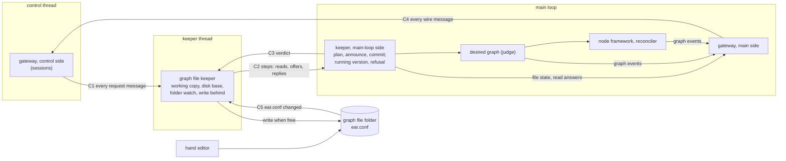

# Knobly graph file: module design

**Status:** module design record v7, 2026-10-31. It covers the lighter scope the owner picked at sizing: one background thread, and `ear.conf` as the only file. It sits beside `batch2.md` and builds on the owner's answers in `docs/design/knobly-config-notes.md`.
**Layer:** System · **▶ Module** · Feature
Every shape below is a current choice and can be revised. Signatures and mechanisms belong in the code architect's slice pages.

## Requirements

| # | Requirement | Source |
|---|---|---|
| R1 | "use the mcurcio/knobly project as the config language" | Owner, 2026-10-30, chat |
| R2 | "enable bi-directional config edits in real-time via the UI" | Owner, 2026-10-30, chat |
| R3 | "in a general purpose sources-and-sinks graph, its always just 'running'" | Owner, 2026-10-29, `pipewire-graph.md` |
| R4 | "The control port shouldn't run in the PipeWire context, because it will not be real time" | Owner, 2026-10-30, `batch2.md` |

His flow (2026-10-31, gate note): "open the file and get a graph object; watch the graph object for changes (from direct writes); when app wants to make a change, manipulate the graph object; background thread periodically flushes the graph object back to disk".

- **Answers this design builds on.** These are picks among offered options, so they are current choices: the keeper runs on its own thread; "periodically" means after each change; when a hand edit collides with edits not yet written, the hand edit wins; a file with errors at boot starts ear with nothing running; the pane is editable now; edits are made at the source; knobly is the only format. At sizing he picked: the keeper, the writer and the file watch share one background thread; `ear.conf` is the only file, `@set` and snippets work, and `@include` is refused with a clear message until a later batch; the `--graph-frequency` and `--block-size` flags (default 48000 and 256) are used only when the file cannot be read or lacks those two settings.
- **Our reading, to restate to him:** knobly has no way to report changes or watch a file, so "from direct writes" is read as hand edits to `ear.conf`. The background thread notices them and brings them into the graph object.

### New terms

| Term | Meaning | Could be |
|---|---|---|
| graph file | `ear.conf`, the one file (no includes yet) | graph file (kept) |
| graph file folder | The folder named by `--config-dir`, which holds `ear.conf`. It may not overlap the recordings folder or the web root | the recordings folder's opener, shared |
| graph file keeper | The module on the background thread: it owns the working copy, writes it to disk and watches the folder | "loading `ear.json`" |
| working copy | knobly's graph object of `ear.conf` as ear holds it; it can be ahead of the disk | knobly's "graph" |
| candidate | A fresh load of the working copy's text with one edit applied | none |
| verdict | The desired graph's answer to a candidate: accepted, or refused with a `CommandError` | `CommandError` |
| disk base | `ear.conf` as ear last read or wrote it | knobly's "saved text" |
| version | An opaque tag that changes whenever the text changes | none |
| diagnostic | A problem in the text: severity, code, message and place | error |

## Module map and threads



| # | Crossing | Carries | Who waits | Order kept |
|---|---|---|---|---|
| C1 | control → keeper | every message received, with a batch sent whole: `graph.*`, `node.*`, `route.*`, `graphFile.*` | nobody; one message is in flight per connection, as today | arrival order, one step at a time |
| C2 | keeper → main | one step: the reads that are due, then at most one offer (a candidate's wanted graph, where each wanted item is written, the text, the cause), then the reply if this is the batch's last step | nobody. The keeper takes no new step until this one is done, but never blocks its thread | main-loop post order |
| C3 | main → keeper | the verdict: accepted, refused or stopping | nobody | the keeper keeps or drops the candidate, then takes its next step |
| C4 | main → control | every message to a client | nobody | per step: `graphFile.changed`, then the node and route events it causes, then the reply |
| C5 | kernel → keeper | a change in the folder that names `ear.conf` | nobody | a disk check, queued behind the steps already waiting and judged by content |

Packages: `ear_folder` ← {`ear_nodes`, `ear_config`}; `ear_control` ← {`ear_server`, `ear_config`}; all of them ← `ear`. `ear_control` declares both interfaces at its edge: the one the gateway sends requests to, and the file-state listener the gateway implements. So `ear_control` never sees knobly.

## Design rules (design choices)

> **1. The working copy leads; the disk wins; one judge of the disk.** An edit changes the working copy, the running graph follows once the edit is accepted, and `ear.conf` is written afterwards. Only the keeper decides whether the disk changed, by comparing the disk with the disk base. It starts watching the folder before it reads, and a write swaps its new text in and keeps it only if the text it replaced is the base. Any difference counts as a disk change, whatever caused it: the keeper reloads, and accepted edits not yet written are dropped and counted.

> **2. Judge before keep, on a fresh load.** Each editor or pane edit is a candidate. It becomes the working copy only if the desired graph accepts it, so nothing refused is kept or written, and an edit cut short leaves the working copy whole. A hand edit cannot be refused away: the working copy follows the disk, and the graph keeps its last accepted version (R3), with the reason shown.

> **3. One thread, one step at a time; one way out.** Requests, verdicts, disk checks and writes all run on the keeper's thread in arrival order. While an offer waits for its verdict, nothing else is taken. A write runs only when no step is waiting, so quick edits share one write. Every message to a client leaves the main loop through the gateway. So a snapshot is never older than a change it races, a file change always comes before the graph events it causes, and a stale copy is never written.

## Contracts

| Module (thread) | Takes | Gives | Never |
|---|---|---|---|
| **Graph file keeper**, new `ear_config` (keeper thread) | C1 requests; C3 verdicts; C5 disk checks | Steps on the main loop, in order: a batch's reads are answered together, and its one reply follows its last step. Candidates edited at the source. knobly's diagnostics and ear's own. Its own refusals (`file-invalid`, `shared-definition`, `file-changed`, `invalid-text`, no such line). Pending restart, worked out from the file's two settings against the engine's. `ear.conf` written when it is free, and kept only if the disk still held the base | judging a graph; letting a knobly object leave its thread; timers |
| **Keeper, main-loop side**, `ear_config` (main loop) | C2 steps | For an offer, in one turn: plan; if accepted (or caused by the disk), the file state; if accepted, commit; then the reply and C3. For a read: the answer from the desired graph and its own record | parsing text. It is the desired graph's only editor, and the one holder of the running version and the last refusal |
| **Confined folder**, new `ear_folder` (any thread) | a folder opened at boot | Reads, and replace-if-unchanged, of regular files beneath the folder that no symlink leads to; the recordings folder's create, unchanged | following `..` or absolute paths. At boot it refuses folders that overlap |
| **Desired graph**, changed (main loop) | `plan(nodes, routes)`, `commit(plan)`, `close()` | A plan or a `CommandError`. Commit's events come in a fixed order: routes removed, nodes removed, nodes updated, nodes added, routes added. A port change is a replacement | files, knobly, versions, the engine's format |
| **Node catalogue**, changed (fixed after boot) | each type's settings | the kind of each setting (text or whole number) | knobly |
| **Gateway** (both sides) | control side: requests, sent whole to the keeper; main side: file states, read answers, graph events, replies | one ordered stream to the control thread | graph or file state on the control thread |
| **Editor**, `web/` (browser) | `graph.*`, `graphFile.*` | A text pane with diagnostics and Save; a notice when edits were dropped | parsing knobly |

## Data flow

| Data | Written by | Read by |
|---|---|---|
| `ear.conf` (disk) | the keeper (accepted versions only); hand editors | the keeper (at boot, on watch events, at each write's compare) |
| Disk base | the keeper | the keeper |
| Working copy: text, version, diagnostics, unwritten edits, write state | the keeper | the keeper; plain copies go out in C2 |
| Wanted nodes and routes | the desired graph, by commit only | node framework, reconciler, `graph.get` |
| Running version, last refusal | the keeper's main-loop side, from each plan | the file state on the wire |
| Pending restart | the keeper, from the file's two settings | the file state on the wire |
| Wire messages | the gateway, on the main loop | the control thread, then the editors |

## Boot and stop

| Boot (waits once, for the first load) | Stop (SIGTERM; waits on the disk only after the recordings are safe) |
|---|---|
| 1. Open the graph file folder and the recordings folder. If they overlap each other or the web root, exit 1 | 1. `close()`: every later plan answers `stopping` |
| 2. The main thread reads `ear.conf`. A missing or unreadable file reads as one error | 2. The main loop posts "stop" to the keeper behind every verdict: queued edits get `stopping`, and reads are still answered |
| 3. The engine's rate and block size come from the file's two settings when both read. Otherwise they come from `--graph-frequency` and `--block-size` (default 48000 and 256), and the file's own values show as pending restart once they read | 3. `stopAll` (WAV files finished), then the 1001 close; then the control thread stops and the loop quits |
| 4. Engine and wiring. The keeper thread starts, watches the folder, reads again, and posts the first offer, planned from empty: it is committed, or nothing runs and the editor shows why. 5. The control port starts | 4. The main thread joins the keeper, which first writes the last accepted version. A failed write is printed |

**Q1. At boot, the file reads but the graph refuses it (a route to a port that does not exist).** Current choice (recommended): treat it like a file with errors, so nothing runs and the reason is shown. Alternative: exit 1 as today (the pane cannot fix it then).

## Wire additions (to `batch2.md` section 6)

```ts
type GraphFileGet       = { method: "graphFile.get" };        // result: GraphFile
type GraphFileSubscribe = { method: "graphFile.subscribe" };  // result: GraphFile, then every graphFile.changed
type GraphFileSet = {
  method: "graphFile.set";      // result: {} once the graph runs it
  params: { text: string;       // ear.conf's whole new text
            version: string };  // the GraphFile.version the text was based on
};
type GraphFileChanged = {
  method: "graphFile.changed";
  params: GraphFile & {
    cause: "edit"               // an editor or pane edit, from any client
         | "disk"               // ear.conf changed on disk; ear reloaded it
         | "write";             // writeFailed was set or cleared
    droppedEdits?: number;      // disk only: accepted edits not yet written, now gone
  };
};
type GraphFile = {
  version: string;
  text: string;                 // ear.conf's text; "" when it is missing or cannot be read
  diagnostics: Diagnostic[];    // any error means the file does not apply
  running?: string;             // the version the graph runs; absent: none yet
  refusal?: Refusal;            // the desired graph refused `version`
  pendingRestart: ("graphFrequency" | "blockSize")[];
  writeFailed?: string;         // the disk refused the last write
};
type Diagnostic = {
  severity: "error" | "warning";
  code: string;                 // knobly's ("E2001") or ear's ("ear/include-unsupported")
  message: string;
  line: number;                 // from 1
  column: number;               // from 1, in UTF-16 code units (the browser's)
};
type Refusal = { code: string; message: string; line?: number; column?: number };  // code: the desired graph's data.code
type GraphFileErrorCode =       // new data.code values
  | "file-changed"              // graphFile.set: version is stale
  | "invalid-text"              // graphFile.set: the text has errors (data.diagnostics)
  | "file-invalid"              // a node.* or route.* edit while the file has errors
  | "shared-definition";        // the line also makes other nodes or routes (data.line, data.column)
```

## File format

```conf
graph_frequency 48000;
block_size 256;
@set $ch 2;                      # comments survive every edit
@snippet card_out $id {          # written once, used by both cards
    card $id;
    playback $ch;
}
node white noise;
node file rec { path "take1.wav"; }
node card desk { @use card_out MOTU; }
node card porch { @use card_out USB2; }
route noise:MONO rec:FL;
route noise:MONO desk:playback_1;
```

- Setting `playback 4` on `desk` rewrites `@set $ch 4;`, which replaces both cards in one commit. Setting `card` on `desk` rewrites only `MOTU` on its `@use` line.
- Removing `playback` from `desk` is refused (`shared-definition`), because that line sits in the snippet both cards use.
- `@include "more.conf";` is the error `ear/include-unsupported`: "@include is not supported yet: write the whole graph in ear.conf".
- `node.*` and `route.*` keep their parameters but edit at the source. `ports-changed` is gone: a port change replaces the node. `node.remove` removes the node's line and every `route` line that names it.
- Only ear's directives are allowed (`graph_frequency`, `block_size`, `node`, `route`). Each setting is read and written as the kind its node type declares.

## Costs and deferrals

- **Accepted edits not yet written can be lost:** on a crash; when a hand edit lands first (his pick); and to an editor that writes in place while it holds the file open. If the graph then refuses the hand edit, it keeps playing the dropped edit, and `running` names a version that no file holds.
- **An edit can wait a few milliseconds behind a write** (the cost he accepted for one thread). Boot and stop wait on the disk with no deadline. A failed last write reaches only standard output.
- **A write swaps its text in before it compares.** When a hand save races it, a reader can see ear's text for an instant before the hand text is put back.
- **Every edit costs a full parse and sends the whole text to every subscriber.** A client's 256-message queue now holds whole texts, so a slow client is closed (1008) sooner. A text over about 64 KiB cannot be saved from the pane. Graph edits are blocked (`file-invalid`) while the file has errors.
- **Building knobly** (decided at the full-scope cut): a pinned commit carries no generated headers. So a throwaway Docker stage runs knobly's own release script, which needs python3, uv and a clang-format download, at image build only. Configure needs none of them. A Linux build outside the image sets `EAR_KNOBLY_DIR`.
- **The image needs a writable volume for the folder**, so a ConfigMap mount no longer works. A first boot without `ear.conf` runs nothing until the pane writes one. Memory exhaustion through the open port stays (his accepted risk; knobly's kno-2w4 is open).
- **The include batch will change the wire:** `text` becomes one text per file.

**Deferred:** `@include` (its files, their watch, keeping include paths inside the folder, writes that span several files, a text per file on the wire); a separate writer thread, so an edit never waits on a write; showing where a value is defined; editing one copy of a snippet; a "saving" indicator; a login; changing graph frequency live; undo.
**Not planned:** knobly in the browser; JSON compatibility; merging concurrent edits.

**Prior art:**
- One thread (an actor) owns the working copy.
- Writes are batched when the queue empties (group commit).
- Changes are built aside and swapped in on success.
- A file compare-and-swap through `renameat2(RENAME_EXCHANGE)`.
- Watch, then read: inotify's version of Kubernetes' list-then-watch.
- nginx's reload; PostgreSQL's `pending_restart`; HTTP `If-Match`; VS Code's "file changed on disk".

## Tracer bullet

1. ear boots from the file above. `white` records to `rec`. The cards fail with `engine-refused` but stay in the graph.
2. The editor sets `path "take2.wav"` on `rec`. The wire carries `graphFile.changed` (cause `edit`), then `node.updated`, then `{}`. The file is rewritten afterwards with its comment kept, and the watch event for ear's own write changes nothing.
3. An editor edit is accepted, and a hand edit lands before it is written, either before the write starts or at the swap. The wire carries `graphFile.changed` (cause `disk`, `droppedEdits: 1`), and the graph moves to the disk's version. This is proven in the keeper's own tests, which step its thread by hand. Through `out/ear`, a hand edit wins without the race.
4. A typo made by hand gives diagnostics and leaves the graph unchanged. A `node.update` is then refused with `file-invalid`.

It proves the one thread, the one disk judge, the collision rule and the invalid-file rule. Non-goals: pane Save, pending restart, a port change replacing a node, boot without a runnable file. Later slices prove these through `out/ear`, along with the folder's limits: `ear.conf` as a symlink out, an `@include` out, and overlapping folders.

## Reconcile with existing code

| Today | Becomes | Cost |
|---|---|---|
| `graph_file.hpp`, `replay` (frozen in m1) | deleted. Boot reads `ear.conf` on the main thread, and its first offer is planned from empty | erratum in `m1-white-to-file.md` section 2 |
| `GraphControl`'s five edit calls; `PortsChanged` | `plan` and `commit`; a port change replaces the node | erratum in `batch2.md` section 4; the core and session tests are rewritten |
| `MainLoopGateway` built on `GraphControl`; a batch is one main-loop task | Its control side sends every message to the keeper. It is still the one crossing to the control thread | `batch2.md` sections 6 (batch rule) and 11; `commands.hpp`, `events.hpp` |
| `RecordingsFolder` in `ear_nodes` | `ConfinedFolder` in `ear_folder`, shared by both folders. The recordings folder keeps today's rules | one module, two users |
| `--config ear.json`; a read-only mount in the image; "a route to an undeclared port exits 1" | `--config-dir` on a writable volume, plus `--graph-frequency` and `--block-size`. A boot without a runnable file runs nothing and shows why (Q1) | Talos manifest, image smoke test, skills, a system test |

*History: v1-v3 gate drafts 2026-10-30; v4 gate answered 2026-10-31; v6 full scope reviewed 2026-10-31; v7 is the lighter scope picked at sizing (one thread, `ear.conf` alone).*
