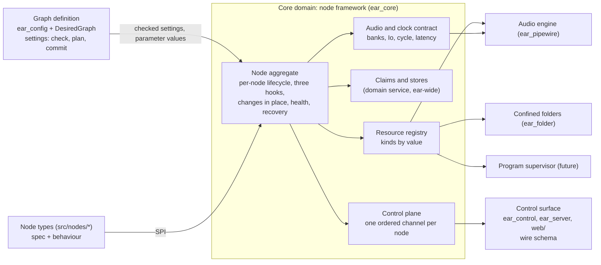
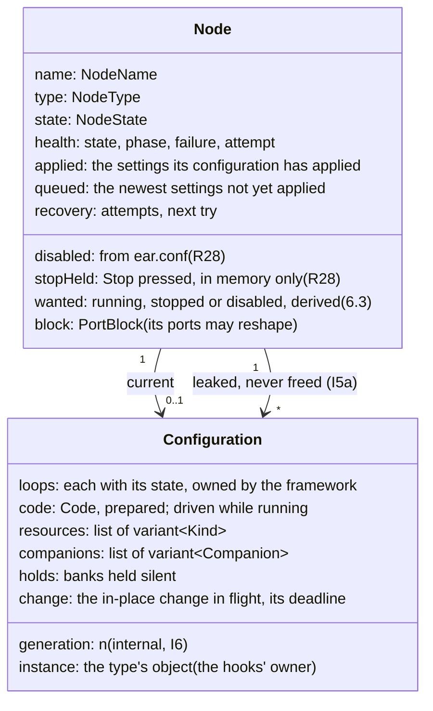
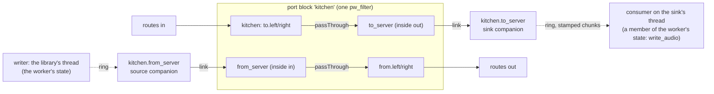

# The node framework: the primitives every node type builds on

Status: proposal, revision 7, 2026-11-08. Revision 1 went to three independent reviews and revision 2 answered them;
revision 3 took the owner's gate answers; revision 3 went to a second round of two independent reviews, and revision 4
answers them with two more answers from the owner (sections 14 and 16). Revision 5 took the owner's words R11 to R18 and
went to a third round of two reviews. Revision 6 takes the owner's answers to revision 5's state-machine gates
(2026-11-08, R19 to R24): **there is no "run"**. The graph always runs; a node is added, configured, started, stopped,
reconfigured and removed inside it, each operation asynchronous and applied in order; a type writes three hooks,
`configure(old, new)`, `start()` and `stop()` (section 6, the one home of the node lifecycle); only a node fails. What
revision 5 called the run object is the node's own object, the type's instance (6.4), and a closing thread's late
message is dropped by an internal counter no type author or operator sees (I6). Revision 6 also changes how questions
are put to the owner: only what an operator or a type author sees is asked (14.2); every internal choice is decided here
and listed, with its reason, in 14.3, so the owner can overturn any. It changes built code; section 13 says what, the
migration and each test group's fate, and re-cuts the slices. Revision 7 takes the owner's answers to revision 6's
gates (2026-11-08, R25 to R28 and 14.1's Q26 to Q28): a node has **two resting states**. `stopped` is silent and keeps
everything it opened; it is a moment's state, set by Stop and Start, never written to `ear.conf` and forgotten when ear
restarts. `disabled` is silent and releases everything; it is a word on the node's line in `ear.conf`
(`node card porch disabled { ... }`), set by Disable and Enable or by a hand edit, and it survives a restart (6.2, 6.3).
Companions are badges in the node's box (gate C2, as recommended). Revisions 6 and 7 are not reviewed yet (section 16).
Built: slice 1
(section 13, "Slice 1 as built", says where it differs) and slice 4's framework side (8.8's erratum), slice 2, the type
interface and its harness (section 13, "Slice 2 as built"), and slice 7, the internal clock with latency (section 13,
"Slice 7 as built"; its spike's verified answers are in sections 10 and 15). Those records keep the built code's own
words (`RunObject`, the recipe, `StartContext`): they name code that 13.2 retires. Nothing else is built. The two module
designs beneath this page, `docs/design/node-primitives.md` (slice 3c and the primitives' part of 3d) and
`docs/design/control-plane.md` (slices 5 and 6, and the wire of 3a, 3b, 3d and 8), are both at revision 5, written to
this revision in the same change (control-plane.md also records the owner's answers to its own gates W3, X2, G1, G3 and
G4); 13.3 says where each is the home of a fact this page cites.
Layer: system design (domain model and public interfaces), beneath the agreed system design
(`docs/design/pipewire-graph.md`) and over the module designs it would change (`docs/design/batch2.md` sections 4 and 6,
`docs/design/sendspin.md` sections 3 to 8).

[V] = verified in the source named, as of `3adc02b`; [U] = unverified, so a slice's test checks it or section 15 keeps it
open.

## 1. The owner's words

| # | The owner's words | Date, where | What it means here |
|---|---|---|---|
| R1 | "what are the core primitives that ear should host so that new nodes can be added simply and only require defining the truly custom bits that its node type demands" | 2026-11-07, chat | A node type is its custom part and nothing else; everything shared is the framework's |
| R2 | "consider how to abstract configuration and control plane events so that nodes can build on a shared base primitive layer" | 2026-11-07, chat | Configuration and control-plane events are framework subsystems, not per-type code |
| R3 | "Is it a virtual node base class? Are there several distinct subsystems, like one for config and one for events? How much do nodes [have] to write to handle bus connections?" | 2026-11-07, chat | The questions this page answers (sections 3, 7, 8 and 9) |
| R4 | "can i add my own sources and sinks?"; "the core will be \"built into ear\"" | 2026-10-29, `pipewire-graph.md` R11 | Types stay built in; adding one must be cheap |
| R5 | "i will want multiple shairport instances" | 2026-10-29, `pipewire-graph.md` R9 | Many nodes of one type, and a third kind of outside thing (a program) |
| R6 | "in a general purpose sources-and-sinks graph, its always just 'running'" | 2026-10-29, `pipewire-graph.md` R2 | Nothing here may make a port block stop processing |
| R7 | Outputs on different devices stay aligned, for "seperate zones" | 2026-10-29, `pipewire-graph.md` R3 | Latency and clock facts belong to the audio contract |
| R8 | "Do we need to specify a hardware device for the clock? Can we drive it via an internal clock running under the raw monotonic clock, and just use a PLL (if necessary) to track against a hardware device anchor?" | 2026-11-07, chat (gate, Q3) | The graph runs on an internal clock; cards follow it (section 10) |
| R9 | "Nodes should not have direct access to stdout or stderr. The core framework should expose the necessary primitives for events, diagnostics, and logging. These should be real-time safe for any audio loops that need them, and there can be non real-time bases for the rest of the system." | 2026-11-07, chat (gate, Q1) | Section 8.8: the framework owns every output; nodes get primitives, realtime-safe where audio code needs them |
| R10 | "Would status changes be useful for debugging things like flapping? Does this status relate to diagnostic events?" | 2026-11-07, chat (gate, Q2) | Status has a coalesced live view and a record of every change; the framework derives flapping (8.2) |
| R11 | "a Run should not be bounded by config changes. I want config and graph changes to be supported at runtime while audio is running" | 2026-11-08, chat | A node keeps running through a settings change it can take in place; a restart is one outcome of a change, not the only one (6.6). The owner's "Run" here is R20's node |
| R12 | "the start+build model seems overly simplistic. I think each node deserves a dedicated state machine, and hooks for each viable state. At a minimum, there should be setup+build+start" | 2026-11-08, chat | One state machine per node (6.2). Revision 5 gave it five hooks; R19 and R23 replace them with three (6.4) |
| R13 | "mailboxes could be supportable in either mode. But why must mailboxes be built before the run object exists? Is this a side effect of the naive node state machine model I described?" | 2026-11-08, chat | Yes: the two-phase start drove the block with the code before the run object existed. The node's instance now exists before its code drives, and owns its mailboxes (6.5) |
| R14 | "G4 is asking the wrong question. The node audio threads should be concerned with reading inputs and writing outputs. The framework should provide the necessary primitives to connect inputs/outputs across nodes AND anytime a node needs to cross inputs/outputs to non-realtime code (eg pipe outputs through a mailbox?)" | 2026-11-08, chat | A type's audio code reads `Io` inputs and writes `Io` outputs, nothing else; crossing to non-realtime code is the framework's (9.6, I12) |
| R15 | G3: "(a)": a leaked run (now: a leaked configuration) holding a store, recording path or port: refused with a detail saying the node starts when that one closes; the late close starts it | 2026-11-08, chat (node-primitives.md gate G3) | I8 and I5a (section 6); its home is node-primitives.md 6.9 |
| R16 | "I like the basic shape of the state machine proposal. And most importantly: it should be per-node. Some node stopping/reconfiguring/failing does not effect the graph globally" | 2026-11-08, chat | Isolation is an invariant (I10): one node's states never stop the graph, the clock or another node; what is global is named, with why (6.8) |
| R17 | "I want the node to control whether settings can be changed in place, with the framework supporting it. For example, changing a network port on a node is something that a node can handle on its own — even if it must output null audio frames for a few seconds. But if reconfiguring changes the shape of the input/output bus, then that might not be fully transparent" | 2026-11-08, chat | The type declares what it can change in place and its `reconfigure` hook decides; the framework holds outputs silent, readies new resources before releasing old ones, swaps claims and enforces a deadline (6.6); a change of ports is a reshape with its own rules (6.7) |
| R18 | "crossing to a non-rat [non-realtime] thread could be managed by allowing a node to internally pipe its inputs/outputs to a hidden node, to maintain the integrity and consistency of the processing graph" | 2026-11-08, chat | Companion nodes: hidden engine nodes linked to a node's inside banks, a closed list of kinds, which replace handoffs, feeds and the outside-node special case (9.6) |
| R19 | On "when does `start` run against `build`": "Shouldn't that all be part of the build stage? How is build different from [re]configure?" | 2026-11-08, chat (gate A2) | There is no separate `setup` or `build`: one hook, `configure`, acquires and constructs, on creation and on every change; readiness the engine delivers later is the framework's (6.4) |
| R20 | On a failed run: "A “run” can’t fail — only a node can fail. We should drop the “run” concept entirely and work with “graph” and “node” concepts. The graph is always running, while nodes can be added to it, configured, wired, start/stop all synchronously within the graph runtime" | 2026-11-08, chat (gate A3) | No run in the API, the states, the wire or this page's words. The graph always runs; operations on a node are applied inside it; a node fails, keeps its wires and releases what it held (6.1, 6.2) |
| R21 | "I meant “asynchronously”" (of "synchronously within the graph runtime" in R20) | 2026-11-08, chat | Operations are asynchronous and ordered: each is applied on the graph's thread in arrival order, its reply says what was applied, and a node's slow work goes on without holding anything else (6.3) |
| R22 | Gate A1: (b), a short set of states the editor colours, and a `phase` field with the exact state and its cause | 2026-11-08, chat | `state` and `phase` (6.2; control-plane.md 4.8) |
| R23 | On the hooks: exactly three, `configure(old, new)`, `start()` and `stop()` | 2026-11-08, chat | 6.4: no `setup`, `build` or `close` hook; removal is a stop and the framework frees the rest |
| R24 | Gate A4 (where reconfigure lives and how it reaches the type's threads): "too technical for me to properly answer" | 2026-11-08, chat | Decided by the designer (14.3, D-A4): hooks run on the graph's thread and reach a node's own thread only by a typed message. And a change of practice: the owner is asked only what an operator or a type author sees (14.2) |
| R25 | On gate F1 (can `ear.conf` say a node is stopped): "“Disabled” would be a better term" | 2026-11-08, chat (gate F1) | The word written in `ear.conf` is `disabled`, not `stopped` (6.3) |
| R26 | On gate F2 (what a stopped node keeps): "Keeps everything" | 2026-11-08, chat (gate F2) | A `stopped` node keeps everything it opened: Start is instant and cannot fail for a missing device or a taken port (6.2) |
| R27 | Asked whether `stopped` and `disabled` are two states or one: "Both words" | 2026-11-08, chat | Two resting states: `stopped` keeps everything, `disabled` releases everything (6.2) |
| R28 | Asked which of the two `ear.conf` keeps: "Only disabled in file" | 2026-11-08, chat | `disabled` is written in `ear.conf` and survives a restart; `stopped` is never written, and is forgotten when ear restarts (6.3) |

R25 to R28 split revision 6's one stopped state in two: Stop and Start (`stopped`, kept in memory, keeping everything)
and Disable and Enable (`disabled`, kept in `ear.conf`, releasing everything). The owner's F2 answer is `stopped`'s;
`disabled` is what F2's option (b) described, now a state of its own.

R19 to R23 replace R12's "at a minimum, there should be setup+build+start" with three hooks, and R13's question ("why must
mailboxes be built before the run object exists?") is answered by them: the node's object exists before its audio code
drives, so it owns what it shares with it (6.5). R11's "a Run should not be bounded by config changes" keeps its
meaning in R20's words: a node keeps running through a change it can take in place (6.6).

Earlier answers in the same walkthrough (2026-11-08, node-primitives.md section 18) hold, reworded for R20: G1, a new
`ear_runtime` package for loops, wakes, the I/O executor, the probe and stores (and the ring companions' threads, 9.6);
G14, loops declared in the spec as handles; G15, resources reached by handle, not through a recipe lambda (now inside
`configure`, 6.4); G17, the node's handle reached from the framework's context (now `node.handle()`, 6.10). G2 (a
mailbox as a kept value) and G4 (a handoff whose consumer is attached late) are superseded by R13 and R14 (14.1).

Design rules 1 to 3 of `pipewire-graph.md` hold unchanged: one owner per piece of state, and each health judgement its
owner's; a node is self-contained, reaching the engine only through powers the framework grants; the graph always runs.

## 2. The problem, measured

What each type writes today [V]:

| Type | Lines | Classes it writes | What is really its own |
|---|---|---|---|
| `white` | 73 | `AudioCode`, `NodeInsides`, `NodeConfig`, `NodeTypeOf` | a noise loop |
| `card` | 105 | the same four | its settings, one rule across them, "open this card", and a pass-through whose indices it works out by hand (`card.cpp:38-43`) |
| `rtp` | 114 | the same four | its settings, "receive this stream", the same hand-indexed pass-through |
| `file` | 190 | the four, a descriptor wrapper, a `HandoffConsumer` | its settings, the path rule, libsndfile |
| `sendspin` | about 1,900 | the four, and the primitives below | the protocol, pairing, the time filter, mDNS |

`sendspin` had to build, privately, about 560 lines of primitives that any threaded or networked type needs [V]:
`Mailbox` (a seqlock latest-value slot), `Feed` (the handoff's reverse), `EventFd`, `NoteGate` (rate-limited notes),
`PortClaims` (which node holds which TCP port, held by the *type* across its nodes), `KeyStore` and `narrowKeyFiles` (a
0600 file per node in the config folder, swept at boot), `ConnectionWatch` (timers), and three threads of its own: the
worker (a 10 ms `poll()`), the notifier, and the library's sync thread, which writes the feed (`worker.cpp:123-135`).

The framework's own seams are closed in three places [V]:

- `NodeGrant` has one method per kind of outside node (`soundCard`, `rtpReceiver`), and `NodeHost`'s constructor takes
  one factory per kind (`node_host.hpp`). A program (R5), a network sink or an RTP sender each edits `ear_core`,
  `NodeHost`, `ear_pipewire` and `main.cpp`.
- The control plane out of a node is `InsidesEvents::say(std::string)` and `lost(std::string)`. About 11 of sendspin's 17
  note texts are state written as pairs of sentences (`connected`/`disconnected`, `pairing-code`/`pairing-code-cleared`,
  `stream`/`stream-ended`, `sending`/`sending-stopped`, `id`, `dialling`, `listening`). Notes reach standard output only,
  so the editor cannot show a pairing code.
- There is no control plane *into* a node except its settings. A failed node starts again only when a setting really
  changes (an update with the same settings changes nothing, `desired_graph.cpp`), so restarting one means changing a
  setting and changing it back, or restarting ear. `NodeState` has no `recovering` (`node_lifecycle.hpp:8`).

What slices 1, 2 and 7 built ties a node's work to its settings (the built code calls it a run) and mixes realtime
crossing into type code (R11 to R20) [V]:

| What the built code does | Where | What it costs |
|---|---|---|
| Every settings change that keeps the ports is a restart: `plan` records it as an update, and `NodeHost` tears the run (the node's work) down and starts a new one | `desired_graph.cpp:159-160`, `node_host.cpp:79-87` | Changing an `rtp` node's port, or a `sendspin` node's name, stops all its audio, closes its connection and re-reads its key file |
| A change of ports replaces the node: it is removed and added, its block destroyed, every route to it unlinked and linked again | `desired_graph.cpp:159-166`, `170-174` | A card going from 2 to 4 playback channels drops the links of its two surviving channels too |
| The code drives the block as soon as `start` returns, before the run object exists | `node_host.cpp:296-309` | Anything the code and the run object share (sendspin's feed, two mailboxes, a bell) must exist before the run object, so it cannot be the run object's (R13) |
| Node states are four, and one machine judges block and run together | `node_lifecycle.hpp:8`, `22-33` | No state for a node applying new settings, none for a stopped node, and no way to stop one |
| A failed node keeps its code driving and its resources held until an update | `node_host.cpp:369-377` | A failed `sendspin` node keeps its claim on its port; its threads stay |
| Two types write realtime code only to cross to a non-realtime thread: `file`'s `Recorder` writes a handoff, `sendspin`'s code reads a feed, publishes two mailboxes and rings a bell | `file.cpp:47-50`, `sendspin_code.cpp:19-44` | Realtime code a type author must get right, with no audio of its own in it (R14) |

## 3. The answer, in one paragraph

The **graph** always runs: ear's internal clock drives it from boot to stop (section 10), and nothing done to one node
pauses it or another node. A **node** is added to it, configured, wired, started, stopped, disabled, enabled,
reconfigured and removed,
each an **operation** applied on the graph's thread, asynchronously and in arrival order: its reply says what was
applied, and the node's slow work (opening a USB card, waiting for Music Assistant) goes on in the engine or on the
node's own thread while the node shows a transitional state. A node type is **declarations, three hooks, and
acquisitions**. The declarations are constexpr tables in one `TypeSpec`: settings (each row restart-only by default, or
marked `.inPlace()` or `.live(...)`), banks, loops, stores, status fields, events, actions and log codes. The hooks are
`configure(old, new)`, called when the node is made (`old` empty) and on every change its rows allow in place, which
acquires, constructs and answers "applied" or "restart"; `start()`, which begins the node's activity; and `stop()`,
which ends it (section 6). The type's **instance**, one object per node, owns its state, mailboxes included; its threads
are the node's, reached from a hook only by a typed message. The acquisitions are framework-owned resources, each
readied, watched and released by the framework; audio that must reach non-realtime code, or come from it, goes through
a **companion node**, a hidden engine node linked to one of the node's inside banks, so a type's audio code only reads
inputs and writes outputs (9.6). There is no base class for the author and no mixins. Six subsystems serve every type:
**lifecycle**, **configuration and parameters**, **resources and companions**, the **control plane** (with diagnostics
and logging: no node touches standard output), **audio and clock** (an internal clock every card follows), and
**recovery**. For bus connections a type writes nothing; a wire never depends on a node's state; and only a node fails,
never the graph (I10).

## 4. Ubiquitous language

The words "run", "run object", "recipe", "setup" and "build" are not used: revision 6 retired them (R20, R23). Where the
built code still uses them, 13.2 says what replaces each.

| Term | Meaning | Today's name, if different |
|---|---|---|
| **Graph** | ear's one running audio graph: the engine, the internal clock, every node and wire. It always runs (R6, R20) | — |
| **Operation** | A change asked of the graph: add, configure, start, stop, disable, enable, remove a node; add or remove a wire. Applied on the graph's thread one at a time, in arrival order; asynchronous (R21): its reply says what was applied, never waits for a node's slow work (6.3) | an edit |
| **Node type** | A built-in kind of node: its type spec and its class, found by its folder in `src/nodes/` | `NodeType` + `NodeTypeOf` |
| **Type spec** | A type's declarations, pure and constexpr (`TypeSpec`; `NodeSpec` stays the graph's name+type+settings, `graph_spec.hpp:25`) | the settings table, plus `NodeConfig::ports()` |
| **Node** | One named instance of a type in the graph; the aggregate root of everything below. Only a node fails (R20) | — |
| **Instance** | The type's own object for one node: a plain class whose three member functions are the hooks, holding the node's main-loop state and what its code shares (6.4). Made by the framework when the node is configured from empty; replaced only by a restart | `RunObject`, members of `NodeInsides` |
| **Settings** | A node's *desired* state, kept in `ear.conf`, judged by the desired graph | `NodeSettings` |
| **Wanted state** | What the graph wants of the node: `running`, `stopped` or `disabled` (6.3). `disabled` is the node's word in `ear.conf` (R25, R28), changed by `disable` and `enable` or a hand edit; `stopped` is the node's stop, held in memory by the framework, changed by `stop` and `start`, never written and forgotten when ear restarts (R28); otherwise `running` | — (every node runs) |
| **Stopped** | A resting state: silent, keeping everything its configuration opened (R26); a moment's state, not part of `ear.conf` | — |
| **Disabled** | A resting state: silent, with no configuration (everything released), the block and wires kept; written in `ear.conf` as `disabled` after the node's name (R25, R27) | — |
| **Parameter** | A setting declared `live`: it also has a realtime value that can move without a restart | — |
| **In-place row** | A setting declared `.inPlace()`: a change to it goes to `configure(old, new)` instead of a restart (6.6) | — (every change restarts) |
| **Port block** | The node's one `pw_filter`, made once for the node's life; owner of its public ports and the wires' ends; its ports may change (a reshape, 6.7) | as today |
| **Bank** | A named, directed group of ports, public or inside; its name and direction in the spec, its members from the settings | `PortBank` (public only); inside ports are a flat list today |
| **Wire** | A route, as the editor draws it: from an output port to an input port. Kept whatever either node's state; a wire to a stopped, disabled or failed node carries silence | route |
| **Node state** | Where a node is in its lifecycle: `added`, `configuring`, `configured`, `starting`, `running`, `reconfiguring`, `stopping`, `stopped`, `disabled`, `failed`, `recovering` (slice 8), and `removed`, the end; the one machine of section 6 | `NodeState` (four values) |
| **Hook** | One of the type's three member functions the framework calls: `configure(old, new)`, `start()`, `stop()` (6.4) | `start`, the recipe, `RunObject::close` |
| **Configuration** | What the node's instance, its code and its resources are for one settings value and every in-place change after it, from `configure(empty, settings)` until a restart, a failure, a disable or the node's removal tears it down. An internal word of the framework's, never on the wire | a run |
| **Generation** | An internal counter the framework raises each time it configures a node from empty; a message from an older generation's thread is dropped (I6). Never seen by a type author or an operator | the run's generation |
| **Configure context** | What `configure` is handed: the format, the node's name, the acquire calls, holds, the code, and typed posts to the node's loops (`ConfigureOf<spec>`); 6.10 declares it whole | `StartContext`, `Ready` |
| **Node context** | What the instance keeps for its life: the node's name, its handle, posts to its loops (`NodeOf<spec>`, 6.10) | — |
| **Node handle** | The node's thread-safe way out: log, status, events, `lost(detail)`; usable from any of the node's threads (node-primitives.md 5) | `InsidesEvents`, `Channel` |
| **Resource** | Something a node's configuration acquired, owned by the framework, released with it (or replaced in place) | outside node, handoff |
| **Resource kind** | A class of resource with its own adapter (section 7.3) | one method each on `NodeGrant` |
| **Companion** | A hidden engine node the framework makes for a node, linked to one of its inside banks; named `<node>.<suffix>`; never named by a wire. Two families: engine companions (a sound card's ALSA adapter, an RTP receiver) and ring companions (a sink or a source with a ring to non-realtime code) (9.6) | outside node; handoff; sendspin's feed |
| **Sink, source** | The two ring companions: a sink hands frames, stamped with their cycle, to a non-realtime consumer; a source plays frames a non-realtime writer gives | handoff; feed |
| **Hold** | Outputs of a bank (or all) kept silent by the framework, with a short fade, while a node asks, or before every barrier that silences the block; acknowledged by the data loop once the fade reached zero (6.6) | — |
| **Plan outcome** | What a committed edit does to one node: `unchanged`, `retune`, `reconfigure`, `restart`, `reshape` (with `inPlace`) or `replace` (6.6, 6.7) | update or replace |
| **Code** | What runs on the realtime thread for one node: `prepare`, `process`, `release`; given in `configure`, swappable in place | `AudioCode` |
| **Loop** | A node's serial executor off the realtime thread, a strand or a dedicated thread, with the state its work runs on (the loop's state, owned by the framework, reached only by a post) | sendspin's worker |
| **Status** | A node's *observed* state, field by field, each field with one declared writer; never health. Today's `NodeStatus` (state and reason) is health and is renamed `NodeHealth` (slice 1), so the word means one thing; `RouteStatus` is a wire's observed state and keeps its name | `say` texts that are state |
| **Event** | A node's *edges*, by declared code | `say` texts that are edges |
| **Action** | A command into a node; changes no desired state | — |
| **Log** | Free text for people, at a level; from node code, the realtime thread (as coded records) or captured library and program output | `std::cerr`, a library's own logging |
| **Diagnostic** | What the framework itself observes about a node: status changes, flapping, recovery attempts, drops | `dropped=` on the `stopped` line |
| **Health** | The node state, its `phase`, its reason, the attempt and how long it has run: the framework's judgement alone | `NodeStatus` |
| **Internal clock** | The graph's one driver: the dummy driver on the host's monotonic clock; every card follows it | as built (slice 7) |

## 5. Bounded contexts and the context map



- **Graph definition** stays the one judge of settings. It asks each type's spec to check them (the table walk, then the
  type's rule across settings, as `make` does today), and it carries parameter changes (section 8.5) in arrival order with
  every other request. Its `plan` now also names each node's outcome (6.6, 6.7) from the spec's row marks and the
  ports, so an operator knows before the commit whether a change restarts the node. It never sees resources, status,
  actions or a node's state.
- **Node framework** owns the node aggregate and the subsystems. Types reach it only through the SPI (section 7) and
  cannot extend its model.
- **Claims and stores** is a domain service, not part of one node's aggregate: a TCP or UDP port, an mDNS name and a
  stored file are ear-wide, so their consistency rule spans nodes (section 6, I8).
- **Audio engine, confined folders and the program supervisor** sit behind one adapter per resource kind, which keeps
  PipeWire, descriptors and process ids out of `ear_core` (as today: no PipeWire type in a public header). Companions
  are made by the audio engine's adapters (`ear_pipewire`); a ring companion's non-realtime thread is `ear_runtime`'s
  (9.6).
- **Control surface** renders what the framework publishes (section 8.7) and judges nothing.

## 6. The node: its lifecycle, hooks and invariants

This section is the one home of the node lifecycle (R11, R16, R17, R19 to R23, R25 to R28). Every other section cites
it. Its shape is the owner's (2026-11-08): the graph always runs; a node is added, configured, started and stopped,
disabled and enabled, reconfigured and removed inside it, asynchronously; a node goes added → configured → running ⇄
stopped, beside disabled and failed, and ends removed; a type writes three hooks. There is no run: what a settings value made (the instance, its code, its resources) is the
framework's internal **configuration**, and only the framework knows when one ends and the next begins.

### 6.1 The graph, its operations, and the aggregate

**The graph always runs.** The internal clock drives it from boot to stop (section 10, as built in slice 7); every block
processes whether wired or not; nothing done to one node pauses the clock, the data loop or another node (I10).

**Operations are asynchronous and ordered** (R20, R21). Every operation on a node (add it, change its settings, start
it, stop it, disable it, enable it, remove it, add or remove a wire to it, and the framework's `restart` action) reaches
the graph's thread (the main loop) whole, through the keeper (AGENTS.md, "How a change moves"), and is applied there one
at a time, in arrival order. Disable and enable are edits of `ear.conf`, like a settings change; start, stop and
`restart` are not (R28): the keeper orders them with the edits around it but writes nothing, and the framework applies
them to the node alone (6.3). Applying an operation means: the desired graph judges it and commits it (an edit), or the
framework checks it against the node (start, stop, `restart`), and the framework sets the node's next step going (a hook called, a barrier posted, a resource asked for) without waiting for it. The reply is sent
in the same main-loop turn and says what was applied (the plan's outcome, 6.6); it never waits for the node's slow
work. That work (an ALSA device opening, a claim waiting for a closing node, a library reconnecting to Music
Assistant) goes on in the engine, on the I/O executor or on the node's own threads, and the node shows a transitional
state until it reports ready (6.2). A later operation on the same node is applied when it arrives, against what the
node has actually applied (6.3); one on another node never waits for it.

**The aggregate.** The node is the consistency boundary for everything its configuration acquires; only the framework
changes it, on the main loop. Resources and companions are a closed `std::variant` of kinds (sections 7.3 and 9.6),
not a class hierarchy.



The node's state is derived from two small pure machines, the wanted state (the desired graph's `disabled` and the
framework's stop) and the queued settings: the **block's**
(made, ready, lost) and the **configuration's** (configuring, configured, driving, changing, going). Both are pure, as
`NodeLifecycle` is today (`node_lifecycle.hpp:10-15`), so every state against every fact is one table-driven test. The
configuration and its generation never appear on the wire, in a record or in a type's API.

### 6.2 The states

```mermaid
stateDiagram-v2
  [*] --> added: add committed, block made
  added --> configuring: no older node of the name left; configure(empty, settings)
  added --> disabled: disabled in ear.conf; nothing configured
  configuring --> configured: every resource ready
  configured --> starting: wanted running
  configured --> stopped: wanted stopped
  starting --> running: block ready, code drives, start() returned
  running --> stopping: stop, disable, restart, removal, a restart-only change
  stopping --> stopped: silence acknowledged (a stop)
  stopping --> disabled: a disable, the configuration gone
  stopped --> stopping: disable (no fade: already silent)
  stopped --> starting: start
  disabled --> configuring: enable
  failed --> disabled: disable
  recovering --> disabled: disable
  running --> reconfiguring: in-place change; configure(old, new)
  stopped --> reconfiguring: in-place change; configure(old, new)
  reconfiguring --> reconfiguring: a newer in-place change before the commit point
  reconfiguring --> running: committed (was running)
  reconfiguring --> stopped: committed (was stopped)
  reconfiguring --> stopping: answered restart; refused; deadline; restart action
  stopping --> configuring: a restart, once the old configuration is gone
  stopped --> configuring: a restart-only change
  configuring --> failed: a resource refused or past its deadline; a hook threw
  configured --> failed: a resource lost; lost(detail)
  starting --> failed
  running --> failed
  reconfiguring --> failed: a kept resource lost; lost(detail)
  stopped --> failed: a resource lost; lost(detail)
  failed --> configuring: a settings change, start, or restart
  failed --> recovering: slice 8, the backoff
  recovering --> configuring: the wait ended
  stopping --> removed: removal, the old configuration gone, block destroyed
  removed --> [*]
```



Not drawn: the block's loss leads from every state but `removed` to `failed`, for good (T13); removal leads from every
state to `stopping` (with cause `removing`), and a node never started (`added`, `configuring`, `configured`, `failed`,
`disabled`) skips `stop()`; a disable leads from `configuring`, `configured`, `starting` and `reconfiguring` to
`stopping` too (cause `disabling`). A change in `added` replaces the settings the node will be configured with, and a
change in `disabled` is stored for when it is enabled: there is nothing to restart, so no edge.

What the framework does in each state. "Silent" means the block is driven by no code: every output sample is 0 and its
inputs are read by nothing (`drive(nullptr)`, `node_host.hpp:70-71`) [V]. Wires are the desired graph's: the
`Reconciler` links a wanted route whenever both its ends are live, whatever either node's state
(`reconciler.cpp:107-151`) [V], so **a wire never depends on a node's state**: it stays through every state but
`removed`, and a peer wired to a silent node reads zeros.

| State | Entered when | Hook called | What `process` runs | The node's outputs carry | Health on the wire (`state`; `phase`) | Standard output (`node` record's `msg`) |
|---|---|---|---|---|---|---|
| `added` | the add commits; the block is made at once, silent | none | nothing | zeros | `starting`; `added` | `node <n> starting` |
| `configuring` | no older node of its name is left (today's `olderGoing`, `node_host.cpp:64-75`) [V], or a restart, a retry, an enable or a restart-only change | the instance is made, then `configure(cx, nullptr, settings)`, once; the framework readies what it acquired (6.4) | nothing | zeros | `starting`, or `stopped` if wanted stopped; `configuring` with what it waits for | — (a wait over 2 s: a `still` record) |
| `configured` | every resource is ready; the code is prepared; work staged on its loops is released | none | nothing | zeros | as `configuring`; `configured` | — |
| `starting` | configured and wanted running, or `start` on a stopped node | `start()` once the block is ready and the code drives (T5) | nothing until the code drives | zeros | `starting`; `starting` (`waiting for the engine` while the block is not ready) | — |
| `running` | the block is ready: the framework carries the latency plan, drives the block with the code and arms its sinks in one data-loop invoke (I4), then calls `start()` | `start()`, once, on entry | the node's code | what the code writes; a held bank zeros (6.6) | `running` | `node <n> running` |
| `reconfiguring` | a committed change whose outcome is `reconfigure`, on a running or stopped node (6.6) | `configure(cx, &old, new)`, once, on entry; then the type's own work, if it asked to finish later | the code, then the swapped code, if any (nothing, if it was stopped) | what the code writes; held banks zeros, faded | `reconfiguring`; with the keys | `node <n> reconfiguring: <keys>`, then `node <n> running` or `stopped` |
| `stopping` | a `stop`; a `disable`; a restart (a restart-only change, a reshape not in place, the `restart` action, an in-place change that fell back); a removal | `stop()`, if the node was running, before the fade | the code for one fade, then nothing | a 5 ms fade, then zeros (no ports once removed) | `stopping`; with the cause (`stop`, `disabling`, `restarting: <keys>`, `removing`) | `node <n> stopping[: <cause>]` |
| `stopped` | the stop's silence acknowledged; or configured while wanted stopped | none | nothing | zeros | `stopped` | `node <n> stopped` |
| `disabled` | added while `ear.conf` says `disabled` (no configuration is ever made); or a disable's teardown ended (the configuration gone, or leaked at its deadline, I5a) | none (`stop()` ran in `stopping` if it was running) | nothing | zeros | `disabled` | `node <n> disabled` |
| `failed` | a fact against the node (a resource refused, lost or past its readiness deadline; `lost(detail)` from its handle; a hook threw) or against its block (lost: final, I1) | none: the framework silences the block and tears the configuration down at once (I5) | the code for one fade, if it was driving; then nothing | a 5 ms fade, then zeros | `failed`, with `reason` (its code below) | `node <n> failed <code>: <detail>` |
| `recovering` (slice 8) | the failed node's configuration is gone and its recovery policy waits before another try | none | nothing | zeros | `recovering`, with `attempt`, `retryInMs` | as 8.8 |
| `removed` | the removal's teardown ended (or was leaked at its deadline, I5a) and the block is destroyed | none | — | no ports | gone from the graph (`node.removed`) | `node <n> removed dropped=<frames>` |

- **The short-lived states** (`added`, `configured`, `starting`) last milliseconds unless the node's name was just freed
  by a node still closing (a remove and add of one name in one plan, or a rename, I7, I8), or the engine is slow to make
  the block ready. `start()` never runs before `process` can actually be called, so a node never begins work whose audio
  would go nowhere (R19: readiness the engine delivers later is the framework's, never the type's).
- **A stopped node keeps its configuration** (R26, "Keeps everything"): its instance, its claims, its companions and its
  loops stay, its code is prepared and not driven, and `start` drives it again within one cycle and one main-loop turn,
  so Start cannot fail for a missing device or a taken port. A sound card stays open and plays the block's zeros; a
  listening port stays claimed, so no other node can take it. What the type's own activity does while stopped is its
  `stop()`'s choice (sendspin closes its connection). A sink is disarmed while stopped, so a recording takes no frames;
  a source plays into a silent block. The stop is a moment's state (R28): never written to `ear.conf`, forgotten when
  ear restarts (the node then runs), and kept through a hand edit that keeps the node (6.3).
- **A disabled node has no configuration** (R25, R27): it is torn down as a failed node is (I5): its instance and loops
  go, its claims are released (a disabled `sendspin` node's port 8928 is free for another node at once), its stores and
  recordings are closed, its companions are destroyed (a disabled card's device is closed, so another program may use
  it). Its block stays, silent, with its ports and its wires (I1, I15), and its input meters still show what reaches it.
  Its settings are still parsed and checked, so a disabled node's line is still valid settings, but nothing is acquired
  for it, and two nodes may name one port while one of them is disabled. `enable` configures it from empty (T22), which
  may fail like any start (`start-failed: cannot listen on port 8928: held by node kitchen2`). A disabled node never
  retries and never recovers (slice 8 skips it). The word survives a restart of ear, and a hand edit can write or
  remove it (R28).
- **A failed node is torn down at once** (R20): its instance and loops go, its claims are released (a listening
  `sendspin` node's port 8928 is free for another node at once), its companions are destroyed, and the block is silent;
  its wires stay. It stays `failed` until a settings change, `start`, the `restart` action, its removal, or recovery
  (slice 8). A lost block is final (I1). Today a failed run keeps its code driving and its resources until an update
  (`node_host.cpp:369-377`) [V].
- **Health on the wire is two fields** (R22): `state`, the short closed set the editor colours (`starting`, `running`,
  `reconfiguring`, `stopping`, `stopped`, `disabled`, `failed`, `recovering`), and `phase`, the exact state with its
  cause. Today's clients see the four states they know plus `reconfiguring`, `stopped`, `disabled` and `recovering`, which control-plane.md's
  protocol 1 makes open values (its G7, decided). Every member of `node.state` per phase is control-plane.md 4.8's.
- **A node that stays in `added`, `configuring`, `configured` or `starting` for 2 s** says why on standard output, in a
  `still` record (control-plane.md 9.1 is the record's home).
- **Every barrier that silences a driving block is faded first** (R17's "null audio frames", applied to every planned
  silence): the framework holds every public output bank for one fade (5 ms), waits for the data loop's acknowledgement
  that the fade reached zero (6.6), then takes the barrier. So a stop, a disable, a restart, a failure or a removal never
  clicks a downstream card. The block's own loss (T13) cannot be faded: the block is gone.

**Failure codes**, the one home of the codes a `failed` node's `reason` carries (an open set on the wire,
control-plane.md 4.5, so a new code is additive under protocol 1):

| Code | When | Recovery's first wait (8.6) |
|---|---|---|
| `start-failed` | before the node first reached `running` or `stopped` in this configuration: a claim, store or recording refused, a readiness deadline passed, a consumer's `begin` failed, `lost(detail)` before then, a hook threw | the longest (60 s): the cause is in the settings or the host |
| `engine-refused` | a companion or the block refused or lost, before or after `running` (today's code, `node_host.cpp:369-371` [V]) | by phase: 60 s before the node reached `running` or `stopped`, 1 s after |
| `lost` (new) | `lost(detail)` from the node's handle once it has reached `running` or `stopped` (today this is `start-failed`, `node_host.cpp:375-377` [V]) | 1 s: a node that ran and died is not a settings problem |

### 6.3 Transitions, operations, and what arrives mid-transition

| # | From | To | Trigger | What the framework does |
|---|---|---|---|---|
| T1 | — | `added` | the add commits | makes the port block, silent; the node's wires link once its ports are live; a node `ear.conf` says is `disabled` goes on at once to T19 |
| T2 | `added` | `configuring` | no older node of the name is left | a new generation; makes the instance; calls `configure(cx, nullptr, settings)`; readies what it acquired (6.4) |
| T3 | `configuring` | `configured` | every resource ready | prepares the code; releases the work staged on the node's loops |
| T4 | `configured` | `starting` or `stopped` | at once, by the wanted state (`stopped` while the node's stop is held) | — |
| T5 | `starting` | `running` | the block is ready | carries the latency plan; in one data-loop invoke (the barrier), drives the code and arms every sink; once it completed, calls `start()` |
| T6 | `running` | `stopping` | `stop`; `disable` (T20); a restart (plan outcome `restart`, a reshape not in place, the `restart` action, T11); removal | calls `stop()`; holds every public output bank for one fade and waits for the acknowledgement; then one invoke silences the block (`drive(nullptr)`) and disarms every sink; sinks drain to their consumers |
| T7 | `stopping` | `stopped` | the silence completed, and the cause was a `stop` | — |
| T8 | `stopped` | `starting` | `start` | as T5 once the block is ready (it already is) |
| T9 | `running`, `stopped` | `reconfiguring` | plan outcome `reconfigure` | calls `configure(cx, &old, new)` on the instance; applies holds; readies new resources beside the old, marking each old one it replaces `retiring` (6.6) |
| T10 | `reconfiguring` | `running` or `stopped`, as before | the hook's work is done (`applied`, or its `whenReady` continuation's `done`) and every new resource is ready | the commit point: swaps the code and layout if asked, re-arms replaced sinks (one barrier, if driving), releases retiring resources by dependency, releases holds with a fade; the node's applied settings become `new` |
| T11 | `reconfiguring` | `stopping` (or `configuring`, if it was stopped) | the hook answered `restart`, a replacement refused or lost, its token's `fail`, the deadline (default 10 s, the spec's `.lifecycle`, 6.10), or the `restart` action | releases the uncommitted replacements; then as T6 with cause `restarting` |
| T12 | `stopping` (a restart), `stopped` (a restart-only change, a restart), `failed`, `recovering` | `configuring` | the old configuration is gone (I5), or was leaked at the close deadline (I5a) | reshapes the block first if the ports changed (6.7); then as T2 with the newest settings |
| T13 | any but `removed` | `failed` (final) | the block lost (`PortBlockEvents::lost`) | tears the configuration down; never configures again (I1) |
| T14 | `configuring`, `configured`, `starting`, `running`, `reconfiguring`, `stopped` | `failed` | a resource refused, lost or past its readiness deadline (in `reconfiguring`: a kept resource, never a `retiring` one); `lost(detail)`; a hook threw | fades if the code drives, then silences the block and tears the configuration down (I5); the block stays |
| T15 | `failed` | `configuring` | a settings change; `start` (a retry, even when the node is already wanted running); the `restart` action | as T12 |
| T16 | `failed` | `recovering` (slice 8) | the configuration is gone and the policy allows another try | a main-loop timer (8.6) |
| T17 | any | `stopping` (cause `removing`), then `removed` | the removal commits; `stopAll` | as T6 (`stop()` only if it was running), then destroys the block (the barrier) and tears the configuration down; `removed` once it is gone or leaked |
| T18 | `reconfiguring` | `reconfiguring` | a newer change whose outcome is `reconfigure`, before the commit point | supersedes: below |
| T19 | `added` | `disabled` | the add commits with the node disabled in `ear.conf` (a boot, a hand edit, `node.add` with `disabled`) | nothing: no instance, no configuration; the block stays silent |
| T20 | `configuring`, `configured`, `starting`, `running`, `reconfiguring`, `stopped` | `stopping` (cause `disabling`), then `disabled` | the disable commits (plan outcome `disable`) | ends an in-place change as a stop does (6.3); as T6 (`stop()` and the fade only if it was running; a stopped node is already silent), then tears the whole configuration down by I5, claims released last; `disabled` once it is gone or leaked (I5a); the node's stop, if held, is dropped |
| T21 | `failed`, `recovering` | `disabled` | the disable commits | the configuration is already gone; the recovery timer is cancelled |
| T22 | `disabled` | `configuring` | the enable commits (plan outcome `enable`) | as T12 with the newest settings: reshapes nothing (the block already has the newest ports, below), a new generation, `configure(cx, nullptr, settings)`; then by the wanted state, `running` |

Every barrier is an asynchronous invoke on the block's data loop: the main loop posts it and goes on, and the next step
continues from its completion, posted back (I4). So no transition of one node waits on the data loop while another's
work queues behind it.

**Start and stop; disable and enable** (R25 to R28). The wanted state is derived from two facts with two owners:

- **`disabled`, the desired graph's**, from the node's line in `ear.conf`: `node <type> <name> disabled;` or `node
  <type> <name> disabled { <settings> }`. `disable` and `enable` are edits at the source like `node.update`
  (control-plane.md 4.2): they write or remove the word after the node's name, committed and written as any edit, so
  the word survives a restart of ear, and a hand edit can disable or enable a node. A line that also makes other nodes
  (inside a snippet) is refused `shared-definition`, as any edit of it is. The plan's outcome is `disable` or `enable`
  (6.6).
- **The node's stop, the framework's**, held by `NodeHost` in memory (R28): `stop` sets it and `start` clears it. They
  are operations the keeper orders with the edits around it, but they write nothing, make no graph-file version and
  are judged by no plan; the framework applies them to the node, and the reply says what it did (control-plane.md 4.2).
  So Stop and Start work while `ear.conf` has errors, and a node's stop is forgotten when ear restarts: after a restart
  every node runs unless `ear.conf` says `disabled`.

The wanted state is `disabled` when the line says so, else `stopped` while the node's stop is held, else `running`, and
the framework converges on it: a node configured while its stop is held rests in `stopped` without calling `start()`; a
disabled node is never configured. The rules where the two meet, decided by the designer (14.3, D-F1 to D-F7):

- `stop` or `start` on a disabled node is refused (`node-disabled`, control-plane.md 4.5): a disabled node has nothing
  open to keep, and starting it means enabling it, which is an edit of `ear.conf`. The `restart` action is refused the
  same way.
- `disable` on a stopped node tears its configuration down (T20) and drops its stop; enabling it later runs it.
  `enable` on a stopped node changes nothing (the line has no word to remove; `applied: "unchanged"`, nothing written):
  it stays stopped until Start.
- A hand edit (or `graphFile.set`) that keeps a node, by name and type, keeps its stop, whatever else it changes in
  the node: a stopped node with a restart-only change is configured afresh and rests in `stopped` again (T12, T4); an
  in-place change returns it to `stopped` (T10). A hand edit that writes `disabled` on a stopped node disables it and
  drops its stop. A node the edit removes, renames or replaces (another type) loses its stop: the new node runs.
- `start` on a `failed` node is a retry (T15), even when nothing holds it stopped, and clears its stop. `stop` on a
  failed or recovering node sets the stop and leaves the node `failed`; a retry or a recovery then rests in `stopped`.
- A settings change to a disabled node commits and is written; nothing runs (plan outcome `stored`, 6.6). A change of
  ports reshapes the block alone (6.7), so its wires and the editor's handles follow the file; there is no
  configuration to restart.

The `restart` action (8.4) is the framework's own: a full stop, a configuration from empty and a start back to the
wanted state, without editing `ear.conf`.

**Operations that arrive mid-transition** are applied when they arrive, newest settings winning, and judged against what
the node has actually applied, never against what is in flight:

- in `added`: a change replaces the settings it will be configured with; `start` and `stop` set or clear the node's
  stop; a `disable` is T19 at once;
- `disable`, in any state but `disabled` and `removed`: ends an in-place change as a `stop` does (before the commit
  point it is superseded; after it, the disable waits for T10 or T11, then applies), then T20 or T21; a disable that
  arrives in `stopping` for a restart goes on to `disabled` once the old configuration is gone, instead of configuring;
- `enable` in `stopping` for a disable: the node is configured afresh with the newest settings once the old
  configuration is gone (as `start` during a stop starts again once stopped); `enable` in `disabled`: T22;
- in `configuring`, `configured` or `starting`, before the node first reached `running` or `stopped`: any change tears
  the configuration down and configures afresh with the newest settings (nothing has started, so nothing is gained by
  reconfiguring in place); `stop` in `starting` before `start()` was called ends at `stopped` without calling `start()`
  or `stop()`;
- in `reconfiguring`, **before the commit point** (T10's swap has not begun, and the hook's `whenReady` continuation
  has not been posted to its loop): a newer change supersedes it (T18). The framework ends it without touching the
  node's applied configuration: replacements not yet committed are released (their claims and companions go, by I5's
  order for those resources only), an unposted continuation is destroyed unrun, its token ignored; holds stay. Then the
  newest settings are classified afresh against the applied ones: a `reconfigure` calls the hook again with `old` the
  applied settings and `new` the newest; a `restart` or `reshape` is T11. The deadline restarts with the new call. A
  `stop` or a removal ends it the same way, then stops;
- in `reconfiguring`, **after the commit point** (the continuation is the type's own work, or the swap is under way): a
  change, `stop` or `start` waits until T10 or T11, then is applied;
- the `restart` action in `reconfiguring`, before or after the commit point: T11 at once (a continuation already posted
  runs, as it would at a stop, node-primitives.md 6.2);
- in `stopping`: a change waits for `stopped` (or, for a restart, replaces the settings the next configuration starts
  with, as today, `node_host.cpp:79-87` [V]); `start` during a stop starts again once stopped;
- in `failed` or `recovering`: a change or `start` is T15 at once (skipping the recovery wait); `stop` sets the wanted
  state and leaves the node `failed`.

### 6.4 The three hooks

A type writes exactly three hooks (R23), as member functions of its class, and nothing else of the lifecycle. The class
is the node's **instance**: the framework makes one when it configures the node from empty (T2, T12, T15), calls its
hooks on the main loop, and frees it when that configuration ends (a restart, a failure, a removal). Its constructor
takes the node's context (`NodeOf<spec>&`, kept for the instance's life) or nothing. The contexts are declared whole in
6.10.

| Hook | Called | Thread | Gets | May | Returns | If the type writes none |
|---|---|---|---|---|---|---|
| `check` (static) | parse | any, pure | `const CheckedOf<spec>&` | nothing else | a refusal or nothing | no rule across settings |
| `ports` (static) | parse | any, pure | the checked settings | nothing else | `Members<spec>` | — (required) |
| `configure(cx, nullptr, now)` | T2: the node is configured from empty | main loop | `ConfigureOf<spec>&`, the checked settings | acquire (claims, recordings, companions, stores' handles), give each loop its state, give the code, declare its code's latency, post work to its loops (run once `configured`). No I/O, no threads started, no blocking | `Configured::applied()` | — (required; `white`'s is two lines) |
| `configure(cx, &old, now)` | T9: every changed key is `.inPlace()` or `.live`, at least one `.inPlace()` (6.6) | main loop | the same context, the applied and the new settings | hold banks, acquire replacements make-before-break, swap claims, swap the code, post to its loops, continue on a loop once replacements are ready | `Configured::applied()`, `Configured::restart(reason)`, or what `cx.whenReady` returned | never called with `old`: every change restarts |
| `start()` | T5, T8: the code drives the block | main loop | its node context | post to its loops (begin dialling, listening, playing) | nothing (a failure later is `lost(detail)`) | nothing to start |
| `stop()` | T6: before the fade, when the node was running | main loop | its node context | post to its loops (say goodbye, close the connection) | nothing | nothing to stop |
| `prepare`, `process`, `release` | the code's: prepared at T3 or a swap, driven while `running` | main loop; realtime; main loop | the format; `Io<spec>` and `GraphCycle`; — | as 7.4 | — | — |

- **`configure` is acquire and construct in one** (R19). There is no separate setup, build or close: what revision 5
  split across `setup` (acquire) and `build` (construct once ready) is one call, because what becomes ready later (a
  claim granted, a store opened, a companion linked, the block's ports ready) is the framework's to wait for, not the
  type's. A resource asked for in `configure` is a handle at once; using it is legal on the node's loops, whose work the
  framework releases only once every resource is ready (T3; node-primitives.md 6.4's staging). So a type writes
  `configure` as if everything were there, and never writes a readiness callback.
- **`old` is empty only when the node is configured from empty**: when it is made, and again after a restart, a failure
  or a recovery. A type whose rows are all restart-only never sees `old`.
- **Its own threads are the node's, and a hook reaches them only by a message** (designer's decision D-A4, 14.3). A loop
  declared with a state type (`loop::dedicated<"worker", Worker>`) gets its state in `configure` (`cx.loop(worker,
  std::make_unique<Worker>(...))`), after which the instance holds no reference to it; a hook reaches it only with
  `post(worker, [](Worker& w) { ... })`, which runs on that loop. The handle carries the state's type, so a post of the
  wrong type does not compile, and a hook cannot touch another thread's data, since it holds none. Threads a library owns
  are the loop state's, started and joined there.
- **Removal is a stop and the framework frees the rest** (R23). After `stop()` (if the node was running) and the
  barrier, the framework closes the node's loops (running work already posted, `stop()`'s goodbye among it), destroys
  each loop's state on its own thread (where a library's threads are joined, never on the main loop), and frees the
  instance and its code on the main loop (I5). A restart and a failure do the same, keeping the block.

```cpp
// sendspin, in revision 6 (9.6 shows its companions; node-primitives.md 4.1, 6.4 and 6.8 its loop, store and worker)
// sendspin_spec.hpp: inline constexpr auto worker = loop::dedicated<"worker", Worker>;   // the loop's state type
class Sendspin {
public:
	static Members<spec> ports(const Checked&);   // to, from, to_server, from_server: two members each
	explicit Sendspin(NodeOf<spec>& node) : node_(node) {}
	Configured configure(ConfigureOf<spec>& cx, const Checked* old, const Checked& now) {
		if (old) return changeInPlace(cx, *old, now);                        // node-primitives.md 4.2
		if (!now.get<serverRow>()) cx.claim(claim::TcpListen{now.get<portRow>()});
		auto& feed = cx.source(fromServer, {.frames = feedFrames(cx.format())});   // declares [0, frames] itself
		cx.loop(worker, std::make_unique<Worker>(node_.handle(), cx.store(keyStore), feed, now));
		cx.sink(toServer, {.frames = cx.format().rate / 2}).consumedBy(worker, &Worker::toServer);
		cx.use(passThrough({bankPair(to, toServer), bankPair(fromServer, from)}));
		return Configured::applied();
	}
	void start() { node_.post(worker, [](Worker& w) { w.begin(); }); }   // dial or listen
	void stop() { node_.post(worker, [](Worker& w) { w.end(); }); }      // goodbye; the client stops
private:
	Configured changeInPlace(ConfigureOf<spec>&, const Checked& old, const Checked& now);
	NodeOf<spec>& node_;
};
```

**Readiness, between `configure` and `configured`**, the framework's, in this order, so a refusal costs nothing
(node-primitives.md 6.1 is the home of each step's detail):

| # | What | When it fails |
|---|---|---|
| 1 | Claims, judged in the same main-loop turn (I8); ports probed once granted | `start-failed: <claim's text>` |
| 2 | Stores and recordings, opened on the I/O executor (5 s each) | `start-failed: <file>: <why>` |
| 3 | Loops started with their states, nothing posted run yet | `start-failed: cannot start loop <name>: <why>` |
| 3' | Companions, once the block is ready and step 1 granted, in parallel with 2 and 3: made, running, every link active (9.6) | `engine-refused: <detail>` |
| 4' | Every sink consumer has begun (`SinkConsumer::begin` returned on its sink's thread; node-primitives.md 6.6 is its home), 5 s | `start-failed: <detail>` |

Then T3: the code is prepared and the work staged on the node's loops runs, in the order posted. Then, wanted running,
T5: once the block is ready, one invoke drives the code and arms the sinks, and `start()` runs once it completed.
Nothing of the type runs between `configure` and `configured` but each sink consumer's `begin` (on its own thread, step
4').

**Hooks never block the main loop** (I11). Each hook is timed; one that takes more than 20 ms is `ear.hook-slow`
(`node`, `hook`, `ms`), a diagnostic, so a type that blocks is seen in the first test that runs it. A hook that throws
is a type bug: the framework catches it, fails the node with `start-failed: <hook> threw: <what>` (or `lost` once the
node had reached `running` or `stopped`) and tears its configuration down, so one type's bug never takes ear down.
`configure` on creation answering `restart` is a type bug too (a `std::logic_error`, caught the same way).

### 6.5 What the instance owns

The owner asked why mailboxes had to exist before the run object (R13). Because the two-phase start drove the block
with the code as soon as `start` returned (`node_host.cpp:305`) [V], and built the run object only once every resource
was ready, later; anything the code shared with it had to outlive both and be made before either. With one `configure`
that makes the instance's parts and gives the code, and the code driven only at T5, the instance exists first:

- **The instance owns the state its code shares**: a `Mailbox<T>` (sendspin's seqlock slot, moved into core as a plain
  class), counters, a lookup table. The code holds references into it; the instance is held by pointer, so its address
  never moves. A loop's state may own such a member too, when its loop is the one that reads it.
- **Teardown already frees the code before the instance** (I5 step 5, as built: "the code first ... it may hold
  references into the run object", section 13, "Slice 1 as built"), so no change is needed there.
- **node-primitives.md's `keep<T>` and `kept<T>` go** (its 3.1, gate G2 superseded): a kept value was shared memory made
  before the run object; now it is a member.
- **A mailbox works either way** (R13): from the code to the instance or a loop's state (a meter, a position) or back
  (a value computed for the code). It carries values, never audio: audio crosses through companions (I12, 9.6). Status
  fields written by the code (`rt` writer, slice 5) are the framework's own mailboxes and need no member.
- **A wake** (an eventfd) is not plain memory, so `ear_core` cannot make one. Types do not ask for wakes yet: with
  companions sendspin needs none of its own (its bell becomes the source companion's played wake, 9.6), and
  node-primitives.md 6.3 keeps their design for the first type that needs one (its G23, decided).
- **A sink's consumer is never late** (revision 2's late `attach` goes, gate G4 superseded): it is a member of a loop's
  state, or given whole, named in `configure` (`consumedBy`, 6.10), and a sink is armed in the same data-loop invoke that drives the
  code (T5) and disarmed in the one that silences it (T6, I5 step 1), so it delivers exactly the cycles the code drove:
  no frame before its consumer exists, none after the code stopped.

### 6.6 Changing settings in place: the node decides, the framework supports

The owner's rule (R17): the node controls whether a setting can change in place; the framework supports it; a change
of the input and output shape may not be transparent.

**What a type declares.** Every setting row is restart-only by default. A row the type can take while the node runs is
marked in its table:

```cpp
inline constexpr auto portRow = setting::required("port", setting::number(1, 65535)).inPlace();
inline constexpr auto gainRow = setting::defaulted("gainDb", setting::decimal(-60, 12, "dB"), 0).live(smooth(20));
```

`.live(...)` implies `.inPlace()` (8.5). The marks are data in the table, so `plan` reads them, the type schema carries
them (`types.get`, 8.7), and the editor can say beside a field whether changing it restarts the node.

**The plan's outcome per node** (`DesiredGraph::plan`, which today tells only "updated" or "replaced",
`desired_graph.cpp:149-168` [V]):

| Outcome | When | What the node does | Its state |
|---|---|---|---|
| `unchanged` | the same settings (today's rule, `desired_graph.cpp:158`) | nothing | as it was |
| `retune` | every changed key is `.live` | the parameter slots move; no hook (control-plane.md 7.4) | as it was (`running` throughout) |
| `reconfigure` | every changed key is `.live` or `.inPlace()`, at least one `.inPlace()`, and the ports are unchanged | `configure(cx, &old, new)` | `reconfiguring`, then back to `running` or `stopped` |
| `restart` | any changed key is restart-only, ports unchanged | stopped if running, its configuration torn down, configured from empty, started again if wanted | `stopping` (cause `restarting`), `configuring`, then as before |
| `reshape` | the same type, the ports differ | 6.7; in place (`inPlace: true`) when every changed key is `.inPlace()` or `.live`, else a restart | `reconfiguring` when in place, else as `restart` |
| `replace` | another type under the same name | removed and added, as today | `stopping`, `removed`, then a new node's `added` |
| `disable` | the line gains `disabled` (other changes in the same edit are stored with it) | T20 or T21: a stop if running, the whole configuration torn down, claims released | `stopping` (cause `disabling`), then `disabled` |
| `enable` | the line loses `disabled` (other changes in the same edit are taken with it) | T22: configured from empty with the newest settings, then by the wanted state | `configuring` (cause `enabling`), then `running` |
| `stored` | any settings change to a node that stays disabled | written; nothing runs; a change of ports reshapes the block alone (6.7) | `disabled` throughout |

The outcome is part of the committed edit: `node.updated` and the edit's reply carry it as `applied`, and a reshape
also `inPlace` (control-plane.md 4.9 is the wire's home), and the `node` record's `msg` names it. So a client knows
before the node acts whether it will restart. A node that has not yet reached `running` or `stopped` takes any change as a
restart of its configuration (6.3).

**The hook's contract** (6.10 declares `ConfigureOf<spec>` and `Configured` whole): called with `old`, `configure` may
hold banks, ask for replacements (make-before-break), swap claims, swap the code (`cx.use`), post work to the node's
loops, and return `Configured::applied()`, `Configured::restart(reason)`, or what `cx.whenReady(loop, work)` returned
(the one way to finish later: `work` runs on that loop, with the loop's state, once every replacement is ready, with the
token whose `done()` ends the change; node-primitives.md 6.2 is its home). It never touches a loop's state on the main
loop: `cx.post` and `cx.whenReady` hand the work to the type on that loop (D-A4, 14.3).

**What the framework does, in order.**

1. Calls `configure(cx, &old, new)` on the main loop (T9). The node is `reconfiguring`. Its configuration still applies
   the old settings; `new` is the change's target, applied at the commit point (T10). A stopped node takes the change
   the same way, without audio: nothing is driven, so holds and the code swap cost nothing.
2. Holds: from the next cycle, each held bank fades to zero over 5 ms and stays at zero (the block applies it after the
   code, so the code needs no branch; levels show the silence). The data loop **acknowledges** a hold in the cycle in
   which its fade reached zero (an atomic flag the block sets, and a signal posted to the main loop); every step that
   would break a held path waits for that acknowledgement. "Null audio frames for a few seconds" (R17) is a hold.
3. New acquisitions are readied beside the old ones, in readiness order (6.4): claims first (a refusal ends the
   change, T11), then files, then companions. Each old resource being replaced is marked `retiring` at once: its
   loss is a diagnostic (`ear.retiring-lost`), never a failure of the node (T14 is for kept resources). A replacement
   companion is linked to the same inside bank as the one it replaces; two sources into one inside input mix for a
   moment, which a hold covers.
4. **The commit point** (T10), when the hook's work is done (`applied`, or its continuation's `done`) and every new
   resource is ready: in one data-loop invoke (if the node is driving), the new code and its layout are installed (6.7) and replaced sinks are
   disarmed while their replacements are armed, so no chunk is lost or doubled at the swap; its latency plan is carried;
   the old code released; then the retiring resources are released by I5's order, for those resources only (companions
   destroyed, sinks drained to their consumers and finished, unclaimed claims released last); then holds fade back in
   over 5 ms; the node is back in `running` or `stopped`, and its applied settings are `new`.
5. **Deadline**: 10 s from step 1 by default; a type may declare up to 60 s in its spec (`.lifecycle =
   Lifecycle{.reconfigureDeadline = 30s}`, 6.10; node-primitives.md 6.13 places the member). Past it, or on a
   replacement refused or lost, or on the token's `fail(detail)`: T11, a restart with the new settings. A restart that
   then fails is a failed start like any other (`failed`, then recovery). A failure never rolls back to the old
   settings: the desired graph committed the new ones, and `ear.conf` holds them (D-B4, 14.3).
6. **One reconfigure at a time, never stuck behind one**: a newer change before the commit point supersedes it (T18,
   6.3); after the commit point it waits; `restart` ends it at once (D-B6, 14.3).
7. **Two nodes swapping ports in one edit** (`a` from 8928 to 8929, `b` the other way) cannot each hold both: each
   new claim is held by the other node's current configuration, so it is refused, and both fall back to restarts. Each
   restart's claim then finds the other's old configuration **going** (it is between I5 steps 1 and 5) and waits for it (I8), whichever teardown
   finishes first. Both come back on their new ports, after a restart each.

**Break before make**, for a thing that cannot be held twice (one ALSA device opened twice; an RTP receiver on a port
its node already binds, node-primitives.md 6.9 and G22): the old one is released before the new is made. The framework
first holds every public output bank the inside bank feeds through the pass-through (or, for a type's own code, every
public output bank), waits for the hold's acknowledgement, and only then destroys the old resource; so a break-first
replacement fades to zero, stays silent, and fades back in, whether or not the type held anything. The type asks with
`Order::breakFirst` where only it can know; the same-port receiver is the framework's own case and needs no call.

**Restart-only by default, and why.** A node's code, instance and loop states were made from the old settings; only the type knows
which of its members a key reaches. So nothing is in place unless the type says so, and the hook may still answer
`restart` for a value it cannot take.

**Refusing a transition.** `configure` cannot refuse: by the time it is called the change is committed. A type could judge a
transition at plan time (a pure `static bool canReconfigure(was, now)`), refusing the edit; this page does not give it
one, because restart is always possible, and a refusal would make a valid `ear.conf` unreachable from a running graph
against "hand edits win" (D-B2, 14.3).

**The built-in types** (estimates; each [U] on its library until its slice's tests run it):

| Type | In place | How | Restart-only, and why |
|---|---|---|---|
| `white` | — | no settings | — |
| `file` | — | — | `path`: a new file is a new recording; a gapless switch (open the new file make-before-break, switch the consumer at a chunk) is possible later |
| `card` | — | — | `card`: the same device cannot be opened twice, so break-first only, which is a restart in all but name; `playback`, `capture`: a reshape (6.7) |
| `rtp` | `address`, `port`, `format`, `rate`, `latencyMs` | `cx.hold(stream)`; `cx.rtpReceiver(fromRtp, new)`: a new port make-before-break (claims the new UDP port, releases the old at the end); the same port break-first, by the framework (above); the receiver kind declares the new latency | `channels`: a reshape |
| `sendspin` | `name`, `port`, `server` (node-primitives.md G19, decided) | node-primitives.md 4.2 is the home. sendspin-cpp fixes its configuration when a client is made (`client.h:333-335` [V]), so a name or port change makes a new client inside the node's worker: the connection drops, the stream ends (its source fades out by itself, 9.6) and Music Assistant reconnects; a `server` change is a redial of the same client, which also drops the stream. In place keeps the node's instance, its identity without re-reading the key file, its loops, companions and status; it does not keep the audio | — |
| `gain` (slice 6) | `gainDb` (live) | a retune: no hook | `channels`: a reshape, which `gain` may take in place (6.7) |

**Live parameters are the cheapest case.** A change only of `.live` rows is a `retune`: no hook, no state change, the
slots move and the code ramps (control-plane.md 7.4 is the home of the mechanism). Its `DesiredNodeListener::nodeRetuned`
becomes one case of the outcome listener below.

**How the outcome reaches `NodeHost`.** `DesiredNodeListener` gains one call,
`nodeChanged(const NodeSpec&, std::shared_ptr<const NodeConfig>, const NodeChange&)` (outcome, changed keys, the old and
new ports), whose default calls `nodeUpdated` for `retune`, `reconfigure` and `restart`, and `nodeRemoved` then
`nodeAdded` for `reshape`; so the gateway, `StatusLog` and every test listener keep working, and only `NodeHost` and the
gateway (for `applied` and the ports) override it. `replace` stays a removal and an addition. `disable`, `enable` and
`stored` are told by `nodeChanged` too; their default calls `nodeUpdated` (the gateway's `node.updated` then carries the
node's `disabled`). Start and stop have no plan outcome: they edit nothing (6.3), and their replies say what the
framework did (control-plane.md 4.2).

### 6.7 A change of shape: reshape

The owner: a change of the input and output shape "might not be fully transparent" (R17). Ports, banks and member
counts are made by `ports(checked)` at parse; a change of them is a **reshape**.

- **How the desired graph judges it.** As today, every wanted route must name a port the new ports declare
  (`desired_graph.cpp:125-142` [V]): a plan that keeps a route to `desk:play.4` while `desk` goes to two playback
  channels is refused. Through the control port it is refused `ports-in-use`, naming every such route, and
  `dropRoutes: true` removes those route lines in the same commit; a hand edit or `graphFile.set` that keeps one is
  refused `unknown-port` as today (control-plane.md X2, answered by the owner as recommended; its 4.9 is the home). By the time a
  reshape commits, no wanted route names a port that vanishes. Wanted routes may name ports that appear; they link
  once the ports are live.
- **What the framework does, by default** (T6, T12): a restart with the block reshaped between the old configuration's
  teardown and the new one's `configure`. The block is kept (I1). Ports that vanish are removed from it (no wanted route names them;
  a route the same plan removed was unlinked first, since routes are removed before nodes change,
  `desired_graph.cpp:192-199` [V]); ports that appear are added, silent, and registered for levels. Surviving ports keep
  their links throughout and carry zeros while the node restarts. Inside banks are resized with the rest, and their
  companions are made afresh by the new `configure`.
- **On a disabled node** (no configuration, 6.2): the block alone is reshaped at the commit, ports that vanish removed
  and ports that appear added silent, with no hook called; the plan's outcome is `stored`, with its `ports` (6.6), and
  enabling the node later configures it with the ports the block already has.
- **In place, when the type takes it.** A reshape is in place when every changed key is `.inPlace()` or `.live` (what
  the plan can check: it compares the ports `ports()` makes, and cannot see which rows `ports()` read; `.shapesPorts()`
  is the schema's promise, 7.1). It is then a reconfigure: the framework adds the new ports to the engine first, calls
  `configure(cx, &old, new)`, which must swap the code (`cx.use`) (its `Io` layout changed: a hook that does not is a `std::logic_error`, caught
  by the harness), and removes the vanished ports after the swap's barrier. `gain` going from 2 to 3 channels keeps
  channels 1 and 2 playing. Companions on resized inside banks are replaced make-before-break.
- **Two layouts while a reshape is in flight.** The block's ports are two flat lists by direction, public then inside
  (`port_blocks.cpp:120-123` [V]), and `Io` resolves banks to indices in `prepare` (9.2); adding `in.3` before an
  inside bank moves that bank's indices. So the block keeps the **prepared layout** the old code was given: new ports
  are added to PipeWire at once, but the data loop still hands the old code the spans of its own layout, and fills the
  new ports' outputs with zeros and ignores their inputs. The swap's one invoke installs the new code and the new
  layout together, between two cycles; vanished ports are removed from PipeWire only after it. A restart's reshape
  (between two configurations) has no old code running and needs no second layout.
- **What the operator sees.** `node.updated {name, settings, ports, applied: "reshape", inPlace}` (the wire's `node.updated`
  carries only `name` and `settings` today, `test/protocol/edits.json:243-249` [V]; `ports` is added, under
  control-plane.md's protocol 1); `node <n> stopping: restarting (ports changed)` then `running` on standard output; routes to
  surviving ports never go `pending`; the editor redraws the handles in place and keeps the node's position.
- **The mechanism** is `PortBlock::reshape(const Ports& next)` on `pw_filter_add_port` and `pw_filter_remove_port`
  on a connected realtime filter [U: that PipeWire 1.4.2 adds and removes ports on a connected `PW_FILTER_FLAG_RT_PROCESS`
  filter without dropping a cycle for other blocks, and that removing a port destroys its links; slice 3d's spike checks
  both, with a type of two input banks and inside banks, so that a port added mid-list moves later banks' indices]. The
  block's port arrays for `process` are rebuilt on the data loop at the barrier. **Fallback**, if the spike
  fails: a reshape is a replace, as today, and only the UX claim (surviving links stay) is lost (D-B5, 14.3).

### 6.8 Isolation: what is per node, and what is global

The owner: "it should be per-node. Some node stopping/reconfiguring/failing does not effect the graph globally" (R16).

**Per node** (I10): a node's state, its configuration, its hooks, its resources and companions, its claims' waits, its recovery
timer, its close deadline and its leak. One node's `configuring`, `reconfiguring`, `stopping`, `stopped`, `disabled`,
`failed` or leaked configuration changes only:

- its own block's code (driven, swapped or silenced, each with a barrier on its own block);
- the audio its peers read from it: zeros on the links from a silent node, or from a held bank;
- the links of its own companions, and of its own ports in a reshape;
- an ear-wide claim it holds, given to a waiter only by I8's rules.

**Global, and why.** These are shared by every node; each is bounded so that no node's lifecycle can stop them.

| Shared | Why it is shared | How one node is kept from stopping it |
|---|---|---|
| The engine and its context | one in-process PipeWire, by design (AGENTS.md) | a refused or lost block or companion fails only its node (`PortBlockEvents::lost`, `OutsideNodeEvents::lost`) |
| The clock driver (the dummy) | the graph has one clock (section 10) | it always drives, outranks every card, and belongs to no node; no node can stop or move it (9.5) |
| The data loop (one realtime thread) | PipeWire runs every block and companion of one driver on one thread | the realtime contract (7.4): `process` is bounded; a barrier is an invoke that runs between two cycles, so it waits for the cycle in progress, which a data-thread stall (hundreds of milliseconds on a loaded host, AGENTS.md) extends; it is asynchronous (I4), so the main loop never waits on it |
| The main loop | every piece of graph state lives there (AGENTS.md, threads) | hooks never block (I11, `ear.hook-slow`); every wait on another thread is asynchronous (I4, I5), barriers included, so one node's teardown on a stalled data thread holds no other node's transition, the keeper's main-loop side or the gateway |
| Graph recalculation | PipeWire re-sorts the graph when a link, a port or a node comes or goes | others keep their audio [U: that a recalculation never costs another block a cycle; slice 3b measures it while a companion is added and removed beside a running ramp] |
| The I/O executor, the strand pool, the output queue, the keeper | one each, for ear (node-primitives.md 6.7, 6.4; 8.8; AGENTS.md) | each job has a deadline; a node's slow job delays only work queued behind it, and is reported |
| `stopAll` | stopping ear stops every node | global by definition |

### 6.9 Invariants

Each the framework's to keep, and a test's to prove. Revision 6 restates every invariant without a run, and adds I14 and
I15.

- **I1. One block, for the node's life.** Settings changes reconfigure the node in place or restart its configuration
  behind the block; a change of ports reshapes it (6.7); only a change of type replaces the node. A lost block is final
  (`node_lifecycle.hpp:11`): recovery never remakes it.
- **I2. Health is the framework's.** A type reports facts (a resource lost, `lost(detail)` on its handle); it never sets
  the node state. Status never counts as health. Every fact crosses to the main loop before it acts, so no thread ever
  tears down the configuration it runs in (as `Channel::lost` does today, `node_host.cpp:181-185`).
- **I3. Ready is the conjunction, and never-ready is a fact.** The node is `configured` when every resource and
  companion its `configure` asked for is ready, and `running` when, besides, the block is ready, the code drives it and
  `start()` returned. Each kind that becomes ready later has a readiness deadline, and missing it is a loss (section
  7.3); "never ready, never lost" cannot last. An in-place change has its own deadline (6.6).
- **I4. Nothing the realtime thread can reach is freed while it can reach it.** Every teardown starts with a barrier on
  the block's data loop: `drive(nullptr)` for a stop, a disable, a restart or a failure, the block's destruction for a
  removal. A
  code swap is a barrier too, and a ring companion's destruction is the barrier for its own realtime side. Barriers are
  asynchronous: an invoke posted without waiting, whose completion is posted back to the main loop, where the next step
  continues (today `drive` is a blocking invoke, `port_blocks.cpp:154-161` [V]; slice 3a changes it to `drive(code,
  done)`). The block and its ring companions share one data loop (one driver, 9.6), so one invoke changes the code and
  every sink's armed flag together: sinks are armed in the invoke that drives the code (T5, T8), re-armed in a swap's
  (T10), and disarmed in the one that silences or destroys the block (T6, I5 step 1). A planned barrier is preceded by
  the framework's fade and waits for its acknowledgement (6.2, 6.6).
- **I5. A resource outlives every thread that can touch it.** Tearing a configuration down (a restart, a failure, a
  disable, a removal) is by dependency, not by reverse acquisition, and every step that waits on another thread is asynchronous.
  The main loop never joins a thread:
  1. `stop()`, if the node was running; the fade, then the barrier (I4), which also disarms every sink, so no sink takes
     the silent block's zeros; then `release`; holds cleared; every source companion's writer closed, so a writer
     waiting for room wakes with "closed"; the node's loops closed to outside work (node-primitives.md 6.4);
  2. companions destroyed, engine and ring alike (they touch only the engine and their rings);
  3. sinks drained: each hands what its ring holds to its consumer and calls `finish` on its own thread, then reports
     (today's handoff close, `handoffs.cpp:44-91`); a consumer may still use its loop's state, which is alive;
  4. the node's loops close: each runs the work already posted (`stop()`'s goodbye among it), then destroys its state
     on its own thread, where a library's threads are stopped and joined (node-primitives.md 6.10);
  5. on the main loop: the code, then the instance, then the companions' rings, wakes, loops, stores, recordings, then
     claims are released, last.

  A stop is step 1's first half only (`stop()`, the fade, the barrier, sinks disarmed and drained): the configuration
  stays. An in-place change releases what it replaced by the same steps, for those resources only, after its code swap.
- **I5a. Teardown has a deadline.** If steps 3 and 4 have not completed within a bound (default 10 s), the framework
  stops waiting: the old configuration is leaked (never freed), an `ear.close-overdue` diagnostic names the node, its
  port claims are abandoned (probed afresh before reuse), and its store and recording claims stay. A leaked
  configuration keeps listening: when it finally closes it releases its claims, says `ear.close-late`, and starts every
  node its claims refused (R15; node-primitives.md 6.9 and 6.10 are the home). At stop, ear proceeds past the bound, so
  the last write of `ear.conf` happens before Kubernetes' grace period ends.
- **I6. Nothing from a node's earlier configuration lands on its current one.** Status, events and facts are written
  through the node's handle, which carries the configuration's generation, an internal counter (4); the main loop drops
  anything from an older generation, and drops facts once step 1 began. An in-place change keeps the generation, so
  what the node says during it lands. The handle is shared-owned so a late writer never touches freed memory (as
  `Channel` is today, `node_host.cpp:173-226`). No type author or operator ever sees the generation (R20).
- **I7. One configuration at a time, one change at a time.** A restart or recovery completes I5 before `configure` is
  called again from empty, so a node never waits on its own old configuration. A node has at most one in-place change
  in flight; a newer change supersedes it before its commit point and waits after it (6.3).
- **I8. A claim has one holder.** As revision 4, with R15. A claim held by a **going** configuration (any between I5's
  step 1 and step 5: a restart's, a failure's, a removal's or a rename's, of any node) is not given to a newer claimant:
  the claimant waits (a readiness with its own deadline, I3) until step 5 released it. A claim held by a configuration
  that is not going (a node running, stopped, configuring or reconfiguring) refuses. A store or recording claim held by
  a leaked configuration is refused with a detail saying the node starts when that one closes, and the late close starts
  it; a leaked configuration's port is abandoned and probed afresh (I5a). A new claim made in place is judged like any
  other, and the old one is released only at the change's commit point, so a node moving from port 8928 to 8929 holds
  both for a moment (node-primitives.md 6.9 is the home of the rules and texts). A stopped node keeps its claims (6.2;
  R26); a disabled node holds none, so enabling it judges its claims afresh, and a claim another node took meanwhile
  fails it, naming that node (6.2; R27).
- **I9. Names are the node's.** Every engine object a node makes is named `<node>.<suffix>`: engine companions by kind
  (`playback`, `capture`, `rtp`), ring companions by their inside bank (9.6); every stored file is
  `<type>-<node>.<suffix>`. One configuration names each once, except a companion and its make-before-break replacement,
  which share a name for a moment (ear joins companions by global id, never by name, `outside_nodes.hpp:38-41` [V]).
- **I10. One node never stops the graph, the clock or another node** (R16, R20; 6.8): every barrier is on the node's own
  block or companion, every wait is the node's own, and a failure tears down only its configuration. Its wires stay
  wanted, and peers read zeros from it.
- **I11. Hooks never block the main loop.** `configure`, `start()` and `stop()` acquire, construct and post; I/O,
  threads that wait and sockets are the framework's (stores, loops, companions) or the loop states' own. A hook past
  20 ms is `ear.hook-slow`.
- **I12. Audio code only reads inputs and writes outputs** (R14). A type's realtime code reads `io[input]`, writes every
  sample of `io[output]`, reads its parameters and writes `rt` status (slice 5). Audio to or from a non-realtime thread
  crosses only through a companion (9.6); a mailbox carries values, never audio.
- **I13. A node's state is its instance's** (R13). What the code shares is a member of the instance (or of the loop state
  that reads it), made in `configure` before the code drives, and freed after the code. So is every sink's consumer
  (6.10).
- **I14. Hooks touch no other thread's data** (D-A4). A hook reaches a loop's state only by `post` or `whenReady`, typed
  by the loop's handle; once given, a loop's state has no reference held by the instance. Debug builds assert the
  thread in every loop state's posted work.
- **I15. Wires do not depend on node state.** A wire is added and removed only by an operation on it (or by its node's
  removal); no node state unlinks it, and a wire to a node that is configuring, stopped, disabled or failed carries
  silence.

### 6.10 The contexts, whole

This is the one home of what each hook is handed and returns (the type author's API for the lifecycle). Members whose
rules belong to a module page cite it; that page states the rules and does not redeclare the class. Both contexts are
thin, spec-typed wrappers over an erased context in core (today's `StartContext` pattern, `node_type.hpp:184-225` [V]),
main-loop only. `ConfigureOf` is valid only inside `configure` (a call outside it, or after it returned, is a
`std::logic_error` naming the node and the call, as `StartContext` throws today, `node_host.cpp:126-127` [V]);
`NodeOf` is valid for the instance's life. A bank, store or loop handle the spec lacks, or of the wrong direction or
reach, does not compile.

```cpp
// ear/core/lifecycle.hpp (slice 3a; members marked 3b, 3c, 3d arrive with that slice)

/// What the instance keeps: the node's own, for the instance's life, main loop only.
template <const auto& Spec> class NodeOf {
public:
	AudioFormat format() const;
	const NodeName& node() const;
	NodeHandle& handle();                                              // 3c (node-primitives.md 5); 3a: today's Channel
	/// Work on one of the node's loops, with that loop's state; the one way a hook reaches a node's own thread.
	template <class Loop> void post(Loop, std::move_only_function<void(typename Loop::State&)> work);   // 3c
};

class ConfigureDone;   // node-primitives.md 6.2: move-only; done() or fail(detail), once, from any thread

/// What configure answers. Only applied() and restart() are public; a "later" answer is made only by whenReady, so a
/// token and a later answer cannot disagree. restart() on creation is a std::logic_error.
class Configured {
public:
	static Configured applied();                      // the framework still waits for every resource asked for
	static Configured restart(std::string reason);    // the type cannot take this change in place after all (T11)
};

template <const auto& Spec> class ConfigureOf {
public:
	AudioFormat format() const;
	const NodeName& node() const;
	// The code (7.2): its own against Io<Spec>, or passThrough. On creation, prepared at T3 and driven at T5; in place,
	// installed at the commit point with its layout (6.7). A configure on creation that gives none is a logic_error.
	void use(NodeCode code);
	// Loops (node-primitives.md 6.4): give a declared loop its state, on creation; later, post to it.
	template <class Loop> void loop(Loop, std::unique_ptr<typename Loop::State>);   // 3c
	template <class Loop> void post(Loop, std::move_only_function<void(typename Loop::State&)> work);
	template <class Loop> ear::Loop& executor(Loop);   // 3c: the loop itself, for a state's timers and watches (armed
	                                                   // from configure: staged until configured, node-primitives.md 6.4)
	// Stores (node-primitives.md 6.8): the handle at once; read and replace on the node's loops once configured.
	template <class Store> StoreHandle& store(Store);                              // 3c
	// Companions (9.6), each on an inside bank of Spec of the right direction (static check). In place, each replaces
	// what the node holds for the same bank, make before break (6.6, step 3).
	template <class Bank> void soundCard(Bank, SoundCardShape, Order = Order::makeFirst);   // 3b
	template <class Bank> void rtpReceiver(Bank, RtpReceiverRequest);   // 3b; claims udp:<port>; same port: break-first
	template <class Bank> SourceWriter& source(Bank, SourceShape);      // 3b; node-primitives.md 6.5 is the writer's home
	template <class Bank> SinkRequest& sink(Bank, SinkShape);           // 3a (interim, in the block; 13.1), 3b
	// Primitives (node-primitives.md 6.9 and 6.11 are the rules' home):
	void claim(claim::TcpListen);   void unclaim(claim::TcpListen);    // 3c; and claim::Udp
	int recording(RecordingRequest);                                   // 3c: claims recording:<path>; its descriptor,
	                                                                   // usable on the node's loops once configured
	// The type's own code's latency (9.4): static, declared here.
	template <class From, class To> void declareLatency(From, To, Latency);
	// In place only (6.6; 3d). Holds: from the next cycle, after a fade; released with a fade at the commit point.
	template <class... Banks> void hold(Banks...);      // routable output banks of Spec (static check)
	void holdAll();
	template <class... Banks> void release(Banks...);   // earlier than the end, if the node wants
	/// node-primitives.md 6.2: once every replacement is ready, posts work(state, token) to the loop; the one later
	/// answer.
	template <class Loop>
	Configured whenReady(Loop, std::move_only_function<void(typename Loop::State&, ConfigureDone)> work);
};

/// A sink's consumer (node-primitives.md 6.6): a member of a loop's state, or given whole; called on the sink's own
/// thread. At
/// configure's return a sink with no consumer, or one named twice, is a std::logic_error naming the node and bank.
class SinkRequest {
public:
	template <class Loop, class Consumer>
	void consumedBy(Loop, Consumer Loop::State::*member) requires std::derived_from<Consumer, SinkConsumer>;
	/// A loop's state that is itself a SinkConsumer (node-primitives.md 4.3's RTP sender).
	template <class Loop> void consumedBy(Loop) requires std::derived_from<typename Loop::State, SinkConsumer>;
	/// Or a consumer of its own, given whole and owned by the sink (file's WavWriter: no loop needed).
	void consumedBy(std::unique_ptr<SinkConsumer>);
	SinkControl& control();                              // pause and resume (node-primitives.md 6.6)
};

/// The spec's lifecycle settings (3d), a TypeSpec member (node-primitives.md 6.13 places it). Refused at compile time:
/// a deadline below 1 s or above 60 s. The type schema carries it (`reconfigureMs`), so the editor can say how long an
/// in-place change may take.
struct Lifecycle { std::chrono::milliseconds reconfigureDeadline = std::chrono::seconds(10); };
```

The type's class, each member found by name and held to exactly this at compile time (a near miss does not compile;
the cases are 13.2's `type_spec_bad.cpp` additions):

```cpp
static Members<spec> ports(const CheckedOf<spec>&);                                       // required
static std::expected<void, std::string> check(const CheckedOf<spec>&);                    // optional
explicit Type(NodeOf<spec>&);  /* or */  Type();                                          // one of the two
Configured configure(ConfigureOf<spec>&, const CheckedOf<spec>* old, const CheckedOf<spec>& now);   // required
void start();                                                                             // optional
void stop();                                                                              // optional
```

- **What a loop handle carries.** `loop::strand<"name", State>` and `loop::dedicated<"name", State>`; the state type may
  be left out (`loop::strand<"name">`), and the loop then has no state and its posts take none. A loop declared with a
  state and given none in `configure` on creation is a `std::logic_error` at configure's return.
- **What a loop's state reaches** is what `configure` gave it: the node's handle, stores, sources' writers, sinks'
  controls, its loop (timers, fd watches). It never sees a context.
- **The harness** (7.6) drives these exact signatures; a type's tests never construct a context.

## 7. The SPI: what a type writes

### 7.1 The type spec (declarations)

```cpp
// rtp, in revision 6 (named handles, as slice 2 built them: section 13, "Slice 2 as built")
inline constexpr auto portRow = setting::required("port", setting::number(1, 65535)).inPlace();
inline constexpr auto channelsRow = setting::required("channels", setting::number(1, 64));   // shape: a reshape
// ... the other rows, as today; address, format, rate and latencyMs also .inPlace() (6.6)
inline constexpr auto stream = bank::output<"stream">;
inline constexpr auto fromRtp = bank::insideInput<"from_rtp">;   // its receiver companion joins here (9.6)
inline constexpr auto receiving = status::flag<"receiving">(writer::companion);   // slice 8: the receiver writes it

inline constexpr TypeSpec spec{
	.settings = SettingsTable<addressRow, portRow, formatRow, channelsRow, rateRow, latencyRow>{"rtp"},
	.banks = Banks<stream, fromRtp>{},
	// optional, each empty by default, in node-primitives.md 6.13's order: .stores, .loops, .lifecycle (6.10),
	// .status, .events, .actions, .logCodes; .recovery defaults to the framework's policy (8.6)
};
```

The smallest type is two declarations and a struct; every table above but `settings` and `banks` may be left out:

```cpp
inline constexpr auto noise = bank::output<"noise">;
inline constexpr TypeSpec spec{.settings = SettingsTable<>{"white"}, .banks = Banks<noise>{}};
```

- **Bank names and directions are constants in the spec**; `ports(checked)` gives each bank's members as a count
  (`members(n)`: `1`..`n`) or names (`members("left", "right")`). Handles are typed by direction and by spec (9.2), so a
  bank the spec lacks, or writing into an input, does not compile; a member list that disagrees with what `prepare`
  is given is a `std::logic_error` (a bug in the type, caught by the harness of 7.6). An **inside bank** is where a
  companion joins (9.6); a type that crosses to non-realtime code declares one per crossing.
- **A rule across settings stays at parse**: an optional `static std::expected<void, std::string> check(const Checked&)`,
  run by `parse` after the table's walk, so `card`'s "playback or capture above 0" is still `invalid-settings` and never
  reaches `ear.conf` (`card_spec.hpp`).
- **A row's mark says how a change to it is applied** (6.6), and this list is the marks' one home: none, restart-only
  (the default); `.inPlace()`, `configure(cx, &old, new)`; `.live(smoothing)`, a retune of the parameter slots (8.5), which
  implies `.inPlace()`; and `.shapesPorts()`, the schema's promise that a change to the row may change the node's ports
  (control-plane.md 5.1 builds it and the all-type tests hold it to `ports()`). The plan never reads `.shapesPorts()`:
  a change is a reshape when the ports `ports()` makes differ (6.7), in place when every changed key is `.inPlace()`
  or `.live`.
- **Rows are read by handle**: `s.get<channelsRow>()`, as today (`settings_table.hpp:219`). A row's value type does not
  identify the row, so there is no `s[row]` sugar.
- **Two new setting kinds are prerequisites** for types the framework claims to serve: `decimal` (gain in dB, ratios;
  it touches knobly's reader, the wire and the editor) and **indexed rows**, a family `gain.<i>` sized by a count row
  (a mixer with one gain per input). Both reuse the row machinery: one checker for settings, action arguments and
  parameters (control-plane.md 5.1).
- **Stores and loops are declared by handle** (node-primitives.md 6.8 and 6.4; the owner's G14): the framework names
  the file, opens it on its I/O executor, owns the boot sweep (today `narrowKeyFiles`, `sendspin_type.cpp:137-144`), and
  starts the loops, each time the node is configured from empty, before its work is released (6.4).
- **Event and log codes are declared** (`EventTable`, `LogCodes`), each with its argument kinds, so a realtime record
  carries only a code and numbers and its text is made off the realtime thread (8.8).
- **One code grammar.** A type's codes are kebab-case words (`pairing-failed`); the framework's are the same under
  `ear.` (`ear.status-flapping`, `ear.close-overdue`, `ear.hook-slow`). Today's wire codes (`engine-refused`,
  `ear/unknown-directive`) keep their spelling, since clients match them.
- The spec is the one source of: the graph file's setting kinds, each row's change mark, the wire schema (8.7), the
  type's output vocabulary, and the compile-time handles the hooks use. Misspelt handles do not compile, as a misspelt
  setting row does today (`src/core/tests/compile_fail/`).

### 7.2 The type's class: its instance and three hooks

```cpp
class Rtp {
public:
	static Members<spec> ports(const Checked& s) { return {stream(members(s.get<channelsRow>())), fromRtp(...)}; }
	Configured configure(ConfigureOf<spec>& cx, const Checked* old, const Checked& now) {
		if (old) cx.hold(stream);                                // in place: null audio until the new receiver runs
		cx.rtpReceiver(fromRtp, receiverFor(now, cx.format()));  // a companion; claims udp:<port>; declares latencyMs;
		                                                         // in place: a new port make-before-break, the same
		                                                         // port break-first, by the framework (6.6)
		cx.use(passThrough({bankPair(fromRtp, stream)}));        // on creation; in place, the same code again: no swap
		return Configured::applied();
	}
};
std::unique_ptr<const NodeType> makeRtpNodeType() { return makeNodeType<spec, Rtp>(); }   // the header's one function
```

`makeNodeType<spec, Type>()` is a plain function template, called from the type's one named function, which the
generated type list calls; no macro and no static self-registration (a static library would drop it at link time). It
keeps the compile-time check that the table is named for its folder. With folders now resources, the header's function
takes no argument.

**The hooks are section 6.4's** (R23): `configure(old, new)`, `start()` and `stop()`, members of the type's class, which
is the node's instance. Revision 5's five hooks (`setup`, `build`, `start`, `reconfigure`, `close`) and revision 4's two
phases (`start` acquired and returned the code, which drove the block at once; a recipe built the run object later) are
gone: `configure` acquires and constructs (R19), the framework waits for readiness, the code drives only at T5, so the
instance exists first and owns what it shares with the code (6.5). Each member is found by its name and held to its
exact signature at compile time, as `check` is today (`type_spec.hpp`, `SpecNodeType::makeConfig`), so a near miss is
refused rather than never called. `rtp` and `card` write only `configure`; `white` writes `configure` and its code.

| The node's code (given with `cx.use`) | When |
|---|---|
| `passThrough(pairs)` (one or more) | audio joined to a companion: `card`, `rtp`, `file`, `sendspin` |
| a struct with `process(Io<spec>, const GraphCycle&) noexcept`, and optional `prepare` and `release` (a concept, erased once into a `NodeCode`) | a type that makes or changes audio: `white`, `gain` |

There is no `NodeConfig`, `StartResult`, `RunObject` or recipe to write, and no base class. The instance's threads, if
any, are its loops' (6.4): the framework starts each loop when the node is configured from empty and closes it when
that configuration is torn down; a library's own threads are a loop state's, joined when it is destroyed on its loop.
A type with neither threads nor shared state keeps nothing (`white`, `card`, `rtp`).

### 7.3 The resources (acquisitions)

`ConfigureOf<spec>`'s calls, on the main loop, inside `configure` only (else `std::logic_error`, as `StartContext`
today); the same calls in an in-place `configure` replace what the node holds (6.6). The list is a closed `std::variant` in core on
purpose: a kind changes what the framework promises. Each kind has one adapter. Companions are resources too; 9.6 is the
home of their contract.

| Kind | Asked by | The type gets (in `configure`) | Ready when (deadline) | Lost when | Replaces |
|---|---|---|---|---|---|
| Sound card (engine companion) | `cx.soundCard(bank, {card, direction})` | nothing to hold | its PCM runs and every link is active (deadline, slice 8) | ERROR, proxy removed, a link failed, or the follower watchdog (9.5) | `SoundCardRequest` |
| RTP receiver (engine companion) | `cx.rtpReceiver(bank, {...})`; claims `udp:<port>` | nothing; slice 8's `receiving` field is written for it | its node runs and every link is active (deadline) | as above | `RtpReceiverRequest`, and `rtp`'s `declareLatency` |
| Sink (ring companion) | `cx.sink(bank, {frames})`, an inside output bank | a `SinkRequest`: its control, and its consumer named with `consumedBy(loop, &State::member)` (6.10), called on the sink's thread with stamped chunks | its node runs, every link is active, and its consumer has begun (step 4') | its node refused or lost, a link failed | `HandoffRequest`, `RtWriter`, `HandoffConsumer` |
| Source (ring companion) | `cx.source(bank, {frames})`, an inside input bank | a writer that may wait for room (bounded; woken with "closed" at I5 step 1), with what played | as a sink | as a sink | sendspin's `Feed`, its two mailboxes and bell |
| Paced source (ring companion, slice 9) | `cx.pacedSource(bank, pcm{format, rate, channels}, latencyFrames)` | a writer for raw PCM from a clockless source | as a sink | as a sink | 7.5's paced feed |
| Program (future, 7.5) | `cx.program({...})` | nothing | its process runs | its process exits | — |
| Runtime file | `cx.runtimeFile(suffix, text)` | a file the node generates (a program's configuration), beneath the config folder, removed with its configuration | once written | — | — |
| Loop | declared in the spec (`loop::strand`, `loop::dedicated`) | its state, given in `cx.loop(handle, state)`, runs there: post, timers, fd watches, wakes | its thread runs | — | sendspin's worker and notifier, `ConnectionWatch` |
| Store | declared in the spec | `cx.store(handle)`: read and replace-if-unchanged on the node's loops, on the framework's I/O executor | once opened and trusted (5 s) | a file it cannot trust | `KeyStore`, `narrowKeyFiles` |
| Recording | `cx.recording({path})`; claims `recording:<path>` | a descriptor, usable once configured, beneath the recordings folder | once opened on the I/O executor (5 s) | — | `RecordingRequest` (opened in `start` today) |
| Port claim | `cx.claim(claim::TcpListen{port})`, `claim::Udp{port}` | nothing | at once, or waits (I8), then probed | — | sendspin's type-level `PortClaims` |
| mDNS advertisement (when a second type needs it) | `cx.advertise({service, port, name, txt})` | nothing | first announcement sent | — | sendspin's `Advertiser` |

- **Mailboxes are not a kind** (6.5): the instance or a loop's state owns them. Handoffs and feeds are not kinds either: they became the
  sink and source companions (9.6), so the realtime side of every crossing is the framework's. **Wakes** are not a kind
  types ask for yet (node-primitives.md G23); sendspin's bell becomes its source's played wake.
- **Readiness deadlines.** Today a port held by another program leaves an `rtp` node `starting` for good, because
  PipeWire only logs the failed bind (AGENTS.md); a card whose PCM never runs gives no event either. Each kind with a
  later readiness has a deadline (a default per kind, at least the kind's own start time) after which the framework
  counts it lost, with the kind's reason.
- **Companion-sourced status.** A companion kind may write fields of its node's status table that the spec gives
  `writer::companion` (revision 4's `writer::resource`). The RTP receiver binds the rtp-source node's proxy and copies
  `rtp.receiving` (a bound proxy sees it; the registry does not [V: `rtp.md` finding h]), and passes a short
  `cleanup.sec` so silence is seen within seconds, not 60 [U: the value]. The card reports the PCM's state and whether
  its hardware pointer advances (9.5); a follower's rate correction lives inside the adapter (`spa_io_rate_match`), not
  in any property ear can read [U], so it is not promised as status.
- **The framework's I/O executor.** Store reads and writes, recordings, runtime files and `/proc` reads run on one
  framework executor of their own, never on the strand pool, so a slow disk delays no node's loop.
- **Blocking source writes** are legal only from a dedicated loop or a thread a loop's state owns, never from a strand
  (asserted in debug builds).
- **Folders become resources**; `NodeFolders` and `make<Type>NodeType(const NodeFolders&)` go.
- **Live properties of an engine companion** (an ALSA adapter's volume `Props`) belong to its kind's adapter, set
  through a parameter (8.5); not designed here.

### 7.4 Threads, as one contract for every type

| What the type writes | Runs on | May |
|---|---|---|
| Rows' parse functions, `check`, `ports` | any thread, pure | nothing else |
| The constructor, `configure`, `start()`, `stop()` | the main loop | acquire; construct; post to its loops. No blocking, no I/O, no threads started (I11); no loop state touched but by a post (I14) |
| `prepare`, `release` | the main loop, never with `process` | allocate |
| `process` | the realtime thread | `io` (its banks, its parameters), `rt` status fields, `io.log` and `io.raise`, and members of its instance or loop states that are wait-free (a mailbox). No locks, allocation, retry loops on a shared value, or syscalls; clock readings come from `GraphCycle` (9.3), not `clock_gettime`; no audio to or from another thread but through a companion (I12) |
| Loop handlers, action handlers, posted work | the node's loop, serially, on its state | block only on a dedicated loop |
| A loop state's own threads (its library's) | its threads | anything; the state stops and joins them when it is destroyed, on its loop (I5 step 4) |
| A sink consumer's `consume` and `finish` | the sink's thread | block on I/O |
| A source writer's `write` and `idle` | a dedicated loop or a thread a loop's state owns | wait for room, bounded |

Once `start()` has returned, no type code runs on the main loop but an in-place `configure` and `stop()`, which only
post and return (sendspin's discipline today,
`docs/design/sendspin.md` section 6). Debug builds assert the thread at every acquire, status write, event, loop post and
source write, as CLAP's thread-check does. Wakes are no longer rung from `process` by type code: a companion rings its
own (9.6), and the status bell is the framework's (8.2).

**Strands by default, dedicated on request** (the owner's answer, Q5). A strand runs on a small framework pool, so many
nodes (R5) do not cost a thread each; a handler that runs longer than a bound is reported. A type whose library blocks
or must be polled asks for `dedicated` loops, as many as it needs: sendspin keeps a worker (the library's poll, 10 ms
[V: `worker.cpp`]) and a separate notifier, so a late "played" report never waits behind the worker's disk writes
(`worker.cpp:307-323`); the notifier now waits on its source companion's played wake (9.6).

### 7.5 The program kind: a pipe into a paced source first

The owner's answer (Q7): programs first join through a pipe, not PipeWire's socket.

- **`cx.program({argv, stdout → paced source})`.** ear starts the program with its audio on standard output. A pipe
  has no clock: the program paces itself on its own host clock, and nothing tells it what played. So the pipe goes into
  a **paced source**, a ring companion (9.6), which converts the declared PCM (`pcm{s16le, 44100, 2}` for
  shairport-sync [U: its exact flags]) to float and resamples it to the graph frequency with a fixed ratio plus an
  adaptive one, steered by a loop on the ring's fill (what rtp-source does from packet arrival). It declares its
  latency (the target fill) on its link (9.4, 9.6), and it is passed to the program as a static latency offset where it
  takes one [U]. A full ring never blocks the program beyond the pipe's own 64 KiB: the paced source drops the oldest
  audio and counts it.
- **Health is process-alive only** (design rule 1): ready when the process runs, lost when it exits. Silence on the
  pipe between sessions is not a loss, so recovery never kills a healthy idle process.
- **Configuration and session state.** The node's `configure` writes the program's configuration as a runtime file (7.3) (its name,
  ports, the pipe backend). The program's standard error is read line by line by a framework thread into its node's
  log (8.8) and, through a line hook, to the node's loop, so a type can turn "session started" into status.
- **What it costs.** With no delay feedback, AirPlay's multi-room alignment across ear and other AirPlay receivers is
  lost; within ear the paced source holds the program's audio on the graph's clock. Claims for its ports (5000, 7000),
  and the mDNS resource or its own Avahi use [U: whether shairport-sync can advertise without a D-Bus Avahi in the
  container].
- **Serving PipeWire's socket** stays possible later, for programs that can only be PipeWire clients; then the mark comes
  from the socket's peer credentials (`pipewire.sec.pid`), and ear writes the program's configuration to give its nodes
  `<node>.<suffix>` names and to turn its autoconnect off. Such a program's nodes would be engine companions.

### 7.6 Testing a type without PipeWire

Slice 2 ships `ear::testing::TypeHarness<spec, Type>`, the one way a type's own tests run it. Revision 6 makes it
apply operations and step the lifecycle, one call per transition, so a test reads as the state machine does. This
section is the harness's one home: the class whole, as slice 3a leaves it. Every call is on `h.`, typed by the spec's
handles; today's `h->` (the `NodeHarness` underneath, keyed by names, `type_harness.hpp:20` [V]) stays only for
hand-made `NodeTypeOf` types' tests. The module pages add calls in the same spelling and list only their additions
(node-primitives.md section 10; control-plane.md 5.9).

```cpp
template <const auto& Spec, class Type> class TypeHarness {
public:
	explicit TypeHarness(AudioFormat = {.rate = 48000, .maxBlock = 256}, NodeName = "node");
	// Operations (6.3) and the lifecycle's steps, one call per transition
	std::optional<std::string> parse(const nlohmann::json& settings);   // a refusal's exact text, or nothing
	void add(bool disabled = false);                 // T1, T2: the instance made, configure(empty, settings) called,
	                                                 // readiness as far as the fakes allow; disabled: T19, nothing made
	template <class Bank> void ready(Bank);          // a companion on that inside bank becomes ready
	template <class Bank> void lose(Bank, std::string detail);
	void blockReady();                               // T5: drives the code, arms sinks, calls start()
	void process(std::uint32_t frames = 256);        // one cycle, with GraphCycle stamps the harness advances
	Outcome change(const nlohmann::json& changes);   // the plan's outcome, then T9 or a restart
	void stop();  void start();  void restart();  void remove();   // T6 and T7; T8; the action; T17, each step observable
	void disable();  void enable();                  // T20 or T21, the whole teardown observable; T22
	NodeState state() const;  std::string phase() const;  std::optional<FailureReason> reason() const;
	// Buffers and fakes, by the spec's handles
	template <class Bank> std::span<float> input(Bank, std::size_t member);
	template <class Bank> std::span<const float> output(Bank, std::size_t member) const;
	template <class Bank> CompanionFake& companion(Bank);   // its kind, request, readiness; a source's feed, a sink's chunks
	template <class Bank> void feed(Bank, std::span<const float> interleaved);   // fills a source's ring
	template <class Bank> bool held(Bank) const;            // a hold, and whether its fade was acknowledged
	void runLoops();                                        // runs what is posted to the node's loops, in order
	const std::vector<std::string>& notes() const;          // what the node said, in order
};
```

```cpp
TypeHarness<rtp::spec, rtp::Rtp> h;
REQUIRE_FALSE(h.parse({{"address", "0.0.0.0"}, {"port", 5004}, ...}));
h.add();                         // configure ran: h.companion(rtp::fromRtp) is an RTP receiver; h.phase() == "configuring"
h.ready(rtp::fromRtp);           // its readiness (or h.lose(rtp::fromRtp, "gone")); now configured
h.blockReady();                  // h.state() == NodeState::running
h.process();                     // buffers by bank: h.input(...), h.output(...); h.feed(bank, frames) fills a source
h.change({{"port", 5006}});      // the outcome (reconfigure), holds, replacements; h.ready(...) then h.state()
h.stop();  h.start();            // silence, then audio again, the configuration kept
h.remove();                      // the teardown's steps in order, each observable
```

It fakes every companion as a ring the test fills or reads (a sink's chunks carry the stamps the test's cycles give), and
every store, recording, claim and loop as node-primitives.md section 10 says; it captures status (view and change
record), events, log records and diagnostics in order (control-plane.md 5.9). The all-type tests (`test/nodes/`) run
every type through it, every state and transition included (stop and start among them), as pluginval and clap-validator
do for JUCE and CLAP plugins.

## 8. The control plane

### 8.1 Channels, by what they are

| Channel | Declared in | Kept | Written by | Delivery | On the wire | On standard output |
|---|---|---|---|---|---|---|
| **Settings** (desired) | `SettingsTable`, each row restart-only, `.inPlace()` or `.live` | `ear.conf` | the graph file keeper | as today; each committed change has an outcome per node (6.6) | `node.added`, `node.updated` with `applied` (and `ports` on a reshape) | a `node` record (`reconfiguring`, `stopping: restarting (<keys>)`) |
| **Parameters** (desired, live) | rows marked `live` | `ear.conf`, at a gesture's end (8.5) | the keeper, and gesture ticks | to an RT slot, wait-free | control-plane.md 4.2 and 4.3 (`node.set`, `gesture.*`, `gesture.changed`) | control-plane.md 9 (`param` records) |
| **Status** (observed) | `StatusTable`, one writer per field: a named loop, `rt` or `companion` (control-plane.md 5.2) | memory; in snapshots | that writer | a coalesced live view, and a record of each change (8.2) | `node.statusChanged {name, fields}` | a `status` record per change |
| **Events** (edges) | `EventTable` | not kept | the node's loops, their threads or `process` (numeric arguments only) | queued, rate-limited (8.3) | `node.eventRaised {name, code, args}` | an `event` record |
| **Actions** (commands in) | `ActionTable` | not kept | a client, through the keeper | to the node's loop; reply | control-plane.md 4.2 (`node.invoke`) | control-plane.md 9 (`action` records) |
| **Log** (free text) | levels, and `LogCodes` for realtime records | not kept | any node code, `process` as coded records, captured library and program output | queued, rate-limited (8.8) | later, `log.subscribe` | a `log` record |
| **Diagnostics** (the framework's own observations) | the framework | counters and the latest of each in snapshots | the framework alone | records on the change | `node.diagnostic {name, code, ...}` | a `diagnostic` record |

Health (`node.state`) is not a channel a type writes (I2); it carries `state` and `phase` (6.2), `reason` while the
node is `failed` or `recovering` (today's member and meaning), and with slice 8 `attempt`, `retryInMs` and
`lastFailure {code, detail, t}` kept after the node runs again, so the editor can show "recovering, attempt 37, last:
card lost" (written to control-plane.md W2's recommendation; its 4.8 is the members' home). No node writes standard
output or standard error (8.8).

**Order.** Records from one writer reach the main loop in the order written. Across a node's writers, an event or a fact
first flushes the node's dirty status fields, so `connected="Kitchen"` precedes `paired`, and the last status before a
`lost` is not overtaken by it; beyond that, records of different writers are ordered by when the drain received them.
A snapshot carries each node's status, health and latest diagnostics from the same main-loop turn.

### 8.2 Status: a live view and a change record

- Each field has exactly one declared writer: a named loop (bound to a loop handle of the spec), `rt`, or `companion`
  (a companion kind writes it, 7.3); a thread a loop's state owns writes through that loop (control-plane.md
  5.2 is the writers' home). `rt` fields are fixed-size (flag, whole number, closed enum) and travel in
  atomic words; text fields are written off the realtime thread under a mutex (a seqlock would let the main loop spin
  behind a preempted writer).
- **The drain.** One global status tick on the main loop, at most every 33 ms. Off-RT writes mark their field dirty and
  ring the status bell if the node was clean. The realtime side rings it at most once per window, gated by an atomic
  exchange as the level bell's `rungFor` is (`port_blocks.cpp:241-243`), only when an `rt` field changed or its record
  ring holds records; so a node whose only output is realtime is still drained, and a node at rest costs nothing. `rt`
  values are *sampled* at the drain: the view sees the latest, never every cycle.
- **The live view** is what the editor and snapshots show: latest values, at most 30 updates a second per node.
- **The change record.** Every change of value becomes a `status` record (field, from, to, time). An off-RT writer's
  changes are recorded as written; an `rt` field's changes are recorded where the value differs from the last one the
  realtime side wrote (it is the single writer, so it keeps the last value), into the coded ring, so a field rewritten
  every cycle with the same value makes no records. The record is rate-limited per node, with drops counted.
- **Flapping is the framework's to see.** Each `rt` field has a transition counter `process` increments on a change,
  and off-RT changes are counted at the write, so transitions between samples are not lost. Above a threshold per window
  the framework emits `ear.status-flapping` (field, transitions, window). Health flaps too: running↔recovering transitions
  per window give `ear.health-flapping`, which catches a node that fails just after the backoff resets (8.6).
- Counters the framework keeps for every node (frames a sink dropped, frames a source came up short) are sampled at the
  drain and in snapshots, never pushed.
- Text is the framework's to make safe: UTF-8 checked, control characters scrubbed, escaped in records (8.8), bounded
  (declared maximum, default 256 bytes, cut and marked). A peer's text (a server name) needs no per-type code (today
  `notes::printable`, `notes.hpp:14`).

### 8.3 Events: queued edges

Rare by declaration: `pairing-failed <reason>`, `key-write-failed <detail>`, `paired <server id>`. Codes and argument
kinds come from the `EventTable`. Off the realtime thread an event is queued per node; from `process` it is `rtevent`,
numeric arguments only, through the coded ring (8.8). A burst of 32 passes, then one a second, and what was held back is
counted in one `ear.events-dropped` diagnostic (today's `NoteGate` policy, `note_gate.hpp`, moved into the framework).

### 8.4 Actions: commands in

- Every control request already goes whole to the keeper's thread in arrival order (AGENTS.md, threads); actions do too,
  so an action is ordered with the edits around it. The keeper posts it to the main loop, the framework checks its
  arguments against the type's table and posts it to the node's loop; the handler's `std::expected<void, std::string>`
  becomes the reply.
- A queued action whose node's configuration is torn down before it runs gets `restarted` (a restart or recovery) or
  `stopping` (a removal); an action already running finishes and replies before the node's loop closes (I5 step 4). A
  node with no configuration (`added`, `configuring`, `disabled`, `failed`, `recovering`) answers `not-running` (control-plane.md 4.5); a
  stopped node takes actions (its loops run).
- **`start`, `stop`, `disable`, `enable` and `restart` are every node's**, the framework's own (R20, R25 to R28; 6.3).
  `disable` and `enable` write or remove the node's `disabled` word in `ear.conf`, so they are edits at the source like
  `node.update`. `start` and `stop` set or clear the node's stop, which only the framework holds and nothing writes, so
  they are neither edits nor type actions: the keeper orders them and the framework applies them at once; `start` on a
  failed node is also a retry (T15), and both are refused on a disabled node. `restart` is an action: a full stop, a configuration from
  empty and a start back to the wanted state, the same as a restart-only settings change, without editing `ear.conf`;
  it skips any recovery wait. During an in-place change it ends it at once (T11) and restarts with the newest settings
  (6.3; D-B6). Its reply and its refusals by
  phase are control-plane.md 7.6's.
- An action changes no desired state. What should survive a restart is a setting or a parameter.

### 8.5 Parameters: one model for live values

Live settings, parameter slots and actions are one model, after CLAP's parameters and gestures; the owner's answer
(Q6) is that a value is written to `ear.conf` once, at a gesture's end.

This section is the model's contract; control-plane.md is the home of its methods, notifications, timings and
refusals (its 4.2, 4.3 and 7.2), which revision 3 of that page reshaped (`node.set`, `gesture.begin`, `change`, `end`
and `cancel`, `gesture.changed`; its G2) from revision 4's one `node.setParam`.

- A setting row declared `.live(smoothing)` is a **parameter**. The framework owns its realtime slot, wait-free, and
  gives `process` its value already smoothed (`io.param<gainRow>()`, control-plane.md 5.4): `smoothing` is a ramp time,
  in the row's own unit (a dB row ramps in dB). A type writes no slot, no `onSettings` and no loop for it.
- **A gesture** belongs to one session, moves the slot while it lasts, and commits once, at its end, as a settings
  edit at the row's source through the keeper; `ear.conf` is written behind as usual. A begin that could not commit is
  refused at once.
- **Hand edits win** (AGENTS.md). A hand edit or `graphFile.set` that lands during a gesture aborts it when it changes
  the dragged value or the line it is defined on (the owner's G3, "Only a related save", control-plane.md 7.3), and so
  does a refused end: the slot returns to the file's value. Any other save leaves the gesture going, and its end writes
  onto the new text. The owning session closing, or going silent for 30 s, ends the gesture as if released, writing the
  last value heard (the owner's G4, "Keep last value", control-plane.md 7.3). The audio never stays on a value
  `ear.conf` does not hold once a gesture is over.
- Snapshots carry each parameter's `{committed, live}`; they differ only during a gesture.
- A hand edit or `graphFile.set` that changes a live row's value moves the slot without a restart (a `retune`). A
  change to an `.inPlace()` row goes to `configure(cx, &old, new)`, to any other row restarts, and to the ports reshapes
  (6.6, 6.7; the plan's outcome is the home).
- A live row of an outside node's property (a card's volume) is set by its kind's adapter (7.3).
- Timestamped changes (a mute at a media time) need an event ring keyed on graph position; reserved, not designed (15).

### 8.6 Recovery

`NodeState` gains `recovering` (T16 in 6.3; the states themselves change with slice 3a, whose erratum to
`batch2.md` section 11 replaces the frozen `node_lifecycle.hpp`, and slice 8 adds this one). Recovery is per node (I10):
one node's backoff never delays another's. The default for every type, the owner's answer (Q4), retries for as long as
the node is in the graph and not disabled (a disable cancels the wait, T21; an enable that fails is retried like any
start that fails); with the internal clock (section 10) a restart costs only the node's own audio:

The first wait is keyed on **the phase the failure happened in**, never on the code's name (6.2's table gives each
code's usual phase):

- **After the node had reached `running` or `stopped`** (`lost`, or `engine-refused` for a companion lost after then):
  the failed node's configuration was already torn down at the failure (6.2), so the wait starts once it is gone; then
  it is configured from empty again after 1 s, doubling to at most 60 s; a node that stays `running` for 60 s resets the
  wait. A sendspin library that dies after
  an hour is tried again after 1 s.
- **Before the node reached `running` or `stopped`** (`start-failed`, or `engine-refused` before `running`: a path that cannot be
  opened, a key file ear will not trust, a port another program holds, a card that never opens): the cause is in the
  settings or the host, so it retries at the longest wait from the first (60 s), not from 1 s. It still never gives up,
  so the cause fixed by hand is picked up within a minute.
- **Visible, not silent.** Each attempt is a diagnostic; `node.state` carries `attempt`, `retryInMs`, `since` and
  `lastFailure` (control-plane.md 4.8); a node that keeps failing just after the reset is `ear.health-flapping` (8.2). The editor shows
  "recovering forever" as it is.
- A type may declare `recovery::none` or a cap (`attempts`), after which it is `failed` until `start`, `restart` or a settings
  change. A lost block is final (I1). The waits are main-loop timers.
- [U] Whether `snd_pcm_open` on a wedged USB device can block, and on which thread (the adapter may open on the main
  loop); with retries every 60 s that risk recurs, so slice 8 checks it before cards use recovery.

### 8.7 The wire schema

- **Names follow today's pattern**: requests are verbs (`node.set`, `node.invoke`, `gesture.begin`), notifications say
  what happened (`gesture.changed`, `node.statusChanged`, `node.eventRaised`, `node.diagnostic`), as `node.update` and
  `node.updated` do now. control-plane.md 4.2 and 4.3 are every method's and notification's home.
- **The lifecycle on the wire** (6.2, 6.6, 6.7, 9.6): `node.state` carries `state` (the closed set the editor colours)
  and `phase` (the exact state and its cause); `node.updated` and an edit's reply carry `applied` (the plan's outcome)
  and, on a reshape, `inPlace` and `ports`; each node in `graph.get` carries `companions` (9.6). All are additive under
  control-plane.md's protocol 1, gated by its `features` (`lifecycle`, `reshape`, `companions`).
- `types` stays a sorted list of names (`graph_view.hpp:25`, `test/protocol/snapshot.json`). `graph.get` gains
  a schema hash (control-plane.md 4.2 makes it one hash for the whole set, `typeSchemaHash`); a new request, `types.get {ifNoneMatch}`, returns the full `typeSchemas` only
  when the client's hash differs: settings rows (key, kind, required, default, range, unit, `change`, `shapes`), banks,
  status fields, event codes, actions, and the type's `reconfigureMs` (6.10). A text row's constraint is machine-readable where it can be (`enum`, `pattern`, `maxLength`),
  with the prose kept as its message.
- **Versioning.** `graph.get` gains `protocol`, the framework's wire version. Within one number every change is
  additive; a breaking change bumps it. A client that sees a higher number than it knows shows a banner and keeps
  working with what it understands. The stdout records' `v` follows the same rule.
- **What the editor must change** (it already ignores unknown methods, `web/src/graph.ts:107-108`): `NodeState` is a
  closed union (`web/src/protocol.ts:13`) that gains `reconfiguring`, `stopped`, `disabled` and `recovering`, and `phase` beside it; `reason`
  stays, present while `failed` and `recovering` (`protocol.ts:47` says "only while failed" today), and slice 8 adds
  `lastFailure` beside it (control-plane.md W2); `FailureCode` (`protocol.ts:15` [V], two values) gains `lost`
  (6.2), open from protocol 1; each new state needs a style (`EarNode.tsx:28` builds the class name from
  the state); `protocol.test.ts`'s fixture coverage gains the new notifications.
- The editor renders forms, status, diagnostics and action buttons from `typeSchemas`, naming no type in `web/`.

### 8.8 Diagnostics and logging: nodes never touch standard output

The owner's rule (R9): nothing a type writes, and nothing its libraries or programs write, reaches standard output or
standard error directly. The framework owns every output and decides where it goes.

**What a node gets**, all through its node handle, so generation-checked and dropped once teardown begins (I6):

| Primitive | Off the realtime thread | On the realtime thread |
|---|---|---|
| **Log** (`debug`, `info`, `warn`, `error`) | free text, formatted on the caller's thread, bounded per record; queued, rate-limited per node (a burst, then one a second, drops counted) | `rtlog(code, n...)`: a code from `LogCodes` and up to four numbers |
| **Event** | as 8.3 | `rtevent(code, n...)`: a code from the `EventTable`, numbers only |
| **Status** | as 8.2 | `rt` fields only |
| **Diagnostics** | the framework's alone: status changes, flapping, recovery attempts, readiness deadlines missed, close overdue, hooks slow, reconfigure deadlines missed, sink drops, source shortfalls, xruns, captured output that was cut | — |

- **The realtime path.** `rtlog`, `rtevent` and `rt` status changes write a fixed-size record (code, numbers, the cycle's
  position) into a per-node single-producer ring, made with the node's configuration: no formatting, no allocation, no lock, no syscall
  beyond the gated bell (8.2). A full ring drops the record and counts it. The drain formats the text from the code's
  declaration, so the realtime thread never touches a string.
- **Every write to the process's descriptors is captured**, because a grep of `src/nodes/` cannot see what PipeWire,
  alsa-lib or a library writes inside ear's process:
  - at boot, before any thread starts, ear duplicates the real standard output for its encoder alone and replaces
    descriptors 1 and 2 with pipes, read by a framework thread into `log` records marked unattributed;
  - PipeWire's logging goes through ear's own `pw_log` implementation, safe on the data loop (PipeWire logs xruns from
    it), into the same records; alsa-lib's through `snd_lib_error_set_handler`;
  - a library's logging goes into its node's log at its own level, through the library's log hook (sendspin-cpp [U]; a
    library with no hook gets one through a carried patch, as `cmake/sendspin-listener.patch` does today);
  - a program's standard error goes into its node's log (7.5).
- **The main loop never blocks on output.** Today `StatusLog` writes and flushes on the main loop
  (`status_log.cpp:22-41`), so a slow log reader (the container runtime, `kubectl logs`) stalls links, readiness and
  timers. Every record goes to one output thread through a bounded queue; a full queue drops records and the next record
  says how many.
- **Boot-time messages** a type writes today (`sendspin_type.cpp:125`) become diagnostics of the store service (7.1).
- **A guard, not the enforcement.** A CTest test still refuses `std::cout`, `std::cerr`, `stdout`, `stderr`, `printf` or
  writes to descriptors 1 or 2 under `src/nodes/`, so a type's own code fails fast; the capture above is what makes the
  rule true.

**Structured from day one, with a human sentence in every record** (the owner's answers, Q1 and Q9). Every line ear
writes on standard output is one JSON object, in one schema, from one encoder (`status_log.cpp` stays the one home):

```json
{"v":1,"seq":812,"t":"2026-11-07T17:42:03.512094Z","kind":"node","node":"desk","state":"recovering","retryInMs":4000,"attempt":3,"lastFailure":{"code":"engine-refused","detail":"card lost"},"msg":"node desk recovering in 4s (attempt 3): card lost"}
{"v":1,"seq":813,"t":"2026-11-07T17:42:03.600211Z","kind":"status","node":"kitchen","field":"connection","from":"dialling","to":"connected","msg":"node kitchen connection dialling -> connected"}
{"v":1,"seq":814,"t":"2026-11-07T17:42:04.010877Z","kind":"event","node":"kitchen","code":"pairing-failed","args":{"reason":"pairing-code-mismatch"},"msg":"node kitchen pairing failed: pairing-code-mismatch"}
{"v":1,"seq":815,"t":"2026-11-07T17:42:04.011020Z","kind":"log","node":"kitchen","level":"warn","source":"sendspin-cpp","text":"…","msg":"node kitchen sendspin-cpp warn: …"}
{"v":1,"seq":816,"t":"2026-11-07T17:42:10.000000Z","kind":"diagnostic","node":"kitchen","code":"ear.status-flapping","field":"connection","transitions":14,"windowMs":10000,"msg":"node kitchen connection flapping: 14 changes in 10s"}
```

- `msg` is a short human sentence, close to today's line, so people read `jq -r .msg` and the system tests migrate a
  check at a time; tools read the fields. `seq` shows order and gaps; durations are always `…Ms`. Records carry no
  generation: it is internal (I6, R20).
- Today's lines (engine scheduling, `control listening`, node states, routes, `graph-file …`, `says`, `stopped`) become
  records of their kinds carrying the same facts; one `graph-file` record per change carries all its diagnostics, where
  today they span several lines.
- Text from peers and libraries is a JSON string, escaped, never interpreted.
- The schema's home is a fixture, `test/protocol/output-records.json`, with a record of every kind, read by the C++
  tests, the system tests and any tooling, as the wire's fixtures are.
- The wire gains `log.subscribe` later (filtered by node and level) with no node changing.

**Erratum, slice 4 as built (2026-11-07).** What the code does where it differs from the text above; the fixture
`test/protocol/output-records.json` is the schema's home:

- **Kinds as built:** `engine`, `control`, `node`, `note`, `route`, `graph-file`, `graph-file-written`,
  `graph-file-write-failed` (the last write's, as ear exits), `log` and `exit` (why ear exits 1). `status`, `event` and
  `diagnostic` come with the slices that make them (1 and 3). A failed node's reason is `failure`, not `lastFailure`
  (there is no recovery yet to make it a past one).
- **No `run` yet.** Records carry no run generation until slice 1 gives runs one; `LogEntry::run` is the seam.
  (Revision 6: records never carry one; the generation is internal, I6, and `LogEntry::run`, `log.hpp:23`, goes, 13.2.)
- **A `graph-file` record's `msg` spans lines**: the plain lines its change printed, joined by `\n`, so `jq -r .msg`
  prints several lines for that one record. One record per change, as above; the lines keep `msg` close to what people
  grepped.
- **Boot-time messages** (`sendspin`'s key files narrowed at boot) are `log` records from source `sendspin`, reached
  through an interim `NodeFolders::log` (a `LogSink*`), until the store service's diagnostics (7.1) replace it. A type
  that reports anything throws `std::logic_error` on a null sink, as for a folder it needs, so nothing is dropped for
  want of one. Slices 1 and 2 reshape `NodeFolders` (folders as resources) and should fold this in.
- **Log records are paced per node, or per source when unattributed**, not only per node: a burst of 32, then one a
  second, and the next record that passes carries `heldBack` (a flood that stops is counted on that source's next
  line). Captured `stderr`, PipeWire and alsa-lib share the output queue with states, routes and notes; unpaced, one
  chatty library could push the pairing-code note out.
- **sendspin-cpp has no log hook** ([U] in section 15 answered): on a host build its `SS_LOG*` macros are a bare
  `fprintf(stderr, ...)` with one process-wide level (`src/platform/logging.h`; `set_log_level` is the only control), and
  IXWebSocket writes there too. Until a carried patch routes `SS_LOG*` through a settable callback that carries the
  client, so ear can name its node, those lines are unattributed `stderr` records at `warn`.
- **A crash keeps its last words.** With descriptors 1 and 2 on pipes read by a thread of the dying process, abort's,
  `std::terminate`'s and assert's messages would die in the pipe. While the capture is installed, handlers for
  `std::terminate` and SIGABRT, SIGSEGV, SIGBUS, SIGFPE and SIGILL write what the pipes hold, as raw bytes, to the real
  descriptors and put those back on 1 and 2 before the crash goes on; `std::terminate` first writes out the output
  queue (bounded waits). The capture's stop no longer waits for the pipes' end of file, which a surviving duplicate of
  descriptor 1 or 2 (a forked child's) would hold off for good: a bell ends it. A program's standard error is never an
  inherited descriptor 2 (7.5).
- **The output queue** is bounded in bytes (4 MiB) as well as lines (4096); a record larger than the bound still goes
  when nothing else waits.

## 9. The audio contract

### 9.1 Bus connections: the type writes none

Public banks are declared; the framework makes the block, its ports, the routes' links and status, and the levels, as
today. A companion names the inside bank it joins, and the framework joins it (9.6). A pass-through is the framework's
code. A type writes no link, port id, registry lookup or route handling; `card`, `rtp`, `file` and `sendspin` write no
audio code at all (9.6).

### 9.2 `Io` by bank, typed by the spec

```cpp
struct WhiteCode {
	std::mt19937 gen{std::random_device{}()};
	void process(Io<spec> io, const GraphCycle&) noexcept { for (auto ch : io[noise]) fill(ch, gen); }
};
```

`Io<spec>` accepts only the spec's bank handles, and a handle carries its direction: an output bank gives
`std::span<float>`, an input bank `std::span<const float>`. So a bank of another type, or writing into an input, does not
compile. Handles resolve to indices in `prepare`, so `io[bank]` is an array index on the realtime thread. Each member is
a span of exactly `io.frames()`; an unlinked input reads zeros and every output sample is written (today's contract,
`node_type.hpp`).

### 9.3 `GraphCycle` grows the clock facts network nodes need

Today it carries `startNs`, `position` and `delayFrames`, from `spa_io_position.clock` (`port_blocks.cpp:197`). It gains:

- **the cycle's start in both clock domains**, `startNs` (`CLOCK_MONOTONIC`) and `startRawNs` (`CLOCK_MONOTONIC_RAW`),
  made once by the framework per cycle. Sendspin converts today, reading both clocks in `process`
  (`sendspin_code.cpp:33-35`); a type never does again, and if the driver's `clock.nsec` changes domain (section 10)
  only the framework changes;
- the driver's identity, `discontinuity` (the first cycle after a driver change or a position jump), `rateDiff` (the
  internal clock's rate against the raw clock, section 10), `nextNs` and the xrun count.

A type dating what it played (sendspin) then knows when its clock jumped instead of hard-syncing blindly.

### 9.4 Latency is the framework's

The framework owns the `pw_filter`, so a type cannot set port latency. By default `pw_filter` merges latency across all
of a filter's ports, which mixes independent paths (a card's playback and capture; sendspin's `to` and `from`) [U: the
merge rule, from `pw_filter`'s source]. So:

- port blocks use `PW_FILTER_FLAG_CUSTOM_LATENCY` and the framework propagates latency per bank pair;
- `passThrough` forwards a companion's latency onto its public bank;
- a companion declares its own (a source its capacity, an RTP receiver its `latencyMs`, 9.6), so only a type's own code
  declares latency, in `configure` (static; a dynamic report is still owed, section 13, "Slice 7 as built"); an in-place
  change that replaces a companion or swaps the code carries the new plan at its commit point (6.6);
- `process` sees, per output bank, the latency downstream of it, which replaces the single driver `delayFrames` (wrong
  today when sendspin's output reaches a following card or a file).

This is what R7's zones, sendspin's clock and the paced feed (7.5) need. It lands in the same slice as the internal
clock (section 13, slice 7), never after it: once the dummy drives, the cycle's `delay` is the dummy's (0 [U]), so
sendspin's dating of what it played (`sendspin_code.cpp:50-51`) would lose the card's output latency until latency
propagation replaces it.

### 9.5 Driving the graph

- **Invariant: only the internal clock drives** (section 10). Every card, network type and program follows it. A driver
  resource kind (`node.driver`, `pw_filter_trigger_process`) is not designed; a type that needs one is a core change.
- **A frozen card no longer stalls the graph**: it is a follower, so the blocks keep their clock. But nothing in the
  graph shows a frozen follower either: it still takes the block's buffer every cycle. Its loss is seen through ERROR, a
  removed proxy or a failed link, and by a **follower watchdog with a named signal**: the PCM's state and hardware pointer
  from `/proc/asound/<card>/pcm<n><p|c>/sub0/status`, read on the I/O executor every few hundred milliseconds; a pointer
  that does not advance while the state is RUNNING, for a bound, is a fact against that card alone [U: that the file
  shows a wedged USB card as stalled; checked on the MOTU].
- A card's playback and capture are two ALSA adapters of one device, each following the internal clock with its own
  rate match; whether they drift apart from each other is [U], checked on hardware.

### 9.6 Crossing to and from non-realtime code: companion nodes

The owner's words: a node's audio threads "should be concerned with reading inputs and writing outputs", and the
framework should "connect inputs/outputs across nodes AND anytime a node needs to cross inputs/outputs to non-realtime
code" (R14), by letting a node "internally pipe its inputs/outputs to a hidden node, to maintain the integrity and
consistency of the processing graph" (R18).

**The rule** (I12). A type's realtime code reads `io[input]` and writes `io[output]`. When audio must leave the realtime
thread (to a file, a network library) or come in from a non-realtime thread (a decoder, a program), the type declares
an inside bank and asks in `configure` for a **companion** on it. The framework makes a hidden engine node, links it to that
bank's ports channel for channel, inside the processing graph, and owns its realtime side, its ring and its wakes. The
type's code is then a `passThrough` between its public banks and its inside banks, or its own code for audio it makes
or changes; it never touches a ring.

Today's outside nodes already work this way (a card's ALSA adapter and an RTP receiver, joined to inside banks through
the framework's pass-through, `card_spec.hpp`, `rtp_spec.hpp`, `outside_nodes.cpp`) [V]. Revision 5 makes them one
concept with today's handoffs and sendspin's feed, which crossed inside the block's own `process`.



**The kinds, a closed list** (a kind changes what the framework promises; 7.3 lists how each is asked for):

| Kind | Family | Joins | Engine name | Realtime side | Non-realtime side | Ring | Drops | Latency it declares on its link | Replaces |
|---|---|---|---|---|---|---|---|---|---|
| Sound card, playback or capture | engine | an inside output (playback) or input (capture) bank | `<node>.playback`, `<node>.capture` | PipeWire's ALSA adapter | the card | the card's own buffer | the card's | what the adapter reports (9.4) | `SoundCardRequest` |
| RTP receiver | engine | an inside input bank | `<node>.rtp` | PipeWire's rtp-source module | the network | rtp-source's | rtp-source's | `latencyMs` (rtp-source reports none) | `RtpReceiverRequest`, `rtp`'s `declareLatency` |
| Sink | ring | an inside output bank | `<node>.<bank>` | ear's `pw_filter`: copies each cycle into its ring, interleaved, with the cycle's stamp | a consumer, a member of one of the node's loop states, called on the sink's own thread (`ear-sink <node>.<bank>`), which may block on I/O | frames the type gives (default 2 s) | a full ring drops frames and counts them (the node's `dropped=`) | none | `HandoffRequest`, `RtWriter`, `HandoffConsumer`, sendspin's capture-stamp mailbox |
| Source | ring | an inside input bank | `<node>.<bank>` | ear's `pw_filter`: plays its ring into its output, zeros when empty | a writer a loop's state holds, on a dedicated loop or its library's thread; it may wait for room | frames the type gives | an empty ring plays zeros and counts the frames short (`shortfall`) | `[0, capacity]` | sendspin's `Feed`, its progress mailbox, its bell, its `declareLatency("from")` |
| Paced source (slice 9) | ring | an inside input bank | `<node>.<bank>` | a source with an adaptive resampler steered by its fill | a writer of raw PCM from a clockless source (a pipe) | the target fill and headroom | drops the oldest | the target fill | 7.5's paced feed |
| RTP sender, a PipeWire-socket program (later) | engine | an inside bank | by kind | PipeWire's | — | — | — | by kind | — |

**The ring companions' contract.**

- **A sink delivers stamped chunks.** Each chunk is one cycle's frames (or what the ring held of it) with that cycle's
  `position`, `startNs`, `startRawNs` and `discontinuity`, and `upstreamFrames`: the latency upstream of the node's
  public input bank that feeds the sink, which the block already carries per bank pair (9.4) and samples per cycle. So
  a consumer dates what it got without a mailbox: the instant the chunk's first frame entered the graph is
  `startRawNs - upstreamFrames * 1e9 / rate` (today sendspin's code publishes a `CaptureAnchor` beside each write,
  `sendspin_code.cpp:25-26` [V], which leaves the upstream latency out; a capture card's buffer then misdates what
  sendspin sends):

  ```cpp
  struct Chunk { std::span<const float> interleaved; std::uint32_t frames; std::uint64_t position;
                 std::int64_t startNs; std::int64_t startRawNs; std::uint32_t upstreamFrames; bool discontinuity; };
  ```

  `SinkConsumer` (`begin`, `consume`, `finish`) and `SinkControl` (`pause`, `resume`) are declared whole in
  node-primitives.md 6.6, their one home; this section keeps the sink's realtime contract.
- **A sink is armed in the invoke that drives the node's code** (T5, T8) and disarmed in the one that silences or
  destroys the block (T6, I5 step 1; I4), so it records exactly the cycles the code drove: no leading loss, no trailing
  zeros (a harness and an engine test: a ramp recorded through a sink starts at the first driven sample and ends at the
  last). Before it is armed and after it is disarmed it takes nothing into its ring.
- **A source plays what its writer gives, and keeps time.** Its writer is today's feed writer (`write` with a patience,
  `idle`, `clear`, `closed`; node-primitives.md 6.5 is the home of its closing contract). On a cycle whose position
  jumped ahead of the last one's end by no more than its capacity, it skips that many frames and counts them played, so
  the audio moves on with the graph (sendspin's rule today, `sendspin_code.cpp:13-17` and `28-32` [V]). A larger or
  backward jump is a new clock, not a skip.
- **A source fades at its edges.** When its ring runs dry with the writer not idle (an underrun), or after `clear`, it
  plays what it holds and fades the last 5 ms of it to zero rather than cutting mid-waveform (its ring keeps one fade's
  worth back for that, or, empty at once, ramps from the last sample it played); when audio comes back it fades in over
  5 ms. sendspin's stream ending (`clear` on `on_stream_end`) therefore fades out. Framework code, so R14 holds.
- **A source says what played.** After each cycle that played or skipped frames it publishes
  `Played{totalFrames, heardRawNs}`, where `heardRawNs` is the cycle's `startRawNs` plus the frames it played and the
  most downstream latency of its link, at the graph frequency (sendspin's dating today, `sendspin_code.cpp:34-43` [V]),
  into a slot it owns, and rings its played wake, at most once until answered. The node's notifier loop waits on
  that wake (its writer's `playedWake()`), as sendspin's notifier waits on its bell today (`worker.cpp:307-323`).
  The downstream latency is what the block's pass-through carries back to the source's link from the node's public
  bank (9.4): a following card's buffer reaches sendspin's dating with no code of sendspin's.
- **Wakes.** A sink wakes its thread when its ring holds frames, at most once per cycle (as the handoff does today,
  `handoffs.cpp:54`, through `pw_loop_signal_event`); a source wakes a writer waiting for room (as `feed.cpp` does).
- **Latency.** Each companion declares its own latency on its link, and the block's pass-through carries it to the
  public bank, as a card's is carried today (section 13, "Slice 7 as built"). So `StartContext::declareLatency` is left
  for a type's own code (a delay line), and moves to `configure` (`cx.declareLatency`).
- **Driven from creation.** A ring companion's `pw_filter` is made as a block is: in the blocks' group (`node.group =
  ear.graph`) and always processing, so the internal clock drives it from creation (`port_blocks.cpp:107-113` [V] for
  the block) and it reaches RUNNING unlinked, as a block does. That is what lets the one join (`joinOutsideNode`, which
  links only once the node is RUNNING, `outside_nodes.hpp:70-75` [V]) join it as it joins an ALSA adapter, which gets
  there as its own driver. An unarmed sink takes nothing meanwhile; a source with nothing written plays zeros.
- **Same cycle, no added quantum.** A companion is a follower of the same driver, linked to its block, so PipeWire runs
  it in the same cycle, ordered by the link: a source before the block, a sink after it [U: slice 3b's ramp test proves
  it: a ramp written to a source arrives at the node's public output with no offset in position, and a ramp at the
  node's input reaches the sink's chunk stamped with the position it was played at].
- **Its lifecycle is the node's** (section 6): asked for in `configure` (or replaced in an in-place `configure`), made once the block
  is ready, ready once it runs and every link is active, lost on refusal, ERROR, removal or a failed link (the node
  fails `engine-refused: <detail>`). One lifecycle for every kind: `joinOutsideNode` (`outside_nodes.cpp`) joins a ring
  companion's `pw_filter` as it joins an ALSA adapter today (above). Torn down at I5 step 2 (destroyed: the barrier for its own
  realtime side), then, for a sink, drained to its consumer and finished at step 3; its ring freed at step 5.
- **Hidden, not secret.** A companion is never in the desired graph, never named by a route, and not metered (only
  public ports are, `port_blocks.cpp`). `graph.get` shows each node's companions as a list under it,
  `companions: [{name, kind, bank, ready, dropped | shortfall}]`, and `node.state` and the `node` record name a companion
  in a failure's detail (`failed engine-refused: the card failed: ...`). The editor draws them as small badges inside
  the node's box (kind and a dot for ready, the drop count on hover), never as boxes with handles (gate C2, answered as
  recommended, 14.1's Q28; control-plane.md 8.7 is the home of the badges).
- **Names.** Engine companions by kind, ring companions by their inside bank (I9). Inside banks are therefore named for
  what they reach: `file`'s `writer`, `sendspin`'s `to_server` and `from_server`. A node's name has no `.` (AGENTS.md:
  letters, digits, `-` and `_`), so a companion's name never equals a node's, and the live graph's lookups by node name
  for routes never match one.

**What each type becomes** (its realtime code, and what crosses):

| Type | Realtime code it writes | Companions | Its code |
|---|---|---|---|
| `white` | the noise loop (it makes audio) | none | `WhiteCode` |
| `card` | none, as today | `playback` on `to_card`, `capture` on `from_card` | `passThrough({play→to_card, from_card→capture})` |
| `rtp` | none, as today | `rtp` on `from_rtp` | `passThrough({from_rtp→stream})` |
| `file` | none (today `Recorder`, `file.cpp:47-50`) | a sink on `writer`, 2 s | `passThrough({record→writer})`; its `WavWriter` is the sink's consumer, given to it whole in `configure` (`consumedBy(std::make_unique<WavWriter>(...))`) |
| `sendspin` | none (today `SendspinCode`, 46 lines, two mailboxes and a bell, `sendspin_code.cpp`) | a source on `from_server` (about 43 ms, `sendspin_type.cpp:31-33`), a sink on `to_server` (0.5 s) | `passThrough({to→to_server, from_server→from})`; the library's sync thread writes the source; `write_audio` is the sink's consumer, its capture stamps the chunks' |
| `gain` (slice 6) | its multiply, with `io.param` | none | `GainCode` |

**What it costs.** One engine node and one copy of each sample per crossing per cycle: `file` has two nodes where it
had one, `sendspin` three; `card` and `rtp` are unchanged. Every crossing is visible, linked and carried by PipeWire's
own latency machinery, and its teardown has a barrier of its own (section 12).

## 10. The graph clock: internal, tracking the raw clock, and every card follows

Today a sound card drives by being linked into the blocks' graph group: the dummy driver is linked to nothing and in no
group, so a linked card is the only driver the blocks can take (`cardPriority = 1`, `engine_names.hpp:12`;
`pipewire-engine` skill, "Sound cards and the clock", step 2 [V]). Each failure of the driving card moves the clock twice,
for every node, and each move costs every `rtp` receiver about `latencyMs` of audio, makes sendspin hard-sync
(`sendspin_code.cpp:26`) and puts a gap in a recording.

The owner's answers (Q3, R8; Q8): **the graph always runs on ear's internal clock, which tracks `CLOCK_MONOTONIC_RAW`,
and every card follows it.**

- **The internal clock** is the dummy driver (`support.node.driver`, `engine.conf`). It is always the graph's driver,
  whatever links or fails, because it joins the blocks' group (`node.group = ear.graph`) and keeps the highest
  `priority.driver` of every driver (200000 against a card's 1): PipeWire walks drivers in priority order, and the dummy
  collects its group and everything linked to it first [V: the slice 7 spike]. A card still runs alone as its own driver
  until its PCM runs, as today, and becomes a follower when it is linked (one repeated sample at the switch on the test
  card). Marking cards `node.driver = false` does not work (the ALSA node re-publishes `node.driver = true`), and putting
  a card in the group makes it a follower from creation but then it never starts before it is linked, which ear's
  lifecycle (link once RUNNING) cannot do [V: spike].
- **It tracks the raw clock.** `CLOCK_MONOTONIC` is slewed by NTP, and chrony's default `maxslewrate` allows up to 83,333
  ppm, which every card's follower loop, every rtp-source loop and sendspin would have to chase. A timer cannot be armed
  on `CLOCK_MONOTONIC_RAW` (timerfd refuses it, `EINVAL`), so the dummy runs with `clock.id = monotonic-raw` in its
  tracking mode: its timer stays on `CLOCK_MONOTONIC` and a delay-locked loop steers it so `clock.position` follows raw
  time; `rate_diff` is that loop's correction [V: spike, PipeWire 1.4.2]. `clock.nsec` and `next_nsec` stay in
  `CLOCK_MONOTONIC`, so the framework still makes `startRawNs` itself by sampling both clocks (9.3), and takes `rateDiff`
  from `clock.rate_diff`. When the graph and the raw clock disagree by more than `resync.ms` (10 ms by default, e.g. after
  a data-thread stall), the position jumps to raw time: the framework flags that cycle as a `discontinuity`. The loop
  clamps its error at 1 ms a cycle, so whether it follows a host slewing at chrony's worst case is untested [U]. The
  framework hands every type both domains (9.3). Sendspin's time filter is already on the raw clock: it converts the
  cycle's start each cycle (`sendspin_code.cpp:33-35`) and the notifier reports `finishRawNs` (`worker.cpp:318`); that
  conversion moves into the framework, so it is never applied twice. **Fallback**, if the spike finds the driver cannot
  track the raw clock: stay on `CLOCK_MONOTONIC` and require the deployment to bound slewing (chrony `maxslewrate 500`, or
  Talos's equivalent), said in the `ear-on-talos` skill.
- **Cards follow with adaptive resampling.** PipeWire's ALSA node, when it follows another driver, runs a delay-locked
  loop on its buffer against the graph clock and steers the adapter's resampler: the tracking PLL of R8, built in.
- **What it gains.** No card ever moves the clock, so a card's failure and recovery cost only that card's audio, and
  recovery that never gives up (8.6) is safe for every type.
- **What it costs.**
  - Every card is resampled all the time: no output is bit-perfect, and resampling 24 MOTU channels has a CPU cost on
    the Talos nodes' unknown CPUs (measured in the spike).
  - A little more latency per card (the follower's headroom); the rate takes a few seconds to settle after a card
    starts.
  - A card's playback and capture each follow with their own loop, so their relative latency jitters by tens of samples:
    round trips and echo cancellation across them are out.
  - USB cards report their pointer at URB granularity; with a 256-frame quantum the follower's "delay too big" resync can
    fire and click [U]. The spike exposes `api.alsa.headroom` and the period size, and counts resyncs on the MOTU.
  - The dummy's delay is always 0, with or without a following card: a following ALSA node writes its delay into its own
    clock, never into the driver's position [V: spike; `node-driver.c`, `alsa-pcm.c`]. CI's null-PCM card reports 0 even
    when it drives, so CI has never seen a nonzero delay. Latency propagation (9.4) lands with this change, in one slice.
- **Verification needs hardware.** CI's test card is a null PCM with no oscillator of its own. As a follower its rate
  match never settles (it always reports a delay of 0, so the correction climbs: the mean step fell 6.6% in 20 s, with
  breaks) [V: spike]. So `AlsaSoundCards` gains a test seam, extra adapter properties, and CI's card sets `clock.name` to
  the dummy's clock name, which turns matching off (bit-exact, no breaks); a real card always keeps matching on. Three
  `sound_card_test.cpp` cases that assert the card drives, or count breaks, change with slice 7. CI proves the wiring (the
  dummy drives with a card linked, the card follows, its loss leaves the clock alone) and sendspin's dating through a
  following card's declared latency; drift tracking and resyncs are checked on the MOTU (`ear-on-talos` skill), with a
  test of sendspin's played time behind a following card.
- **Denormals.** PipeWire 1.4.2's `cpu.zero.denormals` lands on the wrong thread in ear's engine (the data loop's setup
  runs inline on the main thread before the data thread enters), and then leaks to every thread created later [V:
  spike]. The engine instead sets FTZ and DAZ with one blocking invoke on the data loop at start, checked by a test that
  reads the MXCSR from `process`.
- **Later, an anchor.** R8's second half, an internal clock that tracks one card (that card bit-perfect) and keeps its
  last rate when the card is lost, needs ear's own driver node; it can be added as a graph setting (`clock anchor desk;`)
  without changing this model.

## 11. The types, rewritten

| Type | Today (slice 2, `<type>.cpp` and `<type>_spec.hpp`) | Revision 6 (estimate) | What remains its own |
|---|---|---|---|
| `white` | 53 lines | about 50 | the noise loop; `configure` gives it |
| `card` | 66 | about 70 | its rows, its `check`, a `configure` of two companions and a `passThrough`; restart-only (6.6) |
| `rtp` | 75 | about 90 | its rows (five `.inPlace()`), one `configure` of five lines that also serves every in-place change (7.2); `receiving` comes from its companion (slice 8) |
| `file` | 144 | about 110 | its rows, the path rule, libsndfile in a `SinkConsumer`; no realtime code (9.6) |
| `sendspin` | about 1,920 | about 1,200 | the protocol, pairing, the time filter's use of played reports, PCM, mDNS (until a second user); its in-place `configure` for `name`, `port` and `server`; `start()` and `stop()` posting to its worker; status for connection, code, stream, sending; events for pairing results. No realtime code: `SendspinCode`, `Feed`, `Mailbox`, `EventFd` and the capture anchor go (9.6) |
| `gain` (new; needs `decimal` and `.live`) | — | about 25 | one live row with its smoothing, a multiply |

```cpp
// sendspin's hooks, in revision 6 (6.4 shows its class in full)
// configure, from empty: a claim when listening; a source on from_server; the worker loop given its state (the key
//          store's handle, the source's writer, the settings); a sink on to_server consumed by the worker's member;
//          passThrough both ways. Acquires and constructs only; the worker's staged work runs once configured.
// configure, in place: node-primitives.md 4.2: a server URL redials; any other change swaps the client on the
//          worker (the connection drops and comes back); a port is claimed make-before-break.
// start:   posts begin() to the worker: it dials or listens.
// stop:    posts end() to the worker: goodbye, the client stops; the configuration (claim, store, companions) stays.
// Removal (I5): stop(), barrier, release, the source's writer closed (the library's sync thread wakes); both
// companions destroyed; the sink drains into the worker's consumer; the worker runs its queued goodbye and destroys its
// state on its own thread, joining the library's threads (or I5a's deadline passes); then the rest go.
```

## 12. What it gives up, and costs

- **More compile-time machinery.** The settings table and the type spec already need 59 compile-fail tests (about
  80 s at one job, AGENTS.md); the hooks add cases for `configure`, `start`, `stop` and the loop handles' state types. Status, event, action and
  store tables reuse its rows, so they add cases, not a second machine.
- **A wider core.** `ear_core` gains the lifecycle's two pure machines, the two contexts, the resource and companion
  contracts, the per-node ordered stream, parameter slots and main-loop timers (status cap, recovery, readiness and
  reconfigure deadlines). It stays free of PipeWire, sockets, threads and files: the loop pool, eventfds, stores and the
  ring companions' threads are behind interfaces, in `ear_runtime` (the owner's G1) and `ear_pipewire`.
- **Standard output changes completely.** Every line becomes a structured JSON record (8.8); AGENTS.md's status-line
  contract, `status_log.cpp` and every system test that reads standard output change, in one slice.
- **The live view loses intermediate states** within a window, by design; the change record keeps them, up to its rate
  limit, and flapping is a diagnostic (8.2).
- **No card is bit-perfect** (section 10), until the anchor exists.
- **AirPlay loses multi-room alignment** with other AirPlay receivers through a pipe (7.5).
- **A configuration past its teardown deadline is leaked** (I5a): its memory and threads stay until ear exits, said in a diagnostic.
- **ear's descriptors 1 and 2 are pipes** (8.8): anything that writes them directly is read back, not lost, but appears
  as unattributed log records.
- **A shared strand pool** is a new place where one node can delay another; `dedicated` is the escape.
- **Resource kinds stay a closed list in core.** Only types are open.
- **The follower watchdog can misjudge** a host so loaded the data thread stalls (`rtp.md` erratum 3); its bound must
  sit well above the xrun stalls the tests already tolerate.
- **More engine nodes and copies** (9.6). Each crossing to non-realtime code is a node of its own and one copy of each
  sample per cycle: `file` runs two engine nodes, `sendspin` three. At 48 kHz and a 256-frame quantum a stereo copy is
  about 1 µs; the node's scheduling in PipeWire's graph costs more [U: measured in slice 3b with 16 `sendspin` nodes].
- **A wider lifecycle.** Eleven states and an end where there were four, a wanted state per node from two owners (the
  `disabled` word in `ear.conf` and the framework's stop in memory, R28), one more listener call (`nodeChanged`), an in-place path
  with its own deadline, supersession and partial teardown, and a reshape that changes a live `pw_filter`'s ports [U, 6.7]. Each is a
  state-table test, but the number of interleavings (a change during a reconfigure, a loss during a reshape) grows.
- **Every planned silence costs a fade, not a click.** A held bank, and every restart, failure, removal and stop of a
  driving block, fades over 5 ms first and waits for the data loop's acknowledgement (6.2, 6.6); a source fades at an
  underrun or a clear (9.6). A type that wanted a hard cut cannot have one, and each teardown starts 5 ms later.
- **Asynchronous barriers** (I4). Every barrier's next step continues from a completion posted back to the main loop,
  not from the call's return: more states in `NodeHost`'s teardown, in exchange for a main loop that a stalled data
  thread never holds.
- **A reconfigure that falls back restarts with the new settings**; it never rolls back. A hand edit that a node cannot
  apply in place costs that node's audio, as every change does today.
- **The five types move again** (13.2). Every type written in slices 1 and 2 is rewritten from `start` to a class
  with `configure` (and, for `sendspin`, `start()` and `stop()`), and `file` and `sendspin` lose their realtime code.
- **A stopped node holds what it opened** (R26): a stopped card keeps its device, a stopped listener its port. Freeing
  them takes Disable (R27), which writes `ear.conf`, or a removal.
- **A stop does not survive a restart of ear** (R28). An operator who stops a node for the night and expects it silent
  after a reschedule must Disable it instead; the editor says so beside Stop (control-plane.md 8.6).

## 13. Slices

Each slice keeps every existing test green, or says which test changes and why, and changes no audio path unless it
says so. Slices 1, 2, 4 and 7 are built; their "as built" subsections below stay as the record of what was built, in
the built code's words, and 13.2 says what revision 6 changes in that code.

### 13.1 The slices, re-cut for revision 6

Revision 5 put the lifecycle first and split slice 3 in four; revision 6 keeps that order and changes what 3a builds
(three hooks, the wanted state, `start` and `stop`, no run) and what 3d builds (an in-place `configure`, not a fourth
hook); revision 7 adds `disabled` to 3a (the word in `ear.conf`, `disable` and `enable`) and takes `stop` out of
`ear.conf`:

| # | Slice | What it builds | Built? | Needs |
|---|---|---|---|---|
| 1 | The registry and the teardown contract | as revision 4 | built | — |
| 2 | The SPI's shape and its harness | as revision 4 | built | 1 |
| 4 | Output | as revision 4 | built | — |
| 7 | The internal clock, with latency | as revision 4 | built | 1 |
| **3a** | **The lifecycle** | The two pure machines and the derived node state (`added`, `configuring`, `configured`, `starting`, `running`, `stopping`, `stopped`, `disabled`, `failed`, `removed`; `reconfiguring` with 3d, `recovering` with 8), with its erratum to `batch2.md` section 11; the wanted state (R28): the `disabled` word in `ear.conf` (the graph file's reader and edits at the source, `knobly-config.md`; plan outcomes `disable`, `enable` and `stored`; T19 to T22) and the node's stop held by `NodeHost` in memory; `node.disable` and `node.enable` (edits), and `node.start` and `node.stop` (ordered by the keeper, writing nothing) (control-plane.md step L1); a disabled node's block reshaped alone on a change of ports waits for 3d's `PortBlock::reshape` (until then, a replace, as today); the type's class with `configure(cx, nullptr, now)`, `start()` and `stop()`, and the contexts of 6.10 that 3a needs (`ConfigureOf`'s acquire calls, `use`, `declareLatency`, `sink`; `NodeOf` with today's `Channel` as its handle; `Configured::applied()`); readiness as the framework's; the code driven only at T5; asynchronous barriers (`drive(code, done)`, I4) with the framework's fade and its acknowledgement before each; a failed node torn down at once, claims released, wires kept; the failure code `lost`; `ear.hook-slow`; `state` and `phase` on the wire and in the `node` record; `node <n> removed dropped=<frames>`. **The sink, with an interim realtime side**: `cx.sink`, `consumedBy`, `SinkConsumer` (with `begin`, readiness step 4') and stamped chunks land here, but the ring is written by framework code inside the block's own `process`, after the code, from the inside output bank (today's handoff ring, wake and thread, `handoffs.cpp`, reused), armed and disarmed in the same invoke as the code; handoffs go. Loops are not yet the framework's (3c), so 3a's interim gives a consumer to a sink whole only (`file`), and `sendspin` keeps its own threads, started by `start()` and joined off the main loop by its teardown as today's `RunObject::close` does (`node_type.hpp:242`). All five types move from `start` to a class with `configure`; `file`'s code becomes `passThrough({record→writer})` onto the interim sink (its `Recorder` goes); `sendspin`'s feed, mailboxes and bell become its instance's members (R13), and its own code writes `to` into its inside bank `to_server`, which the interim sink carries; its feed is still read by its own code until 3b | — | 1, 2 |
| **3b** | **Companions** | The sink's realtime side moves out of the block into its ring companion, its API unchanged; the source ring companion, with its fades (`ear_pipewire` for the `pw_filter`, in `ear.graph`; `ear_runtime` for the sink's thread); sound cards and RTP receivers become engine companions on the one join (`joinOutsideNode`); companions declare their latency; chunks carry `upstreamFrames`; `graph.get`'s `companions`; the same-cycle ramp test [U, 9.6]. `file` and `sendspin` lose their realtime code | — | 3a |
| **3c** | **Primitives** (node-primitives.md, re-cut: 13.3) | The node handle, loops with their states and typed posts (`cx.loop`, `NodeOf::post`, I14), `consumedBy(loop, member)`, wakes, the I/O executor, stores with the boot sweep, claims (I8 with R15), recordings opened after their claim; the carried log patch; `sendspin` onto `TypeSpec`, its worker a loop state, and `TypeHarness`; `notYetInHarness` goes | — | 3b |
| **3d** | **Changes in place and reshape** (a PipeWire spike first, for `pw_filter`'s ports on a connected filter) | Rows' `.inPlace()`; the plan's outcomes and `nodeChanged`; `configure(cx, &old, new)`, `Configured::restart`, `cx.whenReady`, `ConfigureDone`, `Lifecycle`; holds with fades and their acknowledgement, make-before-break with retiring resources, break-first behind a framework hold, claims swapped, code and layout swapped (two layouts, 6.7), the deadline, supersession (T18) and the fallback restart; `PortBlock::reshape`; `rtp` and `sendspin` change in place (node-primitives.md G19, decided); `applied`, `inPlace` and `ports` on the wire; the editor's "restarts the node" hint. This slice changes the audio path (holds, swaps, reshapes) | — | 3c (claims) |
| 5 | The control plane (control-plane.md, revised: 13.3) | as revision 4; `restart` is an action (8.4) | — | 3c |
| 6 | Parameters (control-plane.md) | as revision 4; a retune is the cheapest outcome of `nodeChanged` | — | 5, 3d |
| 8 | Recovery | as revision 4, on T16 | — | 3a, 5 |
| 9 | Programs | the paced source (a ring companion), runtime files, `program`, then `airplay` | — | 3b, 3c |

**Order: 3a, 3b, 3c, 3d, then 5, 6, 8, 9** (decided by the designer, D-D1, 14.3). 3a first: it is the shape every hook,
test and later slice depends on, and it answers R19 to R23. 3b before 3c: companions remove two of slice 3's primitives
(feeds and late handoffs) and a third's use (sendspin's bell), so 3c builds less. 3d after 3c: an in-place change swaps
claims and posts to loops, and both are 3c's. 5 after 3c, so `Report` sits on the node handle; 6 after 3d, so a retune is
one outcome among the others. Before 3a's code, a module design for 3a, 3b and 3d, `docs/design/node-lifecycle.md`
(journeys, `NodeHost`'s rewrite, the two machines as tables, the async barriers, the interim sink, the reshape spike's
plan, the cut into buildable steps), citing 6.10 for the API (D-D2).

### 13.2 What revision 6 changes in the built code, and the migration

Each built piece and its fate [V, as of the files named]:

| Built piece | Where | Fate | Slice |
|---|---|---|---|
| `NodeState`, `NodeLifecycle` (frozen, `batch2.md` section 4) | `node_lifecycle.hpp:8-41`, `node_lifecycle.cpp` | Replaced: `BlockMachine` and `ConfigurationMachine` (pure), the node state derived from them and the wanted state (`disabled` and the stop); `stateName` gains the new names, `disabled` among them. An erratum in `batch2.md` section 11 | 3a |
| `StartContext` | `node_type.hpp:184-225` | Becomes `ConfigureContext` (erased), behind `ConfigureOf<spec>` (6.10); its `acquire` calls become the context's calls by kind; the `HandoffRequest` call becomes `cx.sink(bank, shape)`; `events()` moves to `NodeOf::handle()`; `declareLatency` stays for a type's own code | 3a |
| `StartResult`, `RunRecipe`, `Ready` | `node_type.hpp:226-306` (`RunRecipe` at 279, `StartResult` at 283) | Go. The two-phase start and its recipe have no successor: `configure` acquires and constructs at once (R19), and readiness is the framework's. `StartResult`'s `SpecCode` constructor becomes `NodeCode`'s, which `cx.use` takes | 3a |
| `NodeConfig::start` | `node_type.hpp:307-315`; `SpecConfig::start`, `type_spec.hpp` | Becomes the type's class: `SpecConfig` makes the instance (with `NodeOf<spec>&` or none) and finds `configure`, `start` and `stop` by name, each held to its signature | 3a |
| `RunObject` | `node_type.hpp:235-243` | Goes: the instance is the type's own class, with no base; its `close` becomes the framework closing the node's loops and destroying their states on their own threads (I5 step 4). 3a keeps its teardown mechanism, renamed, for `sendspin`'s own threads until loops exist (13.1) | 3a, 3c |
| `RunCode`, `passThrough`, `BankPair`, `bankPair`, `makePassThrough` | `node_type.hpp:244-277`, `pass_through.cpp`, `type_spec.hpp` | Kept; `RunCode` is renamed `NodeCode`, which `cx.use` takes | 3a |
| `AudioCode`, `Io`, `Members`, `TypeSpec`, `makeNodeType` | `node_type.hpp`, `type_spec.hpp` | Kept. `TypeSpec` gains `.stores` and `.loops` (3c), rows `.inPlace()` (3d) | 3c, 3d |
| `GraphCycle`, `Latency`, `LatencyPlan`, `PortBlock::carryLatency` | `node_type.hpp:87-118`, `node_host.hpp:53-69` | Kept. The plan is carried at T5 (before the first drive, as now) and again at an in-place change's commit point | 3a, 3d |
| `InsidesEvents`, `Channel` | `node_type.hpp:171-180`, `node_host.cpp:168-226` | 3a keeps `Channel`, reached as `NodeOf::handle()`; 3c replaces both with `NodeHandle` (node-primitives.md 5) | 3a, 3c |
| `LogEntry::run` | `log.hpp:23` | Goes: records carry no generation (I6) | 3a |
| `HandoffRequest`, `RtWriter`, `HandoffConsumer`, `Handoff`, `HandoffAdapter`, `ThreadHandoffs` | `node_type.hpp:134-163`, `node_host.hpp:96-113`, `handoffs.cpp` | 3a: the request, `RtWriter` and the consumer pointer go; the sink's API replaces them, its consumer named in `configure` (a handoff needed its consumer at acquisition, `node_type.hpp:157-161` [V]; now `configure` both asks for the sink and names its consumer). `ThreadHandoff`'s ring, wake and drain stay, as the interim sink's, written from the block's own `process` after the code; `HandoffConsumer` becomes `SinkConsumer` with stamped chunks. 3b: the ring's realtime side moves into the sink's `pw_filter` | 3a, 3b |
| `SoundCardRequest`, `RtpReceiverRequest`, `OutsideAdapter`, `OutsideTarget`, `OutsideNode`, `OutsideNodeEvents` | `node_type.hpp`, `node_host.hpp:114-158` | Kept as the engine companions' requests and adapters, renamed `Companion*`; asked for through `ConfigureOf` by bank handle | 3b |
| `joinOutsideNode`, `AlsaSoundCards`, `RtpReceivers` | `outside_nodes.cpp`, `sound_cards.cpp`, `rtp_receivers.cpp` | Kept: the one companion join; ring companions use it with a `pw_filter` body. `RtpReceivers` declares `latencyMs` on its link | 3b |
| `RecordingRequest`, `RecordingAdapter`, `RecordingFile` | `node_type.hpp:164-167`, `node_host.hpp:159-174` | A deferred kind: claimed, opened on the I/O executor, its descriptor usable once configured (node-primitives.md 6.11) | 3c |
| `ResourceRegistry` | `node_host.hpp:175-196` | Kept: one adapter per kind; gains the ring companions' adapters (3b) and the later kinds | 3b, 3c |
| `NodeHost` | `node_host.cpp` | Rewritten around the two machines and the wanted state. `startRun` (`node_host.cpp:272-310`) becomes T2 and T3 (the instance, `configure`, readiness) and T5 (drive, then `start()`); `nodeUpdated` (`node_host.cpp:581`) splits into the plan's outcomes; a failure (`outsideLost`, `runLost`, `node_host.cpp:369-377`) tears the configuration down and keeps the block; new: `stop` and `start` (T6 to T8), with the node's stop held per node and dropped when the node goes; `disable` and `enable` (T19 to T22); `nodeChanged` is overridden (3d); an in-place path with partial teardown (3d); the block's reshape between teardown and `configure` (3d). Teardown keeps its steps and deadline (`node_host.cpp:379-470`), with companions at steps 2 and 3 | 3a to 3d |
| `NodeHealth`, `NodeHealthListener` | `node_host.hpp:22-37` | Gain `phase`; `StatusLog`'s `node` record and the gateway's `node.state` carry it | 3a |
| `DesiredGraph::plan`, `commit`, `DesiredNodeListener` | `desired_graph.cpp:149-209`, `desired_graph.hpp:15-27` | `disabled` is part of a node's desired state (`NodeSpec` gains it, 3a), with the outcomes `disable`, `enable` and `stored`; the node's stop is not (it is `NodeHost`'s); the plan names each node's outcome; a change of ports with the same type is a reshape, not a replace; `nodeChanged` with defaults keeps other listeners as they are (3d) | 3a, 3d |
| The graph file's model | `src/config/` | Reads and writes `node <type> <name> disabled`, edited at its source by `node.disable` and `node.enable` (R25, R28); `node.start` and `node.stop` pass through the keeper as steps that need no file, as `node.invoke` does (control-plane.md 7.6) | 3a |
| `FilterPortBlocks` | `port_blocks.cpp` | 3a: `drive(code, done)` asynchronous, arming the interim sinks in the same invoke, and the framework's whole-block fade with its acknowledgement; 3d: `reshape` with the prepared layout kept for the old code, and per-bank holds | 3a, 3d |
| `TypeHarness`, `NodeHarness` | `ear/testing/`, `testing/node_harness.cpp` | Apply operations and step the lifecycle (3a), fake companions as rings (3b), the primitives and loop states (3c), in-place changes and reshape (3d) | 3a to 3d |
| `white`, `card`, `rtp` | `src/nodes/*` | `start` becomes `configure` (3a); `rtp`'s `declareLatency` moves into its companion kind (3b); `rtp` changes in place (3d) | 3a, 3b, 3d |
| `file` | `src/nodes/file` | 3a: `configure` asks `cx.sink(writer, ...)` and gives its `WavWriter` whole; the code is `passThrough({record→writer})`, `Recorder` deleted; 3b: the sink becomes a companion, no change to `file`; 3c: its recording deferred | 3a, 3c |
| `sendspin` | `src/nodes/sendspin` | 3a: a class with `configure`, `start()` (its threads start) and `stop()` (its connection closes), its code given in `configure` from its instance's members (still its own code, reading its feed and writing `to` into the inside bank `to_server`, which the interim sink carries to `ToServer`); 3b: a source on `from_server`, `SendspinCode`, `Feed`, `Mailbox`, the capture anchor and the bell deleted, its code a `passThrough`; 3c: its worker a loop with a state (`ToServer` its member, `consumedBy`), store, claims, `TypeSpec`, `TypeHarness`; 3d: its in-place `configure` | 3a to 3d |

**Each built test group's fate.** Names are the test executables of AGENTS.md; counts are `TEST_CASE`s today.

| Test group | Today | Fate |
|---|---|---|
| `node_lifecycle_test.cpp` (7) | the four-state machine | Rewritten in 3a as state-against-fact tables for both machines, the wanted state and the derived state, every transition (T1 to T22) included |
| `node_host_test.cpp` (47) | NodeHost with fake adapters | In 3a: the two order tests ("A node gets its port block, then starts, prepares its code, drives the block and builds its run"; "Start only acquires: the code drives the block at once, and the recipe runs once every resource is ready") are rewritten to the new order (the instance and `configure`, readiness, then drive and `start()` once the block is ready); "A node acquires resources and its events only inside start" becomes "only inside configure"; the two loss cases ("A receiver lost after the node ran ...", "A run lost from its own thread ...") now expect the configuration torn down, claims released and the block silent with its wires kept. New: stop and start (the configuration kept, sinks disarmed and re-armed, `stop()` before the fade), a node configured while wanted stopped never calling `start()`, `start` on a failed node retrying; disable and enable (the whole configuration torn down with the block and wires kept, `stop()` only from `running`, an enable configuring afresh, a node added disabled never configured, a stopped node's stop dropped by a disable, `start`, `stop` and `restart` on a disabled node refused, a stop kept through a hand edit's restart-only change and dropped by a rename). Kept as they are, with renamed steps: block lost (I1), stop order and `allGone`, removal, restart behind the same block, update of a failed node, cards and receivers in either order, one name per engine object, the pass-through, the latency plan, the restart and name waits (I7), notes, I5a's leaks, late messages from an older generation (I6), the barrier first, step 5's order. In 3a the handoff cases (a consumer blocked at teardown; past the deadline; the threads closing after every handoff) move to sinks, and new cases cover a sink with no consumer or two at configure's return, the fade acknowledged before every barrier, and a barrier's completion arriving later than the call (asynchronous). In 3c the recording cases follow the deferred kind, loop states are destroyed on their own threads, and a claim case runs two nodes swapping ports with their teardowns finishing in either order. 3d adds in-place, fallback, deadline, supersession (a newer change before and after the commit point; `restart` and `stop` during an in-place change), a retiring resource lost, hold, code swap and reshape cases |
| `type_spec_test.cpp` (8), `compile_fail/type_spec_bad.cpp` | the spec, `Io`, the behaviour's shape | Kept; the shape cases move from `start` to the class's members; new compile-fail cases: `configure`, `start` or `stop` of the wrong signature, a constructor that is neither of the two, a post whose function takes another loop's state type, `consumedBy` naming a member that is not a `SinkConsumer`, a `Lifecycle` deadline above 60 s, a hold of an input bank, a companion on a public bank (3a, 3b, 3c, 3d) |
| `desired_graph_test.cpp` (17) | plans and commits | Kept; 3a adds `disabled` and the outcomes `disable`, `enable` and `stored`; in 3d the port-change replacement cases become reshapes, and outcome cases are added |
| `handoff_test.cpp` (5), ear_pipewire | the handoff on real threads | Become the interim sink's tests in 3a (order, drops counted, close drains, no allocation on the realtime side, and a ramp recorded through it that starts at the first driven sample and ends at the last, with no trailing zeros, across a stop and a start too), then the sink companion's in 3b, plus the source's (shortfall, time kept, played reports, the fade at an underrun and a clear) and the same-cycle ramp test |
| `port_block_test.cpp` (13), `sound_card_test.cpp` (6), `rtp_receiver_test.cpp` (9), `engine_test.cpp` (7) | blocks, cards, receivers, the engine | Kept; 3d adds reshape (a port added and removed beside a running ramp, links of surviving ports kept) and holds (the fade, then zeros) |
| `white_test.cpp` (3), `card_test.cpp` (4), `rtp_test.cpp` (6), `file_test.cpp` (7) | each type through `TypeHarness` | Rewritten in 3a to the harness's operations, with the same assertions; `file`'s exact-samples test reads the sink fake's chunks from 3b; `rtp` gains in-place cases in 3d |
| sendspin's `code_test.cpp` (13), `feed_test.cpp` (8), `to_server_test.cpp` (4) | its realtime code, feed and handoff consumer | In 3b: the skip and dating cases move to the source companion's tests (the rule moved, 9.6); the feed's to the source's ring; `to_server`'s adapt to stamped chunks. `clock_test.cpp` (4) is kept as it is: end to end, it proves the dating through a following card with companions in the path |
| `test/nodes/` all-type tests | every type through the harness | Kept; the harness walks every state and transition for every type, stop and start included |
| `ear_config_tests` | the graph file model and keeper | 3a adds the `disabled` word: read (with and without a block), written and removed at its source by `node.disable` and `node.enable` with comments and layout kept, refused as `shared-definition` where a snippet makes the node line for several nodes; `node.start` and `node.stop` through the keeper write nothing and make no version, also while the file has errors |
| `ear_system_tests` | the real `out/ear` | Kept. Lines that wait for `node <n> starting` after an edit wait for `node <n> stopping: restarting (<keys>)` then `starting` (3a); lines that wait for a removal's `node <n> stopped dropped=<frames>` wait for `node <n> removed dropped=<frames>` (3a). New in 3a: `node.stop` silences a `white` node's recording (exact zeros, the WAV still growing), `node.start` brings the noise back, and `ear.conf` is untouched; a node stopped before a restart of ear runs after it; `node.disable` writes `disabled` into `ear.conf`, silences the recording and is honoured at the next boot (`node <n> disabled`, nothing configured), and `node.enable` removes it; a disabled `sendspin` node's listening port taken by another node, then the enable failing `start-failed` naming it. The sendspin ramp test, frame for frame through a source and a sink, is 3b's proof. New in 3d: an `rtp` port changed in place (silence, then the tone, no `stopping`), a card's playback count reshaped on the test card (the surviving channel's link never pending), an `rtp` format changed on the same port (a fade to exactly 0, silence, a fade in, no step above the fade's slope), and a `sendspin` name changed in place: `reconfiguring` and never `stopping`, the same client id, the key file not read again, the connection dropped and back |

### 13.3 Where the two module designs are the home

Both pages are at revision 5, written to this revision in the same change. Each fact has one home; the other pages cite
it.

- **`docs/design/node-primitives.md`** (slice 3c, and the primitives' part of 3d, its G18, decided) is the home of: the
  node handle (its 5); readiness steps 1 to 3 and 4' (6.1); `whenReady` and `ConfigureDone` (6.2); wakes (6.3, deferred
  for types); loops, their states and posts (6.4); the source writer's contract (6.5); `SinkConsumer` and `SinkControl`
  (6.6); the I/O executor (6.7); stores (6.8); claims, their holders and texts, the same-key rule and break-first for a
  same-port receiver (6.9); each primitive's place in teardown, full and partial, and the leaked-configuration record
  (6.10); recordings (6.11); `TypeSpec`'s member list and order, `.lifecycle` included (6.13); sendspin's in-place
  `configure` (4.2).
- **`docs/design/control-plane.md`** (slices 5 and 6, and the wire of 3a, 3b, 3d and 8) is the home of: every member of
  `node.state` per phase, `reason` and `lastFailure` (4.8); `node.start`, `node.stop`, `node.disable` and `node.enable` (4.2); `applied`, `inPlace`,
  `dryRun`, `ports-in-use` and `dropRoutes` (4.9); companions on the wire (4.10); every method and notification (4.2,
  4.3), error codes (4.5) and framework diagnostic codes (4.6); `.shapesPorts()`'s build and schema (5.1); `restart`'s
  reply by phase (7.6); the `node` records' fields and the `still` record (9.1).
- **This page** is the home of: the graph's operations (6.1), the states, transitions and failure codes (6.2, 6.3), the
  hooks and their contexts (6.4, 6.10), the plan's outcomes and the rows' marks (6.6, 7.1), holds and their
  acknowledgement, the commit point, supersession (6.3, 6.6), reshape and its two layouts (6.7), the invariants (6.9),
  the harness's class (7.6), and the companions' realtime contract (9.6).

### Slice 1 as built

(Revisions 5 and 6 supersede parts of this record: 13.2 says which built pieces change. The record keeps the built
code's words, run, recipe and `RunObject` among them, which revision 6 retires.)

Slice 1 is built (`node_type.hpp`, `node_host.hpp`, `timers.hpp`, `pass_through.hpp` in `ear_core`). Where it differs
from the sections above, and why:

- **7.2, 7.3: `start` acquires only for `card`, `rtp` and `white`.** `file` still opens its recording in `start` (slice
  2), and `sendspin` still builds its worker (the key file, its threads, its claim) in `start` and hands the built object
  over in its recipe (slice 3). So `StartContext::events()` stays beside `Ready::events()` until slice 3.
- **7.2: the recipe may fail.** It returns `std::expected<std::unique_ptr<RunObject>, FailureReason>`; a failure fails
  the node with `start-failed`, and the run's code and resources stay until a restart, as after an outside node's loss.
  A run with no threads returns no recipe and has no run object.
- **7.2: the code.** `RunCode` is the type's own `AudioCode` (the virtual interface kept) or `passThrough(pairs)`;
  outputs no pair names are silent. The erased concept and `Io<spec>` are slice 2. `makePassThrough` is public so a
  type's own tests check what their pairs carry until `TypeHarness` (7.6).
- **7.1: banks.** Until `TypeSpec`, banks are declared in `Ports` with `PortBank::Reach::inside`; bank names are unique
  per node, so `Ports` itself refuses a port declared twice, and `DesiredGraph`'s own check of that went. Inside ports
  are now named like public ones (`to_card.1`, not `to_card_1`); they are engine names only, never on the wire.
- **7.3: handoff.** `HandoffRequest{bank, capacityFrames, consumer*}` names an input bank, routable or inside; the
  handoff has one channel per port of it. Resource kinds are `std::variant<SoundCardRequest, RtpReceiverRequest,
  HandoffRequest>`, and the `ResourceRegistry` holds one adapter per kind (`OutsideAdapter<Request>` for the outside
  kinds, `HandoffAdapter`), each outside one handed an `OutsideTarget` (its `<node>.<suffix>` name and the bank's ports).
- **6, I5 step 1:** core has no feed yet (sendspin's own feed waits at most 20 ms), so step 1 closes none; the tests
  block a handoff consumer at teardown instead of a feed writer. **Step 5** frees the code first (released and
  unreachable since the barrier, and it may hold references into the run object, as `sendspin`'s code reads its run's
  feed, mailbox and bell; nothing in the run object points at the code), then the run object, the recipe and the config;
  there are no mailboxes, slots, stores or claims in core yet. Handoff objects go once all have closed, at the end of
  step 3, as before.
- **7.2, I5: a recipe that never ran is destroyed on the main loop, never closed.** A run torn down before its outside
  nodes were ready frees its recipe at step 5 without calling it. So, until slice 3, a type whose recipe holds threads
  built in `start` (today only `sendspin`, whose recipe hands over its worker) must ask for no outside node: its recipe
  then runs inside `startRun`, and the run object it returns is closed at step 4 as any other. A type that paired
  pre-built threads with an outside node would join them on the main loop, against I5. Slice 3 removes the pattern
  (`start` acquires only). The recipe runs only once every outside node asked for is made and ready, even when an
  adapter tells `ready()` inside its `make()`.
- **6, I6:** facts (`lost`) are dropped from step 1 on, not step 4; notes (`says`) of the closing run are still heard
  until it closed (a goodbye note), and nothing of a run is heard once it closed or was leaked. The generation is the
  per-run `Channel` itself: each run gets its own, and every path that ends a run (closed, failed to start, leaked)
  detaches it before another run can start, so no number is compared. Status and events (slice 5) follow I6 as
  written.
- **6, I5a:** one close deadline covers steps 3 and 4 together (default 10 s), on a new core interface, `Timers`, that
  the engine's main-loop executor implements. `ear.close-overdue` goes to a `NodeDiagnosticListener`, which the output
  encoder implements: since slice 4 merged, it is a `diagnostic` record on standard output (`output-records.json`);
  the wire carries diagnostics from slice 5. A process with a leaked run ends with `std::_Exit` after the output thread's
  queue is written out. With no claims in core, nothing is marked abandoned, and I8 does not hold past a leak: the next run starts in
  the same turn while the leaked one still holds what the name owns. A leaked `sendspin` run keeps its port claim
  until ear restarts, so its next run fails `cannot listen` (slice 3 moves claims into core); a leaked `file` run's
  handoff thread may still write its descriptor of the recording while the next run truncates and writes the same path.
  A run leaked during step 3 (a handoff still open) is never told to close: its run object, and any connection it
  holds (a `sendspin` client to Music Assistant), stays as it is until ear exits. Once any run was leaked, ear ends
  with `std::_Exit(0)` after the keeper's last write of `ear.conf` (`NodeHost::leakedRuns`), since a leaked thread may
  still post to the main loop or signal an engine source that `main` would otherwise destroy under it.
- **6, I9:** one run names each outside node once (`<node>.<suffix>`; a second is a `std::logic_error` at `acquire`),
  which replaces the old "one RTP receiver per start" rule. Handoffs make no engine object.

### Slice 2 as built

(Revisions 5 and 6 supersede parts of this record: 13.2 says which built pieces change. The record keeps the built
code's words, run, recipe and `RunObject` among them, which revision 6 retires.)

Slice 2 is built (`type_spec.hpp` in `ear_core`; `ear/testing/node_harness.hpp` and `type_harness.hpp` in the test-only
library `ear_type_harness`); `white`, `file`, `card` and `rtp` are written against it, and `sendspin` keeps its shape
until slice 3. Where it differs from sections 7.1, 7.2, 7.3, 7.6 and 9.2, and why:

- **7.1: a bank handle is a variable template**, `bank::output<"stream">`, not `bank::output("stream")`. `Io<spec>`
  refuses another type's bank at compile time only if every bank is its own type, and a function argument cannot
  become part of a type; the name is a template argument instead. Two types' banks of one name and direction are then
  one handle, which is sound: `Io<spec>` resolves a handle by its name among the spec's banks. `bankPair(from, to)` gives
  a pass-through pair checked for direction at compile time. Requests still name their bank as text
  (`std::string(toCard.name)`).
- **7.1: `ports(checked)` returns `Members<spec>`**, written `{stream(members(n)), fromRtp(members(n))}`: each bank's
  handle takes its member list. Every bank of the spec once, and no other, is checked at compile time; a member named
  twice in a bank is a `std::logic_error` when the ports are made (at parse). The layout check at `prepare` (`Io<spec>::resolve`,
  a `std::logic_error`) guards a code run against ports that are not its spec's, which only a type bug or a hand-made
  config can give.
- **7.1, 7.6: a type's spec, rows and behaviour live in its private header, in its own named namespace.** GCC 14 gives
  a template instantiated with a reference to an object in an unnamed namespace external (weak) linkage, named by the
  object's qualified name (a function pointer argument is not affected), so every type's
  `Io<(anonymous namespace)::spec>::resolve`, `Members<…>::ports` and the like were one symbol across files, and the
  linker kept one type's for all: the all-type tests crashed. The same held for tables: `SettingsTable<(anonymous
  namespace)::pathRow>` and `NodeTypeOf<(anonymous namespace)::cardTable>` of two files were one symbol (two of
  `ear_core_tests`' files each had a `cardTable`). A first fix, a hidden `Unique` lambda parameter on `TypeSpec`, covered
  only spec-keyed templates and kept specs out of the type's own tests. So each type declares its rows, banks, spec and
  behaviour `inline constexpr` in `src/nodes/<type>/<type>_spec.hpp`, in `ear::nodes::<type>`, included by `<type>.cpp`
  and by its tests (`ear_node_type()` puts the folder on the tests' include path), which run it through
  `TypeHarness<spec, Behaviour>` by the same bank handles; what needs a library only the type links is declared there
  and defined in `<type>.cpp` (file's `start`). Named, every mangled name is the type's own. `SettingsTable`,
  `NodeTypeOf`, `Io`, `Members` and `makeNodeType` refuse at compile time an object in an unnamed namespace
  (`linkage::named`, `settings_table.hpp`, which reads the compiler's own spelling of the argument), so the mistake
  cannot come back silently. The type `makeNodeType` makes still derives from `NodeType` itself (a friend, as
  `NodeTypeOf` is), handing it the spec's table at run time, not from `NodeTypeOf<spec.settings>`; it keeps the static
  check that the table is named for its folder.
- **7.2: the code.** A code is any struct with `void process(Io<spec>, const GraphCycle&) noexcept`, and optionally
  `void prepare(const AudioFormat&)` and `void release() noexcept`; its spec is read from `process`'s signature, and
  `RunCode` and `StartResult` take it directly (`return WhiteCode{};`), erasing it once into an `AudioCode`.
  `AudioCode::prepare` is not told the ports, so the config `makeNodeType` made binds the erased code to the node's
  ports after `start` returns, and `prepare` resolves the layout from them; a spec code run by any other config refuses
  at `prepare`. 7.1 promises a bank of another type does not compile; for whole codes that holds only at start: a
  behaviour's `start` returning a code written against another spec compiles (StartResult erases it) and is a
  `std::logic_error` at start, before the code drives anything. A behaviour's `check` and a code's `prepare` and
  `release` are found by their names and then held to exactly these signatures at compile time, so a near miss (a
  `check` taking its settings by non-const reference, a `release` that may throw) is refused rather than never called;
  a misspelt name is still not found.
- **7.1: a bank handle is its name, direction and reach.** Another type's bank with all three is the same handle and
  compiles in `Io` (resolved by name against this node's ports, so sound); only a bank the spec lacks is refused, and
  the compile-fail cases are named for that (`io-bank-the-spec-lacks`).
- **7.2: `StartResult` is a class**, a failure or the run's code and optional recipe (`failed()`, `failure()`, `code()`,
  `recipe()`), built from a code, a `RunCode` or `std::unexpected(FailureReason{...})`. Slice 1's `Started` is gone.
- **7.3: the recording kind.** `RecordingRequest{path}` joins the closed list; `acquire` returns
  `std::expected<int, std::string>`, the descriptor or why it cannot be opened (the type fails its start with "cannot
  open <path>: <why>"). The framework owns the descriptor (`RecordingFile`) and closes it at step 5 with the run, after
  the handoffs that write it; a leaked run keeps it. The adapter (`RecordingAdapter`, `node_host.hpp`) is implemented
  in `main.cpp`, as glue like `WriterLines`, because `ear_folder` and `ear_core` must not see each other; a registry
  made without one refuses every recording ("no recordings folder").
- **7.3: folders.** `NodeFolders` keeps `config` and `log` for `sendspin` alone, until slice 3 (stores, and 8.8's
  store diagnostics) replaces it; `recordings` went. Every other type's function takes no argument, and the generated
  list calls each as it is declared.
- **7.6: the harness.** `NodeHarness` runs any `NodeType` (the all-type tests get theirs from the generated list) and
  `TypeHarness<spec, Behaviour>`, which every written type's own tests use, adds buffers by bank handle; both step `process` over buffers the harness owns, with
  every output first filled with NaN so an unwritten sample shows. Handoffs hand each write straight to their
  consumer (never full, so a full ring's drops are NodeHost's tests', not a type's); recordings come from a
  `RecordingAdapter` the test gives. What an acquire checks and how an outside resource is named (`requestedBank`,
  `outsideSuffix`, `ear/core/run_requests.hpp`) is one code for NodeHost and the harness, so they cannot disagree. It
  captures notes and `lost`; actions, parameter gestures, status, events, log records and diagnostics wait for the
  slices that make them. `sendspin` is not run through it yet (`notYetInHarness` in `test/nodes/all_types.hpp`, which a
  new type does not touch): its start still builds its worker.
- **6, I5: a run's recordings are its last member**, after the recipe and the run object, so a run destroyed without
  its teardown (a host freed before `stopAll` finished) frees file's `WavWriter`, which closes its `SNDFILE` on the
  descriptor, before the descriptor closes. `ResourceRegistry`'s three-adapter constructor, which refuses every
  recording, is for hosts that run no `file` node, tests among them; `main.cpp` always gives the folder's adapter.

### Slice 7 as built

(Revisions 5 and 6 supersede parts of this record: 13.2 says which built pieces change. The record keeps the built
code's words, run, recipe and `RunObject` among them, which revision 6 retires.)

Slice 7 is built (`engine.conf`, `engine.cpp`, `port_blocks.cpp`, `sound_cards.cpp` in `ear_pipewire`; `GraphCycle`,
`Latency`, `StartContext::declareLatency`, `LatencyPlan` and `PortBlock::carryLatency` in `ear_core`), on the mechanism
the spike verified (section 10): the dummy joins `ear.graph` with `clock.id = monotonic-raw` and keeps the highest
`priority.driver`; cards keep running alone until their PCM runs and follow once linked. Where it differs from the
sections above, and why:

- **9.3: the xrun count is the framework's.** PipeWire gives a filter no xrun count: `spa_io_clock.xrun` is set only by a
  driving ALSA node, and a node's activation (where `xrun_count` lives) is private [V: `alsa-pcm.c`, `impl-node.c`]. So
  `GraphCycle::xruns` counts the cycles a block saw start ahead of where its last one ended on the same driver: the graph
  lost time (with the tracking dummy, a resync after a stall past `resync.ms`; a shorter stall is caught up without a
  jump and is not counted; a backward resync, which `node-driver.c` can also make, is a discontinuity but no xrun).
  `discontinuity` marks the block's first cycle, a new code's first cycle (each `drive`), a cycle on a new driver
  (`clock.id` changed), any position jump, and the cycle after one too large for the block (which runs no code). The driver's identity is `driverId`, its global id (`clock.id`); the clock's name is not carried.
  `delayFrames` is gone: the dummy's delay is always 0, so it is replaced, not kept beside the latency. **A merge hazard:**
  `GraphCycle`'s third member was `std::uint32_t delayFrames` and is now `std::int64_t startRawNs`, so code written
  against the old shape with three positional initialisers (`GraphCycle{start, position, delay}`) still compiles and puts
  a frame count into the raw start. At the merge with slice 2 every `GraphCycle{` was searched: there are only
  two-argument and designated ones.
- **9.4: the latency a type declares is static, and goes through `StartContext`.** `TypeSpec` is slice 2's, so a type
  declares its own latency per bank with `StartContext::declareLatency(bank, Latency)` in `start` (a default no-op on the
  interface, so a type's own test's fake context ignores it; `NodeHost` refuses a bank the node lacks or one declared
  twice). Nothing reports latency while a run runs: `rtp`'s `latencyMs` and `sendspin`'s feed are fixed for the run. When
  `TypeSpec` lands, a static declaration can move into it; a dynamic report is still owed.
- **9.4: how latency crosses a block.** `NodeHost` hands each run's `LatencyPlan` to its block before the code drives it
  (`carryLatency`), and clears it at the run's teardown (a silent block carries nothing). The plan's pairs are the
  pass-through's `BankPair`s; a run with its own code has none, so its banks tell only what it declared. An output bank
  tells its peers its internal latency plus the most upstream latency of any input bank paired with it; an input bank its
  internal latency plus the most downstream latency of any output bank paired with it. Each bank's ports are combined
  (`spa_latency_info_combine`: least of the least, most of the most) and every port of a bank tells the same. Only ports
  whose peers reported a latency are combined (as `pw_impl_port_recalc_latency` combines only a port's links), so one
  unrouted port does not pull its bank's least to 0. A `Latency`
  is a range in frames of the graph: a quantum counts the block size, nanoseconds are taken at the graph frequency.
- **9.4: what `process` sees.** `GraphCycle::downstream` holds one `Latency` per output port (outputs then inside
  outputs, as the spans), each its bank's combined downstream; `downstreamOf(i)` gives none when it is not told (a test's
  cycle). The main loop publishes it in one atomic word per port, which the realtime side copies into the cycle. Sendspin
  takes the most of its `from` bank: what it plays is heard once that much has played. Only routed paths count, so an
  unrouted node, or one routed to a `file` node, dates by 0.
- **`pw_filter`'s latency in 1.4.2, verified** (`filter.c`, `impl-port.c`) [V]: without the flag the filter merges every
  output's downstream latency into every input and every input's upstream into every output, plus its process latency
  (`default_latency`), so 9.4's concern was right. The engine recomputes a port's latency from its peers on every link and
  peer change (`pw_impl_port_recalc_latency`) and sets it on the port; under the flag the filter stores it and only emits
  `param_changed` for the far side's direction. A block tells its own with `pw_filter_update_params`. **But when a port's
  last link goes, the engine sets a null param, and `handle_latency` returns on null before it emits**: the block is never
  told, and keeps the latency its last peers reported until another peer reports one. So a lost card's latency stays on
  its card block's inside ports (and, through the pass-through, upstream) until a card is made again. It is harmless while
  nothing is linked there, since what the block sends is heard nowhere; a test pins the behaviour so a PipeWire bump that
  fixes it is noticed. Forgetting it ourselves would need the block to watch its links (the live graph knows them):
  owed.
- **Section 10: the test card's seam.** `AlsaSoundCards(engine, extra)` adds adapter properties after a card's own, and
  `clocklessCardProperties()` gives CI's: `clock.name = clock.system.monotonic-raw`, the dummy's name with that clock id
  (`engine_names.hpp`, `internalClockName`). `main.cpp` passes none. The three card cases that asserted the card drives
  now assert it follows (the card's and the blocks' `node.driver-id` is the dummy's, the code is told the dummy's id, and
  neither the card's joining nor its loss is a discontinuity). The channel test is bit-exact with no breaks. The test card
  reports 256 frames of playback latency at a 256 quantum (one quantum, no headroom).
- **Section 10: sendspin's clock tests.** The case driven by the test card, which held only the hard sync's bound, became
  "through a following test card, dated by the card's latency, within 1 ms": the card block runs the framework's
  pass-through with the card's latency carried back to sendspin's `from` bank, and the 1 ms bound now holds there as on the
  dummy alone. The lost-card case checks that no driver change happened. Sendspin's own code reads no clock: `startRawNs`
  replaces its conversion, so the conversion is never applied twice.
- **Section 10: the internal clock takes seconds to reach the raw clock.** The tracking dummy starts at the rate of its
  `CLOCK_MONOTONIC` timer and its loop (PipeWire's DLL at its least bandwidth, `node-driver.c`) moves `rate_diff` to the
  raw clock's over about ten seconds, wandering by some tens of ppm before it settles. This host's `CLOCK_MONOTONIC` ran
  up to 140 ppm off the raw clock, varying between runs (NTP slewing it), so a sendspin stream started within seconds of
  the engine saw the graph off by that much, and the library corrected by interpolating frames (one in twenty cycles,
  failing the 1 ms test's bound on bad cycles in two runs of five). In ear the engine runs for hours, so only the first
  seconds after boot are affected; the sendspin clock tests wait until two seconds of cycles ran within 20 ppm of the
  rate on the raw clock before they play (at most 20 s, then they play with a warning: on a loaded host the data
  thread's stalls make the clock resync past `resync.ms`, which restarts its loop). Before slice 7 the graph followed `CLOCK_MONOTONIC` for good, so on such a host
  the same test would have seen the full offset all along.
- **Section 10: denormals.** `Engine::create` sets FTZ and DAZ on x86 and FZ on arm64 with a blocking invoke on the
  context's data loop right after `pw_context_new`; a test reads the MXCSR from `process` and checks the main thread's is
  untouched. `cpu.zero.denormals` stays unset. **The invoke races the data thread's start** [V: review, 11 failures in
  300 runs of the test]: `pw_data_loop_start` (`data-loop.c`) creates the thread and returns without waiting, and
  `loop_invoke` (`spa/plugins/support/loop.c`) treats a loop whose thread has not yet entered it as its own and runs the
  function inline, on the caller. That is the same race that puts `cpu.zero.denormals` on the main thread. So the function
  does nothing when it runs on the thread that invoked it, and `Engine::create` invokes again (1 ms apart, for at most
  5 s, then fails) until it ran on the data loop's thread; a failed invoke fails `Engine::create` too.
- **Not built, as planned elsewhere:** the follower watchdog and adapter-sourced card status (slice 8), the anchor
  (section 10, later), and the MOTU checks (drift tracking, follower resyncs at a 256-frame quantum, `api.alsa.headroom`
  and the period size, CPU for 24 resampled channels, playback and capture's relative jitter, the chrony `maxslewrate`
  fallback), which are owed on the hardware and listed in the `ear-on-talos` skill. `docs/design/sendspin.md` section 11
  still lists "PipeWire's port latency in the clock": the following card's latency now reaches the dating; a resampler
  before the card is still left to Music Assistant's output delay.

## 14. Gate answers

The owner's answers, 2026-11-07, in chat (current choices; later evidence may reopen them); 14.1 adds those of
2026-11-08; 14.2 says that no owner gate is open (revision 6's three were answered on 2026-11-08); 14.3 lists what the
designer decided; 14.4 says what became of every gate revision 5 asked.

| # | Question | The owner's answer | Where it lands |
|---|---|---|---|
| Q1 | What does a node's output look like on standard output? | R9: nodes never touch standard output or error; the framework gives primitives for events, diagnostics and logging, realtime-safe where audio code needs them. Then, of the output format: "Structured from day one" | 8.8; slice 4 |
| Q2 | Is status coalesced? | Asked first whether status changes help debug flapping and how status relates to diagnostics (R10); then "View + change record": a coalesced live view, a record of every change, a framework flapping diagnostic | 8.2 |
| Q3 | How is the clock chosen? | Asked whether a hardware clock is needed at all, or an internal clock with a PLL against a device (R8); then "Internal, cards follow" | Section 10; slice 7 |
| Q4 | Default recovery | "Backoff, never gives up": 1 s doubling to 60 s, for as long as the node is in the graph (revision 4 keeps it, retrying a failed start at the longest wait, 8.6) | 8.6; slice 8 |
| Q5 | Loops | "Strands, dedicated on request" | 7.4 |
| Q6 | Live values | "Commit at gesture end" | 8.5 |
| Q7 | Programs' first step | "Pipe into a feed first" | 7.5; slice 9 |
| Q8 | The internal clock's host clock (after the second review found timerfd cannot arm the raw clock, and that chrony may slew `CLOCK_MONOTONIC` by up to 83,333 ppm) | "Track the raw clock": the dummy's timer steered to `CLOCK_MONOTONIC_RAW`; if PipeWire cannot, fall back to `CLOCK_MONOTONIC` with bounded slewing in the deployment | Section 10, 9.3; slice 7 |
| Q9 | How people read JSON output (after the second review asked for a human mode) | "JSON with a msg field": every record carries a short human sentence; one format, no flag | 8.8; slice 4 |

### 14.1 The owner's answers of 2026-11-08 (revisions 5, 6 and 7)

| # | Question | The owner's answer | Where it lands |
|---|---|---|---|
| Q10 | node-primitives.md G1: where do loops, wakes, the I/O executor, the probe and stores live? | (a), a new `ear_runtime` package | 3c; 9.6 (the sink's thread) |
| Q11 | node-primitives.md G14: how does a type get its loops? | (a), declared in the spec as handles | 7.1, 7.3 (revision 6: each handle names its loop's state type, 6.10) |
| Q12 | node-primitives.md G15: how is the run object made? | (a), reached by handle, not a recipe lambda | revision 6: inside `configure`, which constructs the instance's parts by handle (6.4); there is no separate `build` (R19) |
| Q13 | node-primitives.md G17: the run handle's accessor | (a), `ready.handle()` | revision 6: `node.handle()` on the node's context (6.10) |
| Q14 | node-primitives.md G3: a store, recording path or port held by a leaked run | R15: (a), refused with a detail saying the node starts when that one closes; the late close starts it | I8, I5a (a leaked configuration) |
| Q15 | node-primitives.md G2: is a mailbox a resource kind or a kept value? | R13: neither; mailboxes existed before the run object only because of the two-phase start | 6.5: the instance owns them |
| Q16 | node-primitives.md G4: a handoff whose consumer is part of the run object | R14: the wrong question; audio code reads inputs and writes outputs, and the framework crosses to non-realtime code | 9.6, I12 |
| Q17 | The lifecycle's shape | R12, R16: one state machine per node; the sketch's shape liked; isolation per node | Section 6 (R12's hook list replaced by Q21) |
| Q18 | Settings changes while audio runs | R11, R17: supported; the node decides what it can change in place, the framework supports it; a change of shape may not be transparent | 6.6, 6.7 |
| Q19 | Crossing to non-realtime code | R18: through hidden nodes the node pipes its inside banks to | 9.6 |
| Q20 | Revision 5's A1: health on the wire, one field or two? | R22: (b), a short set the editor colours, and `phase` with the exact state and its cause | 6.2; control-plane.md 4.8. The set, derived for revision 6's states: `starting`, `running`, `reconfiguring`, `stopping`, `stopped`, `failed`, `recovering` |
| Q21 | The hooks | R23: exactly three, `configure(old, new)`, `start()`, `stop()` | 6.4, 6.10 |
| Q22 | Revision 5's A2: when does `start` run against `build`? | R19: "Shouldn't that all be part of the build stage? How is build different from [re]configure?" | 6.4: one `configure`; readiness is the framework's; `start()` once configured and the block ready |
| Q23 | Revision 5's A3: what happens to a failed run? | R20, R21: there is no run; only a node fails; the graph always runs; operations are asynchronous | 6.1 to 6.3: a failed node is torn down at once, keeps its wires, releases its claims |
| Q24 | Revision 5's A4: where reconfigure lives, and how it reaches the type's threads | R24: "too technical for me to properly answer" | Decided by the designer: D-A4 (14.3) |
| Q25 | Can nodes be started and stopped? | R20: "nodes can be added to it, configured, wired, start/stop" | 6.3; `node.start` and `node.stop` (control-plane.md 4.2); how `ear.conf` says it is gate F1 (Q26) |
| Q26 | Revision 6's F1: can `ear.conf` say that a node is stopped, and how? (recommended: the word `stopped` on the node's line) | R25: "“Disabled” would be a better term"; then R27: "Both words"; then R28: "Only disabled in file" | 6.2, 6.3: `disabled` is a state of its own, written `node <type> <name> disabled { ... }`, set by `node.disable` and `node.enable` or a hand edit, surviving a restart; `stopped` is never written, set by `node.stop` and `node.start`, forgotten at a restart (D-F1 to D-F7) |
| Q27 | Revision 6's F2: what does a stopped node keep? (recommended: (a), everything) | R26: "Keeps everything" | 6.2: a `stopped` node keeps its configuration, claims and companions, and Start cannot fail for a missing device or a taken port; a `disabled` node releases everything (R27) |
| Q28 | Revision 6's C2: what does the editor show of a node's hidden helpers? | (a), as recommended: small badges in the node's box, one per helper, its kind and a dot for ready, its drop count on hover | 9.6; control-plane.md 8.7 |

The owner also answered control-plane.md's five gates the same day: W3 in the owner's words ("I would like each port to
show meter levels so I can see audio traversing the graph"), X2 and G1 as recommended, G3 "Only a related save" and G4
"Keep last value", neither as recommended. They are recorded there (its section 1, R29 to R31, and 14.1) and change
nothing on this page but 6.7's citation of X2.

**A change of practice** (R24). From revision 6, the owner is asked only about what an operator or a type author sees:
what the editor shows, what `ear.conf` can say, what happens to audio, what a type author writes. Each question gives
plain background, a concrete scenario, options, a recommendation and why. Purely technical or internal choices are
decided by the designer and listed in 14.3 with their reasons, so the owner can overturn any of them. The three pages
together asked the owner eight questions in revision 6: F1, F2 and C2 here; W3, X2, G1, G3 and G4 in control-plane.md
14. All eight were answered on 2026-11-08, and none is open.

### 14.2 Owner gates

None is open. Revision 6 asked three here (F1, can `ear.conf` say that a node is stopped, and how; F2, what does a
stopped node keep; C2, what does the editor show of a node's hidden helpers), each with plain background, a scenario,
options and a recommendation; the owner answered all three on 2026-11-08 (14.1, Q26 to Q28; R25 to R28). F1's
recommendation, the word `stopped` in the node's line, was not taken as asked: the owner named the written state
`disabled` (R25), kept both words (R27), and put only `disabled` in the file (R28); F2's answer, "Keeps everything"
(R26), is `stopped`'s. The designer's choices where the two states meet are D-F1 to D-F7 (14.3). The answers raise no new
owner question.

### 14.3 Decided by the designer

Each is a technical or internal choice the owner need not make (R24); each says what was decided and why, and the owner
can overturn any. The pages are written to them.

| # | Decision | Why |
|---|---|---|
| D-A4 | Hooks run on the graph's thread (the main loop). A node's own threads are its loops'; a hook reaches a loop only by posting a function that takes that loop's state, typed by the loop's handle (`post(worker, [](Worker& w) {...})`), and holds no reference to any loop's state (6.4, I14) | One place for every hook, for types with and without threads; a hook cannot race a node's thread, because it holds nothing a thread owns, and a post of the wrong type does not compile. It replaces revision 5's `using Run` and `rx.post`, which needed a run object |
| D-A5 | `configure` has two answers, `applied` and `restart` (R23); there is no "fail" answer. A configuration fails when a resource it asked for is refused or never ready, when the node says `lost(detail)`, or when a hook throws. A rule a value breaks belongs in `check`, at parse | A type never decides health (I2); a value that can never work is refused before it reaches `ear.conf` |
| D-A6 | A loop's state is destroyed on its own loop, after the work already posted ran (`stop()`'s goodbye among it); its destructor stops and joins its library's threads. There is no close hook | R23's three hooks; joining a thread off the main loop keeps I11; the teardown deadline (I5a) still bounds it |
| D-A7 | Any change that arrives before the node first reached `running` or `stopped` restarts its configuration; in-place changes apply only from then on | Nothing has started, so nothing is gained by changing in place, and one rule is easier to test |
| D-A8 | A `stop` or a removal during an in-place change ends it as a newer change would before its commit point, and waits for it after (6.3) | The operator's newest intent wins at once, and a type's own work is never cut in half |
| D-A9 | The `restart` action stays (8.4): a full stop, configure from empty, and back to the wanted state, without editing `ear.conf`; refused on a disabled node (D-F2) | It is the only way to start a node afresh with unchanged settings (a key file fixed by hand), and costs nothing beyond stop and start |
| D-A10 | Standard output: `node <n> stopped` now means a resting stopped node, and `node <n> disabled` a disabled one; a removal ends with `node <n> removed dropped=<frames>` (control-plane.md 9.1) | `stopped` must mean one thing; the system tests that wait for a removal's line change once, in 3a |
| D-A11 | The generation (6.1, I6) is internal: never on the wire, in a record or in a type's API | R20: no run; late messages still need dropping, which a counter does invisibly |
| D-B1 | Each setting row says whether it changes in place (`.inPlace()`, `.live`), restart-only by default; the plan reads the marks; `configure` may still answer `restart` | It is data in the one settings table, so the editor shows "applies in place" or "restarts the node" with no type code, and nothing is in place by accident |
| D-B2 | A type cannot refuse a change it cannot make in place; restart is the fallback | A refusal would make a valid `ear.conf` unreachable from a running graph while the same file boots fine, against "hand edits win" |
| D-B3 | A type asks for the outputs it wants silent during a change (`cx.hold`); the framework fades them out and in over 5 ms. The framework itself fades every planned silence (6.2) and holds before a break-first replacement (6.6) | Only the node knows which outputs a change breaks; fades in framework code keep type code free of realtime work (R14) |
| D-B4 | An in-place change that fails or passes its deadline (10 s, up to 60 s declared) restarts with the new settings; it never rolls back | A restart is what the change would cost without in-place support; a rollback would leave the audio on a value `ear.conf` does not hold |
| D-B5 | A change of ports keeps the block and the links of surviving ports (a reshape), restarting unless every changed key is in place; if slice 3d's spike fails, a reshape is a replace, as today | Surviving wires never blink and the editor keeps the node where it is; the fallback loses only that |
| D-B6 | A newer change, `stop`, removal or `restart` supersedes an in-place change that has not reached its commit point; after it, they wait | The newest intent wins within milliseconds, and nothing is left half-done |
| D-C3 | A type's own audio code may share values (never audio) with its instance or a loop's state, through wait-free members (`Mailbox<T>`) | Internal values are not operator-facing status; audio stays companions-only (I12) |
| D-C4 | A source companion keeps time by default: it skips what a stalled graph missed, counting it played | Every network source wants it, and the rule is subtle enough to write once |
| D-D1 | Slices in the order 3a, 3b, 3c, 3d, then 5, 6, 8, 9 (13.1) | Each later slice hooks into 3a's states; companions remove primitives 3c would otherwise build; in-place changes need claims and loops |
| D-F1 | The wanted state has two owners: `disabled` is the desired graph's (`NodeSpec`, read from and written to `ear.conf`); the node's stop is `NodeHost`'s, in memory, per node, dropped when the node is removed, renamed, replaced or disabled (6.3) | R28: only `disabled` is in the file, so the desired graph, which is the file's, holds only it; the stop is the framework's moment-to-moment state |
| D-F2 | `stop`, `start` and the `restart` action on a disabled node are refused `node-disabled` (control-plane.md 4.5); the editor disables Stop and Start there and offers Enable | A stop's promise (keep everything open, R26) cannot be kept by a node that holds nothing without opening it, and a Start that enabled it without writing the word would leave `ear.conf` saying `disabled` while it plays, so the next restart would silence it |
| D-F3 | `disable` on a stopped node tears it down and drops its stop, so a later `enable` runs it; `enable` on a stopped (or running) node is `unchanged`, writes nothing, and leaves a stopped node stopped | Enable means "remove the word", never "start what the operator stopped"; after a disable the operator's last word is the file's, and enabling it means on |
| D-F4 | A hand edit or `graphFile.set` that keeps a node (same name and type) keeps its stop, whatever else it changes; one that removes, renames or replaces it drops the stop, and the new node runs; one that writes `disabled` disables it (6.3) | The stop is not in the file, so no text can say to keep or drop it; the same node keeps the operator's intent, a new one starts as `ear.conf` says |
| D-F5 | A disabled node keeps its port block, its ports and its wires (silent, its input meters live); a settings change to it is the plan outcome `stored` (written, nothing run), a change of ports reshapes the block alone (6.7); it never retries or recovers | I1 (one block for the node's life) and R27's wires that stay; the editor keeps drawing the node where it is, with handles that match the file |
| D-F6 | `node.start` and `node.stop` pass through the keeper as steps that need no file, as `node.invoke` does; the reply comes in the main-loop turn that applies them (`applied`: `start`, `stop`, `retry` or `unchanged`); no `graphFile.changed` and no `node.updated`; the new `wanted` is on `node.state` (control-plane.md 4.2, 4.8) | They stay ordered with the edits around them, as every request is, and they work while `ear.conf` has errors, since they edit nothing |
| D-F7 | A disable's teardown shows as `stopping` with cause `disabling`, an enable's configuration as `configuring` with cause `enabling`; `disabled` joins the short `state` set (`starting`, `running`, `reconfiguring`, `stopping`, `stopped`, `disabled`, `failed`, `recovering`) | No new transitional colour; the cause says why, as for a restart. `disabled` needs its own colour: it is a resting state the file chose, unlike `stopped` |
| D-D2 | A module design, `docs/design/node-lifecycle.md`, for 3a, 3b and 3d's cut and tests, reviewed before 3a's code; it cites 6.10 for the API | 3a changes a frozen interface, every type and `NodeHost`'s teardown; the owner works design first |

### 14.4 What became of revision 5's gates

| Gate | Now |
|---|---|
| A1 (health on the wire) | Answered (Q20, R22) |
| A2 (when `start` runs) | Obsolete (R19): there is no `build`; `start()` runs once the node is configured and its block is ready, the framework's concern (6.4) |
| A3 (a failed run) | Settled by R20: only a node fails; it is torn down at once and keeps its wires (6.2) |
| A4 (where reconfigure lives) | Decided by the designer: D-A4 |
| B1 to B6 | Decided by the designer: D-B1 to D-B6 |
| C1 (companions as real engine nodes) | Settled by R18 |
| C2 (what clients see of companions) | Kept as an owner gate, rewritten in revision 6; answered as recommended (Q28) |
| C3, C4 | Decided by the designer: D-C3, D-C4 |
| D1, D2 | Decided by the designer: D-D1, D-D2 |
| Group E (rules a module page changed) | Every row is now decided in its module page (node-primitives.md 18.3; control-plane.md 14) or is the owner gate named there: `reason` kept and `lastFailure` beside it (control-plane.md W2, decided); a reshape stranding wires (X2, answered by the owner as recommended); `restart` during an in-place change (D-B6); sendspin's listening and dialling switch in place (node-primitives.md G19, decided); a `still` record (W4, decided); `.shapesPorts()` (X1, decided); status writers a loop, `rt` or `companion` (settled); gestures `node.set`, `gesture.*` (G2, decided); type wakes deferred (G23, decided); a same-port receiver replaced break-first (G22, decided); sink readiness at step 4' (settled) |

## 15. Open items

- Settled by the slice 7 spike (section 10, [V]): the dummy stays the driver by joining `ear.graph`, not by cards marked
  `node.driver = false`; `clock.id = monotonic-raw` works as a steered `CLOCK_MONOTONIC` timer, with `clock.nsec` in
  `CLOCK_MONOTONIC`; the dummy's delay is always 0; the follower's rate match is private to the adapter (logs only); and
  `cpu.zero.denormals` must be replaced by a data-loop invoke.
- [U] Following a host clock slewed at chrony's worst case (83,333 ppm) through the dummy's 1 ms-a-cycle clamp.
- [U] On the MOTU: drift tracking, follower resyncs at a 256-frame quantum, `api.alsa.headroom` and period size, CPU for
  24 resampled channels, playback and capture's relative jitter.
- [U] What `/proc/asound/.../status` shows for a wedged USB card (the follower watchdog, 9.5). `/proc/asound` is absent in
  this container and in CI, and the test card lives inside alsa-lib with no `/proc` entry, so the watchdog's PCM-status
  source is injectable and CI fakes it [V: spike]. Whether a USB unplug
  reaches the adapter's ERROR state without udev in the container; whether `snd_pcm_open` can block, and on which thread.
- Settled by slice 7 (section 13, "Slice 7 as built"; `filter.c`, `impl-port.c` [V]): `pw_filter`'s default merge, and
  `PW_FILTER_FLAG_CUSTOM_LATENCY`'s behaviour in 1.4.2, including that a port's last link going is never told.
- [U] `cleanup.sec`'s smallest safe value for `rtp`'s `receiving`.
- sendspin-cpp has no log hook (8.8's erratum): a carried patch that routes `SS_LOG*` through a settable callback
  carrying the client is owed; until then its lines are unattributed `stderr` records at `warn`.
- [U] shairport-sync: its raw PCM output flags, a static latency offset, and its mDNS without D-Bus in the container
  (7.5).
- Stop's barriers are asynchronous (I4), so `stopAll` posts every node's fade and barrier at once and the stop costs
  about one fade and one cycle in all, not one blocking barrier per node in turn (today's `stopAll`); slice 3a's test
  stops 16 nodes and measures it.
- Timestamped parameter changes and events (8.5): reserved.
- A driver resource kind (9.5): not designed.
- Revisions 5 and 6 (sections 6 and 9.6), each checked by the slice named:
  - [U] `pw_filter_add_port` and `pw_filter_remove_port` on a connected `PW_FILTER_FLAG_RT_PROCESS` filter in PipeWire
    1.4.2: ports appear in the registry and link, a removed port takes its links, and no other block loses a cycle
    (slice 3d's spike; the fallback is a replace, 6.7).
  - [U] A companion adds no quantum of latency: a source runs before its block and a sink after it, in the same cycle
    (slice 3b's ramp test, 9.6).
  - [U] The cost of an engine node per crossing: PipeWire's per-node scheduling with 16 `sendspin` nodes (48 engine
    nodes) on the Talos CPU, unknown until the hardware is (slice 3b measures it here; AGENTS.md).
  - [U] A graph recalculation (a companion or a port added or removed) never costs another block a cycle (slice 3b,
    beside a running ramp).
  - [U] Two sources linked to one inside input are mixed by PipeWire while a replacement is made before the old one goes;
    the hold covers it (slice 3d).
  - [U] A ring companion's `pw_filter`, made in `ear.graph` and always processing as a block is, reaches RUNNING
    unlinked, so `joinOutsideNode` joins it as it joins an ALSA adapter (slice 3b; blocks already process unlinked,
    AGENTS.md).
  - Settled: sendspin-cpp fixes its configuration when a client is made (`client.h:333-335` [V]); a name or port change
    needs a new client, and the connection drops either way. Whether a second client over the same key store keeps the
    client id and pairings, and how long a swap takes, are node-primitives.md's U11 and U12 (slice 3d).
  - [U] The hold's acknowledgement: the data loop sets it in the cycle the fade reached zero and the main loop hears it
    within one cycle and one main-loop turn (slice 3a's fade before every barrier; slice 3d's holds).
  - [U] Asynchronous barriers: a `pw_loop_invoke` posted without blocking, whose completion signals the main loop, runs
    between two cycles exactly as the blocking one does (slice 3a, against today's `drive` tests).
  - [U] How long rtp-source takes to unload and load on a port change, which is how long `rtp` holds its outputs
    (slice 3d's system test).
  - The fade (5 ms), the hook-slow bound (20 ms) and the in-place deadline (10 s, at most 60 s) are first choices,
    to be tuned when slice 3d runs on the MOTU.
  - [U] That knobly reads `node <type> <name> disabled;` and `node <type> <name> disabled { ... }` as ear's directive
    with one more word, and that the keeper writes and removes the word at its source like a setting, keeping comments
    and layout (R25, R28): slice 3a's `ear_config_tests`, before the reader changes. The fallback, if knobly's grammar
    cannot take a fourth word before the block, is `node disabled <type> <name> { ... }`, decided by the designer then
    and recorded here.
  - [U] That `start` after `stop` drives a prepared code again within one cycle and one main-loop turn, with the sink
    re-armed in the same invoke (slice 3a's harness and `handoff_test.cpp`'s ramp across a stop and a start).

## 16. Review record

Revision 1 (commit `docs(design): propose the node framework's primitives…`) went to three reviewers working
independently, each given the page and the code, not the author's reasoning: **A**, realtime safety and concurrency;
**B**, audio graphs, clocking and PipeWire; **C**, plugin-API design (CLAP, VST3, LV2, JUCE) and domain-driven design.
Every finding's evidence in the code was checked before it was taken. Disposition: **taken** (the section that answers
it), **partly**, or **not taken** (why).

### Blockers

| # | Finding | By | Disposition |
|---|---|---|---|
| 1 | Reverse-acquisition teardown frees the feed, handoff, store and claim while the run's threads (the library's sync thread writes the feed, `worker.cpp:123-135`) still use them | A, C | Taken: I5, dependency order. B's "keep reverse order" is overruled by A and C's evidence |
| 2 | The asynchronous close (`NodeInsides::close(closed)`, handoff close) is dropped; a blocking loop would hang the main loop, and `fail()` could join its own thread | A, C | Taken: I2 (facts cross to the main loop), I5 (every wait asynchronous) |
| 3 | Recovery ignores which card drives: each attempt moves the clock twice for every node | B | Taken: section 10. Revision 3: the owner chose an internal clock every card follows (Q3), so no card moves the clock |

### Major

| # | Finding | By | Disposition |
|---|---|---|---|
| 4 | Param slot on a seqlock: a realtime reader can spin behind a preempted non-realtime writer | A | Taken: triple buffer (8.5); no retry loops on RT (7.4) |
| 5 | RT-written counters ring the bell every cycle: about 190 wakes and wire events a second per idle sendspin node | A | Taken: RT never rings; counters sampled; 33 ms cap (8.2) |
| 6 | Stale status from an old run, writes after removal, two writers per field | A | Taken: I6 (generation, shared handle), one writer per field (8.2) |
| 7 | Sendspin's threads misread: the feed's writer is the library's thread; the notifier is separate on purpose; feeds would block strands | A | Taken: run object owns library threads (7.2), several dedicated loops, feed writes only off strands (7.3, 7.4) |
| 8 | Store reads moved onto the main loop; boot sweep of orphaned key files lost; type builds the file name | C | Taken: stores declared by suffix, opened off the main loop, sweep is the framework's (7.1, I9) |
| 9 | Rules across settings had no home; moving card's to `start` would write refused settings to `ear.conf` | C | Taken: `check` at parse (7.1) |
| 10 | Live settings, param slots and actions overlap; no fader model | C | Taken: one parameter model with gestures (8.5), Q6 |
| 11 | A gain or mixer cannot be written: no decimal kind, no indexed rows | C | Taken: prerequisites in 7.1, slice 6, a `gain` estimate in 11 |
| 12 | The program kind is incoherent: no socket, the mark, configuration, idle streams | B, C | Taken: 7.5 as prerequisites, Q7 |
| 13 | Status, events and health had no order between them | C | Taken: one ordered stream per node (8.1) |
| 14 | `types` already exists as a string list; one protocol number mixes framework and types | C | Taken: `typeSchemas` with hashes, `protocol` separate (8.7) |
| 15 | Actions bypassed the keeper; in-flight actions at restart unspecified | A, C | Taken: through the keeper; `restarted`/`stopping`; in-flight finish (8.4, I5) |
| 16 | `s[row]` and bank checks against `ports()` cannot be compile-time | C | Taken: `get<row>()` kept; bank names constants in the spec (7.1) |
| 17 | "Never ready, never lost" (rtp port held elsewhere, a card that never runs, a frozen driver) | B | Taken: readiness deadlines (7.3, I3), the follower watchdog (9.5) |
| 18 | `rtp`'s `receiving` cannot be measured by a type with no code; it lives on the node proxy | B | Taken: adapter-sourced status (7.3) |
| 19 | `GraphCycle` drops clock identity, discontinuity, rate and xruns | B | Taken: 9.3 |
| 20 | Latency must be the framework's now; `pw_filter` merges latency across ports | B, C | Taken: 9.4 and slice 8; the merge rule stays [U] |

### Minor and nits

| # | Finding | By | Disposition |
|---|---|---|---|
| 21 | Wake gating unspecified; sendspin rings every cycle today | A | Taken: "at most once until answered" in 7.3 |
| 22 | Teardown does not always start with `drive(nullptr)`; stop costs a barrier per node | A, C | Taken: I4 reworded; batching in 15 |
| 23 | Live settings on a type with no loop | A, B | Taken: parameter slots need no loop (8.5) |
| 24 | Name reuse (`olderGoing`) must cover claims and recovery; a remove and add of one port in one plan | A, C | Taken: I8 |
| 25 | Peer text on status lines needs framework sanitising | C | Taken: 8.2 |
| 26 | Thread rules need assertions | C | Taken: 7.4 |
| 27 | `NODE_TYPE` must not self-register; keep the folder check | C | Taken: 7.2 |
| 28 | `NodeSpec` is taken | C | Taken: `TypeSpec` |
| 29 | DDD decoration: claims are cross-node; the class diagram's inheritance contradicts the variant; labels without consequence | C | Taken: claims as a domain service (5, I8); diagram redrawn; labels dropped |
| 30 | Sample-accurate timed changes | B | Partly: reserved in 8.5 and 15, not designed |
| 31 | A node that wants to drive | B | Taken as an invariant (9.5); a driver kind not designed |
| 32 | Card playback and capture adapters' clocks | B | Open item [U] (15), checked in the card slice |
| 33 | Outside nodes' live properties (card volume) | B | Partly: the adapter's, through a parameter (7.3, 8.5); not designed |
| 34 | A lost block and recovery | B | Taken: I1 |
| 35 | The level bell is drained on the control thread, so the status bell is new design, not a reuse | B | Taken: 8.2 no longer claims reuse |
| 36 | "Restarting a failed node takes a no-op settings edit" was wrong | A, C | Taken: section 2 corrected |

Not taken: none. One conflict between reviewers (row 1) was decided on the evidence.

### Round 2 (revision 3)

Revision 3 went to two new reviewers, working independently and told to judge sections 1 to 15 before reading round
1's record: **D**, a real-time audio engineer (realtime C++, PipeWire's drivers and followers, network audio); **E**, an
API and developer-experience architect (the node-type author, the operator, client and tool authors). Their evidence in
the code was checked before a finding was taken. Two findings reopened choices the owner had made, and the owner
answered them (Q8, Q9).

| # | Finding | By | Severity | Disposition |
|---|---|---|---|---|
| 37 | Slice 7 as ordered silently removes the card's output latency from sendspin's clock (the dummy's `delay` is 0); section 10 wrongly put sendspin's time filter on `CLOCK_MONOTONIC` (it is raw: `sendspin_code.cpp:33-35`, `worker.cpp:318`); a raw-clock driver could apply the conversion twice | D | blocker | Taken: latency joins the clock slice (9.4, slice 7); section 10 corrected; both domains in `GraphCycle` (9.3) |
| 38 | Gestures break "hand edits win"; a refused `end`, a lost session, two clients and the snapshot's value are undefined | E, D | blocker | Taken: 8.5 (one owner, early refusal, aborts reset the slot, `{committed, live}`, rate cap, ticks skip the keeper) |
| 39 | Asynchronous stores and claims have no point where the run is told they are ready | E | blocker | Taken: the two-phase start (7.2) |
| 40 | The host clock is under-weighted: chrony may slew `CLOCK_MONOTONIC` by 83,333 ppm; timerfd cannot arm the raw clock | D | major | Taken with the owner's answer (Q8): track the raw clock, fallback with bounded slewing (section 10) |
| 41 | The follower watchdog and a card's rate-ratio status have no observable; a frozen follower still takes buffers. Round 1's #17 was answered on paper | D | major | Taken: a named signal from `/proc/asound` (9.5); the rate ratio is no longer promised (7.3) |
| 42 | The realtime ring has no drain trigger; `rt` change records would flood; sampled flapping misses transitions. Round 1's #5 left this open | D, E | major | Taken: a gated realtime bell, records only on a changed value, a transition counter (8.2) |
| 43 | A grep cannot enforce R9 (PipeWire, alsa-lib and libraries write descriptors 1 and 2); `StatusLog` flushes on the main loop, so a slow reader stalls it | D | major | Taken: descriptors captured, `pw_log` and alsa-lib handlers, one output thread with a bounded queue (8.8); the grep stays as a guard |
| 44 | Asynchronous close has no deadline: a hung library thread holds its claims forever and stop never ends. Round 1's #2 lacked this | D | major | Taken: I5a, and I8's wait has a deadline |
| 45 | A pipe has no clock: no format, no resampling, no drift control, and AirPlay alignment is lost. Round 1's #12 still lacked clocking | D, E | major | Taken: the paced feed, runtime files, a stderr line hook; the alignment loss stated (7.5, 12) |
| 46 | Default recovery contradicted itself (7.1 against 8.6); "never gives up" retries fixed failures every 60 s and resets for a node that fails just after 60 s | E | major | Taken: 7.1 fixed; failed starts retry at the longest wait; health in `node.state`; health flapping (8.6, 8.2) |
| 47 | Realtime events both forbidden (8.3) and offered (8.8); log codes undeclared | D, E | major | Taken: `rtevent` with numeric arguments; `LogCodes` in the spec (7.1, 8.3) |
| 48 | No way to test a type without PipeWire | E | major | Taken: `TypeHarness` (7.6), in slice 2 |
| 49 | `Io` untyped by the spec, so the bank checks were hollow; `Members` syntax invalid | E | major | Taken: `Io<spec>` with direction-typed handles; `members(n)` or names (9.2, 7.1) |
| 50 | Words collide: `NodeStatus` is health; wire names break the request/notification pattern; four code styles | E | major | Taken: `NodeStatus` becomes `NodeHealth`; `node.setParam`, `node.action`, `node.paramChanged`, `node.statusChanged`, `node.eventRaised`, `node.diagnostic`; one code grammar for new codes (4, 7.1, 8.7) |
| 51 | JSON-only stdout has no human mode, and the record schema is thin | E | major | Taken with the owner's answer (Q9): `msg` in every record; `seq`, `run`, `…Ms`, one `graph-file` record per change, a fixture of every kind (8.8) |
| 52 | Diagnostics reach stdout only; the editor cannot show flapping or attempts | E | major | Taken: `node.diagnostic`, health fields in `node.state` (8.1) |
| 53 | Schema hashes buy nothing while the schema comes in every `graph.get`; no rule for a higher `protocol`; text constraints are prose | E | major | Taken: `types.get` with `ifNoneMatch`; additive within a number, banner above it; `enum`, `pattern`, `maxLength` (8.7) |
| 54 | `writer::loop` names no loop; the run object's threads have no writer kind | E | minor | Taken: bound to a loop handle; `writer::thread` (8.2) |
| 55 | "The rule becomes unknown methods too" was wrong (the reducer already ignores them); the real gaps are `NodeState`'s union, `reason`, the `recovering` style, fixture coverage | E | minor | Taken: 8.7 |
| 56 | Feeds are not closed at the barrier, so a writer waiting for room can hold step 4 | D | minor | Taken: I5 step 1 |
| 57 | Follower facts: playback and capture's relative jitter, USB resyncs, starting as a follower, CPU | D | minor | Taken: section 10 and its spike |
| 58 | Denormals: use `cpu.zero.denormals` and check the MXCSR | D | minor | Taken: 15 |
| 59 | Store I/O has no executor of its own; one global drain tick; a seqlock for text lets the main loop spin | D | minor | Taken: the I/O executor (7.3), one tick, a mutex for text (8.2) |
| 60 | `node_lifecycle.hpp` is frozen; `rateDiff` meaningless on a plain dummy; `clock_gettime` in `process`; order holds per writer only | D | nit | Taken: erratum with slice 8 (8.6); `rateDiff` tied to the raw clock (9.3); clocks from `GraphCycle` (7.4); order stated per writer (8.1) |
| 61 | `NODE_TYPE` hides the signature; `Context` and `Started` read poorly; the header after `NodeFolders` goes is unspecified | E | nit | Taken: `makeNodeType<spec, Behaviour>()` from the named function, `StartContext`, `StartResult`, a header function with no argument (7.2) |
| 62 | The `gain` walk-through needed about 12 concepts; every table should be ignorable and a two-line type shown | E | — | Partly: the two-declaration type is shown (7.1); smoothing is the row's (8.5); `decimal` and `.live` remain prerequisites |

Round 1 rows reopened by round 2: #2 (now with I5a), #5 (now with the realtime bell), #12 (now the paced feed), #17 (now a
named signal), #20 (now in the clock's slice). Not taken: none.

### Round 3 (revision 5)

Revision 5 went to two new reviewers, working independently: **RA**, realtime audio (PipeWire, realtime C++, network
audio), and **DX**, API and developer experience (the type author, the operator, client authors). Each finding's
evidence was checked in the code before it was acted on; every finding below was confirmed. The module pages were
reconciled in the same round (their review records say what changed there).

| # | Finding | By | Severity | Disposition |
|---|---|---|---|---|
| 63 | Sinks armed after the drive barrier and never disarmed at teardown's: leading cycles lost, trailing zeros recorded (`file.cpp:47-50` writes inside `process` today) | RA | major | Taken: arming and disarming in the same data-loop invoke as the code (T4, T6, I4, I5 step 1, 9.6); a ramp test through a sink (13.2) |
| 64 | A hold's fade not ordered against break-first destruction; R17's case clicks | RA | major | Taken: holds acknowledged by the data loop; break-first waits for it and the framework holds by itself (6.6) |
| 65 | An in-place reshape adds ports before the swap, moving the old code's flat indices (`port_blocks.cpp:120-123`) | RA | major | Taken: two layouts, installed with the code in one invoke; the spike covers two input banks and inside banks (6.7) |
| 66 | The pages disagree on a sendspin rename; "audio plays on" is false (`client.h:333-335`) | RA | major | Taken: node-primitives.md 4.2 is the home; 6.6's row, B3's scenario and 13.2's system test rewritten; what in place buys put to the owner in node-primitives.md G19 |
| 67 | Two nodes swapping ports: the second restart is refused, since a restart's old run is "never going" | RA | major | Taken: "going" defined by the run (I5 steps 1 to 5), any node (I7, I8, 6.6 step 7); a harness case in either order (13.2) |
| 68 | Slice 3a cannot be built: a handoff needs its consumer at acquisition (`node_type.hpp:157-161`), before any run object exists | RA | major | Taken: the sink's API lands in 3a with an interim realtime side inside the block; its consumer named in `Built` (13.1, 13.2) |
| 69 | Restarts, failures, stops and source underruns cut hard | RA | minor | Taken: a framework fade before every planned barrier, acknowledged; a source fades at an underrun or clear (6.2, 9.6, 12) |
| 70 | A reconfigure in flight cannot be overtaken | RA | minor | Taken: supersession before the commit point (T15, 6.3), `restart` ends it; gate B6 (merged with control-plane.md X4) |
| 71 | A ring companion's `pw_filter` has no driver, but the join links only once RUNNING (`outside_nodes.hpp:63-75`) | RA | minor | Taken: ring companions in `ear.graph`, always processing (9.6); [U] kept for 3b (15) |
| 72 | Losing a resource already being replaced fails the node | RA | minor | Taken: `retiring` resources; their loss is `ear.retiring-lost` (6.6, T10) |
| 73 | Blocking barriers multiply on the main loop (`port_blocks.cpp:154-161`) | RA | minor | Taken: asynchronous barriers (I4, 6.8, 15) |
| 74 | Sink chunks carry no upstream latency | RA | minor | Taken: `upstreamFrames`, and the capture instant (9.6) |
| 75 | Stale cross-references; `configured` has no restart; state counts disagree | RA, DX | nit, minor | Taken: header, 13.3, the sendspin row, `configured` replaces the queued settings, nine states everywhere (4, 6.2, 6.3, 12) |
| 76 | The hook facades have no home (`node-lifecycle.md` does not exist) | DX | blocker | Taken: 6.10 declares every facade and result whole; D2 now asks for node-lifecycle.md only for 3a's cut and tests |
| 77 | This page restates facts its module pages changed | DX | blocker | Taken: cited instead of restated (9.6, 6.4, 6.6, 7.2, 7.3, 13.3); group E lists each changed rule with its gate |
| 78 | A run that dies after running fails `start-failed` and waits 60 s (`node_host.cpp:376`) | DX | major | Taken: `run-lost`; recovery keyed on the phase (6.2, 8.6, 8.7) |
| 79 | `rx.run<T>()` is a mutable `T&` on the main loop, checked at run time | DX | major | Taken: `using Run`, `ReconfigureOf<spec, Run>`, `rx.post` and `rx.whenReady` only (6.4, 6.10); gate A4 restated |
| 80 | Finishing later takes two calls that must agree | DX | major | Taken: `whenReady` is the one later answer; `Reconfigured::later()` and `rx.later()` removed (6.10) |
| 81 | No spec member for a longer reconfigure deadline | DX | major | Taken: `.lifecycle = Lifecycle{...}`, 1 to 60 s at compile time, in the schema (6.10; node-primitives.md 6.13) |
| 82 | `applied: "reshape"` does not say whether the node restarts | DX | major | Taken: `inPlace` on a reshape (6.6, 6.7; control-plane.md 4.9) |
| 83 | `.shapesPorts()` missing from this page's marks; in-place reshape worded twice | DX | major | Taken: 7.1 is the marks' home; in place when every changed key is `.inPlace()` or `.live` (6.7) |
| 84 | Gates overturned by module pages, not shown together | DX | major | Taken: group E |
| 85 | Two designs for gestures | DX | major | Taken: 8.5 cut to the model; methods cited from control-plane.md (8.1, 8.5, 8.7) |
| 86 | Sink consumers handed over by raw reference, unchecked | DX | major | Taken: `Built::consume(bank, &Run::member)`; none or two is a `std::logic_error` at build's return (6.10). Not taken: the framework adding an inside bank's members from its pair, since `ports()` runs at parse, before any pair exists; the harness catches a mismatch |
| 87 | State counts and the reconfigure hook's owner disagree | DX | minor | Taken: 4, 7.4, 12 |
| 88 | The diagram and T7/T10 differ | DX | minor | Taken: edges labelled by which resource; `built --> failed` for a lost resource; `handle.lost` not in `setting-up` (6.2, 6.3) |
| 89 | The harness shown three ways | DX | minor | Taken: 7.6 is its one home, every call on `h.` |
| 90 | `writer::companion` named two ways | DX | nit | Taken: 8.1, 8.2 |

### Revision 5, as first written

Revision 5 (2026-11-08) was written to the owner's words R11 to R18; round 3 above reviewed it. Its review was
given sections 6, 9.6, 13 and 14.2 and the code they cite, and asked to judge at least: the state machine's completeness (every
state against every fact, changes mid-transition), the reconfigure's partial teardown against I4 to I6, the reshape's
PipeWire facts, the companions' realtime cost and ordering, and whether 13.2's migration keeps every slice buildable.

### Revision 6 (2026-11-08, not reviewed)

Revision 6 takes the owner's answers to revision 5's state-machine gates (R19 to R24, Q20 to Q25) and rewrites the
lifecycle without a run: the graph always runs and takes asynchronous, ordered operations (6.1); a node's states are
`added`, `configuring`, `configured`, `starting`, `running`, `reconfiguring`, `stopping`, `stopped`, `failed`,
`recovering` and `removed` (6.2), with `start` and `stop` as operations and a wanted state `ear.conf` keeps (6.3, gate
F1); a type writes a class with three hooks, `configure(old, new)`, `start()` and `stop()` (6.4, 6.10), and reaches its
own threads only by typed posts to its loops (D-A4, I14); a failed node is torn down at once and keeps its wires (6.2,
I15); the run's generation is an internal counter (I6). Revision 5's good parts are kept and restated: row marks,
holds with fades and their acknowledgement, make-before-break, the deadline and fallback, supersession, reshape with
two layouts, companions, isolation, and every round 3 fix (sinks armed in the same invoke as the code, fades before
barriers, asynchronous barriers, `retiring` resources, `going` claims). The gates were re-sorted (14.2 to 14.4): three
owner questions remain here, and every other choice is listed as the designer's in 14.3. Both module pages were
rewritten to revision 4 in the same change. A review is owed before slice 3a's module design (D-D2); it should judge at
least: the state machine against every operation mid-transition (6.3), the stopped state against claims and companions
(I8, F2), the typed posts' compile-time guarantee (I14), the interim for `sendspin`'s threads in 3a (13.1), and whether
13.2's migration keeps every slice buildable.

### Revision 7 (2026-11-08, not reviewed)

Revision 7 takes the owner's answers to revision 6's gates (R25 to R28, Q26 to Q28): two resting states instead of one.
`stopped` keeps everything its configuration opened, Start cannot fail for a missing device or a taken port, and the
stop is held in memory only, never written to `ear.conf` and forgotten at a restart; `disabled` releases everything (the
configuration torn down by I5, claims released, companions destroyed), keeps the block and its wires, is the word
`disabled` on the node's line in `ear.conf`, set by `disable` and `enable` or a hand edit, and survives a restart (6.2,
6.3, T19 to T22, the plan outcomes `disable`, `enable` and `stored`, I8). The designer decided where the two meet
(D-F1 to D-F7): start, stop and restart refused on a disabled node, a disable dropping a stop, a hand edit keeping a
kept node's stop, `node.start` and `node.stop` ordered by the keeper but writing nothing. Gate C2 was answered as
recommended (badges). Slice 3a builds both states (13.1); 13.2's migration and tests follow. Both module pages moved to
revision 5 in the same change; control-plane.md also takes the owner's answers to W3, X2, G1, G3 and G4. No owner gate
is open. The review owed for revision 6 now covers revision 7; it should judge, beside revision 6's list: the two
owners of the wanted state (D-F1) against "hand edits win", a disable during an in-place change and during a restart's
teardown (6.3), and an enable that finds its port taken (I8).
