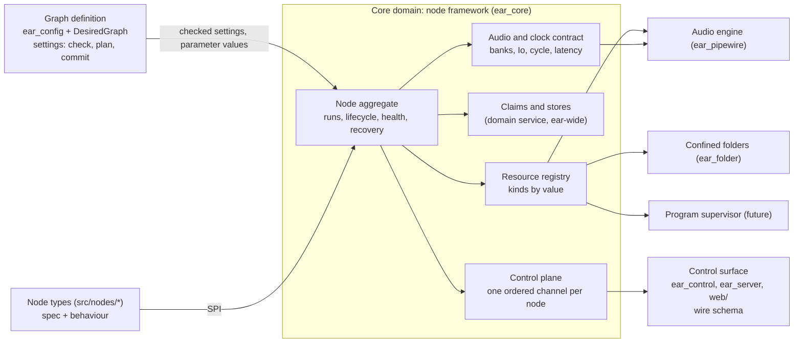
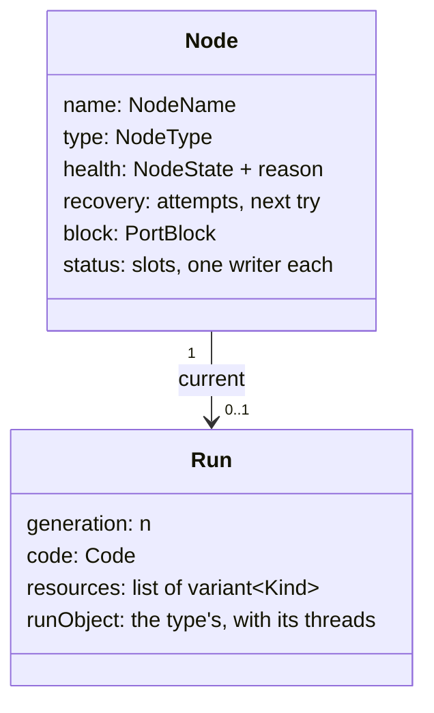

# The node framework: the primitives every node type builds on

Status: proposal, revision 3, 2026-11-07. Revision 1 went to three independent reviews (section 16); revision 2
answered them; revision 3 takes the owner's gate answers (section 14). Nothing here is built.
Layer: system design (domain model and public interfaces), beneath the agreed system design
(`docs/design/pipewire-graph.md`) and over the module designs it would change (`docs/design/batch2.md` sections 4 and 6,
`docs/design/sendspin.md` sections 3 to 8).

[V] = verified in the source named, as of `3ab159a`; [U] = unverified, so a slice's test checks it or section 15 keeps it
open.

## 1. The owner's words

| # | The owner's words | Date, where | What it means here |
|---|---|---|---|
| R1 | "what are the core primitives that ear should host so that new nodes can be added simply and only require defining the truly custom bits that its node type demands" | 2026-11-07, chat | A node type is its custom part and nothing else; everything shared is the framework's |
| R2 | "consider how to abstract configuration and control plane events so that nodes can build on a shared base primitive layer" | 2026-11-07, chat | Configuration and control-plane events are framework subsystems, not per-type code |
| R3 | "Is it a virtual node base class? Are there several distinct subsystems, like one for config and one for events? How much do nodes [have] to write to handle bus connections?" | 2026-11-07, chat | The questions this page answers (sections 3, 7, 8 and 9) |
| R4 | "can i add my own sources and sinks?"; "the core will be \"built into ear\"" | 2026-10-29, `pipewire-graph.md` R11 | Types stay built in; adding one must be cheap |
| R5 | "i will want multiple shairport instances" | 2026-10-29, `pipewire-graph.md` R9 | Many nodes of one type, and a third kind of outside thing (a program) |
| R6 | "in a general purpose sources-and-sinks graph, its always just 'running'" | 2026-10-29, `pipewire-graph.md` R2 | Nothing here may make a port block stop processing |
| R7 | Outputs on different devices stay aligned, for "seperate zones" | 2026-10-29, `pipewire-graph.md` R3 | Latency and clock facts belong to the audio contract |
| R8 | "Do we need to specify a hardware device for the clock? Can we drive it via an internal clock running under the raw monotonic clock, and just use a PLL (if necessary) to track against a hardware device anchor?" | 2026-11-07, chat (gate, Q3) | The graph runs on an internal clock; cards follow it (section 10) |
| R9 | "Nodes should not have direct access to stdout or stderr. The core framework should expose the necessary primitives for events, diagnostics, and logging. These should be real-time safe for any audio loops that need them, and there can be non real-time bases for the rest of the system." | 2026-11-07, chat (gate, Q1) | Section 8.8: the framework owns every output; nodes get primitives, realtime-safe where audio code needs them |
| R10 | "Would status changes be useful for debugging things like flapping? Does this status relate to diagnostic events?" | 2026-11-07, chat (gate, Q2) | Status has a coalesced live view and a record of every change; the framework derives flapping (8.2) |

Design rules 1 to 3 of `pipewire-graph.md` hold unchanged: one owner per piece of state, and each health judgement its
owner's; a node is self-contained, reaching the engine only through powers the framework grants; the graph always runs.

## 2. The problem, measured

What each type writes today [V]:

| Type | Lines | Classes it writes | What is really its own |
|---|---|---|---|
| `white` | 73 | `AudioCode`, `NodeInsides`, `NodeConfig`, `NodeTypeOf` | a noise loop |
| `card` | 105 | the same four | its settings, one rule across them, "open this card", and a pass-through whose indices it works out by hand (`card.cpp:38-43`) |
| `rtp` | 114 | the same four | its settings, "receive this stream", the same hand-indexed pass-through |
| `file` | 190 | the four, a descriptor wrapper, a `HandoffConsumer` | its settings, the path rule, libsndfile |
| `sendspin` | about 1,900 | the four, and the primitives below | the protocol, pairing, the time filter, mDNS |

`sendspin` had to build, privately, about 560 lines of primitives that any threaded or networked type needs [V]:
`Mailbox` (a seqlock latest-value slot), `Feed` (the handoff's reverse), `EventFd`, `NoteGate` (rate-limited notes),
`PortClaims` (which node holds which TCP port, held by the *type* across its nodes), `KeyStore` and `narrowKeyFiles` (a
0600 file per node in the config folder, swept at boot), `ConnectionWatch` (timers), and three threads of its own: the
worker (a 10 ms `poll()`), the notifier, and the library's sync thread, which writes the feed (`worker.cpp:123-135`).

The framework's own seams are closed in three places [V]:

- `NodeGrant` has one method per kind of outside node (`soundCard`, `rtpReceiver`), and `NodeHost`'s constructor takes
  one factory per kind (`node_host.hpp`). A program (R5), a network sink or an RTP sender each edits `ear_core`,
  `NodeHost`, `ear_pipewire` and `main.cpp`.
- The control plane out of a node is `InsidesEvents::say(std::string)` and `lost(std::string)`. About 11 of sendspin's 17
  note texts are state written as pairs of sentences (`connected`/`disconnected`, `pairing-code`/`pairing-code-cleared`,
  `stream`/`stream-ended`, `sending`/`sending-stopped`, `id`, `dialling`, `listening`). Notes reach standard output only,
  so the editor cannot show a pairing code.
- There is no control plane *into* a node except its settings. A failed node starts again only when a setting really
  changes (an update with the same settings changes nothing, `desired_graph.cpp`), so restarting one means changing a
  setting and changing it back, or restarting ear. `NodeState` has no `recovering` (`node_lifecycle.hpp:8`).

## 3. The answer, in one paragraph

A node type is **declarations, one behaviour, and acquisitions**. The declarations are constexpr tables in one
`TypeSpec`: settings (as today, plus a rule across them), bank names, status fields, events, actions, stores, recovery
and latency. The behaviour is one plain class: `ports` (member counts from the settings), `start` (acquires resources and
returns the run's code), `process` if it makes or changes audio, and the run object it builds for work off the realtime
thread. The acquisitions are framework-owned resources, each an RAII handle the framework readies, watches and closes in
dependency order, asynchronously. There is no base class for the author beyond the existing type-erasing `NodeTypeOf`,
and no mixins: capabilities combine freely, so they are acquired, not inherited. Five subsystems serve every type:
**configuration and parameters**, **resources**, the **control plane** (with diagnostics and logging: no node touches
standard output), **audio and clock** (an internal clock every card follows), and **recovery**. For bus connections a
type writes nothing.

## 4. Ubiquitous language

| Term | Meaning | Today's name, if different |
|---|---|---|
| **Node type** | A built-in kind of node: its type spec and its behaviour, found by its folder in `src/nodes/` | `NodeType` + `NodeTypeOf` |
| **Type spec** | A type's declarations, pure and constexpr (`TypeSpec`; `NodeSpec` stays the graph's name+type+settings, `graph_spec.hpp:25`) | the settings table, plus `NodeConfig::ports()` |
| **Node** | One named instance of a type in the desired graph; the aggregate root of everything below | — |
| **Settings** | A node's *desired* state, kept in `ear.conf`, judged by the desired graph | `NodeSettings` |
| **Parameter** | A setting declared `live`: it also has a realtime value that can move without a restart | — |
| **Port block** | The node's one `pw_filter`, made once for the node's life; owner of its public ports and the routes' ends | as today |
| **Bank** | A named, directed group of ports, public or inside; its name and direction in the spec, its members from the settings | `PortBank` (public only); inside ports are a flat list today |
| **Run** | One start of a node, from `start` to the end of its close; restarted behind the same block | `NodeInsides` |
| **Run object** | The type's own object for a run (sendspin's client, pairing, time filter), with the threads it owns | members of `NodeInsides` |
| **Context** | What `start` sees: the format, the node's name, and the acquire calls | `NodeGrant` |
| **Resource** | Something a run acquired, owned by the framework, closed with the run | outside node, handoff |
| **Resource kind** | A class of resource with its own adapter (section 7.3) | one method each on `NodeGrant` |
| **Code** | What runs on the realtime thread for one run: `prepare`, `process`, `release` | `AudioCode` |
| **Loop** | A run's serial executor off the realtime thread: a strand, or a dedicated thread | sendspin's worker |
| **Status** | A node's *observed* state, field by field, each field with one declared writer; never health | `say` texts that are state |
| **Event** | A node's *edges*, by declared code | `say` texts that are edges |
| **Action** | A command into a node; changes no desired state | — |
| **Log** | Free text for people, at a level; from node code, the realtime thread (as coded records) or captured library and program output | `std::cerr`, a library's own logging |
| **Diagnostic** | What the framework itself observes about a node: status changes, flapping, recovery attempts, drops | `dropped=` on the `stopped` line |
| **Health** | `NodeState` and its reason: the framework's judgement alone | as today |
| **Internal clock** | The graph's one driver: the dummy driver on the host's monotonic clock; every card follows it | today a linked card drives |

## 5. Bounded contexts and the context map



- **Graph definition** stays the one judge of settings. It asks each type's spec to check them (the table walk, then the
  type's rule across settings, as `make` does today), and it carries parameter changes (section 8.5) in arrival order with
  every other request. It never sees resources, status or actions.
- **Node framework** owns the node aggregate and the subsystems. Types reach it only through the SPI (section 7) and
  cannot extend its model.
- **Claims and stores** is a domain service, not part of one node's aggregate: a TCP or UDP port, an mDNS name and a
  stored file are ear-wide, so their consistency rule spans nodes (section 6, I8).
- **Audio engine, confined folders and the program supervisor** sit behind one adapter per resource kind, which keeps
  PipeWire, descriptors and process ids out of `ear_core` (as today: no PipeWire type in a public header).
- **Control surface** renders what the framework publishes (section 8.7) and judges nothing.

## 6. The node aggregate and its invariants

The node is the consistency boundary for everything one run acquires; only the framework changes it, on the main loop.
Resources are a closed `std::variant` of kinds (section 7.3), not a class hierarchy.



Invariants (each the framework's to keep, and a test's to prove):

- **I1. One block, for the node's life.** Settings changes restart the run behind it; a port change replaces the node (as
  today). A lost block is final (`node_lifecycle.hpp:11`): recovery never remakes it.
- **I2. Health is the framework's.** A type reports facts (a resource lost, `fail(detail)`); it never sets `NodeState`.
  Status never counts as health. Every fact crosses to the main loop before it acts, so no thread ever tears down the run
  it runs in (as `Channel::lost` does today, `node_host.cpp:153-157`).
- **I3. Ready is the conjunction, and never-ready is a fact.** The node is `running` when the block and every resource of
  the run are ready. Each resource kind that becomes ready later has a readiness deadline, and missing it is a loss
  (section 7.3); "never ready, never lost" cannot last.
- **I4. Nothing the realtime thread can reach is freed while it can reach it.** Every teardown starts with a barrier on
  the block's data loop: `drive(nullptr)` for a restart, the block's destruction for a removal or stop (both are blocking
  invokes, `port_blocks.cpp:97-127` [V]).
- **I5. A resource outlives every thread that can touch it.** Teardown is by dependency, not by reverse acquisition, and
  every step that waits on another thread is asynchronous. The main loop never joins a thread:
  1. the barrier (I4), then `release`;
  2. outside nodes torn down (they touch only the engine);
  3. handoffs closed: each drains and calls `finish` on its own thread, then reports (as today, `handoffs.cpp:44-91`); a
     consumer may still use the run object, which is alive;
  4. the run closes: its loops take no new work, in-flight handlers and actions finish (an action gets its reply), the
     run object stops its threads (the library's included) and says goodbye on its own thread, then calls `closed` from
     any thread (as `NodeInsides::close` today, `node_type.hpp:126-128`);
  5. on the main loop: the run object is destroyed, then feeds, mailboxes, parameter slots and wakes are freed, then stores
     close, then claims are released, last.
- **I6. Nothing from an old run lands on a new one.** Status, events and facts are written through a per-run handle that
  carries the run's generation; the main loop drops anything from an older generation, and drops everything once step 4
  began. Status slots are reset only after step 4 completes. The handle is shared-owned so a late writer never touches
  freed memory (as `Channel` is today, `node_host.cpp:142-190`).
- **I7. One run at a time.** A restart or recovery completes I5 before `start` is called again.
- **I8. A claim has one holder.** A port, mDNS name or store held by an older run, or by a removed or renamed node still
  closing, is not given to a newer one: the newer node's start waits until the older run's step 5 released it (today's
  `olderGoing` rule, `node_host.cpp:59`, generalised from names to claims). A claim held by a running node refuses
  (`startFailed: cannot listen on port <p>: held by <node>`). So removing a node on port 8928 and adding another on 8928
  in one plan works: the new one starts once the old one let go.
- **I9. Names are the node's.** Every engine object a resource makes is named `<node>.<suffix>`; every stored file is
  `<type>-<node>.<suffix>`; the registry refuses two resources of one run with one suffix.

## 7. The SPI: what a type writes

### 7.1 The type spec (declarations)

```cpp
// rtp, in this proposal
constexpr auto channelsRow = setting::required("channels", setting::number(1, 64));
// ... the other rows, as today
constexpr SettingsTable<addressRow, portRow, formatRow, channelsRow, rateRow, latencyRow> settings{"rtp"};
constexpr auto stream = bank::output("stream");
constexpr auto fromRtp = bank::insideInput("rtp");
constexpr auto receiving = status::flag("receiving", writer::resource);   // written by the receiver's adapter

constexpr TypeSpec spec{
	.settings = settings,
	.banks = Banks<stream, fromRtp>{},
	.status = StatusTable<receiving>{},
	// .events, .actions, .stores, .recovery, .latency: optional; defaults are empty, recovery::none, no latency
};
```

- **Bank names and directions are constants in the spec**; `ports(checked)` gives only each bank's members. So a
  misspelt bank in `process` does not compile, and the members' count is checked once at `prepare`.
- **A rule across settings stays at parse**: an optional `static std::expected<void, std::string> check(const Checked&)`,
  run by `parse` after the table's walk, so `card`'s "playback or capture above 0" is still `invalid-settings` and never
  reaches `ear.conf` (today `card.cpp:94`).
- **Rows are read by handle**: `s.get<channelsRow>()`, as today (`settings_table.hpp:219`). A row's value type does not
  identify the row, so there is no `s[row]` sugar.
- **Two new setting kinds are prerequisites** for types the framework claims to serve: `decimal` (gain in dB, ratios;
  it touches knobly's reader, the wire and the editor) and **indexed rows**, a family `gain.<i>` sized by a count row
  (a mixer with one gain per input). Both reuse the row machinery: one checker for settings, action arguments and
  parameters.
- **Stores are declared by suffix** (`stores = Stores<store::file("key", mode0600)>{}`): the framework names the file,
  opens it off the main loop, owns the boot sweep that narrows every such file in the folder (today `narrowKeyFiles`,
  `sendspin_type.cpp:124`) and hands the run a handle.
- The spec is the one source of: the graph file's setting kinds, the wire schema (8.7), the type's status-line
  vocabulary, and the compile-time handles the behaviour uses. Misspelt handles do not compile, as a misspelt setting row
  does today (`src/core/tests/compile_fail/`).

### 7.2 The behaviour (one plain class)

```cpp
struct Rtp {
	static Members ports(const Checked& s);                     // pure: {stream: n, fromRtp: n}
	static Started start(Context& cx, const Checked& s);        // main loop; never blocks, does no I/O
};
NODE_TYPE(rtp, spec, Rtp);
```

`NODE_TYPE` expands to the named function the generated type list calls (today's `make<Type>NodeType`), never to static
self-registration, which a static library drops at link time; it keeps the compile-time check that the table is named
for its folder.

`Started` is a failure (`startFailed: <detail>`) or the run: its code, and optionally its run object.

| The run's code | When |
|---|---|
| `passThrough(fromBank, toBank)` (one or more pairs) | audio joined to an outside thing: `card`, `rtp` |
| a class with `prepare`, `process`, `release` (a concept, erased once) | a type that makes or changes audio |

There is no `NodeConfig` or `NodeInsides` to write. The **run object** is any class with `close(done)`, built in `start`
from acquired resources; the framework owns it and closes it at I5 step 4. It holds the threads the type's library owns,
and it alone joins them, off the main loop.

### 7.3 The resources (acquisitions)

`Context::acquire(request)` on the main loop, inside `start` only (else `std::logic_error`, as `NodeGrant` today). The
list is a closed `std::variant` in core on purpose: a kind changes what the framework promises. Each kind has one adapter.

| Kind | Request | The type gets | Ready when (deadline) | Lost when | Replaces |
|---|---|---|---|---|---|
| Sound card | `outside::soundCard{card, direction}`, an inside bank | nothing to hold | its PCM runs and every link is active (deadline) | ERROR, proxy removed, a link failed, or the follower watchdog (9.5) | `NodeGrant::soundCard` |
| RTP receiver | `outside::rtpReceiver{...}`, an inside bank | nothing; it writes its `receiving` field | its node runs and every link is active (deadline) | as above | `NodeGrant::rtpReceiver` |
| Program (future, section 7.5) | `outside::program{...}` | nothing | its process runs | its process exits | — |
| Handoff | `handoff{bank, frames, consumer}` | an `RtWriter&` for `process` | at once | — | `NodeGrant::handoff` |
| Feed | `feed{bank, frames}` | an RT reader for `process`, a writer that may wait for room | at once | — | sendspin's `Feed` |
| Mailbox | `mailbox<T>{}` | an RT writer, a reader off RT; newest wins | at once | — | sendspin's `Mailbox` |
| Wake | `wake{}` | an RT ring, at most once until answered; a handle a loop waits on | at once | — | sendspin's `EventFd` |
| Loop | `loop::strand`, `loop::dedicated` (any number) | a serial executor: post, timers, fd watches, wakes | its thread runs | — | sendspin's worker and notifier, `ConnectionWatch` |
| Store | declared in the spec (7.1) | read and replace-if-unchanged, off the main loop | once opened and trusted (asynchronous) | a file it cannot trust | `KeyStore`, `narrowKeyFiles` |
| Recordings file | `recording{path}` | a descriptor beneath the recordings folder | at once | — | `NodeFolders.recordings` |
| Port claim | `claim::tcpListen{port}`, `claim::udp{port}` | nothing | at once, or waits (I8), then probed | — | sendspin's type-level `PortClaims` |
| mDNS advertisement (when a second type needs it) | `advertise{service, port, name, txt}` | nothing | first announcement sent | — | sendspin's `Advertiser` |

- **Readiness deadlines.** Today a port held by another program leaves an `rtp` node `starting` for good, because
  PipeWire only logs the failed bind (AGENTS.md); a card whose PCM never runs gives no event either. Each kind with a
  later readiness has a deadline (a default per kind, at least the kind's own start time) after which the framework
  counts it lost, with the kind's reason.
- **Adapter-sourced status.** A resource kind may write fields of its node's status table that the spec gives
  `writer::resource`. The RTP adapter binds the rtp-source node's proxy and copies `rtp.receiving` (a bound proxy sees
  it; the registry does not [V: `rtp.md` finding h]), and passes a short `cleanup.sec` so silence is seen within seconds,
  not 60 [U: the value].
- **Blocking feed writes** are legal only from a dedicated loop or a thread the run object owns, never from a strand
  (asserted in debug builds).
- **Folders become resources**; `NodeFolders` and `make<Type>NodeType(const NodeFolders&)` go.
- **Live properties of an outside node** (an ALSA adapter's volume `Props`) belong to its kind's adapter, set through a
  parameter (8.5); not designed here.

### 7.4 Threads, as one contract for every type

| What the type writes | Runs on | May |
|---|---|---|
| Rows' parse functions, `check`, `ports` | any thread, pure | nothing else |
| `start` | the main loop | acquire; construct. No blocking, no I/O (stores open on the framework's side) |
| `prepare`, `release` | the main loop, never with `process` | allocate |
| `process` | the realtime thread | the RT ends of its resources, `io`, `rt` status fields, `rtlog` and `rtevent` only. No locks, allocation, retry loops on a shared value, or syscalls other than a wake |
| Loop handlers, action handlers | the run's loop, serially | block only on a dedicated loop |
| The run object's own threads | its threads | anything; the object joins them in `close` |
| `HandoffConsumer::consume`, `finish` | the handoff's thread | block on I/O |

After `start` returns, no type code runs on the main loop (sendspin's discipline today, `docs/design/sendspin.md`
section 6). Debug builds assert the thread at every `acquire`, status write, event, loop post and feed write, as CLAP's
thread-check does.

**Strands by default, dedicated on request** (the owner's answer, Q5). A strand runs on a small framework pool, so many nodes (R5) do not cost a
thread each; a handler that runs longer than a bound is reported. A type whose library blocks or must be polled asks for
`dedicated` loops, as many as it needs: sendspin keeps a worker (the library's poll, 10 ms [V: `worker.cpp`]) and a
separate notifier, so a late "played" report never waits behind the worker's disk writes (`worker.cpp:307-323`).

### 7.5 The program kind: a pipe into a feed first

The owner's answer (Q7): programs first join through a pipe, not PipeWire's socket.

- **`outside::program{argv, stdout → feed bank}`.** ear starts the program with its audio on standard output
  (shairport-sync can write raw PCM to a pipe [U: its exact format flags]); a framework thread reads the pipe into a feed,
  which the block's code reads like sendspin's. No socket is served, no new trust boundary, and the feed primitive is
  reused.
- **Health is process-alive only** (design rule 1): ready when the process runs, lost when it exits. Silence on the
  pipe between sessions is not a loss, so recovery never kills a healthy idle process.
- **The program's own logging** (its stderr) is captured into the node's log (8.8); it never reaches ear's standard
  output directly.
- Claims for its ports (5000, 7000), and the mDNS resource or its own Avahi use [U: whether shairport-sync can
  advertise without a D-Bus Avahi in the container].
- **Serving PipeWire's socket** stays possible later, for programs that can only be PipeWire clients; then the mark comes
  from the socket's peer credentials (`pipewire.sec.pid`), and ear writes the program's configuration to give its nodes
  `<node>.<suffix>` names and to turn its autoconnect off.

## 8. The control plane

### 8.1 Channels, by what they are

| Channel | Declared in | Kept | Written by | Delivery | On the wire | On standard output |
|---|---|---|---|---|---|---|
| **Settings** (desired) | `SettingsTable` | `ear.conf` | the graph file keeper | as today | `node.added`, `node.updated` | as today |
| **Parameters** (desired, live) | rows marked `live` | `ear.conf`, at commit (8.5) | the keeper | to an RT slot, wait-free | `node.param` | at commit only |
| **Status** (observed) | `StatusTable`, one writer per field: `loop`, `rt` or `resource` | memory; in snapshots | that writer | a coalesced live view, rate-capped, and a record of every change (8.2) | `node.status {name, fields}` | each change, as a `status` record (8.8) |
| **Events** (edges) | `EventTable` | not kept | the run's loop or, as coded records, `process` | queued, rate-limited (8.3) | `node.event {name, code, args}` | an `event` record |
| **Actions** (commands in) | `ActionTable` | not kept | a client, through the keeper | to the run's loop; reply | `node.act` → `{}` or an error | — |
| **Log** (free text) | levels only | not kept | any node code, the realtime thread as coded records, and captured library or program output | queued, rate-limited (8.8) | later, a log subscription | a `log` record |
| **Diagnostics** (the framework's own observations) | the framework | counters in snapshots | the framework alone | records on the change | in snapshots | a `diagnostic` record |

Health (`node.state`) is not a channel a type writes (I2). No node writes standard output or standard error (8.8).

**One ordered stream per node.** Status, events and facts from one run reach the main loop in the order they were
written: before an event or a fact is delivered, the node's dirty status fields are flushed. So `connected="Kitchen"`
always precedes `paired`, and the last status before a `lost` is not overtaken by it. A snapshot carries each node's
status and state from the same main-loop turn.

### 8.2 Status: coalesced slots, capped rate

- Each field is a slot with exactly one declared writer, so a seqlock's single-writer rule holds. `rt` fields are
  fixed-size (flag, whole number, closed enum); text fields are written by a loop or a resource.
- A loop or resource write marks the field dirty and, if the node was clean, rings the status bell once (gated until the
  drain). An `rt` write never rings: `rt` fields are sampled at each drain.
- The main loop drains at most once per 33 ms (one level window): a bell rung sooner arms a one-shot timer for the rest
  of the window. So `node.status` is at most 30 a second per node, whatever a peer or the realtime thread does, and the
  drain is still driven by events (the bell), not polled.
- Counters the framework keeps for every node (frames a handoff dropped, frames a feed came up short) are not status
  writes: they are read at a drain, in snapshots and on the `stopped` line (`dropped=`), so a node idling on an empty feed
  makes no traffic.
- Text is the framework's to make safe: UTF-8 checked, control characters scrubbed, escaped in records (8.8), bounded
  (declared maximum, default 256 bytes, cut and marked). A peer's text (a server name) needs no per-type code (today
  `notes::printable`, `notes.hpp:14`).
- **Two outputs, not one** (the owner's answer, Q2; R10). The *live view* above is coalesced: the editor and snapshots
  show what is true now. The *change record* is every write the framework sees, turned into a `status` record (field,
  old value, new value, the time of the write) on the writer's thread (`rt` writes through the coded ring of 8.8), so the
  debugging trail keeps what the view drops. The record is rate-limited per node like events, with drops counted.
- **Flapping is the framework's to see.** It counts transitions per field per window and, above a threshold, emits a
  `status.flapping` diagnostic (field, transitions, window), so a flapping field is visible even when its change
  records were rate-limited. No type writes code for this.

### 8.3 Events: queued edges

Rare by declaration: `pairing-failed <reason>`, `key-write-failed <detail>`, `paired <server id>`. Codes and argument
kinds come from the table. A bounded per-node queue; a burst of 32 passes, then one a second, and what was held back is
counted in one `events-dropped <n>` (today's `NoteGate` policy, `note_gate.hpp`, moved into the framework). Not
writable from the realtime thread.

### 8.4 Actions: commands in

- Every control request already goes whole to the keeper's thread in arrival order (AGENTS.md, threads); actions do too,
  so an action is ordered with the edits around it. The keeper posts it to the main loop, the framework checks its
  arguments against the type's table and posts it to the run's loop; the handler's `std::expected<void, std::string>`
  becomes the reply.
- A queued action whose run ends before it runs gets `restarted` (a restart or recovery) or `stopping`; an action already
  running finishes and replies before the run's loop closes (I5 step 4). A node with no run answers `not-running`.
- **`restart` is every node's**, the framework's own: the same teardown and start as a settings change, without editing
  `ear.conf`, and it skips any recovery wait.
- An action changes no desired state. What should survive a restart is a setting or a parameter.

### 8.5 Parameters: one model for live values

Revision 1 had live settings, parameter slots and actions overlapping. They are one model now, after CLAP's parameters
and gestures:

- A setting row declared `live` is a **parameter**. The framework owns its realtime slot (wait-free: a triple buffer
  with an atomic index exchange, so the realtime reader never retries) and gives `process` its value as
  `io.param(gainRow)`. A type writes no slot, no `onSettings` and no loop for it, so a type with no loop has parameters.
- `node.param {name, key, value, gesture}` moves it: `begin`, `change`… set the slot and tell subscribers, persisting
  nothing; `end` (or a set without a gesture) commits once, as a settings edit at its source through the desired graph,
  and `ear.conf` is written behind as usual. A fader drag is one file write, not one per tick.
- A hand edit or `graphFile.set` that changes a live row's value moves the slot without a restart. A change to any
  other row restarts; a change of ports replaces.
- Smoothing is offered, not imposed: `Smoothed<float>` ramps a parameter over a declared time in `process`.
- A live row of an outside node's property (a card's volume) is set by its kind's adapter (7.3).
- Timestamped changes (a mute at a media time) need an event ring keyed on graph position; reserved, not designed (15).

### 8.6 Recovery (section 10 has the clock's part)

`NodeState` gains `recovering {retryInMs}`. The default for every type is `recovery::backoff{1s, 60s}`, retrying for
as long as the node is in the graph (the owner's answer, Q4): after a loss the node is torn down (I5), waits, and starts
again; each failure doubles the wait up to 60 s, and a run that stays `running` for 60 s resets it. So a card replugged
hours later comes back by itself. A type may declare `recovery::none` or a cap (`attempts`), after which it is `failed`
until `restart` or a settings change. Each attempt is a diagnostic record. The wait is a main-loop timer.
A lost block is final (I1). This is also how a program that keeps crashing restarts (`pipewire-graph.md`: "backoff
sounds good").

### 8.7 The wire schema

- `types` stays a sorted list of names (`graph_view.hpp:25`, `test/protocol/snapshot.json`). A new field,
  `typeSchemas`, gives for each type its settings rows (key, kind, required, default, range, unit, live, what a text must
  be), banks, status fields, event codes and actions, generated from the spec, with a hash of each type's schema so a
  client can cache it.
- `graph.get` gains `protocol`, the framework's wire version, separate from the types' hashes.
- New notifications (`node.status`, `node.event`, `node.param`) are ignored by a client that does not know them; the
  editor today ignores events naming unknown nodes (`batch2.md` section 6), and the rule becomes "unknown methods too".
- The editor renders forms, status and action buttons from `typeSchemas`, naming no type in `web/`.

### 8.8 Diagnostics and logging: nodes never touch standard output

The owner's rule (R9): nothing a type writes, and nothing its libraries or programs write, reaches standard output or
standard error directly. The framework owns every output and decides where it goes.

**What a node gets**, all through its run handle, so generation-checked and dropped after close begins (I6):

| Primitive | Off the realtime thread | On the realtime thread |
|---|---|---|
| **Log** (`debug`, `info`, `warn`, `error`) | free text, formatted on the caller's thread, bounded per record; queued, rate-limited per node (a burst, then one a second, drops counted) | `rtlog(code, n...)`: a declared code and up to four numbers |
| **Event** | as 8.3 | `rtevent(code, n...)`: likewise |
| **Status** | as 8.2 | `rt` fields only, through their slots |
| **Diagnostics** | the framework's alone: status changes, flapping, recovery attempts, readiness deadlines missed, handoff drops, feed shortfalls, xruns, captured output that was cut | — |

- **The realtime path.** `rtlog` and `rtevent` write a fixed-size record (code, numbers, the cycle's position) into a
  per-run single-producer ring acquired at start: no formatting, no allocation, no lock, no syscall. A full ring drops
  the record and counts it. The framework drains the ring off the realtime thread, on the status drain (8.2), and formats
  the text from the code's declaration in the spec, so the realtime thread never touches a string.
- **Captured output.** A library's logging is routed into its node's log at its own level, through the library's log
  hook (sendspin-cpp [U]; a library with no hook gets one through a carried patch, as `cmake/sendspin-listener.patch`
  does today, because ear's standard error is one stream for the whole process and cannot be attributed to a node). A
  program's standard error is read by a framework thread, line by line, into its node's log (7.5).
- **Boot-time messages** a type writes today (`sendspin_type.cpp:125`, key files narrowed at boot) become diagnostics of
  the store service (7.1).
- **Enforced, not trusted.** A CTest test refuses any reference to `std::cout`, `std::cerr`, `stdout`, `stderr`,
  `printf` or a write to file descriptors 1 or 2 under `src/nodes/`, as configure refuses one type linking another today.

**Structured from day one** (the owner's answer to Q1). Every line ear writes on standard output is one JSON object, in
one schema, from one encoder (`status_log.cpp` stays the one home):

```json
{"v":1,"t":"2026-11-07T17:42:03.512094Z","kind":"node","node":"desk","state":"recovering","retryMs":4000,"reason":{"code":"engine-refused","detail":"card lost"}}
{"v":1,"t":"2026-11-07T17:42:03.600211Z","kind":"status","node":"kitchen","field":"connection","from":"dialling","to":"connected"}
{"v":1,"t":"2026-11-07T17:42:04.010877Z","kind":"event","node":"kitchen","code":"pairing-failed","args":{"reason":"pairing-code-mismatch"}}
{"v":1,"t":"2026-11-07T17:42:04.011020Z","kind":"log","node":"kitchen","level":"warn","source":"sendspin-cpp","text":"…"}
{"v":1,"t":"2026-11-07T17:42:10.000000Z","kind":"diagnostic","node":"kitchen","code":"status.flapping","field":"connection","transitions":14,"windowS":10}
```

- Today's lines (engine scheduling, `control listening`, node states, routes, `graph-file …`, `says`) become records of
  their kinds carrying the same facts; none is kept in its old text form.
- Text from peers and libraries is a JSON string, escaped, never interpreted.
- The schema's home is a fixture, `test/protocol/output-records.json`, read by the C++ tests, the system tests and any
  tooling, as the wire's fixtures are.
- The wire gains a log subscription later (`log.subscribe`, filtered by node and level) with no node changing.

## 9. The audio contract

### 9.1 Bus connections: the type writes none

Public banks are declared; the framework makes the block, its ports, the routes' links and status, and the levels, as
today. An outside resource names the inside bank it joins, and the framework joins it. A pass-through is the framework's
code. A type writes no link, port id, registry lookup or route handling; `card` and `rtp` write no audio code.

### 9.2 `Io` by bank

```cpp
struct White {
	std::mt19937 gen{std::random_device{}()};
	void process(Io io, const GraphCycle&) noexcept { for (auto ch : io[noise]) fill(ch, gen); }  // `noise` from the spec
};
```

Bank handles resolve to indices in `prepare`, so `io[bank]` is an array index on the realtime thread. Each member is a
span of exactly `io.frames()`; an unlinked input reads zeros and every output sample is written (today's contract,
`node_type.hpp`).

### 9.3 `GraphCycle` grows the clock facts network nodes need

Today it carries `startNs`, `position` and `delayFrames`, from `spa_io_position.clock` (`port_blocks.cpp:197`). It
gains, from the same structure: the driver's identity (its clock id), `discontinuity` (set by the framework for the first
cycle after a driver change or a position jump), `rateDiff`, `nextNs` and the xrun count. A type dating what it played
(sendspin, `sendspin_code.cpp:52`) then knows when its clock jumped instead of hard-syncing blindly.

### 9.4 Latency is the framework's

The framework owns the `pw_filter`, so a type cannot set port latency. By default `pw_filter` merges latency across all
of a filter's ports, which mixes independent paths (a card's playback and capture; sendspin's `to` and `from`) [U: the
merge rule, from `pw_filter`'s source]. So:

- port blocks use `PW_FILTER_FLAG_CUSTOM_LATENCY` and the framework propagates latency per bank pair;
- `passThrough` forwards the outside node's latency onto its public bank;
- a type declares its own internal latency in the spec (static) or reports it from its loop (dynamic: `rtp`'s
  `latencyMs`, a feed's size);
- `process` sees, per output bank, the latency downstream of it, which replaces the single driver `delayFrames` (wrong
  today when sendspin's output reaches a following card or a file).

This is what R7's zones, sendspin's clock and an AirPlay delay estimate all need; it moves from revision 1's open items
into the contract, and has its own slice (section 13, slice 8).

### 9.5 Driving the graph

- **Invariant: only the internal clock drives** (section 10). Every card, network type and program follows it. A driver
  resource kind (`node.driver`, `pw_filter_trigger_process`) is not designed; a type that needs one is a core change.
- **A frozen card no longer stalls the graph**: it is a follower, so the blocks keep their clock. Its loss is still seen
  through ERROR, a removed proxy or a failed link, and additionally by a follower watchdog: a card whose buffer stops
  moving against the graph clock for a bound (several level windows) is a fact against that card alone [U: what an
  ALSA follower reports when its device freezes].
- A card's playback and capture are two ALSA adapters of one device, each following the internal clock with its own
  rate match; whether they drift apart from each other is [U], checked on hardware.

## 10. The graph clock: internal, and every card follows

Today a sound card drives by being linked into the blocks' graph group: the dummy driver is linked to nothing and in no
group, so a linked card is the only driver the blocks can take (`cardPriority = 1`, `engine_names.hpp:12`;
`pipewire-engine` skill, "Sound cards and the clock", step 2 [V]). Each failure of the driving card moves the clock twice,
for every node, and each move costs every `rtp` receiver about `latencyMs` of audio, makes sendspin hard-sync
(`sendspin_code.cpp:26`) and puts a gap in a recording.

The owner's answer (Q3, R8): **the graph always runs on ear's internal clock, and every card follows it.**

- **The internal clock** is the dummy driver (`support.node.driver`, `engine.conf`), a timer on the host's monotonic
  clock. It joins the blocks' group (or every card is made `node.driver = false`; the spike picks), so it is always the
  graph's driver, whatever links or fails [U: which of the two PipeWire honours; the card slice's spike].
- **Cards follow with adaptive resampling.** PipeWire's ALSA node, when it follows another driver, runs a delay-locked
  loop on its buffer against the graph clock and steers the adapter's resampler: the tracking PLL of R8, built in. Each
  card's status carries `following` and its current rate ratio (adapter-sourced, 7.3).
- **What it gains.** No card ever moves the clock, so a card's failure and recovery cost only that card's audio, and
  backoff that never gives up (8.6) is safe for every type. The graph's clock identity never changes in normal running,
  so `discontinuity` (9.3) marks only the rare jump (a host clock step, an xrun).
- **What it costs.** Every card is resampled all the time, so no output is bit-perfect; a small CPU cost per channel; a
  little more latency per card (the follower's headroom); and the rate takes a few seconds to settle after a card starts.
- **Verification needs hardware.** CI's test card is a null PCM with no oscillator of its own, so CI proves the wiring
  (the dummy drives with a card linked, the card follows, its loss leaves the clock alone) but not drift tracking; that is
  checked on the MOTU (`ear-on-talos` skill).
- **Later, an anchor.** R8's second half, an internal clock that tracks one card (that card bit-perfect) and keeps its
  last rate when the card is lost, needs ear's own driver node; it can be added as a graph setting (`clock anchor desk;`)
  without changing this model.
- **Which host clock.** `CLOCK_MONOTONIC_RAW` (R8) is immune to NTP slewing, which suits a free-running master; but
  `GraphCycle.startNs` and sendspin's time filter are on `CLOCK_MONOTONIC` today, and followers absorb NTP's few parts per
  million either way. The spike checks whether the dummy driver can run on the raw clock in PipeWire 1.4.2, and the
  choice is made with what it costs the timestamps [U].

## 11. The types, rewritten

| Type | Today | This proposal (estimate) | What remains its own |
|---|---|---|---|
| `white` | 73 lines, 4 classes | about 25, 1 struct | the noise loop |
| `card` | 105, 4 classes | about 40 | its rows, its `check`, two acquisitions, `passThrough` |
| `rtp` | 114, 4 classes | about 45 | its rows, one acquisition, `passThrough`; `receiving` comes from its adapter |
| `file` | 190 | about 90 | its rows, the path rule, libsndfile in a `HandoffConsumer` |
| `sendspin` | about 1,900 | about 1,300 | the protocol, pairing, the time filter, PCM, mDNS (until a second user); status for connection, code, stream, sending; events for pairing results |
| `gain` (new; needs `decimal` and `live`) | — | about 30 | one live row, `Smoothed<float>`, a multiply |

```cpp
// sendspin's start, in this proposal
static Started start(Context& cx, const Checked& s) {
	if (!s.get<serverRow>()) cx.acquire(claim::tcpListen{s.get<portRow>()});   // waits or refuses per I8
	auto& feed = cx.acquire(feed{from, feedFrames(cx.format())});
	auto& worker = cx.acquire(loop::dedicated);
	auto& notifier = cx.acquire(loop::dedicated);
	auto client = SendspinRun::make(cx, worker, notifier, cx.store<keyStore>(), feed, s);  // owns the library's threads
	auto& toServer = cx.acquire(handoff{to, cx.format().rate / 2, client->toServer()});
	return Started{SendspinCode{feed, toServer, client->progress()}, std::move(client)};
}
// Teardown (I5): barrier, release; handoff `to` drains into the client; the client closes, stopping the library's sync
// thread (the feed's writer) and both loops; then the feed, the store and the claim go.
```

## 12. What it gives up, and costs

- **More compile-time machinery.** The settings table already needs 37 compile-fail tests (about 50 s at one job).
  Status, event, action and store tables reuse its rows, so they add cases, not a second machine.
- **A wider core.** `ear_core` gains the resource contracts, the per-node ordered stream, parameter slots and two
  main-loop timers (status cap, recovery) plus readiness deadlines. It stays free of PipeWire, sockets, threads and files:
  the loop pool, eventfds and stores are behind interfaces in `ear_pipewire` and `ear_folder`.
- **Standard output changes completely.** Every line becomes a structured JSON record (8.8); AGENTS.md's status-line
  contract, `status_log.cpp` and every system test that reads standard output change, in one slice.
- **The live view loses intermediate states** within a window, by design; the change record keeps them, up to its rate
  limit, and flapping is a diagnostic (8.2).
- **No card is bit-perfect** (section 10), until the anchor exists.
- **A shared strand pool** is a new place where one node can delay another; `dedicated` is the escape.
- **Resource kinds stay a closed list in core.** Only types are open.
- **The follower watchdog can misjudge** a host so loaded the data thread stalls (`rtp.md` erratum 3); its bound must
  sit well above the xrun stalls the tests already tolerate.

## 13. Slices

Each slice keeps every existing test green and changes no audio path unless it says so.

1. **The registry and the teardown contract.** `Context::acquire` with the two outside kinds and handoffs; named inside
   banks; `passThrough`; I4 to I7 as tests (a feed writer blocked at teardown, a loop mid-handler, a late status write
   from an old generation). `NodeHost` takes the registry. `card` and `rtp` move.
2. **The SPI's shape.** `TypeSpec`, `check`, bank constants, `NODE_TYPE`, `Io` by bank; `white` and `file` move; folders
   become resources.
3. **Primitives into core.** Loops, feed, mailbox, wake, stores (boot sweep, async open), claims (I8). `sendspin` moves
   and deletes its copies.
4. **Diagnostics and structured output.** The output primitives of 8.8 (log, events, status records, diagnostics), the
   coded realtime ring, library and program output captured, every standard-output line a JSON record; `sendspin_type.cpp`'s
   `std::cerr` and the library's own logging moved onto them; AGENTS.md's contract and the system tests changed.
5. **The control plane.** The ordered per-node stream, status (live view and change record, flapping), events, actions
   through the keeper, `restart`, `typeSchemas` and `protocol`, the editor rendering from them; sendspin's notes split.
6. **Parameters.** `decimal` and indexed rows, `live`, triple-buffered slots, `node.param` with gestures,
   `Smoothed<float>`; a `gain` type proves it.
7. **The internal clock** (a PipeWire spike first): the dummy always drives, cards follow, the raw-clock question;
   checked in CI for wiring and on the MOTU for drift. This slice changes the audio path.
8. **Clock facts and latency.** `GraphCycle`'s new facts, custom latency per bank pair, declared and reported latency,
   downstream latency in `process`.
9. **Recovery.** Readiness deadlines, the follower watchdog, adapter-sourced status (`rtp` `receiving`, a card's
   `following`), `recovering` with backoff that never gives up.
10. **Programs**: `outside::program` with a pipe into a feed (7.5), then an `airplay` type.

## 14. Gate answers

The owner's answers, 2026-11-07, in chat (current choices; later evidence may reopen them):

| # | Question | The owner's answer | Where it lands |
|---|---|---|---|
| Q1 | What does a node's output look like on standard output? | R9: nodes never touch standard output or error; the framework gives primitives for events, diagnostics and logging, realtime-safe where audio code needs them. Then, of the output format: "Structured from day one" | 8.8; slice 4 |
| Q2 | Is status coalesced? | Asked first whether status changes help debug flapping and how status relates to diagnostics (R10); then "View + change record": a coalesced live view, a record of every change, a framework flapping diagnostic | 8.2 |
| Q3 | How is the clock chosen? | Asked whether a hardware clock is needed at all, or an internal clock with a PLL against a device (R8); then "Internal, cards follow" | Section 10; slice 7 |
| Q4 | Default recovery | "Backoff, never gives up": 1 s doubling to 60 s, for as long as the node is in the graph | 8.6; slice 9 |
| Q5 | Loops | "Strands, dedicated on request" | 7.4 |
| Q6 | Live values | "Commit at gesture end" | 8.5 |
| Q7 | Programs' first step | "Pipe into a feed first" | 7.5; slice 10 |

## 15. Open items

- [U] Whether PipeWire's data thread flushes denormals for filter callbacks; if not, whether the framework sets FTZ/DAZ
  around `process`.
- [U] `pw_filter`'s default latency merge, and `PW_FILTER_FLAG_CUSTOM_LATENCY`'s behaviour in 1.4.2.
- [U] Whether the dummy driver drives with a card linked by joining the group or by cards marked `node.driver = false`;
  whether it can run on `CLOCK_MONOTONIC_RAW`; drift tracking on the MOTU; whether a card's playback and capture
  adapters drift apart (section 10).
- [U] What an ALSA follower reports when its device freezes (the follower watchdog, 9.5).
- [U] Whether sendspin-cpp has a log hook, so its logging can be captured (8.8); if not, what its logging writes to.
- [U] shairport-sync's raw PCM output flags and its mDNS without D-Bus in the container (7.5).
- [U] Whether a USB unplug reaches the ALSA adapter's ERROR state without udev in the container.
- [U] `cleanup.sec`'s smallest safe value for `rtp`'s `receiving`.
- Stop costs one blocking barrier per node (`node_host.cpp`'s `stopAll`); batching them is a later improvement.
- Timestamped parameter changes and events (8.5): reserved.
- A driver resource kind (9.5): not designed.

## 16. Review record

Revision 1 (commit `docs(design): propose the node framework's primitives…`) went to three reviewers working
independently, each given the page and the code, not the author's reasoning: **A**, realtime safety and concurrency;
**B**, audio graphs, clocking and PipeWire; **C**, plugin-API design (CLAP, VST3, LV2, JUCE) and domain-driven design.
Every finding's evidence in the code was checked before it was taken. Disposition: **taken** (the section that answers
it), **partly**, or **not taken** (why).

### Blockers

| # | Finding | By | Disposition |
|---|---|---|---|
| 1 | Reverse-acquisition teardown frees the feed, handoff, store and claim while the run's threads (the library's sync thread writes the feed, `worker.cpp:123-135`) still use them | A, C | Taken: I5, dependency order. B's "keep reverse order" is overruled by A and C's evidence |
| 2 | The asynchronous close (`NodeInsides::close(closed)`, handoff close) is dropped; a blocking loop would hang the main loop, and `fail()` could join its own thread | A, C | Taken: I2 (facts cross to the main loop), I5 (every wait asynchronous) |
| 3 | Recovery ignores which card drives: each attempt moves the clock twice for every node | B | Taken: section 10. Revision 3: the owner chose an internal clock every card follows (Q3), so no card moves the clock |

### Major

| # | Finding | By | Disposition |
|---|---|---|---|
| 4 | Param slot on a seqlock: a realtime reader can spin behind a preempted non-realtime writer | A | Taken: triple buffer (8.5); no retry loops on RT (7.4) |
| 5 | RT-written counters ring the bell every cycle: about 190 wakes and wire events a second per idle sendspin node | A | Taken: RT never rings; counters sampled; 33 ms cap (8.2) |
| 6 | Stale status from an old run, writes after removal, two writers per field | A | Taken: I6 (generation, shared handle), one writer per field (8.2) |
| 7 | Sendspin's threads misread: the feed's writer is the library's thread; the notifier is separate on purpose; feeds would block strands | A | Taken: run object owns library threads (7.2), several dedicated loops, feed writes only off strands (7.3, 7.4) |
| 8 | Store reads moved onto the main loop; boot sweep of orphaned key files lost; type builds the file name | C | Taken: stores declared by suffix, opened off the main loop, sweep is the framework's (7.1, I9) |
| 9 | Rules across settings had no home; moving card's to `start` would write refused settings to `ear.conf` | C | Taken: `check` at parse (7.1) |
| 10 | Live settings, param slots and actions overlap; no fader model | C | Taken: one parameter model with gestures (8.5), Q6 |
| 11 | A gain or mixer cannot be written: no decimal kind, no indexed rows | C | Taken: prerequisites in 7.1, slice 6, a `gain` estimate in 11 |
| 12 | The program kind is incoherent: no socket, the mark, configuration, idle streams | B, C | Taken: 7.5 as prerequisites, Q7 |
| 13 | Status, events and health had no order between them | C | Taken: one ordered stream per node (8.1) |
| 14 | `types` already exists as a string list; one protocol number mixes framework and types | C | Taken: `typeSchemas` with hashes, `protocol` separate (8.7) |
| 15 | Actions bypassed the keeper; in-flight actions at restart unspecified | A, C | Taken: through the keeper; `restarted`/`stopping`; in-flight finish (8.4, I5) |
| 16 | `s[row]` and bank checks against `ports()` cannot be compile-time | C | Taken: `get<row>()` kept; bank names constants in the spec (7.1) |
| 17 | "Never ready, never lost" (rtp port held elsewhere, a card that never runs, a frozen driver) | B | Taken: readiness deadlines (7.3, I3), the follower watchdog (9.5) |
| 18 | `rtp`'s `receiving` cannot be measured by a type with no code; it lives on the node proxy | B | Taken: adapter-sourced status (7.3) |
| 19 | `GraphCycle` drops clock identity, discontinuity, rate and xruns | B | Taken: 9.3 |
| 20 | Latency must be the framework's now; `pw_filter` merges latency across ports | B, C | Taken: 9.4 and slice 8; the merge rule stays [U] |

### Minor and nits

| # | Finding | By | Disposition |
|---|---|---|---|
| 21 | Wake gating unspecified; sendspin rings every cycle today | A | Taken: "at most once until answered" in 7.3 |
| 22 | Teardown does not always start with `drive(nullptr)`; stop costs a barrier per node | A, C | Taken: I4 reworded; batching in 15 |
| 23 | Live settings on a type with no loop | A, B | Taken: parameter slots need no loop (8.5) |
| 24 | Name reuse (`olderGoing`) must cover claims and recovery; a remove and add of one port in one plan | A, C | Taken: I8 |
| 25 | Peer text on status lines needs framework sanitising | C | Taken: 8.2 |
| 26 | Thread rules need assertions | C | Taken: 7.4 |
| 27 | `NODE_TYPE` must not self-register; keep the folder check | C | Taken: 7.2 |
| 28 | `NodeSpec` is taken | C | Taken: `TypeSpec` |
| 29 | DDD decoration: claims are cross-node; the class diagram's inheritance contradicts the variant; labels without consequence | C | Taken: claims as a domain service (5, I8); diagram redrawn; labels dropped |
| 30 | Sample-accurate timed changes | B | Partly: reserved in 8.5 and 15, not designed |
| 31 | A node that wants to drive | B | Taken as an invariant (9.5); a driver kind not designed |
| 32 | Card playback and capture adapters' clocks | B | Open item [U] (15), checked in the card slice |
| 33 | Outside nodes' live properties (card volume) | B | Partly: the adapter's, through a parameter (7.3, 8.5); not designed |
| 34 | A lost block and recovery | B | Taken: I1 |
| 35 | The level bell is drained on the control thread, so the status bell is new design, not a reuse | B | Taken: 8.2 no longer claims reuse |
| 36 | "Restarting a failed node takes a no-op settings edit" was wrong | A, C | Taken: section 2 corrected |

Not taken: none. One conflict between reviewers (row 1) was decided on the evidence.
