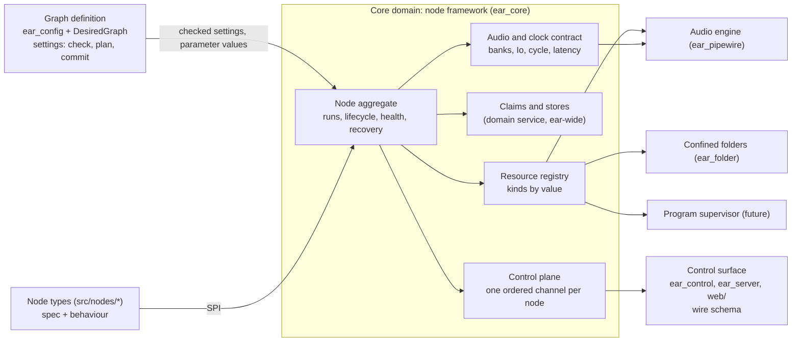
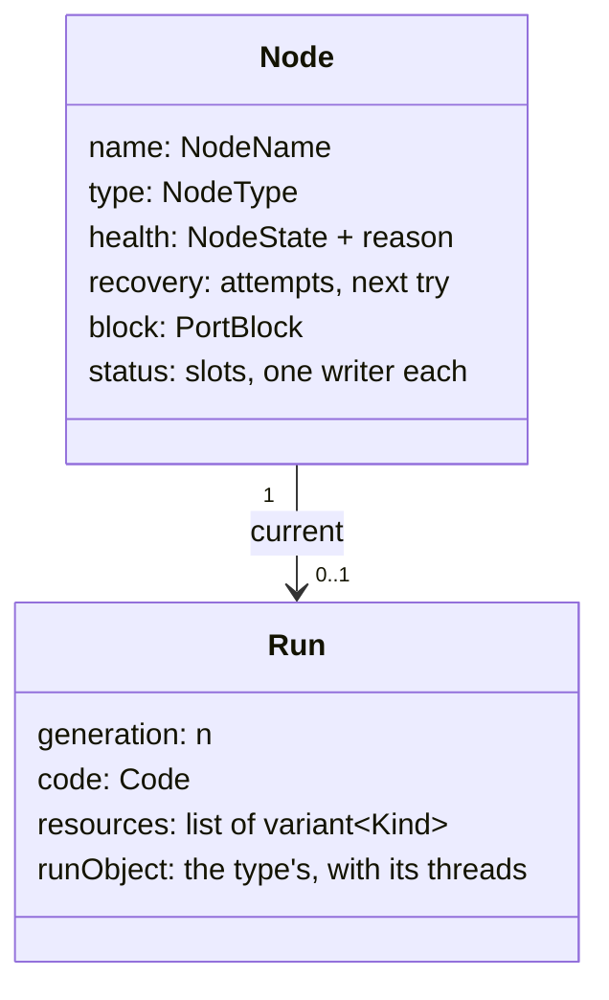

# The node framework: the primitives every node type builds on

Status: proposal, revision 4, 2026-11-07. Revision 1 went to three independent reviews and revision 2 answered them;
revision 3 took the owner's gate answers; revision 3 went to a second round of two independent reviews, and revision 4
answers them with two more answers from the owner (sections 14 and 16). Built: slice 1 (section 13, "Slice 1 as
built", says where it differs) and slice 4's framework side (8.8's erratum: the node-facing primitives, log and event
calls on a run handle and the realtime coded ring, wait for the run handle and land with slice 5), slice 2, the type
interface and its harness (section 13, "Slice 2 as built"), and slice 7, the internal clock with latency (section 13,
"Slice 7 as built"; its spike's verified answers are in sections 10 and 15). Nothing else is built.
Layer: system design (domain model and public interfaces), beneath the agreed system design
(`docs/design/pipewire-graph.md`) and over the module designs it would change (`docs/design/batch2.md` sections 4 and 6,
`docs/design/sendspin.md` sections 3 to 8).

[V] = verified in the source named, as of `3ab159a`; [U] = unverified, so a slice's test checks it or section 15 keeps it
open.

## 1. The owner's words

| # | The owner's words | Date, where | What it means here |
|---|---|---|---|
| R1 | "what are the core primitives that ear should host so that new nodes can be added simply and only require defining the truly custom bits that its node type demands" | 2026-11-07, chat | A node type is its custom part and nothing else; everything shared is the framework's |
| R2 | "consider how to abstract configuration and control plane events so that nodes can build on a shared base primitive layer" | 2026-11-07, chat | Configuration and control-plane events are framework subsystems, not per-type code |
| R3 | "Is it a virtual node base class? Are there several distinct subsystems, like one for config and one for events? How much do nodes [have] to write to handle bus connections?" | 2026-11-07, chat | The questions this page answers (sections 3, 7, 8 and 9) |
| R4 | "can i add my own sources and sinks?"; "the core will be \"built into ear\"" | 2026-10-29, `pipewire-graph.md` R11 | Types stay built in; adding one must be cheap |
| R5 | "i will want multiple shairport instances" | 2026-10-29, `pipewire-graph.md` R9 | Many nodes of one type, and a third kind of outside thing (a program) |
| R6 | "in a general purpose sources-and-sinks graph, its always just 'running'" | 2026-10-29, `pipewire-graph.md` R2 | Nothing here may make a port block stop processing |
| R7 | Outputs on different devices stay aligned, for "seperate zones" | 2026-10-29, `pipewire-graph.md` R3 | Latency and clock facts belong to the audio contract |
| R8 | "Do we need to specify a hardware device for the clock? Can we drive it via an internal clock running under the raw monotonic clock, and just use a PLL (if necessary) to track against a hardware device anchor?" | 2026-11-07, chat (gate, Q3) | The graph runs on an internal clock; cards follow it (section 10) |
| R9 | "Nodes should not have direct access to stdout or stderr. The core framework should expose the necessary primitives for events, diagnostics, and logging. These should be real-time safe for any audio loops that need them, and there can be non real-time bases for the rest of the system." | 2026-11-07, chat (gate, Q1) | Section 8.8: the framework owns every output; nodes get primitives, realtime-safe where audio code needs them |
| R10 | "Would status changes be useful for debugging things like flapping? Does this status relate to diagnostic events?" | 2026-11-07, chat (gate, Q2) | Status has a coalesced live view and a record of every change; the framework derives flapping (8.2) |

Design rules 1 to 3 of `pipewire-graph.md` hold unchanged: one owner per piece of state, and each health judgement its
owner's; a node is self-contained, reaching the engine only through powers the framework grants; the graph always runs.

## 2. The problem, measured

What each type writes today [V]:

| Type | Lines | Classes it writes | What is really its own |
|---|---|---|---|
| `white` | 73 | `AudioCode`, `NodeInsides`, `NodeConfig`, `NodeTypeOf` | a noise loop |
| `card` | 105 | the same four | its settings, one rule across them, "open this card", and a pass-through whose indices it works out by hand (`card.cpp:38-43`) |
| `rtp` | 114 | the same four | its settings, "receive this stream", the same hand-indexed pass-through |
| `file` | 190 | the four, a descriptor wrapper, a `HandoffConsumer` | its settings, the path rule, libsndfile |
| `sendspin` | about 1,900 | the four, and the primitives below | the protocol, pairing, the time filter, mDNS |

`sendspin` had to build, privately, about 560 lines of primitives that any threaded or networked type needs [V]:
`Mailbox` (a seqlock latest-value slot), `Feed` (the handoff's reverse), `EventFd`, `NoteGate` (rate-limited notes),
`PortClaims` (which node holds which TCP port, held by the *type* across its nodes), `KeyStore` and `narrowKeyFiles` (a
0600 file per node in the config folder, swept at boot), `ConnectionWatch` (timers), and three threads of its own: the
worker (a 10 ms `poll()`), the notifier, and the library's sync thread, which writes the feed (`worker.cpp:123-135`).

The framework's own seams are closed in three places [V]:

- `NodeGrant` has one method per kind of outside node (`soundCard`, `rtpReceiver`), and `NodeHost`'s constructor takes
  one factory per kind (`node_host.hpp`). A program (R5), a network sink or an RTP sender each edits `ear_core`,
  `NodeHost`, `ear_pipewire` and `main.cpp`.
- The control plane out of a node is `InsidesEvents::say(std::string)` and `lost(std::string)`. About 11 of sendspin's 17
  note texts are state written as pairs of sentences (`connected`/`disconnected`, `pairing-code`/`pairing-code-cleared`,
  `stream`/`stream-ended`, `sending`/`sending-stopped`, `id`, `dialling`, `listening`). Notes reach standard output only,
  so the editor cannot show a pairing code.
- There is no control plane *into* a node except its settings. A failed node starts again only when a setting really
  changes (an update with the same settings changes nothing, `desired_graph.cpp`), so restarting one means changing a
  setting and changing it back, or restarting ear. `NodeState` has no `recovering` (`node_lifecycle.hpp:8`).

## 3. The answer, in one paragraph

A node type is **declarations, one behaviour, and acquisitions**. The declarations are constexpr tables in one
`TypeSpec`: settings (as today, plus a rule across them), bank names, status fields, events, actions, stores, recovery
and latency. The behaviour is one plain class: `ports` (member counts from the settings), `start` (acquires resources and
returns the run's code), `process` if it makes or changes audio, and the run object it builds for work off the realtime
thread. The acquisitions are framework-owned resources, each an RAII handle the framework readies, watches and closes in
dependency order, asynchronously. There is no base class for the author beyond the existing type-erasing `NodeTypeOf`,
and no mixins: capabilities combine freely, so they are acquired, not inherited. Five subsystems serve every type:
**configuration and parameters**, **resources**, the **control plane** (with diagnostics and logging: no node touches
standard output), **audio and clock** (an internal clock every card follows), and **recovery**. For bus connections a
type writes nothing.

## 4. Ubiquitous language

| Term | Meaning | Today's name, if different |
|---|---|---|
| **Node type** | A built-in kind of node: its type spec and its behaviour, found by its folder in `src/nodes/` | `NodeType` + `NodeTypeOf` |
| **Type spec** | A type's declarations, pure and constexpr (`TypeSpec`; `NodeSpec` stays the graph's name+type+settings, `graph_spec.hpp:25`) | the settings table, plus `NodeConfig::ports()` |
| **Node** | One named instance of a type in the desired graph; the aggregate root of everything below | — |
| **Settings** | A node's *desired* state, kept in `ear.conf`, judged by the desired graph | `NodeSettings` |
| **Parameter** | A setting declared `live`: it also has a realtime value that can move without a restart | — |
| **Port block** | The node's one `pw_filter`, made once for the node's life; owner of its public ports and the routes' ends | as today |
| **Bank** | A named, directed group of ports, public or inside; its name and direction in the spec, its members from the settings | `PortBank` (public only); inside ports are a flat list today |
| **Run** | One start of a node, from `start` to the end of its close; restarted behind the same block | `NodeInsides` |
| **Run object** | The type's own object for a run (sendspin's client, pairing, time filter), with the threads it owns | members of `NodeInsides` |
| **Start context** | What `start` sees: the format, the node's name, and the acquire calls (`StartContext`); and `Ready`, what the run object's recipe is handed once every resource is ready (7.2) | `NodeGrant` |
| **Resource** | Something a run acquired, owned by the framework, closed with the run | outside node, handoff |
| **Resource kind** | A class of resource with its own adapter (section 7.3) | one method each on `NodeGrant` |
| **Code** | What runs on the realtime thread for one run: `prepare`, `process`, `release` | `AudioCode` |
| **Loop** | A run's serial executor off the realtime thread: a strand, or a dedicated thread | sendspin's worker |
| **Status** | A node's *observed* state, field by field, each field with one declared writer; never health. Today's `NodeStatus` (state and reason) is health and is renamed `NodeHealth` (slice 1), so the word means one thing; `RouteStatus` is a route's observed state and keeps its name | `say` texts that are state |
| **Event** | A node's *edges*, by declared code | `say` texts that are edges |
| **Action** | A command into a node; changes no desired state | — |
| **Log** | Free text for people, at a level; from node code, the realtime thread (as coded records) or captured library and program output | `std::cerr`, a library's own logging |
| **Diagnostic** | What the framework itself observes about a node: status changes, flapping, recovery attempts, drops | `dropped=` on the `stopped` line |
| **Health** | `NodeState`, its reason, the attempt and how long it has run: the framework's judgement alone | `NodeStatus` |
| **Internal clock** | The graph's one driver: the dummy driver on the host's monotonic clock; every card follows it | today a linked card drives |

## 5. Bounded contexts and the context map



- **Graph definition** stays the one judge of settings. It asks each type's spec to check them (the table walk, then the
  type's rule across settings, as `make` does today), and it carries parameter changes (section 8.5) in arrival order with
  every other request. It never sees resources, status or actions.
- **Node framework** owns the node aggregate and the subsystems. Types reach it only through the SPI (section 7) and
  cannot extend its model.
- **Claims and stores** is a domain service, not part of one node's aggregate: a TCP or UDP port, an mDNS name and a
  stored file are ear-wide, so their consistency rule spans nodes (section 6, I8).
- **Audio engine, confined folders and the program supervisor** sit behind one adapter per resource kind, which keeps
  PipeWire, descriptors and process ids out of `ear_core` (as today: no PipeWire type in a public header).
- **Control surface** renders what the framework publishes (section 8.7) and judges nothing.

## 6. The node aggregate and its invariants

The node is the consistency boundary for everything one run acquires; only the framework changes it, on the main loop.
Resources are a closed `std::variant` of kinds (section 7.3), not a class hierarchy.



Invariants (each the framework's to keep, and a test's to prove):

- **I1. One block, for the node's life.** Settings changes restart the run behind it; a port change replaces the node (as
  today). A lost block is final (`node_lifecycle.hpp:11`): recovery never remakes it.
- **I2. Health is the framework's.** A type reports facts (a resource lost, `fail(detail)`); it never sets `NodeState`.
  Status never counts as health. Every fact crosses to the main loop before it acts, so no thread ever tears down the run
  it runs in (as `Channel::lost` does today, `node_host.cpp:153-157`).
- **I3. Ready is the conjunction, and never-ready is a fact.** The node is `running` when the block and every resource of
  the run are ready. Each resource kind that becomes ready later has a readiness deadline, and missing it is a loss
  (section 7.3); "never ready, never lost" cannot last.
- **I4. Nothing the realtime thread can reach is freed while it can reach it.** Every teardown starts with a barrier on
  the block's data loop: `drive(nullptr)` for a restart, the block's destruction for a removal or stop (both are blocking
  invokes, `port_blocks.cpp:97-127` [V]).
- **I5. A resource outlives every thread that can touch it.** Teardown is by dependency, not by reverse acquisition, and
  every step that waits on another thread is asynchronous. The main loop never joins a thread:
  1. the barrier (I4), then `release`; every feed is closed, so a writer waiting for room wakes with "closed" (every wait
     in a resource is bounded, and none outlives this step);
  2. outside nodes torn down (they touch only the engine);
  3. handoffs closed: each drains and calls `finish` on its own thread, then reports (as today, `handoffs.cpp:44-91`); a
     consumer may still use the run object, which is alive;
  4. the run closes: its loops take no new work, in-flight handlers and actions finish (an action gets its reply), the
     run object stops its threads (the library's included) and says goodbye on its own thread, then calls `closed` from
     any thread (as `NodeInsides::close` today, `node_type.hpp:126-128`);
  5. on the main loop: the run object is destroyed, then feeds, mailboxes, parameter slots and wakes are freed, then stores
     close, then claims are released, last.
- **I5a. Close has a deadline.** If step 3 or 4 has not completed within a bound (default 10 s; a peer that never
  answers is already a test case), the framework stops waiting: the run object and its threads are leaked (detached, never
  destroyed, so nothing they touch is freed), an `ear.close-overdue` diagnostic names the node, steps 5's frees are
  skipped for what the leaked threads can reach, and its claims are marked abandoned. An abandoned claim goes to a waiter
  only after a fresh probe of the kernel. At stop, ear proceeds past the bound, so the last write of `ear.conf` happens
  before Kubernetes' grace period ends.
- **I6. Nothing from an old run lands on a new one.** Status, events and facts are written through a per-run handle that
  carries the run's generation; the main loop drops anything from an older generation, and drops everything once step 4
  began. Status slots are reset only after step 4 completes. The handle is shared-owned so a late writer never touches
  freed memory (as `Channel` is today, `node_host.cpp:142-190`).
- **I7. One run at a time.** A restart or recovery completes I5 before `start` is called again.
- **I8. A claim has one holder.** A port, mDNS name or store held by an older run, or by a removed or renamed node still
  closing, is not given to a newer one: the newer node's start waits (a readiness with its own deadline, I3) until the
  older run's step 5 released it or I5a abandoned it (today's
  `olderGoing` rule, `node_host.cpp:59`, generalised from names to claims). A claim held by a running node refuses
  (`startFailed: cannot listen on port <p>: held by <node>`). So removing a node on port 8928 and adding another on 8928
  in one plan works: the new one starts once the old one let go.
- **I9. Names are the node's.** Every engine object a resource makes is named `<node>.<suffix>`; every stored file is
  `<type>-<node>.<suffix>`; the registry refuses two resources of one run with one suffix.

## 7. The SPI: what a type writes

### 7.1 The type spec (declarations)

```cpp
// rtp, in this proposal
constexpr auto channelsRow = setting::required("channels", setting::number(1, 64));
// ... the other rows, as today
constexpr SettingsTable<addressRow, portRow, formatRow, channelsRow, rateRow, latencyRow> settings{"rtp"};
constexpr auto stream = bank::output("stream");
constexpr auto fromRtp = bank::insideInput("rtp");
constexpr auto receiving = status::flag("receiving", writer::resource);   // written by the receiver's adapter

constexpr TypeSpec spec{
	.settings = settings,
	.banks = Banks<stream, fromRtp>{},
	.status = StatusTable<receiving>{},
	// optional, each empty by default: .events, .logCodes, .actions, .stores, .latency;
	// .recovery defaults to the framework's policy (8.6)
};
```

The smallest type is two declarations and a struct; every table above but `settings` and `banks` may be left out:

```cpp
constexpr auto noise = bank::output("noise");
constexpr TypeSpec spec{.settings = SettingsTable<>{"white"}, .banks = Banks<noise>{}};
```

- **Bank names and directions are constants in the spec**; `ports(checked)` gives each bank's members as a count
  (`members(n)`: `1`..`n`) or names (`members("left", "right")`). Handles are typed by direction and by spec (9.2), so a
  bank of another type, or writing into an input, does not compile; a member list that disagrees with what `prepare`
  is given is a `std::logic_error` (a bug in the type, caught by the harness of 7.6).
- **A rule across settings stays at parse**: an optional `static std::expected<void, std::string> check(const Checked&)`,
  run by `parse` after the table's walk, so `card`'s "playback or capture above 0" is still `invalid-settings` and never
  reaches `ear.conf` (today `card.cpp:94`).
- **Rows are read by handle**: `s.get<channelsRow>()`, as today (`settings_table.hpp:219`). A row's value type does not
  identify the row, so there is no `s[row]` sugar.
- **Two new setting kinds are prerequisites** for types the framework claims to serve: `decimal` (gain in dB, ratios;
  it touches knobly's reader, the wire and the editor) and **indexed rows**, a family `gain.<i>` sized by a count row
  (a mixer with one gain per input). Both reuse the row machinery: one checker for settings, action arguments and
  parameters. A row is made live with `.live(smoothing)` (8.5).
- **Stores are declared by suffix** (`stores = Stores<store::file("key", mode0600)>{}`): the framework names the file,
  opens it on its I/O executor, owns the boot sweep that narrows every such file in the folder (today `narrowKeyFiles`,
  `sendspin_type.cpp:124`) and hands the run a handle once it is open (7.2).
- **Event and log codes are declared** (`EventTable`, `LogCodes`), each with its argument kinds, so a realtime record
  carries only a code and numbers and its text is made off the realtime thread (8.8).
- **One code grammar.** A type's codes are kebab-case words (`pairing-failed`); the framework's are the same under
  `ear.` (`ear.status-flapping`, `ear.close-overdue`). Today's wire codes (`engine-refused`, `ear/unknown-directive`)
  keep their spelling, since clients match them.
- The spec is the one source of: the graph file's setting kinds, the wire schema (8.7), the type's output vocabulary,
  and the compile-time handles the behaviour uses. Misspelt handles do not compile, as a misspelt setting row does today
  (`src/core/tests/compile_fail/`).

### 7.2 The behaviour (one plain class)

```cpp
struct Rtp {
	static Members ports(const Checked& s);                           // pure: {stream: members(n), fromRtp: members(n)}
	static StartResult start(StartContext& cx, const Checked& s);    // main loop; acquires only; never blocks, no I/O
};
std::unique_ptr<const NodeType> makeRtpNodeType() { return makeNodeType<spec, Rtp>(); }   // the header's one function
```

`makeNodeType<spec, Behaviour>()` is a plain function template, called from the type's one named function, which the
generated type list calls; no macro and no static self-registration (a static library would drop it at link time). It
keeps the compile-time check that the table is named for its folder. With folders now resources, the header's function
takes no argument.

**Two phases.** `start` only acquires; it returns a `StartResult`: a failure (`startFailed: <detail>`), or the run's code
and, optionally, a recipe for its run object. The framework drives the block with the code at once (the graph always
runs: an empty feed reads silence), readies every resource (stores opened, claims granted and probed, outside nodes
running), and only then calls the recipe with a `Ready&` that hands over what became ready (the store's contents, the
granted port). The run object is built there, on the main loop, and may start its threads; the node is `running` once
the recipe returned. So no run object reads a key file or binds a port before the framework has it ready (CLAP's split
between `activate` and `start_processing`, for the same reason).

| The run's code | When |
|---|---|
| `passThrough(fromBank, toBank)` (one or more pairs) | audio joined to an outside thing: `card`, `rtp` |
| a class with `prepare`, `process`, `release` (a concept, erased once) | a type that makes or changes audio |

There is no `NodeConfig` or `NodeInsides` to write. The **run object** is any class with `close(done)`; the framework
owns it and closes it at I5 step 4. It holds the threads the type's library owns, and it alone joins them, off the main
loop.

### 7.3 The resources (acquisitions)

`StartContext::acquire(request)` on the main loop, inside `start` only (else `std::logic_error`, as `NodeGrant` today). The
list is a closed `std::variant` in core on purpose: a kind changes what the framework promises. Each kind has one adapter.

| Kind | Request | The type gets | Ready when (deadline) | Lost when | Replaces |
|---|---|---|---|---|---|
| Sound card | `outside::soundCard{card, direction}`, an inside bank | nothing to hold | its PCM runs and every link is active (deadline) | ERROR, proxy removed, a link failed, or the follower watchdog (9.5) | `NodeGrant::soundCard` |
| RTP receiver | `outside::rtpReceiver{...}`, an inside bank | nothing; it writes its `receiving` field | its node runs and every link is active (deadline) | as above | `NodeGrant::rtpReceiver` |
| Program (future, section 7.5) | `outside::program{...}` | nothing | its process runs | its process exits | — |
| Handoff | `handoff{bank, frames, consumer}` | an `RtWriter&` for `process` | at once | — | `NodeGrant::handoff` |
| Feed | `feed{bank, frames}` | an RT reader for `process`, a writer that may wait for room (bounded; woken with "closed" at I5 step 1) | at once | — | sendspin's `Feed` |
| Paced feed | `pacedFeed{bank, pcm{format, rate, channels}, latencyFrames}` | a writer for raw PCM from a clockless source | at once | — | — (programs, 7.5) |
| Runtime file | `runtimeFile{suffix, text}` | a file the run generates (a program's configuration), beneath the config folder, removed at close | once written | — | — |
| Mailbox | `mailbox<T>{}` | an RT writer, a reader off RT; newest wins | at once | — | sendspin's `Mailbox` |
| Wake | `wake{}` | an RT ring, at most once until answered; a handle a loop waits on | at once | — | sendspin's `EventFd` |
| Loop | `loop::strand`, `loop::dedicated` (any number) | a serial executor: post, timers, fd watches, wakes | its thread runs | — | sendspin's worker and notifier, `ConnectionWatch` |
| Store | declared in the spec (7.1) | through `Ready&` (7.2): read and replace-if-unchanged, on the framework's I/O executor | once opened and trusted (asynchronous) | a file it cannot trust | `KeyStore`, `narrowKeyFiles` |
| Recordings file | `recording{path}` | a descriptor beneath the recordings folder | at once | — | `NodeFolders.recordings` |
| Port claim | `claim::tcpListen{port}`, `claim::udp{port}` | nothing | at once, or waits (I8), then probed | — | sendspin's type-level `PortClaims` |
| mDNS advertisement (when a second type needs it) | `advertise{service, port, name, txt}` | nothing | first announcement sent | — | sendspin's `Advertiser` |

- **Readiness deadlines.** Today a port held by another program leaves an `rtp` node `starting` for good, because
  PipeWire only logs the failed bind (AGENTS.md); a card whose PCM never runs gives no event either. Each kind with a
  later readiness has a deadline (a default per kind, at least the kind's own start time) after which the framework
  counts it lost, with the kind's reason.
- **Adapter-sourced status.** A resource kind may write fields of its node's status table that the spec gives
  `writer::resource`. The RTP adapter binds the rtp-source node's proxy and copies `rtp.receiving` (a bound proxy sees
  it; the registry does not [V: `rtp.md` finding h]), and passes a short `cleanup.sec` so silence is seen within seconds,
  not 60 [U: the value]. The card adapter reports the PCM's state and whether its hardware pointer advances (9.5); a
  follower's rate correction lives inside the adapter (`spa_io_rate_match`), not in any property ear can read [U], so it
  is not promised as status.
- **The framework's I/O executor.** Store reads and writes, runtime files and `/proc` reads run on one framework
  executor of their own, never on the strand pool, so a slow disk delays no node's loop.
- **Blocking feed writes** are legal only from a dedicated loop or a thread the run object owns, never from a strand
  (asserted in debug builds).
- **Folders become resources**; `NodeFolders` and `make<Type>NodeType(const NodeFolders&)` go.
- **Live properties of an outside node** (an ALSA adapter's volume `Props`) belong to its kind's adapter, set through a
  parameter (8.5); not designed here.

### 7.4 Threads, as one contract for every type

| What the type writes | Runs on | May |
|---|---|---|
| Rows' parse functions, `check`, `ports` | any thread, pure | nothing else |
| `start` | the main loop | acquire; construct. No blocking, no I/O (stores open on the framework's side) |
| `prepare`, `release` | the main loop, never with `process` | allocate |
| `process` | the realtime thread | the RT ends of its resources, `io`, `rt` status fields, `rtlog` and `rtevent` only. No locks, allocation, retry loops on a shared value, or syscalls other than a wake; clock readings come from `GraphCycle` (9.3), not `clock_gettime` |
| Loop handlers, action handlers | the run's loop, serially | block only on a dedicated loop |
| The run object's own threads | its threads | anything; the object joins them in `close` |
| `HandoffConsumer::consume`, `finish` | the handoff's thread | block on I/O |

After `start` and the run object's recipe return, no type code runs on the main loop (sendspin's discipline today, `docs/design/sendspin.md`
section 6). Debug builds assert the thread at every `acquire`, status write, event, loop post and feed write, as CLAP's
thread-check does.

**Strands by default, dedicated on request** (the owner's answer, Q5). A strand runs on a small framework pool, so many nodes (R5) do not cost a
thread each; a handler that runs longer than a bound is reported. A type whose library blocks or must be polled asks for
`dedicated` loops, as many as it needs: sendspin keeps a worker (the library's poll, 10 ms [V: `worker.cpp`]) and a
separate notifier, so a late "played" report never waits behind the worker's disk writes (`worker.cpp:307-323`).

### 7.5 The program kind: a pipe into a paced feed first

The owner's answer (Q7): programs first join through a pipe, not PipeWire's socket.

- **`outside::program{argv, stdout → pacedFeed}`.** ear starts the program with its audio on standard output. A pipe
  has no clock: the program paces itself on its own host clock, and nothing tells it what played. So the pipe goes into
  a **paced feed**, the framework's, which converts the declared PCM (`pcm{s16le, 44100, 2}` for shairport-sync [U: its
  exact flags]) to float and resamples it to the graph frequency with a fixed ratio plus an adaptive one, steered by a
  loop on the feed's fill (what rtp-source does from packet arrival). Its latency (the target fill) is declared in 9.4,
  and passed to the program as a static latency offset where it takes one [U]. A full feed never blocks the program
  beyond the pipe's own 64 KiB: the paced feed drops the oldest audio and counts it.
- **Health is process-alive only** (design rule 1): ready when the process runs, lost when it exits. Silence on the
  pipe between sessions is not a loss, so recovery never kills a healthy idle process.
- **Configuration and session state.** The run writes the program's configuration as a runtime file (7.3) (its name,
  ports, the pipe backend). The program's standard error is read line by line by a framework thread into its node's
  log (8.8) and, through a line hook, to the run's loop, so a type can turn "session started" into status.
- **What it costs.** With no delay feedback, AirPlay's multi-room alignment across ear and other AirPlay receivers is
  lost; within ear the paced feed holds the program's audio on the graph's clock. Claims for its ports (5000, 7000), and
  the mDNS resource or its own Avahi use [U: whether shairport-sync can advertise without a D-Bus Avahi in the
  container].
- **Serving PipeWire's socket** stays possible later, for programs that can only be PipeWire clients; then the mark comes
  from the socket's peer credentials (`pipewire.sec.pid`), and ear writes the program's configuration to give its nodes
  `<node>.<suffix>` names and to turn its autoconnect off.

### 7.6 Testing a type without PipeWire

Slice 2 ships `ear::testing::TypeHarness<spec, Behaviour>`, the one way a type's own tests run it: it parses settings
(and shows each refusal's text), calls `start` with fake resources, fires readiness and loss of each, builds the run
object, steps `process` with a given `Io` and `GraphCycle`, sends actions and parameter gestures, and captures status
(view and change record), events, log records and diagnostics in order. The all-type tests (`test/nodes/`) run every
type through it, as pluginval and clap-validator do for JUCE and CLAP plugins.

## 8. The control plane

### 8.1 Channels, by what they are

| Channel | Declared in | Kept | Written by | Delivery | On the wire | On standard output |
|---|---|---|---|---|---|---|
| **Settings** (desired) | `SettingsTable` | `ear.conf` | the graph file keeper | as today | `node.added`, `node.updated` | a `node` record |
| **Parameters** (desired, live) | rows marked `live` | `ear.conf`, at a gesture's end (8.5) | the keeper, and gesture ticks | to an RT slot, wait-free | request `node.setParam`; notification `node.paramChanged` | at commit only |
| **Status** (observed) | `StatusTable`, one writer per field: a named loop, `rt`, `resource` or `thread` | memory; in snapshots | that writer | a coalesced live view, and a record of each change (8.2) | `node.statusChanged {name, fields}` | a `status` record per change |
| **Events** (edges) | `EventTable` | not kept | the run's loops, threads or `process` (numeric arguments only) | queued, rate-limited (8.3) | `node.eventRaised {name, code, args}` | an `event` record |
| **Actions** (commands in) | `ActionTable` | not kept | a client, through the keeper | to the run's loop; reply | request `node.action` → `{}` or an error | — |
| **Log** (free text) | levels, and `LogCodes` for realtime records | not kept | any node code, `process` as coded records, captured library and program output | queued, rate-limited (8.8) | later, `log.subscribe` | a `log` record |
| **Diagnostics** (the framework's own observations) | the framework | counters and the latest of each in snapshots | the framework alone | records on the change | `node.diagnostic {name, code, ...}` | a `diagnostic` record |

Health (`node.state`) is not a channel a type writes (I2); it now carries `attempt`, `runningSinceMs`, and
`lastFailure {code, detail, atMs}` kept after the node runs again, so the editor can show "recovering, attempt 37, last:
card lost". No node writes standard output or standard error (8.8).

**Order.** Records from one writer reach the main loop in the order written. Across a run's writers, an event or a fact
first flushes the node's dirty status fields, so `connected="Kitchen"` precedes `paired`, and the last status before a
`lost` is not overtaken by it; beyond that, records of different writers are ordered by when the drain received them.
A snapshot carries each node's status, health and latest diagnostics from the same main-loop turn.

### 8.2 Status: a live view and a change record

- Each field has exactly one declared writer: a named loop (bound to a loop handle at `start`), `rt`, `resource`, or
  `thread` (a thread the run object owns). `rt` fields are fixed-size (flag, whole number, closed enum) and travel in
  atomic words; text fields are written off the realtime thread under a mutex (a seqlock would let the main loop spin
  behind a preempted writer).
- **The drain.** One global status tick on the main loop, at most every 33 ms. Off-RT writes mark their field dirty and
  ring the status bell if the node was clean. The realtime side rings it at most once per window, gated by an atomic
  exchange as the level bell's `rungFor` is (`port_blocks.cpp:241-243`), only when an `rt` field changed or its record
  ring holds records; so a node whose only output is realtime is still drained, and a node at rest costs nothing. `rt`
  values are *sampled* at the drain: the view sees the latest, never every cycle.
- **The live view** is what the editor and snapshots show: latest values, at most 30 updates a second per node.
- **The change record.** Every change of value becomes a `status` record (field, from, to, time). An off-RT writer's
  changes are recorded as written; an `rt` field's changes are recorded where the value differs from the last one the
  realtime side wrote (it is the single writer, so it keeps the last value), into the coded ring, so a field rewritten
  every cycle with the same value makes no records. The record is rate-limited per node, with drops counted.
- **Flapping is the framework's to see.** Each `rt` field has a transition counter `process` increments on a change,
  and off-RT changes are counted at the write, so transitions between samples are not lost. Above a threshold per window
  the framework emits `ear.status-flapping` (field, transitions, window). Health flaps too: running↔recovering transitions
  per window give `ear.health-flapping`, which catches a node that fails just after the backoff resets (8.6).
- Counters the framework keeps for every node (frames a handoff dropped, frames a feed came up short) are sampled at the
  drain and in snapshots, never pushed.
- Text is the framework's to make safe: UTF-8 checked, control characters scrubbed, escaped in records (8.8), bounded
  (declared maximum, default 256 bytes, cut and marked). A peer's text (a server name) needs no per-type code (today
  `notes::printable`, `notes.hpp:14`).

### 8.3 Events: queued edges

Rare by declaration: `pairing-failed <reason>`, `key-write-failed <detail>`, `paired <server id>`. Codes and argument
kinds come from the `EventTable`. Off the realtime thread an event is queued per node; from `process` it is `rtevent`,
numeric arguments only, through the coded ring (8.8). A burst of 32 passes, then one a second, and what was held back is
counted in one `ear.events-dropped` diagnostic (today's `NoteGate` policy, `note_gate.hpp`, moved into the framework).

### 8.4 Actions: commands in

- Every control request already goes whole to the keeper's thread in arrival order (AGENTS.md, threads); actions do too,
  so an action is ordered with the edits around it. The keeper posts it to the main loop, the framework checks its
  arguments against the type's table and posts it to the run's loop; the handler's `std::expected<void, std::string>`
  becomes the reply.
- A queued action whose run ends before it runs gets `restarted` (a restart or recovery) or `stopping`; an action already
  running finishes and replies before the run's loop closes (I5 step 4). A node with no run answers `not-running`.
- **`restart` is every node's**, the framework's own: the same teardown and start as a settings change, without editing
  `ear.conf`, and it skips any recovery wait.
- An action changes no desired state. What should survive a restart is a setting or a parameter.

### 8.5 Parameters: one model for live values

Live settings, parameter slots and actions are one model, after CLAP's parameters and gestures; the owner's answer
(Q6) is that a value is written to `ear.conf` once, at a gesture's end.

- A setting row declared `.live(smoothing)` is a **parameter**. The framework owns its realtime slot, wait-free (an
  `std::atomic` for a single scalar; a triple buffer with an atomic index exchange only for a value of several words)
  and gives `process` its value as `io.param(gainRow)`, already smoothed: `smoothing` is a ramp time, in the row's own
  unit (a dB row ramps in dB). A type writes no slot, no `onSettings` and no loop for it.
- **A gesture** is `node.setParam {name, key, value, gesture: "begin" | "change" | "end"}` from one session, which owns
  it until it ends. `begin` is refused at once when the commit could not land: `shared-definition` (the row's value is
  defined on a line that makes other nodes), `file-invalid`, `stopping`, or another session's gesture on the same
  parameter. `change` ticks carry the gesture's id and a sequence number and go straight to the main loop (they do not
  queue behind the keeper, which may be writing); they move the slot and are announced as `node.paramChanged`, at most
  30 a second. `end` goes through the keeper in order with every other request and commits once, as a settings edit at
  the row's source; `ear.conf` is written behind as usual. A set without a gesture is a `begin` and an `end` in one.
- **Hand edits win** (AGENTS.md). A hand edit or `graphFile.set` that lands during a gesture aborts it: the slot returns
  to the file's value and `node.paramChanged {gesture: "aborted"}` tells every client. So does a refused `end`, the
  owning session closing, and a gesture with no tick for 10 s. The audio never stays on a value `ear.conf` does not hold.
- Snapshots carry each parameter's `{committed, live}`; they differ only during a gesture.
- A hand edit or `graphFile.set` that changes a live row's value moves the slot without a restart. A change to any
  other row restarts; a change of ports replaces.
- A live row of an outside node's property (a card's volume) is set by its kind's adapter (7.3).
- Timestamped changes (a mute at a media time) need an event ring keyed on graph position; reserved, not designed (15).

### 8.6 Recovery

`NodeState` gains `recovering` (a frozen interface today, `node_lifecycle.hpp`: an erratum in `batch2.md` section 11
comes with slice 8). The default for every type, the owner's answer (Q4), retries for as long as the node is in the
graph; with the internal clock (section 10) a restart costs only the node's own audio:

- **After a loss** (a resource lost, `fail(detail)` from the run): torn down (I5), then started again after 1 s, doubling
  to at most 60 s; a run that stays `running` for 60 s resets the wait.
- **After a start that failed** (`start-failed`: a path that cannot be opened, a key file ear will not trust, a port
  another program holds): the cause is in the settings or the host, so it retries at the longest wait from the first
  (60 s), not from 1 s. It still never gives up, so the cause fixed by hand is picked up within a minute.
- **Visible, not silent.** Each attempt is a diagnostic; `node.state` carries `attempt`, `retryInMs`, `runningSinceMs`
  and `lastFailure`; a node that keeps failing just after the reset is `ear.health-flapping` (8.2). The editor shows
  "recovering forever" as it is.
- A type may declare `recovery::none` or a cap (`attempts`), after which it is `failed` until `restart` or a settings
  change. A lost block is final (I1). The waits are main-loop timers.
- [U] Whether `snd_pcm_open` on a wedged USB device can block, and on which thread (the adapter may open on the main
  loop); with retries every 60 s that risk recurs, so slice 8 checks it before cards use recovery.

### 8.7 The wire schema

- **Names follow today's pattern**: requests are verbs (`node.setParam`, `node.action`), notifications say what
  happened (`node.paramChanged`, `node.statusChanged`, `node.eventRaised`, `node.diagnostic`), as `node.update` and
  `node.updated` do now.
- `types` stays a sorted list of names (`graph_view.hpp:25`, `test/protocol/snapshot.json`). `graph.get` gains
  `typeSchemaHashes` (a hash per type); a new request, `types.get {ifNoneMatch}`, returns the full `typeSchemas` only
  when the client's hash differs: settings rows (key, kind, required, default, range, unit, live), banks, status fields,
  event codes, actions. A text row's constraint is machine-readable where it can be (`enum`, `pattern`, `maxLength`),
  with the prose kept as its message.
- **Versioning.** `graph.get` gains `protocol`, the framework's wire version. Within one number every change is
  additive; a breaking change bumps it. A client that sees a higher number than it knows shows a banner and keeps
  working with what it understands. The stdout records' `v` follows the same rule.
- **What the editor must change** (it already ignores unknown methods, `web/src/graph.ts:107-108`): `NodeState` is a
  closed union (`web/src/protocol.ts:13`) that gains `recovering`; `reason` is "present only while failed"
  (`protocol.ts:47`) and becomes `lastFailure`; `recovering` needs a style (`EarNode.tsx:28` builds the class name from
  the state); `protocol.test.ts`'s fixture coverage gains the new notifications.
- The editor renders forms, status, diagnostics and action buttons from `typeSchemas`, naming no type in `web/`.

### 8.8 Diagnostics and logging: nodes never touch standard output

The owner's rule (R9): nothing a type writes, and nothing its libraries or programs write, reaches standard output or
standard error directly. The framework owns every output and decides where it goes.

**What a node gets**, all through its run handle, so generation-checked and dropped after close begins (I6):

| Primitive | Off the realtime thread | On the realtime thread |
|---|---|---|
| **Log** (`debug`, `info`, `warn`, `error`) | free text, formatted on the caller's thread, bounded per record; queued, rate-limited per node (a burst, then one a second, drops counted) | `rtlog(code, n...)`: a code from `LogCodes` and up to four numbers |
| **Event** | as 8.3 | `rtevent(code, n...)`: a code from the `EventTable`, numbers only |
| **Status** | as 8.2 | `rt` fields only |
| **Diagnostics** | the framework's alone: status changes, flapping, recovery attempts, readiness deadlines missed, close overdue, handoff drops, feed shortfalls, xruns, captured output that was cut | — |

- **The realtime path.** `rtlog`, `rtevent` and `rt` status changes write a fixed-size record (code, numbers, the cycle's
  position) into a per-run single-producer ring acquired at start: no formatting, no allocation, no lock, no syscall
  beyond the gated bell (8.2). A full ring drops the record and counts it. The drain formats the text from the code's
  declaration, so the realtime thread never touches a string.
- **Every write to the process's descriptors is captured**, because a grep of `src/nodes/` cannot see what PipeWire,
  alsa-lib or a library writes inside ear's process:
  - at boot, before any thread starts, ear duplicates the real standard output for its encoder alone and replaces
    descriptors 1 and 2 with pipes, read by a framework thread into `log` records marked unattributed;
  - PipeWire's logging goes through ear's own `pw_log` implementation, safe on the data loop (PipeWire logs xruns from
    it), into the same records; alsa-lib's through `snd_lib_error_set_handler`;
  - a library's logging goes into its node's log at its own level, through the library's log hook (sendspin-cpp [U]; a
    library with no hook gets one through a carried patch, as `cmake/sendspin-listener.patch` does today);
  - a program's standard error goes into its node's log (7.5).
- **The main loop never blocks on output.** Today `StatusLog` writes and flushes on the main loop
  (`status_log.cpp:22-41`), so a slow log reader (the container runtime, `kubectl logs`) stalls links, readiness and
  timers. Every record goes to one output thread through a bounded queue; a full queue drops records and the next record
  says how many.
- **Boot-time messages** a type writes today (`sendspin_type.cpp:125`) become diagnostics of the store service (7.1).
- **A guard, not the enforcement.** A CTest test still refuses `std::cout`, `std::cerr`, `stdout`, `stderr`, `printf` or
  writes to descriptors 1 or 2 under `src/nodes/`, so a type's own code fails fast; the capture above is what makes the
  rule true.

**Structured from day one, with a human sentence in every record** (the owner's answers, Q1 and Q9). Every line ear
writes on standard output is one JSON object, in one schema, from one encoder (`status_log.cpp` stays the one home):

```json
{"v":1,"seq":812,"t":"2026-11-07T17:42:03.512094Z","kind":"node","node":"desk","run":4,"state":"recovering","retryInMs":4000,"attempt":3,"lastFailure":{"code":"engine-refused","detail":"card lost"},"msg":"node desk recovering in 4s (attempt 3): card lost"}
{"v":1,"seq":813,"t":"2026-11-07T17:42:03.600211Z","kind":"status","node":"kitchen","run":2,"field":"connection","from":"dialling","to":"connected","msg":"node kitchen connection dialling -> connected"}
{"v":1,"seq":814,"t":"2026-11-07T17:42:04.010877Z","kind":"event","node":"kitchen","run":2,"code":"pairing-failed","args":{"reason":"pairing-code-mismatch"},"msg":"node kitchen pairing failed: pairing-code-mismatch"}
{"v":1,"seq":815,"t":"2026-11-07T17:42:04.011020Z","kind":"log","node":"kitchen","run":2,"level":"warn","source":"sendspin-cpp","text":"…","msg":"node kitchen sendspin-cpp warn: …"}
{"v":1,"seq":816,"t":"2026-11-07T17:42:10.000000Z","kind":"diagnostic","node":"kitchen","run":2,"code":"ear.status-flapping","field":"connection","transitions":14,"windowMs":10000,"msg":"node kitchen connection flapping: 14 changes in 10s"}
```

- `msg` is a short human sentence, close to today's line, so people read `jq -r .msg` and the system tests migrate a
  check at a time; tools read the fields. `seq` shows order and gaps; `run` is the run's generation; durations are
  always `…Ms`.
- Today's lines (engine scheduling, `control listening`, node states, routes, `graph-file …`, `says`, `stopped`) become
  records of their kinds carrying the same facts; one `graph-file` record per change carries all its diagnostics, where
  today they span several lines.
- Text from peers and libraries is a JSON string, escaped, never interpreted.
- The schema's home is a fixture, `test/protocol/output-records.json`, with a record of every kind, read by the C++
  tests, the system tests and any tooling, as the wire's fixtures are.
- The wire gains `log.subscribe` later (filtered by node and level) with no node changing.

**Erratum, slice 4 as built (2026-11-07).** What the code does where it differs from the text above; the fixture
`test/protocol/output-records.json` is the schema's home:

- **Kinds as built:** `engine`, `control`, `node`, `note`, `route`, `graph-file`, `graph-file-written`,
  `graph-file-write-failed` (the last write's, as ear exits), `log` and `exit` (why ear exits 1). `status`, `event` and
  `diagnostic` come with the slices that make them (1 and 3). A failed node's reason is `failure`, not `lastFailure`
  (there is no recovery yet to make it a past one).
- **No `run` yet.** Records carry no run generation until slice 1 gives runs one; `LogEntry::run` is the seam.
- **A `graph-file` record's `msg` spans lines**: the plain lines its change printed, joined by `\n`, so `jq -r .msg`
  prints several lines for that one record. One record per change, as above; the lines keep `msg` close to what people
  grepped.
- **Boot-time messages** (`sendspin`'s key files narrowed at boot) are `log` records from source `sendspin`, reached
  through an interim `NodeFolders::log` (a `LogSink*`), until the store service's diagnostics (7.1) replace it. A type
  that reports anything throws `std::logic_error` on a null sink, as for a folder it needs, so nothing is dropped for
  want of one. Slices 1 and 2 reshape `NodeFolders` (folders as resources) and should fold this in.
- **Log records are paced per node, or per source when unattributed**, not only per node: a burst of 32, then one a
  second, and the next record that passes carries `heldBack` (a flood that stops is counted on that source's next
  line). Captured `stderr`, PipeWire and alsa-lib share the output queue with states, routes and notes; unpaced, one
  chatty library could push the pairing-code note out.
- **sendspin-cpp has no log hook** ([U] in section 15 answered): on a host build its `SS_LOG*` macros are a bare
  `fprintf(stderr, ...)` with one process-wide level (`src/platform/logging.h`; `set_log_level` is the only control), and
  IXWebSocket writes there too. Until a carried patch routes `SS_LOG*` through a settable callback that carries the
  client, so ear can name its node, those lines are unattributed `stderr` records at `warn`.
- **A crash keeps its last words.** With descriptors 1 and 2 on pipes read by a thread of the dying process, abort's,
  `std::terminate`'s and assert's messages would die in the pipe. While the capture is installed, handlers for
  `std::terminate` and SIGABRT, SIGSEGV, SIGBUS, SIGFPE and SIGILL write what the pipes hold, as raw bytes, to the real
  descriptors and put those back on 1 and 2 before the crash goes on; `std::terminate` first writes out the output
  queue (bounded waits). The capture's stop no longer waits for the pipes' end of file, which a surviving duplicate of
  descriptor 1 or 2 (a forked child's) would hold off for good: a bell ends it. A program's standard error is never an
  inherited descriptor 2 (7.5).
- **The output queue** is bounded in bytes (4 MiB) as well as lines (4096); a record larger than the bound still goes
  when nothing else waits.

## 9. The audio contract

### 9.1 Bus connections: the type writes none

Public banks are declared; the framework makes the block, its ports, the routes' links and status, and the levels, as
today. An outside resource names the inside bank it joins, and the framework joins it. A pass-through is the framework's
code. A type writes no link, port id, registry lookup or route handling; `card` and `rtp` write no audio code.

### 9.2 `Io` by bank, typed by the spec

```cpp
struct WhiteCode {
	std::mt19937 gen{std::random_device{}()};
	void process(Io<spec> io, const GraphCycle&) noexcept { for (auto ch : io[noise]) fill(ch, gen); }
};
```

`Io<spec>` accepts only the spec's bank handles, and a handle carries its direction: an output bank gives
`std::span<float>`, an input bank `std::span<const float>`. So a bank of another type, or writing into an input, does not
compile. Handles resolve to indices in `prepare`, so `io[bank]` is an array index on the realtime thread. Each member is
a span of exactly `io.frames()`; an unlinked input reads zeros and every output sample is written (today's contract,
`node_type.hpp`).

### 9.3 `GraphCycle` grows the clock facts network nodes need

Today it carries `startNs`, `position` and `delayFrames`, from `spa_io_position.clock` (`port_blocks.cpp:197`). It gains:

- **the cycle's start in both clock domains**, `startNs` (`CLOCK_MONOTONIC`) and `startRawNs` (`CLOCK_MONOTONIC_RAW`),
  made once by the framework per cycle. Sendspin converts today, reading both clocks in `process`
  (`sendspin_code.cpp:33-35`); a type never does again, and if the driver's `clock.nsec` changes domain (section 10)
  only the framework changes;
- the driver's identity, `discontinuity` (the first cycle after a driver change or a position jump), `rateDiff` (the
  internal clock's rate against the raw clock, section 10), `nextNs` and the xrun count.

A type dating what it played (sendspin) then knows when its clock jumped instead of hard-syncing blindly.

### 9.4 Latency is the framework's

The framework owns the `pw_filter`, so a type cannot set port latency. By default `pw_filter` merges latency across all
of a filter's ports, which mixes independent paths (a card's playback and capture; sendspin's `to` and `from`) [U: the
merge rule, from `pw_filter`'s source]. So:

- port blocks use `PW_FILTER_FLAG_CUSTOM_LATENCY` and the framework propagates latency per bank pair;
- `passThrough` forwards the outside node's latency onto its public bank;
- a type declares its own internal latency in the spec (static) or reports it from its loop (dynamic: `rtp`'s
  `latencyMs`, a feed's size);
- `process` sees, per output bank, the latency downstream of it, which replaces the single driver `delayFrames` (wrong
  today when sendspin's output reaches a following card or a file).

This is what R7's zones, sendspin's clock and the paced feed (7.5) need. It lands in the same slice as the internal
clock (section 13, slice 7), never after it: once the dummy drives, the cycle's `delay` is the dummy's (0 [U]), so
sendspin's dating of what it played (`sendspin_code.cpp:50-51`) would lose the card's output latency until latency
propagation replaces it.

### 9.5 Driving the graph

- **Invariant: only the internal clock drives** (section 10). Every card, network type and program follows it. A driver
  resource kind (`node.driver`, `pw_filter_trigger_process`) is not designed; a type that needs one is a core change.
- **A frozen card no longer stalls the graph**: it is a follower, so the blocks keep their clock. But nothing in the
  graph shows a frozen follower either: it still takes the block's buffer every cycle. Its loss is seen through ERROR, a
  removed proxy or a failed link, and by a **follower watchdog with a named signal**: the PCM's state and hardware pointer
  from `/proc/asound/<card>/pcm<n><p|c>/sub0/status`, read on the I/O executor every few hundred milliseconds; a pointer
  that does not advance while the state is RUNNING, for a bound, is a fact against that card alone [U: that the file
  shows a wedged USB card as stalled; checked on the MOTU].
- A card's playback and capture are two ALSA adapters of one device, each following the internal clock with its own
  rate match; whether they drift apart from each other is [U], checked on hardware.

## 10. The graph clock: internal, tracking the raw clock, and every card follows

Today a sound card drives by being linked into the blocks' graph group: the dummy driver is linked to nothing and in no
group, so a linked card is the only driver the blocks can take (`cardPriority = 1`, `engine_names.hpp:12`;
`pipewire-engine` skill, "Sound cards and the clock", step 2 [V]). Each failure of the driving card moves the clock twice,
for every node, and each move costs every `rtp` receiver about `latencyMs` of audio, makes sendspin hard-sync
(`sendspin_code.cpp:26`) and puts a gap in a recording.

The owner's answers (Q3, R8; Q8): **the graph always runs on ear's internal clock, which tracks `CLOCK_MONOTONIC_RAW`,
and every card follows it.**

- **The internal clock** is the dummy driver (`support.node.driver`, `engine.conf`). It is always the graph's driver,
  whatever links or fails, because it joins the blocks' group (`node.group = ear.graph`) and keeps the highest
  `priority.driver` of every driver (200000 against a card's 1): PipeWire walks drivers in priority order, and the dummy
  collects its group and everything linked to it first [V: the slice 7 spike]. A card still runs alone as its own driver
  until its PCM runs, as today, and becomes a follower when it is linked (one repeated sample at the switch on the test
  card). Marking cards `node.driver = false` does not work (the ALSA node re-publishes `node.driver = true`), and putting
  a card in the group makes it a follower from creation but then it never starts before it is linked, which ear's
  lifecycle (link once RUNNING) cannot do [V: spike].
- **It tracks the raw clock.** `CLOCK_MONOTONIC` is slewed by NTP, and chrony's default `maxslewrate` allows up to 83,333
  ppm, which every card's follower loop, every rtp-source loop and sendspin would have to chase. A timer cannot be armed
  on `CLOCK_MONOTONIC_RAW` (timerfd refuses it, `EINVAL`), so the dummy runs with `clock.id = monotonic-raw` in its
  tracking mode: its timer stays on `CLOCK_MONOTONIC` and a delay-locked loop steers it so `clock.position` follows raw
  time; `rate_diff` is that loop's correction [V: spike, PipeWire 1.4.2]. `clock.nsec` and `next_nsec` stay in
  `CLOCK_MONOTONIC`, so the framework still makes `startRawNs` itself by sampling both clocks (9.3), and takes `rateDiff`
  from `clock.rate_diff`. When the graph and the raw clock disagree by more than `resync.ms` (10 ms by default, e.g. after
  a data-thread stall), the position jumps to raw time: the framework flags that cycle as a `discontinuity`. The loop
  clamps its error at 1 ms a cycle, so whether it follows a host slewing at chrony's worst case is untested [U]. The
  framework hands every type both domains (9.3). Sendspin's time filter is already on the raw clock: it converts the
  cycle's start each cycle (`sendspin_code.cpp:33-35`) and the notifier reports `finishRawNs` (`worker.cpp:318`); that
  conversion moves into the framework, so it is never applied twice. **Fallback**, if the spike finds the driver cannot
  track the raw clock: stay on `CLOCK_MONOTONIC` and require the deployment to bound slewing (chrony `maxslewrate 500`, or
  Talos's equivalent), said in the `ear-on-talos` skill.
- **Cards follow with adaptive resampling.** PipeWire's ALSA node, when it follows another driver, runs a delay-locked
  loop on its buffer against the graph clock and steers the adapter's resampler: the tracking PLL of R8, built in.
- **What it gains.** No card ever moves the clock, so a card's failure and recovery cost only that card's audio, and
  recovery that never gives up (8.6) is safe for every type.
- **What it costs.**
  - Every card is resampled all the time: no output is bit-perfect, and resampling 24 MOTU channels has a CPU cost on
    the Talos nodes' unknown CPUs (measured in the spike).
  - A little more latency per card (the follower's headroom); the rate takes a few seconds to settle after a card
    starts.
  - A card's playback and capture each follow with their own loop, so their relative latency jitters by tens of samples:
    round trips and echo cancellation across them are out.
  - USB cards report their pointer at URB granularity; with a 256-frame quantum the follower's "delay too big" resync can
    fire and click [U]. The spike exposes `api.alsa.headroom` and the period size, and counts resyncs on the MOTU.
  - The dummy's delay is always 0, with or without a following card: a following ALSA node writes its delay into its own
    clock, never into the driver's position [V: spike; `node-driver.c`, `alsa-pcm.c`]. CI's null-PCM card reports 0 even
    when it drives, so CI has never seen a nonzero delay. Latency propagation (9.4) lands with this change, in one slice.
- **Verification needs hardware.** CI's test card is a null PCM with no oscillator of its own. As a follower its rate
  match never settles (it always reports a delay of 0, so the correction climbs: the mean step fell 6.6% in 20 s, with
  breaks) [V: spike]. So `AlsaSoundCards` gains a test seam, extra adapter properties, and CI's card sets `clock.name` to
  the dummy's clock name, which turns matching off (bit-exact, no breaks); a real card always keeps matching on. Three
  `sound_card_test.cpp` cases that assert the card drives, or count breaks, change with slice 7. CI proves the wiring (the
  dummy drives with a card linked, the card follows, its loss leaves the clock alone) and sendspin's dating through a
  following card's declared latency; drift tracking and resyncs are checked on the MOTU (`ear-on-talos` skill), with a
  test of sendspin's played time behind a following card.
- **Denormals.** PipeWire 1.4.2's `cpu.zero.denormals` lands on the wrong thread in ear's engine (the data loop's setup
  runs inline on the main thread before the data thread enters), and then leaks to every thread created later [V:
  spike]. The engine instead sets FTZ and DAZ with one blocking invoke on the data loop at start, checked by a test that
  reads the MXCSR from `process`.
- **Later, an anchor.** R8's second half, an internal clock that tracks one card (that card bit-perfect) and keeps its
  last rate when the card is lost, needs ear's own driver node; it can be added as a graph setting (`clock anchor desk;`)
  without changing this model.

## 11. The types, rewritten

| Type | Today | This proposal (estimate) | What remains its own |
|---|---|---|---|
| `white` | 73 lines, 4 classes | about 25, 1 struct | the noise loop |
| `card` | 105, 4 classes | about 40 | its rows, its `check`, two acquisitions, `passThrough` |
| `rtp` | 114, 4 classes | about 45 | its rows, one acquisition, `passThrough`; `receiving` comes from its adapter |
| `file` | 190 | about 90 | its rows, the path rule, libsndfile in a `HandoffConsumer` |
| `sendspin` | about 1,900 | about 1,300 | the protocol, pairing, the time filter, PCM, mDNS (until a second user); status for connection, code, stream, sending; events for pairing results |
| `gain` (new; needs `decimal` and `.live`) | — | about 25 | one live row with its smoothing, a multiply |

```cpp
// sendspin's start, in this proposal: acquire only; the run object is built once everything is ready (7.2)
static StartResult start(StartContext& cx, const Checked& s) {
	if (!s.get<serverRow>()) cx.acquire(claim::tcpListen{s.get<portRow>()});   // waits or refuses per I8
	auto& feed = cx.acquire(feed{from, feedFrames(cx.format())});
	auto& progress = cx.acquire(mailbox<PlayProgress>{});
	auto& worker = cx.acquire(loop::dedicated);
	auto& notifier = cx.acquire(loop::dedicated);
	auto& toServer = cx.acquire(handoff{to, cx.format().rate / 2});           // its consumer is attached by the run
	return StartResult{SendspinCode{feed, toServer.writer(), progress},
	                   [&, s](Ready& ready) {                                   // main loop, once all is ready
		                   return SendspinRun::make(ready.store<keyStore>(), worker, notifier, feed, progress, toServer, s);
	                   }};
}
// Teardown (I5): barrier, release, the feed closed (the library's sync thread wakes); handoff `to` drains into the run;
// the run closes, stopping the library's threads and both loops (or I5a's deadline passes); then the rest go.
```

## 12. What it gives up, and costs

- **More compile-time machinery.** The settings table already needs 37 compile-fail tests (about 50 s at one job).
  Status, event, action and store tables reuse its rows, so they add cases, not a second machine.
- **A wider core.** `ear_core` gains the resource contracts, the per-node ordered stream, parameter slots and two
  main-loop timers (status cap, recovery) plus readiness deadlines. It stays free of PipeWire, sockets, threads and files:
  the loop pool, eventfds and stores are behind interfaces in `ear_pipewire` and `ear_folder`.
- **Standard output changes completely.** Every line becomes a structured JSON record (8.8); AGENTS.md's status-line
  contract, `status_log.cpp` and every system test that reads standard output change, in one slice.
- **The live view loses intermediate states** within a window, by design; the change record keeps them, up to its rate
  limit, and flapping is a diagnostic (8.2).
- **No card is bit-perfect** (section 10), until the anchor exists.
- **AirPlay loses multi-room alignment** with other AirPlay receivers through a pipe (7.5).
- **A run past its close deadline is leaked** (I5a): its memory and threads stay until ear exits, said in a diagnostic.
- **ear's descriptors 1 and 2 are pipes** (8.8): anything that writes them directly is read back, not lost, but appears
  as unattributed log records.
- **A shared strand pool** is a new place where one node can delay another; `dedicated` is the escape.
- **Resource kinds stay a closed list in core.** Only types are open.
- **The follower watchdog can misjudge** a host so loaded the data thread stalls (`rtp.md` erratum 3); its bound must
  sit well above the xrun stalls the tests already tolerate.

## 13. Slices

Each slice keeps every existing test green and changes no audio path unless it says so.

1. **The registry and the teardown contract.** `StartContext::acquire` with the two outside kinds and handoffs; named
   inside banks; `passThrough`; the two-phase start; I4 to I7 and I5a as tests (a feed writer blocked at teardown, a loop
   mid-handler, a late status write from an old generation, a run that never closes). `NodeHost` takes the registry;
   `NodeStatus` becomes `NodeHealth`. `card` and `rtp` move.
2. **The SPI's shape and its harness.** `TypeSpec`, `check`, bank constants, `Io<spec>`, `makeNodeType`, folders as
   resources, `TypeHarness` (7.6); `white` and `file` move; the all-type tests run every type through the harness.
3. **Primitives into core.** Loops, feed, mailbox, wake, the I/O executor, stores (boot sweep, async open), claims
   (I8). `sendspin` moves and deletes its copies.
4. **Output.** The output thread and its bounded queue; descriptors 1 and 2 captured; ear's `pw_log` and alsa-lib's
   handler; the output primitives of 8.8 and the coded realtime ring; every record JSON with `msg`, `seq` and `run`;
   `output-records.json`; `sendspin_type.cpp`'s `std::cerr` and the library's logging moved; AGENTS.md's contract and the
   system tests changed.
5. **The control plane.** The status drain and tick, status (view, change record, flapping), events, diagnostics on the
   wire, actions through the keeper, `restart`, `typeSchemas` with `types.get` and `protocol`, the editor rendering from
   them; sendspin's notes split.
6. **Parameters.** `decimal` and indexed rows, `.live`, wait-free slots, gestures with their aborts, `Smoothed`; a
   `gain` type proves it.
7. **The internal clock, with latency** (a PipeWire spike first; this slice changes the audio path). The dummy always
   drives and tracks the raw clock (or the fallback), cards follow, `GraphCycle`'s new facts, custom latency per bank
   pair, declared and reported latency, downstream latency in `process`; sendspin's dating through a following card
   tested in CI, drift and resyncs checked on the MOTU.
8. **Recovery.** `recovering` (with its erratum to `batch2.md`), backoff for losses and long retries for failed starts,
   health in `node.state`, health flapping, readiness deadlines, the follower watchdog, adapter-sourced status (`rtp`
   `receiving`, the card's PCM state); `snd_pcm_open`'s blocking checked first.
9. **Programs.** The paced feed, runtime files, `outside::program` with stderr captured and a line hook; then an
   `airplay` type.

### Slice 1 as built

Slice 1 is built (`node_type.hpp`, `node_host.hpp`, `timers.hpp`, `pass_through.hpp` in `ear_core`). Where it differs
from the sections above, and why:

- **7.2, 7.3: `start` acquires only for `card`, `rtp` and `white`.** `file` still opens its recording in `start` (slice
  2), and `sendspin` still builds its worker (the key file, its threads, its claim) in `start` and hands the built object
  over in its recipe (slice 3). So `StartContext::events()` stays beside `Ready::events()` until slice 3.
- **7.2: the recipe may fail.** It returns `std::expected<std::unique_ptr<RunObject>, FailureReason>`; a failure fails
  the node with `start-failed`, and the run's code and resources stay until a restart, as after an outside node's loss.
  A run with no threads returns no recipe and has no run object.
- **7.2: the code.** `RunCode` is the type's own `AudioCode` (the virtual interface kept) or `passThrough(pairs)`;
  outputs no pair names are silent. The erased concept and `Io<spec>` are slice 2. `makePassThrough` is public so a
  type's own tests check what their pairs carry until `TypeHarness` (7.6).
- **7.1: banks.** Until `TypeSpec`, banks are declared in `Ports` with `PortBank::Reach::inside`; bank names are unique
  per node, so `Ports` itself refuses a port declared twice, and `DesiredGraph`'s own check of that went. Inside ports
  are now named like public ones (`to_card.1`, not `to_card_1`); they are engine names only, never on the wire.
- **7.3: handoff.** `HandoffRequest{bank, capacityFrames, consumer*}` names an input bank, routable or inside; the
  handoff has one channel per port of it. Resource kinds are `std::variant<SoundCardRequest, RtpReceiverRequest,
  HandoffRequest>`, and the `ResourceRegistry` holds one adapter per kind (`OutsideAdapter<Request>` for the outside
  kinds, `HandoffAdapter`), each outside one handed an `OutsideTarget` (its `<node>.<suffix>` name and the bank's ports).
- **6, I5 step 1:** core has no feed yet (sendspin's own feed waits at most 20 ms), so step 1 closes none; the tests
  block a handoff consumer at teardown instead of a feed writer. **Step 5** frees the code first (released and
  unreachable since the barrier, and it may hold references into the run object, as `sendspin`'s code reads its run's
  feed, mailbox and bell; nothing in the run object points at the code), then the run object, the recipe and the config;
  there are no mailboxes, slots, stores or claims in core yet. Handoff objects go once all have closed, at the end of
  step 3, as before.
- **7.2, I5: a recipe that never ran is destroyed on the main loop, never closed.** A run torn down before its outside
  nodes were ready frees its recipe at step 5 without calling it. So, until slice 3, a type whose recipe holds threads
  built in `start` (today only `sendspin`, whose recipe hands over its worker) must ask for no outside node: its recipe
  then runs inside `startRun`, and the run object it returns is closed at step 4 as any other. A type that paired
  pre-built threads with an outside node would join them on the main loop, against I5. Slice 3 removes the pattern
  (`start` acquires only). The recipe runs only once every outside node asked for is made and ready, even when an
  adapter tells `ready()` inside its `make()`.
- **6, I6:** facts (`lost`) are dropped from step 1 on, not step 4; notes (`says`) of the closing run are still heard
  until it closed (a goodbye note), and nothing of a run is heard once it closed or was leaked. The generation is the
  per-run `Channel` itself: each run gets its own, and every path that ends a run (closed, failed to start, leaked)
  detaches it before another run can start, so no number is compared. Status and events (slice 5) follow I6 as
  written.
- **6, I5a:** one close deadline covers steps 3 and 4 together (default 10 s), on a new core interface, `Timers`, that
  the engine's main-loop executor implements. `ear.close-overdue` goes to a `NodeDiagnosticListener`, which the output
  encoder implements: since slice 4 merged, it is a `diagnostic` record on standard output (`output-records.json`);
  the wire carries diagnostics from slice 5. A process with a leaked run ends with `std::_Exit` after the output thread's
  queue is written out. With no claims in core, nothing is marked abandoned, and I8 does not hold past a leak: the next run starts in
  the same turn while the leaked one still holds what the name owns. A leaked `sendspin` run keeps its port claim
  until ear restarts, so its next run fails `cannot listen` (slice 3 moves claims into core); a leaked `file` run's
  handoff thread may still write its descriptor of the recording while the next run truncates and writes the same path.
  A run leaked during step 3 (a handoff still open) is never told to close: its run object, and any connection it
  holds (a `sendspin` client to Music Assistant), stays as it is until ear exits. Once any run was leaked, ear ends
  with `std::_Exit(0)` after the keeper's last write of `ear.conf` (`NodeHost::leakedRuns`), since a leaked thread may
  still post to the main loop or signal an engine source that `main` would otherwise destroy under it.
- **6, I9:** one run names each outside node once (`<node>.<suffix>`; a second is a `std::logic_error` at `acquire`),
  which replaces the old "one RTP receiver per start" rule. Handoffs make no engine object.

### Slice 2 as built

Slice 2 is built (`type_spec.hpp` in `ear_core`; `ear/testing/node_harness.hpp` and `type_harness.hpp` in the test-only
library `ear_type_harness`); `white`, `file`, `card` and `rtp` are written against it, and `sendspin` keeps its shape
until slice 3. Where it differs from sections 7.1, 7.2, 7.3, 7.6 and 9.2, and why:

- **7.1: a bank handle is a variable template**, `bank::output<"stream">`, not `bank::output("stream")`. `Io<spec>`
  refuses another type's bank at compile time only if every bank is its own type, and a function argument cannot
  become part of a type; the name is a template argument instead. Two types' banks of one name and direction are then
  one handle, which is sound: `Io<spec>` resolves a handle by its name among the spec's banks. `bankPair(from, to)` gives
  a pass-through pair checked for direction at compile time. Requests still name their bank as text
  (`std::string(toCard.name)`).
- **7.1: `ports(checked)` returns `Members<spec>`**, written `{stream(members(n)), fromRtp(members(n))}`: each bank's
  handle takes its member list. Every bank of the spec once, and no other, is checked at compile time; a member named
  twice in a bank is a `std::logic_error` when the ports are made (at parse). The layout check at `prepare` (`Io<spec>::resolve`,
  a `std::logic_error`) guards a code run against ports that are not its spec's, which only a type bug or a hand-made
  config can give.
- **7.1, 7.6: a type's spec, rows and behaviour live in its private header, in its own named namespace.** GCC 14 gives
  a template instantiated with a reference to an object in an unnamed namespace external (weak) linkage, named by the
  object's qualified name (a function pointer argument is not affected), so every type's
  `Io<(anonymous namespace)::spec>::resolve`, `Members<…>::ports` and the like were one symbol across files, and the
  linker kept one type's for all: the all-type tests crashed. The same held for tables: `SettingsTable<(anonymous
  namespace)::pathRow>` and `NodeTypeOf<(anonymous namespace)::cardTable>` of two files were one symbol (two of
  `ear_core_tests`' files each had a `cardTable`). A first fix, a hidden `Unique` lambda parameter on `TypeSpec`, covered
  only spec-keyed templates and kept specs out of the type's own tests. So each type declares its rows, banks, spec and
  behaviour `inline constexpr` in `src/nodes/<type>/<type>_spec.hpp`, in `ear::nodes::<type>`, included by `<type>.cpp`
  and by its tests (`ear_node_type()` puts the folder on the tests' include path), which run it through
  `TypeHarness<spec, Behaviour>` by the same bank handles; what needs a library only the type links is declared there
  and defined in `<type>.cpp` (file's `start`). Named, every mangled name is the type's own. `SettingsTable`,
  `NodeTypeOf`, `Io`, `Members` and `makeNodeType` refuse at compile time an object in an unnamed namespace
  (`linkage::named`, `settings_table.hpp`, which reads the compiler's own spelling of the argument), so the mistake
  cannot come back silently. The type `makeNodeType` makes still derives from `NodeType` itself (a friend, as
  `NodeTypeOf` is), handing it the spec's table at run time, not from `NodeTypeOf<spec.settings>`; it keeps the static
  check that the table is named for its folder.
- **7.2: the code.** A code is any struct with `void process(Io<spec>, const GraphCycle&) noexcept`, and optionally
  `void prepare(const AudioFormat&)` and `void release() noexcept`; its spec is read from `process`'s signature, and
  `RunCode` and `StartResult` take it directly (`return WhiteCode{};`), erasing it once into an `AudioCode`.
  `AudioCode::prepare` is not told the ports, so the config `makeNodeType` made binds the erased code to the node's
  ports after `start` returns, and `prepare` resolves the layout from them; a spec code run by any other config refuses
  at `prepare`. 7.1 promises a bank of another type does not compile; for whole codes that holds only at start: a
  behaviour's `start` returning a code written against another spec compiles (StartResult erases it) and is a
  `std::logic_error` at start, before the code drives anything. A behaviour's `check` and a code's `prepare` and
  `release` are found by their names and then held to exactly these signatures at compile time, so a near miss (a
  `check` taking its settings by non-const reference, a `release` that may throw) is refused rather than never called;
  a misspelt name is still not found.
- **7.1: a bank handle is its name, direction and reach.** Another type's bank with all three is the same handle and
  compiles in `Io` (resolved by name against this node's ports, so sound); only a bank the spec lacks is refused, and
  the compile-fail cases are named for that (`io-bank-the-spec-lacks`).
- **7.2: `StartResult` is a class**, a failure or the run's code and optional recipe (`failed()`, `failure()`, `code()`,
  `recipe()`), built from a code, a `RunCode` or `std::unexpected(FailureReason{...})`. Slice 1's `Started` is gone.
- **7.3: the recording kind.** `RecordingRequest{path}` joins the closed list; `acquire` returns
  `std::expected<int, std::string>`, the descriptor or why it cannot be opened (the type fails its start with "cannot
  open <path>: <why>"). The framework owns the descriptor (`RecordingFile`) and closes it at step 5 with the run, after
  the handoffs that write it; a leaked run keeps it. The adapter (`RecordingAdapter`, `node_host.hpp`) is implemented
  in `main.cpp`, as glue like `WriterLines`, because `ear_folder` and `ear_core` must not see each other; a registry
  made without one refuses every recording ("no recordings folder").
- **7.3: folders.** `NodeFolders` keeps `config` and `log` for `sendspin` alone, until slice 3 (stores, and 8.8's
  store diagnostics) replaces it; `recordings` went. Every other type's function takes no argument, and the generated
  list calls each as it is declared.
- **7.6: the harness.** `NodeHarness` runs any `NodeType` (the all-type tests get theirs from the generated list) and
  `TypeHarness<spec, Behaviour>`, which every written type's own tests use, adds buffers by bank handle; both step `process` over buffers the harness owns, with
  every output first filled with NaN so an unwritten sample shows. Handoffs hand each write straight to their
  consumer (never full, so a full ring's drops are NodeHost's tests', not a type's); recordings come from a
  `RecordingAdapter` the test gives. What an acquire checks and how an outside resource is named (`requestedBank`,
  `outsideSuffix`, `ear/core/run_requests.hpp`) is one code for NodeHost and the harness, so they cannot disagree. It
  captures notes and `lost`; actions, parameter gestures, status, events, log records and diagnostics wait for the
  slices that make them. `sendspin` is not run through it yet (`notYetInHarness` in `test/nodes/all_types.hpp`, which a
  new type does not touch): its start still builds its worker.
- **6, I5: a run's recordings are its last member**, after the recipe and the run object, so a run destroyed without
  its teardown (a host freed before `stopAll` finished) frees file's `WavWriter`, which closes its `SNDFILE` on the
  descriptor, before the descriptor closes. `ResourceRegistry`'s three-adapter constructor, which refuses every
  recording, is for hosts that run no `file` node, tests among them; `main.cpp` always gives the folder's adapter.

### Slice 7 as built

Slice 7 is built (`engine.conf`, `engine.cpp`, `port_blocks.cpp`, `sound_cards.cpp` in `ear_pipewire`; `GraphCycle`,
`Latency`, `StartContext::declareLatency`, `LatencyPlan` and `PortBlock::carryLatency` in `ear_core`), on the mechanism
the spike verified (section 10): the dummy joins `ear.graph` with `clock.id = monotonic-raw` and keeps the highest
`priority.driver`; cards keep running alone until their PCM runs and follow once linked. Where it differs from the
sections above, and why:

- **9.3: the xrun count is the framework's.** PipeWire gives a filter no xrun count: `spa_io_clock.xrun` is set only by a
  driving ALSA node, and a node's activation (where `xrun_count` lives) is private [V: `alsa-pcm.c`, `impl-node.c`]. So
  `GraphCycle::xruns` counts the cycles a block saw start ahead of where its last one ended on the same driver: the graph
  lost time (with the tracking dummy, a resync after a stall past `resync.ms`; a shorter stall is caught up without a
  jump and is not counted; a backward resync, which `node-driver.c` can also make, is a discontinuity but no xrun).
  `discontinuity` marks the block's first cycle, a new code's first cycle (each `drive`), a cycle on a new driver
  (`clock.id` changed), any position jump, and the cycle after one too large for the block (which runs no code). The driver's identity is `driverId`, its global id (`clock.id`); the clock's name is not carried.
  `delayFrames` is gone: the dummy's delay is always 0, so it is replaced, not kept beside the latency. **A merge hazard:**
  `GraphCycle`'s third member was `std::uint32_t delayFrames` and is now `std::int64_t startRawNs`, so code written
  against the old shape with three positional initialisers (`GraphCycle{start, position, delay}`) still compiles and puts
  a frame count into the raw start. At the merge with slice 2 every `GraphCycle{` was searched: there are only
  two-argument and designated ones.
- **9.4: the latency a type declares is static, and goes through `StartContext`.** `TypeSpec` is slice 2's, so a type
  declares its own latency per bank with `StartContext::declareLatency(bank, Latency)` in `start` (a default no-op on the
  interface, so a type's own test's fake context ignores it; `NodeHost` refuses a bank the node lacks or one declared
  twice). Nothing reports latency while a run runs: `rtp`'s `latencyMs` and `sendspin`'s feed are fixed for the run. When
  `TypeSpec` lands, a static declaration can move into it; a dynamic report is still owed.
- **9.4: how latency crosses a block.** `NodeHost` hands each run's `LatencyPlan` to its block before the code drives it
  (`carryLatency`), and clears it at the run's teardown (a silent block carries nothing). The plan's pairs are the
  pass-through's `BankPair`s; a run with its own code has none, so its banks tell only what it declared. An output bank
  tells its peers its internal latency plus the most upstream latency of any input bank paired with it; an input bank its
  internal latency plus the most downstream latency of any output bank paired with it. Each bank's ports are combined
  (`spa_latency_info_combine`: least of the least, most of the most) and every port of a bank tells the same. Only ports
  whose peers reported a latency are combined (as `pw_impl_port_recalc_latency` combines only a port's links), so one
  unrouted port does not pull its bank's least to 0. A `Latency`
  is a range in frames of the graph: a quantum counts the block size, nanoseconds are taken at the graph frequency.
- **9.4: what `process` sees.** `GraphCycle::downstream` holds one `Latency` per output port (outputs then inside
  outputs, as the spans), each its bank's combined downstream; `downstreamOf(i)` gives none when it is not told (a test's
  cycle). The main loop publishes it in one atomic word per port, which the realtime side copies into the cycle. Sendspin
  takes the most of its `from` bank: what it plays is heard once that much has played. Only routed paths count, so an
  unrouted node, or one routed to a `file` node, dates by 0.
- **`pw_filter`'s latency in 1.4.2, verified** (`filter.c`, `impl-port.c`) [V]: without the flag the filter merges every
  output's downstream latency into every input and every input's upstream into every output, plus its process latency
  (`default_latency`), so 9.4's concern was right. The engine recomputes a port's latency from its peers on every link and
  peer change (`pw_impl_port_recalc_latency`) and sets it on the port; under the flag the filter stores it and only emits
  `param_changed` for the far side's direction. A block tells its own with `pw_filter_update_params`. **But when a port's
  last link goes, the engine sets a null param, and `handle_latency` returns on null before it emits**: the block is never
  told, and keeps the latency its last peers reported until another peer reports one. So a lost card's latency stays on
  its card block's inside ports (and, through the pass-through, upstream) until a card is made again. It is harmless while
  nothing is linked there, since what the block sends is heard nowhere; a test pins the behaviour so a PipeWire bump that
  fixes it is noticed. Forgetting it ourselves would need the block to watch its links (the live graph knows them):
  owed.
- **Section 10: the test card's seam.** `AlsaSoundCards(engine, extra)` adds adapter properties after a card's own, and
  `clocklessCardProperties()` gives CI's: `clock.name = clock.system.monotonic-raw`, the dummy's name with that clock id
  (`engine_names.hpp`, `internalClockName`). `main.cpp` passes none. The three card cases that asserted the card drives
  now assert it follows (the card's and the blocks' `node.driver-id` is the dummy's, the code is told the dummy's id, and
  neither the card's joining nor its loss is a discontinuity). The channel test is bit-exact with no breaks. The test card
  reports 256 frames of playback latency at a 256 quantum (one quantum, no headroom).
- **Section 10: sendspin's clock tests.** The case driven by the test card, which held only the hard sync's bound, became
  "through a following test card, dated by the card's latency, within 1 ms": the card block runs the framework's
  pass-through with the card's latency carried back to sendspin's `from` bank, and the 1 ms bound now holds there as on the
  dummy alone. The lost-card case checks that no driver change happened. Sendspin's own code reads no clock: `startRawNs`
  replaces its conversion, so the conversion is never applied twice.
- **Section 10: the internal clock takes seconds to reach the raw clock.** The tracking dummy starts at the rate of its
  `CLOCK_MONOTONIC` timer and its loop (PipeWire's DLL at its least bandwidth, `node-driver.c`) moves `rate_diff` to the
  raw clock's over about ten seconds, wandering by some tens of ppm before it settles. This host's `CLOCK_MONOTONIC` ran
  up to 140 ppm off the raw clock, varying between runs (NTP slewing it), so a sendspin stream started within seconds of
  the engine saw the graph off by that much, and the library corrected by interpolating frames (one in twenty cycles,
  failing the 1 ms test's bound on bad cycles in two runs of five). In ear the engine runs for hours, so only the first
  seconds after boot are affected; the sendspin clock tests wait until two seconds of cycles ran within 20 ppm of the
  rate on the raw clock before they play (at most 20 s, then they play with a warning: on a loaded host the data
  thread's stalls make the clock resync past `resync.ms`, which restarts its loop). Before slice 7 the graph followed `CLOCK_MONOTONIC` for good, so on such a host
  the same test would have seen the full offset all along.
- **Section 10: denormals.** `Engine::create` sets FTZ and DAZ on x86 and FZ on arm64 with a blocking invoke on the
  context's data loop right after `pw_context_new`; a test reads the MXCSR from `process` and checks the main thread's is
  untouched. `cpu.zero.denormals` stays unset. **The invoke races the data thread's start** [V: review, 11 failures in
  300 runs of the test]: `pw_data_loop_start` (`data-loop.c`) creates the thread and returns without waiting, and
  `loop_invoke` (`spa/plugins/support/loop.c`) treats a loop whose thread has not yet entered it as its own and runs the
  function inline, on the caller. That is the same race that puts `cpu.zero.denormals` on the main thread. So the function
  does nothing when it runs on the thread that invoked it, and `Engine::create` invokes again (1 ms apart, for at most
  5 s, then fails) until it ran on the data loop's thread; a failed invoke fails `Engine::create` too.
- **Not built, as planned elsewhere:** the follower watchdog and adapter-sourced card status (slice 8), the anchor
  (section 10, later), and the MOTU checks (drift tracking, follower resyncs at a 256-frame quantum, `api.alsa.headroom`
  and the period size, CPU for 24 resampled channels, playback and capture's relative jitter, the chrony `maxslewrate`
  fallback), which are owed on the hardware and listed in the `ear-on-talos` skill. `docs/design/sendspin.md` section 11
  still lists "PipeWire's port latency in the clock": the following card's latency now reaches the dating; a resampler
  before the card is still left to Music Assistant's output delay.

## 14. Gate answers

The owner's answers, 2026-11-07, in chat (current choices; later evidence may reopen them):

| # | Question | The owner's answer | Where it lands |
|---|---|---|---|
| Q1 | What does a node's output look like on standard output? | R9: nodes never touch standard output or error; the framework gives primitives for events, diagnostics and logging, realtime-safe where audio code needs them. Then, of the output format: "Structured from day one" | 8.8; slice 4 |
| Q2 | Is status coalesced? | Asked first whether status changes help debug flapping and how status relates to diagnostics (R10); then "View + change record": a coalesced live view, a record of every change, a framework flapping diagnostic | 8.2 |
| Q3 | How is the clock chosen? | Asked whether a hardware clock is needed at all, or an internal clock with a PLL against a device (R8); then "Internal, cards follow" | Section 10; slice 7 |
| Q4 | Default recovery | "Backoff, never gives up": 1 s doubling to 60 s, for as long as the node is in the graph (revision 4 keeps it, retrying a failed start at the longest wait, 8.6) | 8.6; slice 8 |
| Q5 | Loops | "Strands, dedicated on request" | 7.4 |
| Q6 | Live values | "Commit at gesture end" | 8.5 |
| Q7 | Programs' first step | "Pipe into a feed first" | 7.5; slice 9 |
| Q8 | The internal clock's host clock (after the second review found timerfd cannot arm the raw clock, and that chrony may slew `CLOCK_MONOTONIC` by up to 83,333 ppm) | "Track the raw clock": the dummy's timer steered to `CLOCK_MONOTONIC_RAW`; if PipeWire cannot, fall back to `CLOCK_MONOTONIC` with bounded slewing in the deployment | Section 10, 9.3; slice 7 |
| Q9 | How people read JSON output (after the second review asked for a human mode) | "JSON with a msg field": every record carries a short human sentence; one format, no flag | 8.8; slice 4 |

## 15. Open items

- Settled by the slice 7 spike (section 10, [V]): the dummy stays the driver by joining `ear.graph`, not by cards marked
  `node.driver = false`; `clock.id = monotonic-raw` works as a steered `CLOCK_MONOTONIC` timer, with `clock.nsec` in
  `CLOCK_MONOTONIC`; the dummy's delay is always 0; the follower's rate match is private to the adapter (logs only); and
  `cpu.zero.denormals` must be replaced by a data-loop invoke.
- [U] Following a host clock slewed at chrony's worst case (83,333 ppm) through the dummy's 1 ms-a-cycle clamp.
- [U] On the MOTU: drift tracking, follower resyncs at a 256-frame quantum, `api.alsa.headroom` and period size, CPU for
  24 resampled channels, playback and capture's relative jitter.
- [U] What `/proc/asound/.../status` shows for a wedged USB card (the follower watchdog, 9.5). `/proc/asound` is absent in
  this container and in CI, and the test card lives inside alsa-lib with no `/proc` entry, so the watchdog's PCM-status
  source is injectable and CI fakes it [V: spike]. Whether a USB unplug
  reaches the adapter's ERROR state without udev in the container; whether `snd_pcm_open` can block, and on which thread.
- Settled by slice 7 (section 13, "Slice 7 as built"; `filter.c`, `impl-port.c` [V]): `pw_filter`'s default merge, and
  `PW_FILTER_FLAG_CUSTOM_LATENCY`'s behaviour in 1.4.2, including that a port's last link going is never told.
- [U] `cleanup.sec`'s smallest safe value for `rtp`'s `receiving`.
- sendspin-cpp has no log hook (8.8's erratum): a carried patch that routes `SS_LOG*` through a settable callback
  carrying the client is owed; until then its lines are unattributed `stderr` records at `warn`.
- [U] shairport-sync: its raw PCM output flags, a static latency offset, and its mDNS without D-Bus in the container
  (7.5).
- Stop costs one blocking barrier per node (`node_host.cpp`'s `stopAll`); batching them is a later improvement.
- Timestamped parameter changes and events (8.5): reserved.
- A driver resource kind (9.5): not designed.

## 16. Review record

Revision 1 (commit `docs(design): propose the node framework's primitives…`) went to three reviewers working
independently, each given the page and the code, not the author's reasoning: **A**, realtime safety and concurrency;
**B**, audio graphs, clocking and PipeWire; **C**, plugin-API design (CLAP, VST3, LV2, JUCE) and domain-driven design.
Every finding's evidence in the code was checked before it was taken. Disposition: **taken** (the section that answers
it), **partly**, or **not taken** (why).

### Blockers

| # | Finding | By | Disposition |
|---|---|---|---|
| 1 | Reverse-acquisition teardown frees the feed, handoff, store and claim while the run's threads (the library's sync thread writes the feed, `worker.cpp:123-135`) still use them | A, C | Taken: I5, dependency order. B's "keep reverse order" is overruled by A and C's evidence |
| 2 | The asynchronous close (`NodeInsides::close(closed)`, handoff close) is dropped; a blocking loop would hang the main loop, and `fail()` could join its own thread | A, C | Taken: I2 (facts cross to the main loop), I5 (every wait asynchronous) |
| 3 | Recovery ignores which card drives: each attempt moves the clock twice for every node | B | Taken: section 10. Revision 3: the owner chose an internal clock every card follows (Q3), so no card moves the clock |

### Major

| # | Finding | By | Disposition |
|---|---|---|---|
| 4 | Param slot on a seqlock: a realtime reader can spin behind a preempted non-realtime writer | A | Taken: triple buffer (8.5); no retry loops on RT (7.4) |
| 5 | RT-written counters ring the bell every cycle: about 190 wakes and wire events a second per idle sendspin node | A | Taken: RT never rings; counters sampled; 33 ms cap (8.2) |
| 6 | Stale status from an old run, writes after removal, two writers per field | A | Taken: I6 (generation, shared handle), one writer per field (8.2) |
| 7 | Sendspin's threads misread: the feed's writer is the library's thread; the notifier is separate on purpose; feeds would block strands | A | Taken: run object owns library threads (7.2), several dedicated loops, feed writes only off strands (7.3, 7.4) |
| 8 | Store reads moved onto the main loop; boot sweep of orphaned key files lost; type builds the file name | C | Taken: stores declared by suffix, opened off the main loop, sweep is the framework's (7.1, I9) |
| 9 | Rules across settings had no home; moving card's to `start` would write refused settings to `ear.conf` | C | Taken: `check` at parse (7.1) |
| 10 | Live settings, param slots and actions overlap; no fader model | C | Taken: one parameter model with gestures (8.5), Q6 |
| 11 | A gain or mixer cannot be written: no decimal kind, no indexed rows | C | Taken: prerequisites in 7.1, slice 6, a `gain` estimate in 11 |
| 12 | The program kind is incoherent: no socket, the mark, configuration, idle streams | B, C | Taken: 7.5 as prerequisites, Q7 |
| 13 | Status, events and health had no order between them | C | Taken: one ordered stream per node (8.1) |
| 14 | `types` already exists as a string list; one protocol number mixes framework and types | C | Taken: `typeSchemas` with hashes, `protocol` separate (8.7) |
| 15 | Actions bypassed the keeper; in-flight actions at restart unspecified | A, C | Taken: through the keeper; `restarted`/`stopping`; in-flight finish (8.4, I5) |
| 16 | `s[row]` and bank checks against `ports()` cannot be compile-time | C | Taken: `get<row>()` kept; bank names constants in the spec (7.1) |
| 17 | "Never ready, never lost" (rtp port held elsewhere, a card that never runs, a frozen driver) | B | Taken: readiness deadlines (7.3, I3), the follower watchdog (9.5) |
| 18 | `rtp`'s `receiving` cannot be measured by a type with no code; it lives on the node proxy | B | Taken: adapter-sourced status (7.3) |
| 19 | `GraphCycle` drops clock identity, discontinuity, rate and xruns | B | Taken: 9.3 |
| 20 | Latency must be the framework's now; `pw_filter` merges latency across ports | B, C | Taken: 9.4 and slice 8; the merge rule stays [U] |

### Minor and nits

| # | Finding | By | Disposition |
|---|---|---|---|
| 21 | Wake gating unspecified; sendspin rings every cycle today | A | Taken: "at most once until answered" in 7.3 |
| 22 | Teardown does not always start with `drive(nullptr)`; stop costs a barrier per node | A, C | Taken: I4 reworded; batching in 15 |
| 23 | Live settings on a type with no loop | A, B | Taken: parameter slots need no loop (8.5) |
| 24 | Name reuse (`olderGoing`) must cover claims and recovery; a remove and add of one port in one plan | A, C | Taken: I8 |
| 25 | Peer text on status lines needs framework sanitising | C | Taken: 8.2 |
| 26 | Thread rules need assertions | C | Taken: 7.4 |
| 27 | `NODE_TYPE` must not self-register; keep the folder check | C | Taken: 7.2 |
| 28 | `NodeSpec` is taken | C | Taken: `TypeSpec` |
| 29 | DDD decoration: claims are cross-node; the class diagram's inheritance contradicts the variant; labels without consequence | C | Taken: claims as a domain service (5, I8); diagram redrawn; labels dropped |
| 30 | Sample-accurate timed changes | B | Partly: reserved in 8.5 and 15, not designed |
| 31 | A node that wants to drive | B | Taken as an invariant (9.5); a driver kind not designed |
| 32 | Card playback and capture adapters' clocks | B | Open item [U] (15), checked in the card slice |
| 33 | Outside nodes' live properties (card volume) | B | Partly: the adapter's, through a parameter (7.3, 8.5); not designed |
| 34 | A lost block and recovery | B | Taken: I1 |
| 35 | The level bell is drained on the control thread, so the status bell is new design, not a reuse | B | Taken: 8.2 no longer claims reuse |
| 36 | "Restarting a failed node takes a no-op settings edit" was wrong | A, C | Taken: section 2 corrected |

Not taken: none. One conflict between reviewers (row 1) was decided on the evidence.

### Round 2 (revision 3)

Revision 3 went to two new reviewers, working independently and told to judge sections 1 to 15 before reading round
1's record: **D**, a real-time audio engineer (realtime C++, PipeWire's drivers and followers, network audio); **E**, an
API and developer-experience architect (the node-type author, the operator, client and tool authors). Their evidence in
the code was checked before a finding was taken. Two findings reopened choices the owner had made, and the owner
answered them (Q8, Q9).

| # | Finding | By | Severity | Disposition |
|---|---|---|---|---|
| 37 | Slice 7 as ordered silently removes the card's output latency from sendspin's clock (the dummy's `delay` is 0); section 10 wrongly put sendspin's time filter on `CLOCK_MONOTONIC` (it is raw: `sendspin_code.cpp:33-35`, `worker.cpp:318`); a raw-clock driver could apply the conversion twice | D | blocker | Taken: latency joins the clock slice (9.4, slice 7); section 10 corrected; both domains in `GraphCycle` (9.3) |
| 38 | Gestures break "hand edits win"; a refused `end`, a lost session, two clients and the snapshot's value are undefined | E, D | blocker | Taken: 8.5 (one owner, early refusal, aborts reset the slot, `{committed, live}`, rate cap, ticks skip the keeper) |
| 39 | Asynchronous stores and claims have no point where the run is told they are ready | E | blocker | Taken: the two-phase start (7.2) |
| 40 | The host clock is under-weighted: chrony may slew `CLOCK_MONOTONIC` by 83,333 ppm; timerfd cannot arm the raw clock | D | major | Taken with the owner's answer (Q8): track the raw clock, fallback with bounded slewing (section 10) |
| 41 | The follower watchdog and a card's rate-ratio status have no observable; a frozen follower still takes buffers. Round 1's #17 was answered on paper | D | major | Taken: a named signal from `/proc/asound` (9.5); the rate ratio is no longer promised (7.3) |
| 42 | The realtime ring has no drain trigger; `rt` change records would flood; sampled flapping misses transitions. Round 1's #5 left this open | D, E | major | Taken: a gated realtime bell, records only on a changed value, a transition counter (8.2) |
| 43 | A grep cannot enforce R9 (PipeWire, alsa-lib and libraries write descriptors 1 and 2); `StatusLog` flushes on the main loop, so a slow reader stalls it | D | major | Taken: descriptors captured, `pw_log` and alsa-lib handlers, one output thread with a bounded queue (8.8); the grep stays as a guard |
| 44 | Asynchronous close has no deadline: a hung library thread holds its claims forever and stop never ends. Round 1's #2 lacked this | D | major | Taken: I5a, and I8's wait has a deadline |
| 45 | A pipe has no clock: no format, no resampling, no drift control, and AirPlay alignment is lost. Round 1's #12 still lacked clocking | D, E | major | Taken: the paced feed, runtime files, a stderr line hook; the alignment loss stated (7.5, 12) |
| 46 | Default recovery contradicted itself (7.1 against 8.6); "never gives up" retries fixed failures every 60 s and resets for a node that fails just after 60 s | E | major | Taken: 7.1 fixed; failed starts retry at the longest wait; health in `node.state`; health flapping (8.6, 8.2) |
| 47 | Realtime events both forbidden (8.3) and offered (8.8); log codes undeclared | D, E | major | Taken: `rtevent` with numeric arguments; `LogCodes` in the spec (7.1, 8.3) |
| 48 | No way to test a type without PipeWire | E | major | Taken: `TypeHarness` (7.6), in slice 2 |
| 49 | `Io` untyped by the spec, so the bank checks were hollow; `Members` syntax invalid | E | major | Taken: `Io<spec>` with direction-typed handles; `members(n)` or names (9.2, 7.1) |
| 50 | Words collide: `NodeStatus` is health; wire names break the request/notification pattern; four code styles | E | major | Taken: `NodeStatus` becomes `NodeHealth`; `node.setParam`, `node.action`, `node.paramChanged`, `node.statusChanged`, `node.eventRaised`, `node.diagnostic`; one code grammar for new codes (4, 7.1, 8.7) |
| 51 | JSON-only stdout has no human mode, and the record schema is thin | E | major | Taken with the owner's answer (Q9): `msg` in every record; `seq`, `run`, `…Ms`, one `graph-file` record per change, a fixture of every kind (8.8) |
| 52 | Diagnostics reach stdout only; the editor cannot show flapping or attempts | E | major | Taken: `node.diagnostic`, health fields in `node.state` (8.1) |
| 53 | Schema hashes buy nothing while the schema comes in every `graph.get`; no rule for a higher `protocol`; text constraints are prose | E | major | Taken: `types.get` with `ifNoneMatch`; additive within a number, banner above it; `enum`, `pattern`, `maxLength` (8.7) |
| 54 | `writer::loop` names no loop; the run object's threads have no writer kind | E | minor | Taken: bound to a loop handle; `writer::thread` (8.2) |
| 55 | "The rule becomes unknown methods too" was wrong (the reducer already ignores them); the real gaps are `NodeState`'s union, `reason`, the `recovering` style, fixture coverage | E | minor | Taken: 8.7 |
| 56 | Feeds are not closed at the barrier, so a writer waiting for room can hold step 4 | D | minor | Taken: I5 step 1 |
| 57 | Follower facts: playback and capture's relative jitter, USB resyncs, starting as a follower, CPU | D | minor | Taken: section 10 and its spike |
| 58 | Denormals: use `cpu.zero.denormals` and check the MXCSR | D | minor | Taken: 15 |
| 59 | Store I/O has no executor of its own; one global drain tick; a seqlock for text lets the main loop spin | D | minor | Taken: the I/O executor (7.3), one tick, a mutex for text (8.2) |
| 60 | `node_lifecycle.hpp` is frozen; `rateDiff` meaningless on a plain dummy; `clock_gettime` in `process`; order holds per writer only | D | nit | Taken: erratum with slice 8 (8.6); `rateDiff` tied to the raw clock (9.3); clocks from `GraphCycle` (7.4); order stated per writer (8.1) |
| 61 | `NODE_TYPE` hides the signature; `Context` and `Started` read poorly; the header after `NodeFolders` goes is unspecified | E | nit | Taken: `makeNodeType<spec, Behaviour>()` from the named function, `StartContext`, `StartResult`, a header function with no argument (7.2) |
| 62 | The `gain` walk-through needed about 12 concepts; every table should be ignorable and a two-line type shown | E | — | Partly: the two-declaration type is shown (7.1); smoothing is the row's (8.5); `decimal` and `.live` remain prerequisites |

Round 1 rows reopened by round 2: #2 (now with I5a), #5 (now with the realtime bell), #12 (now the paced feed), #17 (now a
named signal), #20 (now in the clock's slice). Not taken: none.
