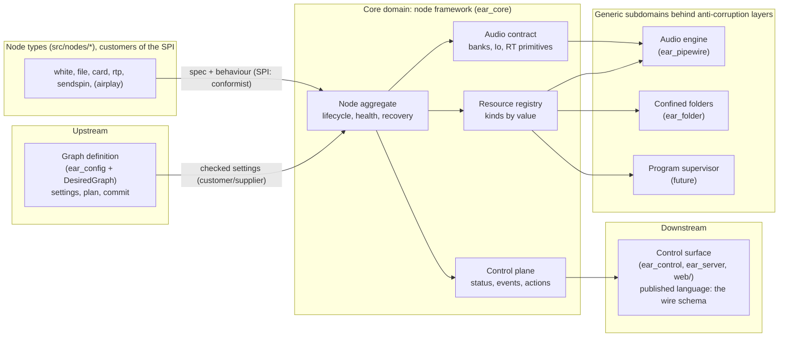
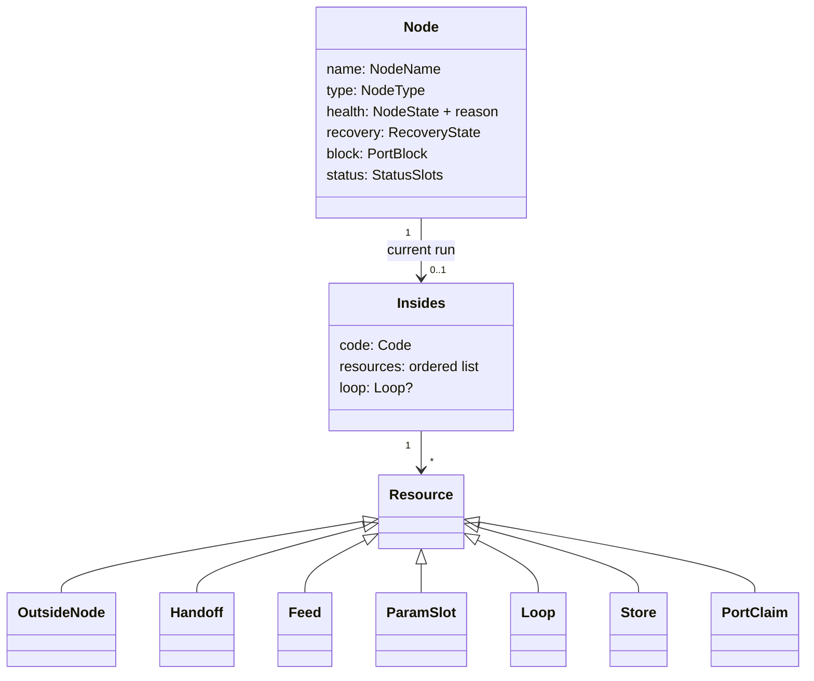

# The node framework: the primitives every node type builds on

Status: proposal for review, 2026-11-07. Nothing here is built.
Layer: system design (domain model and public interfaces), beneath the agreed system design
(`docs/design/pipewire-graph.md`) and over the module designs it would change (`docs/design/batch2.md` section 4,
`docs/design/sendspin.md` sections 3 to 8).

[V] = verified in the source named, as of `3ab159a`; [U] = unverified, so a slice's test checks it or section 14 keeps it
open.

## 1. The owner's words

| # | His words | Date, where | What it means here |
|---|---|---|---|
| R1 | "what are the core primitives that ear should host so that new nodes can be added simply and only require defining the truly custom bits that its node type demands" | 2026-11-07, chat | A node type is its custom part and nothing else; everything shared is the framework's |
| R2 | "consider how to abstract configuration and control plane events so that nodes can build on a shared base primitive layer" | 2026-11-07, chat | Configuration and control-plane events are framework subsystems, not per-type code |
| R3 | "Is it a virtual node base class? Are there several distinct subsystems, like one for config and one for events? How much do nodes [have] to write to handle bus connections?" | 2026-11-07, chat | The questions this page answers (sections 5, 6 and 9) |
| R4 | "can i add my own sources and sinks?"; "the core will be \"built into ear\"" | 2026-10-29, `pipewire-graph.md` R11 | Types stay built in; adding one must be cheap |
| R5 | "i will want multiple shairport instances" | 2026-10-29, `pipewire-graph.md` R9 | Many nodes of one type, and a third kind of outside thing (a program) |
| R6 | "in a general purpose sources-and-sinks graph, its always just 'running'" | 2026-10-29, `pipewire-graph.md` R2 | Nothing here may make a port block stop processing |

Design rules 1 to 3 of `pipewire-graph.md` hold unchanged: one owner per piece of state, and each health judgement its
owner's; a node is self-contained, reaching the engine only through powers the framework grants; the graph always runs.

## 2. The problem, measured

What each type writes today [V]:

| Type | Lines | Classes it writes | What is really its own |
|---|---|---|---|
| `white` | 73 | `AudioCode`, `NodeInsides`, `NodeConfig`, `NodeTypeOf` | a noise loop |
| `card` | 105 | the same four | its settings, "open this card", and a pass-through whose indices it works out by hand |
| `rtp` | 114 | the same four | its settings, "receive this stream", the same hand-indexed pass-through |
| `file` | 190 | the four, a descriptor wrapper, a `HandoffConsumer` | its settings and libsndfile |
| `sendspin` | about 1,900 | the four, and the primitives below | the protocol, pairing, the time filter, mDNS |

`sendspin` had to build, privately, about 560 lines of primitives that any threaded or networked type needs [V]:
`Mailbox` (a seqlock latest-value slot), `Feed` (the handoff's reverse: an ordinary thread to the realtime thread),
`EventFd`, `NoteGate` (rate-limited notes), `PortClaims` (which node holds which TCP port, held by the *type* across its
nodes), `KeyStore` (a 0600 file per node in the config folder, narrowed at boot), `ConnectionWatch` (timers), and its own
worker thread waiting in `poll()` for at most 10 ms.

The framework's own seams are closed in three places [V]:

- `NodeGrant` has one method per kind of outside node (`soundCard`, `rtpReceiver`), and `NodeHost`'s constructor takes
  one factory per kind (`node_host.hpp`). A program (R5), a network sink or an RTP sender each edits `ear_core`,
  `NodeHost`, `ear_pipewire` and `main.cpp`.
- The control plane out of a node is `InsidesEvents::say(std::string)` and `lost(std::string)`. About 11 of sendspin's 17
  note texts are state written as pairs of sentences (`connected`/`disconnected`, `pairing-code`/`pairing-code-cleared`,
  `stream`/`stream-ended`, `sending`/`sending-stopped`, `id`, `dialling`, `listening`). Notes reach standard output only,
  so the editor cannot show a pairing code.
- There is no control plane *into* a node except changing its settings. Restarting a failed node takes a no-op settings
  edit or restarting ear, and a node whose insides failed stays failed (`NodeState` has no `recovering`;
  `node_lifecycle.hpp`: "recovering arrives with programs").

## 3. The answer, in one paragraph

A node type is **declarations, one behaviour, and acquisitions**. The declarations are constexpr tables: its settings
(exists today), its ports as a pure function of its settings, its status fields, its events, its actions and its recovery
policy. The behaviour is one plain class: `start`, which acquires resources from a context and returns the node's code,
plus `process` if it makes or changes audio, plus handlers on its own serial loop if it has work off the realtime
thread. The acquisitions are framework-owned resources (outside nodes, handoffs, feeds, parameter slots, a loop, a
stored file, a claimed port), each an RAII handle the framework readies, watches and tears down in a fixed order. There
is no virtual base class for the author to derive from beyond the existing type-erasing `NodeTypeOf`, and no mixins:
capabilities combine freely, so they are acquired, not inherited. Four subsystems serve every type: **configuration**,
**resources**, the **control plane**, and **audio**. For bus connections a type writes nothing.

## 4. Ubiquitous language

| Term | Meaning | Today's name, if different |
|---|---|---|
| **Node type** | A built-in kind of node: its spec and its behaviour, found by its folder in `src/nodes/` | `NodeType` + `NodeTypeOf` |
| **Spec** | A type's declarations: settings, ports, status, events, actions, recovery. Pure, constexpr where it can be | the settings table, plus `NodeConfig::ports()` |
| **Node** | One named instance of a type in the desired graph; the aggregate root of everything below | — |
| **Settings** | A node's *desired* state, kept in `ear.conf`, judged by the desired graph | `NodeSettings` |
| **Port block** | The node's one `pw_filter`, made once for the node's life; owner of its public ports and the routes' ends | as today |
| **Bank** | A named, directed group of ports (`play`, `from`); public or inside | `PortBank` (public only); inside ports are a flat list today |
| **Insides** | One run of a node: what `start` made, from start to teardown; restarted behind the same block | `NodeInsides` |
| **Context** | What `start` and the loop see: the format, the node's name, and the acquire calls | `NodeGrant` |
| **Resource** | Something the insides acquired from the context, owned by the framework, gone with the insides | outside node, handoff |
| **Resource kind** | A class of resource (sound card, RTP receiver, program, handoff, feed, loop, store, port claim) with its own adapter | one method each on `NodeGrant` |
| **Code** | What runs on the realtime thread for one run: `prepare`, `process`, `release` | `AudioCode` |
| **Loop** | The node's serial executor for everything off the realtime thread | sendspin's worker |
| **Status** | A node's *observed* state, declared field by field; never health | `say` texts that are state |
| **Event** | A node's *edges*: something that happened, declared by code | `say` texts that are edges |
| **Action** | A command into a node, not kept in `ear.conf` | — |
| **Health** | `NodeState` and its reason: the framework's judgement alone | as today |
| **Recovery** | What the framework does after a loss: nothing (today) or restart with backoff | — |

## 5. Bounded contexts and the context map



- **Graph definition** stays upstream and unchanged in role: it alone judges settings, and it asks each type's spec to
  check them (as `NodeType::parse` does now). It never sees resources, status or actions.
- **Node framework** is the core domain. It owns the node aggregate and the four subsystems. Node types are its
  customers through a **service provider interface (SPI)**, and they conform to it: a type cannot extend the framework's
  model, only fill in its declarations and behaviour.
- **Audio engine, confined folders and the program supervisor** are generic subdomains. Each resource kind's adapter is
  the anti-corruption layer that keeps PipeWire, file descriptors and process ids out of `ear_core` (as today: no
  PipeWire type in a public header).
- **Control surface** is downstream. The framework publishes a **wire schema** (its published language): each type's
  settings, status, events and actions, so the editor renders any type without naming it. It stays a conformist to
  the framework's model, and still never judges anything.

## 6. The node aggregate

The node is the consistency boundary. Everything acquired for a run belongs to the node's insides, and only the
framework changes it, on the main loop.



Invariants (each is the framework's to keep, and a test's to prove):

- **I1. One block, for the node's life.** Settings changes restart the insides behind it; a port change replaces the
  node (as today, `desired_graph.cpp`).
- **I2. Health is the framework's.** A type reports facts (a resource lost, `fail(detail)`); it never sets `NodeState`.
  Status fields never count as health.
- **I3. Ready is the conjunction.** The node is `running` when the block is ready and every resource the run acquired is
  ready. A resource with no readiness of its own (a handoff, a store) is ready at once.
- **I4. Nothing the realtime thread can reach is destroyed while it can reach it.** Teardown always starts with
  `drive(nullptr)`, a blocking barrier with the block's data loop [V: `port_blocks.cpp`, `pw_loop_invoke(..., true, ...)`],
  then `release`, then resources in reverse acquisition order, then the insides.
- **I5. Nothing runs after teardown.** Once teardown begins, the run's loop takes no new work, its timers and watches are
  cancelled, its status and events are dropped, and actions to it get `stopping`.
- **I6. One run at a time.** A restart tears the old run down completely before `start` is called again (as today).
- **I7. Names are the node's.** Every engine object a resource makes is named `<node>.<suffix>` and carries the node's
  mark (design rule 2); the registry refuses two resources of one node with the same suffix.

## 7. The SPI: what a type writes

### 7.1 The spec (declarations)

```cpp
// src/nodes/rtp/rtp.cpp, in this proposal
constexpr auto channelsRow = setting::required("channels", setting::number(1, 64));
// ... the other rows, as today
constexpr SettingsTable<addressRow, portRow, formatRow, channelsRow, rateRow, latencyRow> settings{"rtp"};

constexpr auto receiving = status::flag("receiving");          // section 8
constexpr StatusTable<receiving> statusTable{};

constexpr NodeSpec spec{
	.settings = settings,
	.status = statusTable,             // optional; default empty
	.events = EventTable<>{},          // optional
	.actions = ActionTable<>{},        // optional; `restart` is every node's (section 8.4)
	.recovery = recovery::none,        // or recovery::backoff{1s, 60s}; section 8.5
};
```

- **Ports are a pure function of the checked settings**, written next to the spec:
  `static Ports ports(const Checked&)`. A bank is public or inside, and inside banks are named like public ones
  (`inside(input("rtp", numbered(n)))`), so nothing indexes a flat list of inside ports again.
- The spec is the **one source** of: the graph file's setting kinds (as today), the wire schema (section 8.6), the
  status-line vocabulary of the type, and the compile-time handles the behaviour uses. A misspelt row, field, event or
  action does not compile, as a misspelt setting row does today (`src/core/tests/compile_fail/`).
- Every table reuses one row machinery (kinds, ranges, text parse functions, a fixed check order), so an action's
  arguments are checked exactly as settings are.

### 7.2 The behaviour (one plain class)

```cpp
struct Rtp {
	static Ports ports(const Checked& s);
	static Started start(Context& cx, const Checked& s);   // main loop; must not block
};
NODE_TYPE(rtp, spec, Rtp);  // what the generated type list instantiates; replaces make<Type>NodeType
```

`Started` is either a failure (`startFailed: <detail>`) or the run's code:

| The run's code | When |
|---|---|
| `passThrough(from, to)` (one or more bank pairs) | a type whose audio is joined to an outside thing; `card` and `rtp` |
| any class with `prepare`, `process`, `release` (a concept, not a base class; erased once) | a type that makes or changes audio |
| `silence` | a type whose outputs are all fed by others (rare; mostly tests) |

There is no `NodeConfig` and no `NodeInsides` for the author to write: the framework keeps the checked settings and the
acquired resources itself, and the code object lives in the run.

A type with work off the realtime thread asks for a loop (section 7.3) and registers handlers on it in `start`. Its
long-lived state (sendspin's client, pairing, time filter) is an object it constructs in `start`, owned by the run, and
reached only from that loop.

### 7.3 The resources (acquisitions)

`Context::acquire(request)` on the main loop, inside `start` only (else `std::logic_error`, as `NodeGrant` today).

| Kind | Request | What the type gets | Ready when | Replaces |
|---|---|---|---|---|
| Outside node: sound card | `outside::soundCard{card, direction}` + an inside bank | nothing to hold; the framework joins the bank | its PCM runs and every link is active | `NodeGrant::soundCard` |
| Outside node: RTP receiver | `outside::rtpReceiver{...}` + an inside bank | as above | its socket is bound and every link is active | `NodeGrant::rtpReceiver` |
| Outside node: program (future) | `outside::program{argv, ...}` + inside banks | as above; the supervisor's identity | the program's nodes appear with the node's mark and are linked | — |
| Handoff | `handoff{bank, frames, consumer}` | an `RtWriter&` for `process` | at once | `NodeGrant::handoff` |
| Feed | `feed{bank, frames}` | an RT reader for `process`, a blocking writer for the loop | at once | sendspin's `Feed` |
| Parameter slot | `param<T>{initial}` | an RT reader, a loop-side writer; latest value wins | at once | — (live settings, volume) |
| Mailbox | `mailbox<T>{}` | an RT writer, a loop-side reader; latest value wins | at once | sendspin's `Mailbox` |
| Loop | `loop{}` or `loop{dedicated}` | a serial executor: post, timers, fd watches, a wake handle the RT side may ring | its thread runs | sendspin's worker thread, `EventFd`, `ConnectionWatch` |
| Store | `store{"sendspin-" + node + ".key"}` | read, replace-if-unchanged, mode 0600, kept across runs and restarts of ear | at once (a file it cannot trust fails `start`) | `KeyStore`, `narrowKeyFiles` |
| Recordings file | `recording{path}` | a descriptor opened beneath the recordings folder | at once | `NodeFolders.recordings` |
| Port claim | `claim::tcpListen{port}`, `claim::udp{port}` | nothing to hold; ear-wide, then probed against the kernel | at once (refused: `startFailed: cannot listen on port <p>: <why>`) | sendspin's type-level `PortClaims` |

- **The registry is open by kind.** `ear_core` declares each kind's request and readiness contract; one adapter per kind
  implements it (`ear_pipewire` for outside nodes, handoffs, feeds; `ear_folder` for stores and recordings; the
  supervisor for programs). `NodeHost` takes one registry, not one factory per kind, and `main.cpp` registers adapters.
  Adding a kind edits core's list of requests (a closed `std::variant`, deliberately: a kind changes what the framework
  promises, so it is a core decision) and adds one adapter; it edits no node type and not `NodeHost`.
- **Folders become resources.** `NodeFolders` and the `make<Type>NodeType(const NodeFolders&)` signature go; the
  generated type list instantiates `NODE_TYPE` declarations directly.
- **Claims are ear-wide.** A future `airplay` node and a `sendspin` node cannot both be told they hold port 7000.

### 7.4 Threads, as one contract for every type

| What the type writes | Runs on | May |
|---|---|---|
| Settings rows' parse functions, `ports(checked)` | any thread, pure | nothing else |
| `start` | the main loop | acquire; construct; not block, not do I/O beyond what an acquisition does for it |
| `prepare`, `release` | the main loop, never concurrently with `process` | allocate |
| `process` | the realtime thread | only RT-safe calls: the resources' RT ends, `status.rt()` (section 8.1). No locks, allocation, syscalls other than a wake |
| Loop handlers, action handlers, live settings | the node's loop, serially | block only on a `dedicated` loop |
| `HandoffConsumer::consume`, `finish` | the handoff's own thread | block on I/O |

After `start` returns, no node code runs on the main loop. This is the discipline sendspin keeps by hand today
(`docs/design/sendspin.md` section 6); here it is the framework's.

**Loops are strands, shared by default.** A plain `loop{}` is a serial strand on a small framework pool, so many nodes
(R5) do not cost a thread each. `loop{dedicated}` is its own thread, for a type whose library blocks or must own a
thread (sendspin: its library has no wake hook and is polled every 10 ms [V: `worker.cpp`]). The pool's size and whether
a strand may ever block are open (section 14, Q5).

## 8. The control plane

### 8.1 Four channels, by what they are

| Channel | Declared in | Kept | Written from | Delivery | On the wire | On standard output |
|---|---|---|---|---|---|---|
| **Settings** (desired) | `SettingsTable` | `ear.conf` | the graph file keeper only | as today | `node.added`, `node.updated` | as today |
| **Status** (observed) | `StatusTable` | memory; in every snapshot | the loop (any field) or RT (`flag`, `wholeNumber`, `enum` fields only) | **coalesced**: latest value per field | `node.status {name, fields}` | `node <n> status <field>=<value>` |
| **Events** (edges) | `EventTable` | not kept | the loop | **queued**, rate-limited per node | `node.event {name, code, args}` | `node <n> says <code> <args>` |
| **Actions** (commands in) | `ActionTable` | not kept | a client | to the node's loop, serially; async reply | `node.act {name, action, args}` → `{}` or an error | — |

Health (`node.state`) stays where it is and is not a channel a type writes (I2).

### 8.2 Status: coalesced slots

- Each field is a slot. Text fields are written on the loop and are bounded (the declared maximum length, default 256
  bytes; longer is cut and marked). RT-writable fields are fixed-size and travel in atomic words, as `Mailbox` does today
  [V: `mailbox.hpp`].
- A write sets the field's bit in the node's dirty mask; the write that turns the mask from clean to dirty rings the
  framework's status bell (one eventfd for all nodes, as the level bell is one eventfd rung from the data thread [V:
  `level_bell.cpp`]). The main loop drains every dirty node in one turn and tells listeners once per node with the
  fields that changed.
- **Memory is bounded whatever a peer does**: a slot per field, a bit per field, one bell. This replaces `NoteGate`'s
  token bucket for everything that is state.
- **Coalescing drops intermediate values** written within one drain. That is right for state and wrong for edges, which
  is why edges are events (Q2).

### 8.3 Events: queued edges

- Rare by declaration: `pairing-failed <reason>`, `key-write-failed <detail>`, `paired <server id>`. Codes and argument
  kinds come from the table, so the wire and the status line are generated, not written.
- A bounded per-node queue on the loop side, drained on the main loop; a burst of 32 passes, then one a second, and what
  was held back is counted in one `events-dropped <n>` (today's `NoteGate` policy [V: `note_gate.hpp`], moved into the
  framework). Not writable from RT.

### 8.4 Actions: commands in

- A row names the action and its arguments (checked by the settings row machinery). The control port decodes
  `node.act`, the gateway sends it to the main loop, the framework checks the arguments against the type's table and
  posts the call to the node's loop; the handler's `expected<void, std::string>` becomes the reply.
- **`restart` is every node's**, handled by the framework (the same teardown and start as a settings change), so a
  failed card or sendspin node is restarted from the editor without editing `ear.conf`.
- Actions are refused with `stopping` once the graph is closed, with `not-running` when the node has no run (failed and
  not recovering), and are never queued across a restart.
- An action does not change desired state. Anything that should survive a restart is a setting.

### 8.5 Recovery

`NodeState` gains `recovering`. The spec declares `recovery::none` (today's behaviour, the default) or
`recovery::backoff{first, max}`. After a loss (a resource lost, or `fail(detail)` from the loop) a node with backoff is
torn down, waits, and starts again; each failure doubles the wait up to `max`, and a run that stays `running` for `max`
resets it. `restart` and a settings change skip the wait. The wait is a main-loop timer, the framework's only one, and
its schedule is on the wire (`node.state recovering {retryInMs}`) so the editor can show it. This is also how a program
that keeps crashing restarts (`pipewire-graph.md`: "backoff sounds good").

### 8.6 The wire schema (published language)

`graph.get` and `graph.subscribe`'s snapshot gain `types`: for each type its settings rows (key, kind, required,
default, range, unit, what a text must be), status fields, event codes and actions, generated from the spec. Each
`NodeView` gains `status`. The editor's add-node panel shows a form per type instead of raw JSON, and a node's box shows
its status and its action buttons, with no type named in `web/`. The wire format's home stays `docs/design/batch2.md`
section 6 and `test/protocol/`; a protocol version in `graph.get` arrives with this change (Q4).

### 8.7 Live settings

A setting row declares `applies::restart` (default; today's behaviour) or `applies::live`. When an update changes only
live rows, the framework does not restart: it calls the type's `onSettings(const Checked&)` on its loop, which writes
parameter slots the code reads. A change to any restart row restarts; a change that changes ports replaces (as today).
Smoothing a live value on the realtime side (a gain ramp) is the type's, in `process`.

## 9. The audio contract

### 9.1 Bus connections: the type writes none

Public banks are declared; the framework makes the block, its ports, the links for routes, the routes' status and the
levels, as today. Inside banks are joined by the framework to the outside resource that names them. A pass-through is
the framework's code. So a type writes no link, port id, registry lookup or route handling, ever; `card` and `rtp` write
no audio code at all.

### 9.2 `Io` by bank

```cpp
struct White {
	static constexpr auto noise = bank::out("noise");      // a compile-time handle, checked against ports()
	std::mt19937 gen{std::random_device{}()};
	void process(Io io, const GraphCycle&) noexcept { for (auto ch : io[noise]) fill(ch, gen); }
};
```

- Bank handles resolve to indices in `prepare` (main loop), so `io[bank]` is an array index on the realtime thread, never
  a string lookup.
- `io.frames()`, `io[bank][member]` is a `span<float>` of exactly `frames`; inputs are `span<const float>`; an unlinked
  input reads zeros and every output sample must be written (today's contract [V: `node_type.hpp`]).
- `GraphCycle` stays as it is (`startNs`, `position`, `delayFrames`).

### 9.3 The realtime primitives, promoted to core

| Primitive | Direction | Shape | Today |
|---|---|---|---|
| Handoff | RT → handoff thread | lock-free ring of interleaved frames, drops counted | `ThreadHandoffs` (framework) |
| Feed | loop → RT | the same ring, reverse; the writer may wait for room | sendspin private |
| Param slot | loop → RT | latest value, seqlock over atomic words, trivially copyable `T` | none |
| Mailbox | RT → loop | latest value, the same seqlock | sendspin private |
| Wake | RT → loop | eventfd write, at most once until the loop answers | sendspin private, level bell |

All are created by acquisition (so torn down under I4), sized in frames from the format, and allocate nothing after
`prepare`. Counters the framework keeps for every node (frames dropped by handoffs, frames short in feeds) are framework
status fields every node has, so `dropped=` on the `stopped` line is one of them.

## 10. The types, rewritten

| Type | Today | This proposal (estimate) | What remains its own |
|---|---|---|---|
| `white` | 73 lines, 4 classes | about 25, 1 struct | the noise loop |
| `card` | 105, 4 classes | about 35 | its rows, the cross-row rule, two acquisitions, `passThrough` |
| `rtp` | 114, 4 classes | about 45 | its rows, one acquisition, `passThrough`; a `receiving` status (its "not built" list) |
| `file` | 190 | about 90 | its rows, the path rule, libsndfile in a `HandoffConsumer` |
| `sendspin` | about 1,900 | about 1,300 | the protocol, pairing, the time filter, PCM, mDNS; status fields for connection, pairing code, stream and sending; actions such as forgetting pairings |

```cpp
// sendspin's start, in this proposal
static Started start(Context& cx, const Checked& s) {
	if (!s[server]) cx.acquire(claim::tcpListen{s[port]});
	Loop& loop = cx.acquire(loop::dedicated);
	Store& key = cx.acquire(store{"sendspin-" + cx.node() + ".key"});
	auto& feed = cx.acquire(feed{bank::out("from"), feedFrames(cx.format())});
	auto& toServer = cx.acquire(handoff{bank::in("to"), cx.format().rate / 2, /* consumer made on the loop */});
	return SendspinCode::start(cx, loop, key, feed, toServer, s);   // the client object lives in the run, on `loop`
}
```

## 11. What it gives up, and costs

- **More compile-time machinery.** The settings table already needs 37 compile-fail tests (about 50 s at one job).
  Status, event and action tables reuse its rows, so they add cases, not a second machine.
- **A wider core.** `ear_core` gains the resource contracts, the control-plane slots and the recovery timer. It stays
  free of PipeWire, sockets, threads and files: the loop pool, eventfds and stores are behind interfaces, implemented in
  `ear_pipewire` and `ear_folder`.
- **Status lines change.** Sendspin's state-like `says` lines become `status` lines. The system tests that read them
  change, and `AGENTS.md`'s status-line contract changes.
- **Coalescing loses intermediate states** (8.2), by design.
- **A shared loop pool** is a new place where one node can delay another, if a type blocks on a shared strand. `dedicated`
  is the escape, and a strand handler that runs long is reported (Q5).
- **Resource kinds stay a closed list in core.** A new kind is a core change on purpose; only types are open.

## 12. Slices

Each slice keeps every existing test green and changes no audio path.

1. **The resource registry.** `Context::acquire` with the two existing outside kinds and handoffs; named inside banks;
   `passThrough`. `NodeHost` takes the registry. `card` and `rtp` move. No wire or status-line change.
2. **The SPI's shape.** `NodeSpec`, the behaviour concept, `NODE_TYPE`, `Io` by bank; `white` and `file` move; folders
   become resources; `NodeFolders` goes.
3. **Primitives into core.** Loop (dedicated and strand), feed, param slot, mailbox, wake, store, port claims. `sendspin`
   moves onto them and deletes its copies.
4. **The control plane.** Status, events, actions, `restart`, the wire schema, the editor rendering from it; sendspin's
   notes split into status and events.
5. **Live settings and recovery.** `applies::live`, `recovering` with backoff; card retry becomes `recovery::backoff`.
   This slice is the base the program supervisor and `airplay` build on.

## 13. Gate questions for the owner

| # | Question | Options |
|---|---|---|
| Q1 | Do status lines replace the state-like `says` lines on standard output? | Yes, and `says` is for events only (recommended) / keep both |
| Q2 | Coalescing drops intermediate status values within one main-loop turn. Accept? | Accept (recommended) / every status change queued |
| Q3 | Default recovery for `card` and `sendspin` once slice 5 lands | `backoff{1s, 60s}` (recommended) / `none` |
| Q4 | Version the wire with this change? | A `protocol` number in `graph.get` (recommended) / no version |
| Q5 | Loops: strands on a shared pool by default, or one thread per node always? | Strands, `dedicated` on request (recommended) / a thread each |

## 14. Open items

- [U] Whether PipeWire's data thread already flushes denormals for filter callbacks; if not, whether the framework sets
  FTZ/DAZ around `process`.
- [U] Port latency: a type with internal buffering (a feed, `rtp`'s `latencyMs`) should be able to declare its latency so
  PipeWire's latency reporting and R3's zones can use it. Sendspin lists it as not built; it belongs in the audio contract
  but is not designed here.
- [U] The program kind's readiness and mark: how a program's own nodes are recognised as the node's (design rule 2) is
  the supervisor's design, not this page's.
- [U] Whether text status fields need to be writable from RT at all (this page says no).

## 15. Review record

Filled in after independent review.
