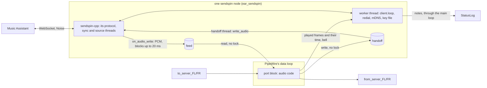

# The `sendspin` node: Music Assistant's audio in and out of ear

Status: design with its spike results and the frozen pages of three slices (S1, S2, S3), 2026-11-05.
Layer: module, inside the agreed system design (`docs/design/pipewire-graph.md`) and batch 2's module
map (`docs/design/batch2.md`). Precedent: `docs/design/rtp.md`.

[V] = verified by the spike or in the source named; [U] = unverified, so a slice's test checks it or
section 11 says it stays open. The spike was thrown away; it ran inside the dev image against the real
`aiosendspin[server]==10.2.2` (the version Music Assistant pins) and never touched Music Assistant,
Home Assistant, the cluster or real audio hardware.

## 1. The owner's words

| # | His words | Date, where | What it means here |
|---|---|---|---|
| R1 | "Implement the sendspin protocol as a new node type. Open a PR" | 2026-11-05, chat | A built-in node type, `sendspin` |
| R2 | "support home assistant network audio as source + sink" | 2026-10-30, batch 2 | Both directions in one node |
| R3 | "in a general purpose sources-and-sinks graph, its always just 'running'" | 2026-10-29, chat | The graph keeps running whatever the server does |
| R4 | he "didnt want to assume that a single hardware device was driving the entirety of the graph" | 2026-10-29, chat | A network node follows the graph's clock and never drives it |
| R5 | "sources and sinks that have a configurable frequency should be proactively configured to match the 'graph frequency'" | 2026-10-29, chat | Music Assistant is asked for the graph frequency |
| R6 | multi-device sample alignment "yes" | 2026-10-29, memory note | Keep sync to the protocol's bound at ear's edge (section 7 says what is left out) |

Gate answers, 2026-11-05 (his current choices; later evidence may reopen them):

| Question | His answer |
|---|---|
| Direction | "Both directions": Music Assistant's audio comes out of output ports, and audio routed to input ports goes to Music Assistant, in one node |
| Connection | "Both, chosen per node": with a `server` setting ear dials that URL (e.g. `ws://<host>:8927/sendspin`); without it ear listens (default 8928) and advertises `_sendspin._tcp` over mDNS |
| Permission | "Pairing code required": unpaired access stays off; ear prints a short-lived code on a status line and the operator types it into Music Assistant. Either way ear keeps a private key on disk in the graph file folder, mode 0600, so its identity survives restarts |

## 2. Current choices (revisable; none is his requirement)

- The official client library sendspin-cpp, pinned at commit `7be2278a252dd8c71da55732e93fe28871a9021d`
  (no tag: section 5(a)), behind one new package, `ear_sendspin`, the only one that sees it (as `ear_config` is knobly's).
- The node is a port block with its own audio code and one worker thread. It is not a third kind of
  outside node (section 3).
- Three general framework additions: a **feed** (the handoff's reverse: an ordinary thread writes, the
  realtime thread reads), **node notes** (a node's insides say something; `StatusLog` prints it) and the
  **cycle clock** (what a block's code reads about this graph cycle).
- The player role asks for FLAC 24, FLAC 16 and PCM 16, stereo, at the graph frequency only; the server
  resamples (R5, spec "player@v1"). The source role sends PCM 24 stereo at the graph frequency, 20 ms chunks.
- Roles built: player and source only. Opus off (section 5(a2)). Volume and mute commands off: Music
  Assistant sees a player with no volume control (deferred). Output delay stays adjustable there; the
  library keeps it in the key file.
- mDNS: `mjansson/mdns` 1.4.3, one public-domain header, driven by the worker thread. No daemon.
- CI runs the real `aiosendspin` server (section 13).

## 3. The shape, and what it gives up



Design rules (design choices, not requirements):

1. **The library never touches a realtime thread or PipeWire's main loop.** Its `notify_audio_played` and
   `write_audio` take locks on host builds (section 5(e)), and its `stop()` and destructor can wait (section 10);
   each runs on an ordinary thread, and everything crossing to the data loop goes through a feed, a handoff or a mailbox.
2. **Connection state is its own domain.** The node is `running` once its block is ready, whatever the
   server does (R3). Connected, paired and streaming are notes, never node states.
3. **Audio time is the graph's.** The library is told when frames play from the cycle's start on the graph's
   clock, never from when the thread woke (section 7).

Design it twice:

| | A: the library behind the block (current choice) | B: ear speaks the protocol itself (Beast, noise-c, FLAC decoder) |
|---|---|---|
| Interop | The official client, proven against the server in sections 5(b)-(d) | Every pairing round, re-handshake, Sentinel fallback and time filter written and kept up by us |
| Cost | Five fetched dependencies; a master-branch pin; a 10 ms timer confined to the worker; its threads and logging habits; two spec gaps we cannot fix (section 11) | About 5 000 lines of security-critical code and a moving spec; no timer |
| Control | No hook for a failed dial, a bind failure or `Origin` | Everything |

A third outside node (a `pw_stream` linked to inside ports) was the other shape for the block's side. It would
fit `joinOutsideNode`, but costs a second PipeWire node and links carrying what a function call can, with
`ready` and `lost` events no one needs: the node must be `running` with no server (R3). The block with
audio code is `file`'s shape, and costs two new grant powers.

Prior art: every Sendspin player has this shape (a blocking sink callback in front of a DAC's ring). JACK's
disk-reader pattern is the feed; ear's handoff is its writer twin. Not this context's job: Music
Assistant's queue, players and groups; the artwork, metadata, controller and visualizer roles.

**Tracer bullet (S1):** an `ear.conf` with a `sendspin` node dialling a real server and a `file` node; the
server plays a ramp; the WAV holds that ramp, frame for frame. It proves the dependency wiring, the
feed, the clock and the notes. Not in it: pairing, keys, audio to the server, listening, mDNS, redial.

## 4. Settings, ports and names

```conf
node sendspin kitchen { server "ws://192.168.1.10:8927/sendspin"; name "Kitchen"; }   # dials
node sendspin porch { port 8928; name "Porch"; }                                      # listens, advertises
node sendspin study;                                                                  # same, on 8928, named "study"
```

| Key | Kind | Grammar | Refused with (detail of `invalid-settings`) |
|---|---|---|---|
| (settings) | | a JSON object | `settings: must be an object with optional "server", "port" and "name"` |
| any other key | | none | `unknown key <key>` |
| `server` | text | `ServerUrl`: `ws://`, a host (dotted-quad IPv4, or letters, digits, `-` and `.`, at most 253), optional `:<1-65535>`, then a path of `/` and `[A-Za-z0-9._~-]`; no `wss://`, no user, query or fragment | `server: must be ws://<host>[:<port>]/<path>` |
| `port` | whole number | 1-65535; absent: 8928 (this parser is the one home of that default) | `port: must be a whole number, 1-65535`; with `server`: `port: only without "server"` |
| `name` | text | 1-64 bytes, none below 0x20 and no 0x7f; absent: the node's name | `name: must be 1 to 64 bytes with no control characters` |

Checks run in this order and the first failure is told: object, unknown keys (in the object's order),
server, port, name. A host name is looked up on the library's transport thread, never on the main loop.

- Ports, fixed: outputs `from_server_FL`, `from_server_FR`; inputs `to_server_FL`, `to_server_FR`. No inside
  ports. Engine node: `<node>`, the block alone.
- The key file: `<config-dir>/sendspin-<node>.key`. A node name holds only letters, digits, `-` and `_`, so the
  name is safe, and renaming a node makes a new identity (re-pair).
- On the network (S3): instance and host label `ear-<node>-<first 8 of client id>`, stable and unique
  without probing. Music Assistant shows `name`, from the hello.

## 5. Spike (2026-11-05): the premises, refuted or not

A throwaway C++ client ran one library client behind a real `pw_filter` block on ear's `Engine`
(`engine.conf`, graph group, always processing), 48 kHz and 256 frames unless noted, in the dev
image on the arm64 Docker VM (no realtime, load 2-4). A Python driver ran `SendspinServer` with
`allow_noncompliant_clients=False`, as Music Assistant does by default. The server played a ramp (L = low 16
bits of the frame index, R = high 16), so every output frame names its place exactly.

| Premise | Result | Evidence |
|---|---|---|
| (a) It builds on Debian 13, GCC 14 and links beside Boost, nlohmann/json, knobly | **True, at a master commit, not v0.9.5.** `accept_inbound_connections` (a dialling node must not listen) landed 2026-11-04, after the tag; so pin the commit. Five `kept_fetchcontent` pins at full commits survive `make clean` with the network off. | [V] ear's own `main.cpp` linked with the library runs a graph file; `nm -D` exports nothing of the library; offline configure after a clean; 102 objects, 20 s at 8 jobs with a cold cache; stripped ear with it 3.2 MB |
| (a2) Opus | **Off.** libsndfile pulls `libopus.so`; micro-opus's static C symbols would be exported to it and interpose. We need FLAC and PCM only. | [V] `ldd`; [U] the interposition itself was not provoked |
| (a3) Under ear's C++23 and warnings | True. The library must be added below ear's `CMAKE_CXX_STANDARD`; `<expected>`-using ear headers need it too. | [V] |
| (b) Both connection modes reach the real server | **True.** Handshake (Noise KKpsk2), hello, time sync. | [V] dial and inbound; `supported_roles` `player@v1`, `source@v1`; idle with no roles |
| (c) Dynamic code with unpaired access off, dialled and inbound | **True in both.** A wrong code keeps the code showing and retries the round; the right one pairs, re-handshakes in band and activates roles. A restarted client with its file resumes `paired=1` with no code. | [V] `connected=1 paired=1`; files `keypair`, `pairing_psk`, `rec_0`, `rec_order` |
| (c2) What Music Assistant needs | Its player settings start `start_pin_pairing` for a client that `is_connected`, whichever side dialled; it picks the dynamic code when digits are offered. Unpaired off + its approval: the client stays idle, no audio. | [V] by reading `providers/sendspin/{provider,player}.py` (`player.py:1183`, `provider.py:821`) and by the driver's `trust_unpaired`; **real Music Assistant NOT RUN** |
| (d) Audio with sane timestamps; source reaches the server | **True.** PCM 16, FLAC 16, FLAC 24 at 48000 arrive exact; 44100 and 96000 are resampled by the server. A 1 kHz tone arrives at amplitude 0.500, R = -L; timestamps span 4.96 s for 5 s; PCM 24 too. Source activates only when paired. | [V] WAV fit; `SourceStreamStartedEvent`; Music Assistant's `sendspin_source` plugin takes any format into 48 kHz/16-bit |
| (e) What may run on a realtime thread | **Neither call.** `notify_audio_played` takes `EventFlags`' and `ShadowSlot`'s mutexes; `write_audio` takes `SharedRingBuffer::mtx_` on host (the guide's "never waits" holds only loosely). | [V] `src/platform/{event_flags,shadow_slot,shared_ring_buffer}.h`, `src/source_task.cpp:225` |
| (e2) `loop()` with least polling | **A timer stays.** The Inbox has a lock-free `poll()` and no wake hook. The worker waits on the block's bell or 10 ms. | [V] `src/inbox.h`, internals "Inbox"; idle cost 0.28 s CPU in 20 s for the whole process |
| (f) Feeding the clock | **Cycle start plus the raw/monotonic offset holds the bound; wake time does not.** See below. | [V] |
| (f2) One skipped graph cycle | **Without care it costs 25 ms of audio.** The library sees -5.3 ms, drops the whole 25 ms chunk and inserts 19.7 ms of silence. Treating the skipped frames as played leaves only the 5.3 ms jump: 22 skips, no lost sync. | [V] each `Lost sync (19.68 ms)` matches one `dpos=512` cycle |
| (f3) The ring's size | **Small.** With 2.7 s the library writes ahead and a correction lands 2.7 s late (5.3 ms of error lingered for seconds). 2048 frames (43 ms) corrects within a chunk and never underran in steady state. | [V] |
| (g) CI | **Real server in the dev image.** Section 13. | [V] hash-locked install 8 s, 235 MB |
| (h) mDNS | **`mjansson/mdns` 1.4.3 works**, against aiosendspin's own zeroconf discovery: it found the node, dialled it, paired and streamed, in two containers on a bridge and in one container; goodbye seen. The library has no advertiser. avahi needs a daemon and D-Bus. | [V] |
| More | Two clients in one process run side by side. No retry after a failed or lost dial (the app must redial). A taken port only logs. `stop()` took under 10 ms; destructor 1 ms while dialling a dead address here (the guide bounds it at 30 s). | [V] |

Sync at the block's port against the time filter's prediction (spec "Sync accuracy"), settled, excluding
1.5 s after a skipped cycle:

| Run | Skips | Error p50 / p99 / worst | Within 1 ms | Frames corrected |
|---|---|---|---|---|
| Server clock +0 ppm, cycle start | 22 | -20 / -18 / 139 µs | 100% | 0 |
| FLAC, +0 ppm | 9 | -1 / 0 / 86 µs | 100% | 0 |
| Block 64; block 1024 | 46; 0 | -6 / -3 µs; -8 / -6 µs | 100%; 100% | 0 |
| +50 ppm | 14 | 92 / 437 / 595 µs | 100% | 91 (40 s × 50 ppm = 96) |
| -100 ppm | 2 | -94 / -14 / -1079 µs | 99.4% (first bursts) | 188 (expected 192) |
| +300 ppm, no skip handling, from 25 s | 10 | ~100 µs | steady; 3 ms jumps while the filter learned drift to 25 s | 553 (576) |
| +0 ppm, **wake time** | 7 | -930 / -554 / -3619 µs | **52%**; 868 corrections | rejected |

Speed: one frame per chunk at most, -0.084% over 150 ms with 25 ms chunks (spec: ±0.5%).

Findings about the library for upstream (section 11): no `Origin` refusal; at INFO it logs the Pairing PSK in
clear (`Provisioned Sendspin Pairing PSK: ...`), so ear fixes the level at WARN before any client exists.

## 6. Threads

| Thread | Runs | Never |
|---|---|---|
| PipeWire's data loop | `SendspinCode::process`: feed read, handoff write, cycle clock, two mailboxes, one eventfd write (as a handoff's wake) | The library; locks; allocation |
| PipeWire's main loop | `NodeConfig::start`: one read and at most one write of the key file (as `file` opens its WAV), port checks; notes printed | `client.start`, `stop`, destruction; name lookups |
| Worker `ear-sendspin <node>` | The library's "main loop": `start`, `loop`, `stop`, destruction; every listener callback but `on_audio_write`; `notify_audio_played`; key file writes; redial; mDNS. Waits in `poll()` on the bell, 10 ms at most | Audio |
| Handoff thread | `write_audio`; at `finish()`, tells the worker to stop and joins it | |
| Library threads | `SsProto`, `SsSync` (`on_audio_write`, which blocks up to 20 ms on the feed), `SsSrc`, IXWebSocket's | |

Teardown stays the framework's one order. Block gone, `release`, handoff drained (the last audio reaches
`write_audio` while the client lives), `HandoffConsumer::finish()` stops the client on the handoff's
thread, `closed` on the main loop, insides and feed destroyed. So a restart or stop never blocks the main
loop, however long the library takes. All threads start after `Engine::create`, so they inherit its blocked
stop signals. This does make the source handoff the node's teardown hook: S1 has it before it carries audio.

## 7. Clock

The graph's clock is not the server's, and neither is the library's (`CLOCK_MONOTONIC_RAW`). The library
works as with any DAC: `on_audio_write` fills the sink, the sink reports frames played with the time they
finish, and it adds or drops one interpolated frame per chunk beyond 100 µs, or hard-syncs beyond 5 ms.

On each cycle the block's code computes, without a system call that can block:

```
finish = cycle.startNs (position->clock.nsec, CLOCK_MONOTONIC) + (raw_now - mono_now) + got * 1e9 / rate
```

Both `now`s are vDSO reads, taken together, so a late wake cancels out. A `pw_filter` reads `clock.nsec`,
`next_nsec`, `position`, `duration` and `rate_diff` from `spa_io_position` on the data loop [V]. `(frames, finish)`
goes through a seqlock mailbox and a bell to the worker, which calls `notify_audio_played`.

- **A skipped cycle** (`position` advanced by more than last cycle's frames, by at most the feed's capacity) discards that
  many frames and counts them played (section 5(f2)). A larger or backward jump is a change of driver: not
  skipped, the library re-aligns. [U] with a sound card driving: `clock.nsec` and driver changes were not run.
- **Feed capacity:** the next power of two at or above `max(rate * 40 ms, 2 * maxBlock)`.
- **What this bound covers:** the block's port. The cycle, the card's buffer and the room beyond are not
  counted (spec: "the client compensates"): ear plays late against other Sendspin devices by about one
  block plus the card's buffer. Until PipeWire's port latency is read (deferred), the operator sets
  Music Assistant's output delay for the player.
- Capture time for the source role: the code publishes `(framesWritten, rawNs)` each cycle; the consumer
  dates its first frame from that, so a late handoff wake does not move the stamp.

## 8. What is persisted

`<config-dir>/sendspin-<node>.key`, mode 0600, one JSON object per node, written by `NodeKeyStore`:

```json
{ "createdAt": "2026-11-05T22:00:00Z", "changedAt": "2026-11-05T22:01:00Z", "changedBy": "ear",
  "blobs": { "keypair": "<base64url>", "pairing_psk": "...", "rec_0": "...", "rec_order": "...",
             "last_played": "...", "output_delay": "..." } }
```

- Through `ConfinedFolder`: read and replaced with no symlink on the path, staged and swapped as `ear.conf` is, at
  most 64 KiB. Each `save_blob` writes the whole file on the worker thread. The keeper's watch ignores other names [V `namesFile`].
- Holds the static private key, the Pairing PSK and long-term PSKs: secrets. Never logged, never on the wire to the editor.
- `start` reads it. Missing: writes an empty one, so a read-only folder fails at once. Unreadable, a symlink,
  malformed: the node fails and the file is left alone. A new identity is never minted over trusted state
  (Music Assistant's `security.py` does the same).
- The round limit and pairing window live in memory (`pairing_rounds_since_verified_kc_`) [V], so a restart of the node is the
  "deliberate operator action" the spec asks for.

## 9. Status lines

One new frame in `status_log.cpp`, `node <name> says <text>`; the texts' one home is `src/sendspin/notes.hpp`.

```
node <n> says id <client id>                      S2: first, once
node <n> says dialling <url>                      S1
node <n> says listening <port> as <instance>      S3
node <n> says connected <server name> paired|unpaired      S1 (server name: control bytes become ?, at most 64)
node <n> says disconnected                        S1
node <n> says pairing-code <123-456>              S2: shown until cleared
node <n> says pairing-code-cleared                S2
node <n> says paired <server id>                  S2
node <n> says pairing-failed <reason>             S2: attempt-timeout, concurrent-attempt, method-not-supported,
                                                       pairing-code-mismatch, user-cancelled, unknown
node <n> says pairing-held                        S2: 20 wrong rounds: restart the node to try again
node <n> says stream <flac|pcm> <rate> <channels> <bits>   S1
node <n> says stream-ended                        S1
node <n> says stream-refused <codec> <rate> <channels> <bits>   S1
node <n> says sending <rate> 2 24                 S2
node <n> says sending-stopped                     S2
node <n> says key-write-failed <detail>           S2
node <n> says advertise-failed <detail>           S3
```

## 10. Failure behaviour

| What | The node | Told | Recovery |
|---|---|---|---|
| Server unreachable, or gone | `running`, outputs silent after the feed drains, inputs dropped | `disconnected` | Redial from the worker, 1 s doubling to 30 s, reset when connected (the editor's policy). The library neither retries nor reports a failed dial [V]; the worker reads `is_connected()` each wake |
| Stream in a format not asked for (not 2 channels, not the graph frequency, not 16 or 24 bit) | `running`, silent; bytes discarded but counted played, so the library stays in time | `stream-refused ...` | The next `stream/start` |
| Server approves without pairing | Idle: no roles, no audio; the hello says unpaired access is off | `connected <name> unpaired` | Pair |
| Wrong code | The library asks for another round; the same code stays shown | (nothing new) | Type it again |
| 20 wrong rounds | Attempts held back | `pairing-failed pairing-code-mismatch`, `pairing-held` | Restart the node (`node.update` or ear) |
| Pairing times out or is cancelled | Connection stays | `pairing-failed <reason>`, `pairing-code-cleared` | Start again in Music Assistant |
| Server lost its record, or the file was lost | Sentinel fallback: connected, unpaired, idle (spec) | `connected <name> unpaired` | Pair again |
| Listen port held by another program, or by another `sendspin` node | `failed start-failed: cannot listen on port <p>: <reason>` | as a node failure | `node.update` retries. Checked in `start`: claims across ear's nodes, then a probe bind, because the library only logs a failed bind [V]; a program taking the port in the moment between is not caught |
| mDNS socket cannot open | Listening without advertising | `advertise-failed <detail>` | Music Assistant can still be given the URL |
| Key file bad at start | `failed start-failed: <folder's detail>` | as a node failure | Fix the file or folder; `node.update` |
| Key write fails later | Pairing holds this run only (library's contract) | `key-write-failed <detail>` | Fix the folder, pair again |
| Graph skips a cycle | About one block's jump; no lost sync | | Automatic |
| Stopping | Goodbye, close; up to 3 s for a half-open socket, up to 30 s for a dial in flight, off the main loop | `stopped` when done | Exit waits for it (as a hung disk delays exit) |

## 11. What it gives up and defers

Costs: five fetched dependencies at a master pin; a 10 ms timer and a redial timer on the worker (against
"Coordinate by events, never timers": the library offers no event, so they stay inside its adapter); `git`
and a 235 MB Python server in the dev image; a pod on an overlay network cannot advertise (dial instead);
the server alone decides when the source streams.

Two gaps in the library ear cannot fix from outside, for upstream issues:

1. **`Origin` is not refused.** The spec says a client MUST reject an upgrade carrying `Origin`; the host
   server accepts it and any path [V: an upgrade with `Origin: http://evil.example` got `client/init`]. A web
   page can open a socket to a listening node. It reaches only the Noise handshake and an idle
   session: without the code nothing plays or is heard, so this is not a stop.
2. The Pairing PSK at INFO (section 5). Ear stays at WARN; the library's warnings go to standard error.

The pairing code goes only to standard output, as chosen; the editor does not show it (deferred). Anyone who
reaches port 7777 can still edit the graph: pairing guards Music Assistant's side, not ear's control port.

Deferred: volume and mute from Music Assistant; line sense (`signal`), so no autostart; PipeWire's port latency in the clock;
the editor showing notes; IPv6; `wss://`; several servers at once; choosing the advertised interface
(today: the one the kernel routes 224.0.0.251 through); RFC 6762 probing (names are unique by construction);
more than stereo. Not planned: Opus; artwork, metadata, controller, visualizer roles.

NOT RUN by the spike: real Music Assistant; a sound card driving the graph; amd64 (CI will); a host with realtime scheduling.

## 12. Reconcile with existing code

| Change | Why | Cost |
|---|---|---|
| `NodeGrant` gains `feed`, `cycleClock`, `notes` | General powers: a future network source (`airplay`) needs the same | Every fake grant in `src/nodes/tests` and `src/core/tests` (they throw) |
| `NodeHost` constructor gains `FeedFactory&`, `Executor&` | Feeds are made by an adapter; notes cross to the main loop | `main.cpp`, every `NodeHost` test |
| `PortBlock` gains `cycleClock()`; `onProcess` stores the cycle before running the code | Timing without changing `AudioCode::process` for the three types that ignore it | Fake blocks; hidden rule: valid only inside `process` |
| `FrameRing` (private to `ear_pipewire`) out of `ThreadHandoff` | One ring for both directions | A refactor under the handoff's existing tests |
| `ear_folder`: `replaceIf` gains a mode for a file it creates | 0600 at birth, one home for staged writes | One caller updated |
| `main.cpp` holds the graph file folder in a `shared_ptr` and adds the type | `ear_nodes` stays free of the library; main composes | `builtinNodeTypes` unchanged, so `white_test`'s list too |
| `dev` image: `git`, `python3`, `python3-venv`, venv | `micro-flac` needs a submodule; real server | Section 13 |

Frozen headers are changed through this page, as their first comment asks (batch 2 section 11 records it).

## 13. Build and test costs

- `CMakeLists.txt`, before `add_subdirectory(src)`: `USE_TLS` and `USE_ZLIB` off, roles trimmed, `kept_fetchcontent`
  in order at full commits, each before the library's own `FetchContent_Declare` (first declaration wins):

| Dependency | Commit | Licence | Note |
|---|---|---|---|
| ArduinoJson v7.4.1 | `32520135092970120a5ac165cf45f48e658c421d` | MIT | |
| IXWebSocket v12.0.1 | `64fae7676bd8fe31f7cb4bcde7a6841892dad65e` | BSD-3 | |
| micro-flac v0.3.0 | `f9c27d4d0166021db977d7fc37d205b21d81e9f2` | Apache-2.0 | `GIT_SUBMODULES lib/micro-ogg-demuxer`, hence `git` |
| noise-c v0.1.13 | `a1e08809a1b8f65cd91765ba7d68a6d00648ad61` | MIT | `SOURCE_SUBDIR no-such-directory`: its CMakeLists is ESP-IDF's; the library builds it |
| sendspin-cpp | `7be2278a252dd8c71da55732e93fe28871a9021d` | Apache-2.0 | `SENDSPIN_ENABLE_{CONTROLLER,METADATA,ARTWORK,VISUALIZER,COLOR,OPUS}=OFF` |
| mjansson/mdns 1.4.3 (S3) | archive SHA-256 `be1fd8e35599cb7de179decbd0633c121d11a2dcb9cc193ff5c590bd0d480483` | public domain | `URL`; header only |

- Licences: configure copies each into `out/licenses/`; the `run` stage copies that to `/opt/ear/licenses`.
- `test.yml`: the deps cache's `path` lists each tree. `scripts/dev.sh`: `GIT_CONFIG_COUNT=1`,
  `GIT_CONFIG_KEY_0=safe.directory`, `GIT_CONFIG_VALUE_0=*`: Docker Desktop's mount reports a fresh clone as another owner now and then [V: 1 of 5 clones].
- **CI: the real server, chosen.** `dev` image adds `git`, `python3`, `python3-venv` (146 MB) and
  `/opt/sendspin-server`, a venv from `test/sendspin/requirements.txt` (23 packages, `--require-hashes`, every
  wheel for both architectures; made with `uv pip compile --universal --generate-hashes`; 8 s, 235 MB). The `run`
  image gets none. Every job loading `dev` pays the larger layers (cached); first build about 40 s more; each
  system test about 10 s, in parallel. The alternative, a fake server in C++, would prove only what we believed.
- Configure with `BUILD_TESTS=ON` stops naming `EAR_SENDSPIN_SERVER_PYTHON` when `/opt/sendspin-server/bin/python` is missing, so the tests cannot be skipped by accident.

## 14. Slices

Series: S1, then S2, then S3. Each is green alone. Land per slice: `git add -A -- <owned> && git commit -m '<msg>' -- <owned>`, then
push. A slice that needs a file outside its list or a signature change adds an erratum here and stops.

### S1, the tracer: a `sendspin` node dials a server and plays its audio out of output ports

Grammar for this slice: `server` required (`server: missing`), `port` is an unknown key; `name` as section 4.
Unpaired access **on** and no key file: the test's server approves the client. S2 removes both.
Inputs exist and their audio is dropped (the handoff exists for teardown, section 6).

`src/core/include/ear/core/node_type.hpp` gains (interfaces have protected destructors, as `RtWriter`):

```cpp
class RtReader {   // realtime end of a feed; valid until the node's insides are gone
  /// Realtime only; no lock, allocation or waiting. Up to `frames` frames into planar `channels`
  /// (size == the feed's channels, each >= frames), zeros after them. Returns frames read.
  virtual std::uint32_t read(std::span<const std::span<float>> channels, std::uint32_t frames) noexcept = 0;
  virtual std::uint32_t skip(std::uint32_t frames) noexcept = 0;   // realtime only; discards; returns how many
};
class FeedWriter {   // ordinary-thread end: one writing thread at a time
  /// Interleaved frames in; with no room waits up to `patience`, woken by read() or skip().
  /// Returns frames accepted (0 when none fit in time).
  virtual std::uint32_t write(std::span<const float> interleaved, std::uint32_t frames,
                              std::chrono::milliseconds patience) = 0;
};
struct Feed { RtReader& reader; FeedWriter& writer; };
/// This cycle of the graph. startNs: its start on CLOCK_MONOTONIC. position: the driver's frames.
struct GraphCycle { std::int64_t startNs; std::uint64_t position; std::uint32_t frames; };
class RtCycleClock { virtual GraphCycle cycle() const noexcept = 0; };   // realtime, inside process() only
/// Any thread, never blocks. Told on the main loop in order; dropped once the node is gone.
class NodeNotes { virtual void say(std::string text) = 0; };
// NodeGrant gains (start() only, else std::logic_error):
  virtual Feed feed(std::uint32_t channels, std::uint32_t capacityFrames) = 0;   // destroyed after the insides
  virtual const RtCycleClock& cycleClock() = 0;                                  // the block's; lives as long as the node
  virtual NodeNotes& notes() = 0;                                                // may be kept by the worker
```

`src/core/include/ear/core/node_host.hpp` gains:

```cpp
class PortBlock { /* ... */ virtual const RtCycleClock& cycleClock() const noexcept = 0; };
class FeedEnds {   // destroyed on the main thread, with no reader or writer left
  virtual RtReader& reader() noexcept = 0;
  virtual FeedWriter& writer() noexcept = 0;
};
class FeedFactory {
  virtual std::unique_ptr<FeedEnds> make(const NodeName& node, std::uint32_t channels, std::uint32_t capacityFrames) = 0;
};
class NodeNoteListener { virtual void nodeSays(const NodeName& node, const std::string& text) = 0; };   // main thread
NodeHost(AudioFormat format, PortBlockFactory& blocks, HandoffFactory& handoffs, FeedFactory& feeds,
         SoundCardFactory& cards, RtpReceiverFactory& receivers, Executor& mainLoop);
void subscribeNotes(NodeNoteListener& listener);
```

`src/pipewire/include/ear/pipewire/feeds.hpp` (new): `class ThreadFeeds final : public FeedFactory` (no constructor arguments).
`src/pipewire/frame_ring.hpp` (new, private): `FrameRing(channels, capacityFrames)` over `spa_ringbuffer`, power-of-two frames,
`writePlanar`, `writeInterleaved`, `readPlanar`, `readSpan`, `skip`; `ThreadHandoff` moves onto it. The writer waits on an
eventfd in `poll()`; `read` and `skip` write it only while a writer says it waits.
`port_blocks.cpp`: `onProcess` stores `{position->clock.nsec, position->clock.position, frames}` before `processCycle`.
`status_log.hpp`: `StatusLog` also implements `NodeNoteListener`.

`src/sendspin/include/ear/sendspin/sendspin_type.hpp` (new, the package's one public header):

```cpp
/// "sendspin" (docs/design/sendspin.md section 4). `folder`: the graph file folder, for each node's key file.
std::unique_ptr<const NodeType> makeSendspinNodeType(std::shared_ptr<const folder::ConfinedFolder> folder);
```

Private to the package: `settings.hpp` (`ServerUrl::parse`, `struct SendspinSettings { std::optional<ServerUrl> server; std::uint16_t port; std::string name; }`, one parse), `pcm.hpp` (little-endian 16 and 24 bit to float and back, exact), `sendspin_code.hpp`, `mailbox.hpp` (seqlock of one trivially copyable value), `notes.hpp` (each text, `printable()`), `session.hpp`:

```cpp
struct PlayProgress { std::uint64_t totalFrames; std::int64_t finishRawNs; };
class SendspinCode final : public AudioCode {   // process(): section 7, then feed read, progress, bell
public:
  SendspinCode(RtReader& feed, const RtCycleClock& clock, RtWriter& toServer, Mailbox<PlayProgress>& progress, int bell, std::uint32_t rate);
};
class SendspinSession final : public HandoffConsumer {   // owns the worker and, through it, the client
public:
  SendspinSession(SendspinSettings settings, AudioFormat format, FeedWriter& feed, NodeNotes& notes, std::uint32_t feedFrames);
  ~SendspinSession() override;                  // after finish(); joins nothing new
  void consume(std::span<const float>, std::uint32_t) override;   // S1: drops; S2: write_audio
  void finish() override;                       // tells the worker to stop, joins it
  int bell() const noexcept;                    // the eventfd the code rings
  Mailbox<PlayProgress>& progress() noexcept;
  std::int64_t clientTimeOf(std::int64_t serverUs) const;   // the tests' window on the time filter
};
```

Owned files (S1): `CMakeLists.txt`, `cmake/SendspinDeps.cmake` (new), `docker/Dockerfile`, `scripts/dev.sh`, `.github/workflows/test.yml`, `test/sendspin/requirements.txt` (new), `src/CMakeLists.txt`, `src/main.cpp`, `src/core/**`, `src/pipewire/{feeds.cpp,frame_ring.hpp,handoffs.cpp,port_blocks.cpp,CMakeLists.txt}`, `src/pipewire/include/ear/pipewire/feeds.hpp`, `src/pipewire/tests/feed_test.cpp` (new), `src/control/{status_log.cpp,include/ear/control/status_log.hpp,tests/**}`, `src/nodes/tests/**`, `src/sendspin/**` (new), `test/CMakeLists.txt`, `test/support/sendspin_server.{py,hpp}` (new), `test/system/{sendspin_test.cpp,CMakeLists.txt}`.

The test server, `test/support/sendspin_server.py`, a real `SendspinServer`, one command per stdin line, one event per stdout line, so tests wait for events: args `--listen 0 | --dial <url> [--state <dir>]`; commands `trust`, `play <seconds>`, later `pair`, `code <digits>`, `source-start`, `source-stop`, `quit`; events `ready <url>`, `connected <client id>`, `play-start <us>`, `play-finished <frames>`, `disconnected`. The ramp is section 5's.

Acceptance (each test waits for events; a deadline only fails it):

1. `[feed]` real threads: a 10 s ramp written with patience is read back exact, in order; `read` past the end zero-fills; a full feed's `write` wakes on `read`, returns 0 at `patience`; `read` does not allocate.
2. `[node_host]` a feed asked outside `start` throws; feeds outlive the insides and handoffs (fakes log the order); `say` from another thread reaches `nodeSays` in order, and not after `nodeGone`.
3. `[port_blocks]` real engine: `cycle()` inside `process` reports the cycle's `frames`, a `position` advancing by them, and `startNs` no later than now.
4. `[status_log]` `node a says b`.
5. `[sendspin][settings]` each refusal's exact text in order; `ServerUrl` accepts `ws://10.0.0.1:8927/sendspin`, `ws://ma.local/sendspin`; refuses `wss://a/b`, `ws://a`, `ws://u@a/b`, `ws://a/b?c`, `ws://[::1]/b`, `ws://a:0/b`, `ws://a:65536/b`, a space.
6. `[sendspin][pcm]` every 16-bit value and 24-bit edges round-trip exact.
7. `[sendspin][code]` fake reader, clock, writer: 256 frames read gives `totalFrames + 256` and `finish = startNs + (raw - mono) + 256/rate`; `position` ahead by 256 skips 256 and counts them; ahead by more than the feed's capacity, or behind, skips none; nothing read reports nothing and rings nothing.
8. `[sendspin][format]` the stream check accepts 48000/2/16 and 48000/2/24 and refuses 44100, 1 channel, 32 bit, with `stream-refused`'s exact text; a refused stream's bytes are counted and not written.
9. `[sendspin][clock]` real engine, real block, real server, 8 s of ramp: in every cycle more than 1.5 s after a skip and 3 s after the first frame, |output time - `clientTimeOf(ramp time)`| < 1 ms in at least 99%; no index step other than +1 or a block's multiple. [U: a loaded CI host's skips; erratum 3 of `rtp.md` applies.]
10. `[system][sendspin]` the real `out/ear`, `node sendspin ma { server "<url>"; }`, `node file rec`, routes to `FL`, `FR`. Once `node ma running`, both routes `linked`, `node ma says connected`, `play 1.5`; on `play-finished` wait for the buffered lead, SIGTERM. Exit 0, `node rec stopped dropped=0`, `says stream flac 48000 2 24`. The WAV's first non-zero frame onward holds at least 1.2 s where each frame is exactly `(lo/32768, hi/32768)` of a ramp index, stepping by +1 or a block's multiple.
11. `[system][sendspin]` with no server at all the node is `running`, its meters read silence, and SIGTERM exits 0 within the deadline.
12. Run image: `scripts/image-smoke.sh` still passes; `/opt/ear/licenses` holds the five.

Mutation probes (the verifier applies each, sees red, restores):

| Probe | Red |
|---|---|
| Deinterleave FR into FL's span | 10 |
| Never call `notify_audio_played` | 10 (the library never leaves its first alignment) |
| `finish` from `clock_gettime` at wake instead of `cycle.startNs` | 9 |
| Leave `got/rate` out of `finish` | 9 and 7 |
| Skip on any position gap, however large | 7 |
| No skip at all | 7 |
| Feed 2^17 frames | 9 [U: only if a filter update lands in the window; else report green] |
| `read` leaves the rest of the span unwritten | 1 |
| `say` delivered inline | 2 |
| Accept `wss://` | 5 |

Commit: `feat(sendspin): play Music Assistant's audio through a sendspin node`

### S2: audio to Music Assistant, the key file, pairing code required

Unpaired access **off** for good: S1's test server approval now earns nothing. `pairing_code_out_channels = {DISPLAY}`, `pairing_code_formats = {DIGITS}`. The log level stays WARN. `consume` calls `write_audio`.

```cpp
// src/folder: replaceIf gains the mode of a file it creates (an existing file keeps its own).
std::expected<ReplaceOutcome, FolderError> replaceIf(const std::string& relative,
    const std::optional<std::string>& expected, std::string_view text, std::size_t maxBytes, mode_t createMode = 0644) const;
// src/sendspin/key_store.hpp
class NodeKeyStore final : public sendspin::SendspinPersistenceProvider {
public:
  /// Reads the file, or creates it empty, mode 0600. Error: node start fails with this detail.
  static std::expected<std::unique_ptr<NodeKeyStore>, std::string> open(std::shared_ptr<const folder::ConfinedFolder> folder, const NodeName& node, NodeNotes& notes);
  std::optional<std::vector<std::uint8_t>> load_blob(const std::string& key) override;
  bool save_blob(const std::string& key, const std::uint8_t* data, std::size_t size) override;   // worker; writes the file; failure: key-write-failed
};
// sendspin_code.hpp: process() also writes inputs to the handoff and publishes
struct CaptureAnchor { std::uint64_t framesWritten; std::int64_t atRawNs; };
```

Owned files: `src/folder/**`, `src/sendspin/**`, `test/support/sendspin_server.py`, `test/system/sendspin_test.cpp`.

Acceptance:

1. `[folder]` a created file has mode 0600 under any umask; an existing one keeps its mode; symlinks refused as today.
2. `[sendspin][keys]` real folder: blobs round-trip byte for byte; audit fields set; `changedAt` moves; malformed JSON, a directory, a symlink out, over 64 KiB, and a read-only folder each fail `open` with the folder's detail, and the bad file is unchanged.
3. `[system][sendspin]` dialled pairing with a real server: `says id`, `says connected ... unpaired`; `pair`; on `says pairing-code <d>` send a wrong `code`, then the right one; `says paired`; `says connected ... paired`; `play`; the ramp in the WAV.
4. `[system][sendspin]` restart ear, keep the folder: same `says id`, `connected ... paired`, no code asked; the key file is mode 0600.
5. `[system][sendspin]` `trust` with no pairing: no stream reaches the node and no source role activates; `says connected ... unpaired` only.
6. `[system][sendspin]` paired, `white` routed to `to_server_FL` only: `source-start`; `says sending 48000 2 24`; the server's audio has energy on the routed channel and exact zeros on the other; first and last chunk stamps differ by the frames' duration ± 50 ms; `source-stop`; `says sending-stopped`.
7. `[system][sendspin]` wrong code 20 times: `pairing-failed pairing-code-mismatch`, `pairing-held`; `node.update` clears it: the right code then pairs.
8. A corrupt key file: `node ma failed start-failed: ...`; the file is unchanged; the rest of the graph runs.

Commit: `feat(sendspin): send routed audio to Music Assistant, paired by a code`

### S3: listening and mDNS, per-node choice, the failures left

Grammar: section 4 in full. `accept_inbound_connections = !server`. Worker gains redial and `Advertiser`.

```cpp
// src/sendspin/advertiser.hpp: mjansson/mdns behind one class; one socket per node; worker thread only.
class Advertiser {
public:
  /// Opens the socket and announces PTR, SRV, TXT (path=/sendspin, name=<name>) and A. Error: its detail.
  static std::expected<std::unique_ptr<Advertiser>, std::string> open(std::string instance, std::string name, std::uint16_t port);
  void answer() noexcept;   // reads what waits, answers; never blocks
  ~Advertiser();            // goodbye
};
// src/sendspin/port_claims.hpp: main thread only; held by the type; released when the insides go.
class PortClaims { public: std::expected<void, std::string> claim(std::uint16_t port, const NodeName& node); void release(std::uint16_t port); };
```

Owned files: `src/sendspin/**`, `cmake/SendspinDeps.cmake`, `docker/Dockerfile` (`EXPOSE 8928`), `test/support/sendspin_server.py`, `test/system/sendspin_test.cpp`, `AGENTS.md`, `.claude/skills/sendspin/SKILL.md` (new), `.claude/skills/ear-on-talos/SKILL.md`, `.claude/skills/control-port/SKILL.md` (only if a line is wrong), this page (results and errata).

Acceptance:

1. `[sendspin][settings]` section 4's table in full, including `port` with `server`.
2. `[system][sendspin]` `node sendspin ma { port <free>; }`: `says listening <p> as ear-ma-<8>`; a server with `--dial` pairs and plays; WAV holds the ramp.
3. `[system][sendspin]` same with mDNS: the test server with discovery (no URL given) finds the node, dials, pairs; TXT `path=/sendspin`, `name=<name>`; after SIGTERM the server reports the service removed. [U: multicast on GitHub's runner bridge; ran on the Docker VM only.]
4. `[system][sendspin]` dialling node with a server stopped mid-stream: `says disconnected`; `node ma running`, other nodes unaffected; server restarted with `--state`: `says connected ... paired`, audio resumes with no action.
5. `[system][sendspin]` a port another program holds, and two `sendspin` nodes on one port: each refused node `failed start-failed: cannot listen on port <p>: ...`; the others run; `node.update` to a free port recovers.
6. `[sendspin][backoff]` the redial's delays with a fake clock: 1, 2, 4 ... 30 s, reset on connect.
7. `[system][sendspin]` two nodes, one dialling and one listening, same ear, same server: separate identities, both paired, both play.
8. A dialling node opens no listening socket (a connect to 8928 is refused).
9. `AGENTS.md` names the type, settings, ports, package, status lines, the new image contents and the not-built list; the `sendspin` skill holds the traps of section 5.

Commit: `feat(sendspin): listen and advertise over mDNS, per node`

## 15. New terms

| Term | Meaning | Why needed | Could be |
|---|---|---|---|
| Feed | A lock-free ring from an ordinary thread to the realtime thread; a handoff's reverse | Network audio into a block | "reverse handoff" (rejected: its ends are not the handoff's) |
| Cycle clock | What a block's code reads about this graph cycle | Audio time for the protocol's sync | PipeWire's `spa_io_position`, kept behind core |
| Note (of a node) | A sentence a node's insides say, printed as `says`; not a state | Connection and pairing are not node states | "event" (too wide) |
| Worker | The node's own thread, the library's "main loop" | So `loop`, `stop` and the disk never touch PipeWire | Library's "main loop" (clashes with PipeWire's) |
| Server, client | Music Assistant, and the ear node, in the protocol's words | The spec's terms | ear's "source" and "sink" mean ports, so the library's `source` role is called "sending" here |
| Pairing code | Six digits the node prints for the operator to type into Music Assistant | His Permission answer | "PIN" (Music Assistant's word) |
| Key file | `sendspin-<node>.key`: the node's private key and pairing records | His Permission answer | |
| Skip | A graph cycle the driver missed: frames counted as played | Section 5(f2) | "xrun", which also covers late cycles |

## 16. Errata

None yet.
