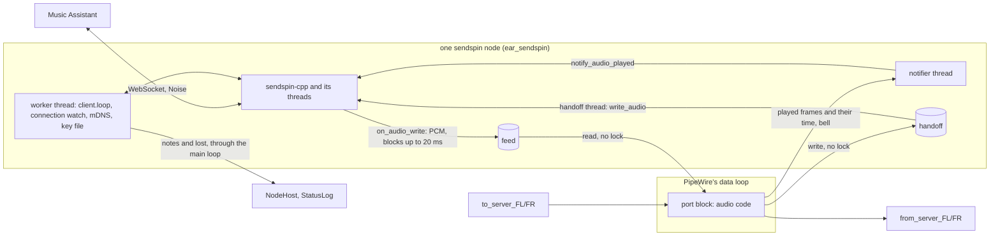

# The `sendspin` node: Music Assistant's audio in and out of ear

Status: design with its spike results and the frozen pages of three slices, 2026-11-05.
Layer: module, inside the agreed system design (`docs/design/pipewire-graph.md`) and batch 2's module
map (`docs/design/batch2.md`).

[V] = verified by the spike or in the source named; [U] = unverified, so a slice's test checks it or section 11 says it stays
open. The spike was thrown away; it ran in the dev image against the real `aiosendspin[server]==10.2.2` (Music Assistant's pin)
and touched no Music Assistant, Home Assistant, cluster or real audio hardware.

## 1. The owner's words

| # | His words | Date, where | What it means here |
|---|---|---|---|
| R1 | "Implement the sendspin protocol as a new node type. Open a PR" | 2026-11-05, chat | A built-in node type, `sendspin` |
| R2 | "support home assistant network audio as source + sink" | 2026-10-30, batch 2 | Both directions in one node |
| R3 | "in a general purpose sources-and-sinks graph, its always just 'running'" | 2026-10-29, chat | The graph keeps running whatever the server does |
| R4 | he "didnt want to assume that a single hardware device was driving the entirety of the graph" | 2026-10-29, chat | A network node follows the graph's clock and never drives it |
| R5 | "sources and sinks that have a configurable frequency should be proactively configured to match the 'graph frequency'" | 2026-10-29, chat | Music Assistant is asked for the graph frequency |
| R6 | multi-device sample alignment "yes" | 2026-10-29, memory note | Keep sync to the protocol's bound at ear's edge (section 7 says what is left out) |

Gate answers, 2026-11-05 (his current choices; later evidence may reopen them):

| Question | His answer |
|---|---|
| Direction | "Both directions": Music Assistant's audio comes out of output ports, and audio routed to input ports goes to Music Assistant, in one node |
| Connection | "Both, chosen per node": with a `server` setting ear dials that URL (e.g. `ws://<host>:8927/sendspin`); without it ear listens (default 8928) and advertises `_sendspin._tcp` over mDNS |
| Permission | "Pairing code required": unpaired access stays off; ear prints a short-lived code on a status line and the operator types it into Music Assistant. Either way ear keeps a private key on disk in the graph file folder, mode 0600, so its identity survives restarts |

## 2. Current choices (revisable; none is his requirement)

- The official client library sendspin-cpp, pinned at commit `7be2278a252dd8c71da55732e93fe28871a9021d`
  (no tag: section 5(a)), behind one new package, `ear_sendspin`, the only one that sees it (as `ear_config` is knobly's).
- The node is a port block with its own audio code and its own threads, not a third kind of outside node (section 3).
- Three framework additions: the **graph cycle**, a parameter of `AudioCode::process`; **insides events** (a note, or
  lost); `NodeInsides::close` (insides with threads close off the main loop). The **feed** (the handoff's reverse) is
  private to the package, on a ring shared with the handoff.
- The player role asks for FLAC 24 stereo alone, at the graph frequency only; the server resamples (R5, spec "player@v1"), and
  must be able to send FLAC 24 at 44100 or 48000 Hz. One depth, so a server cannot change it under the sync thread (erratum 23). The
  source role sends PCM 24 stereo at the graph frequency, 20 ms chunks.
- Roles: player and source only. Opus off (section 5(a2)). Volume and mute commands off (deferred). Output delay
  stays adjustable in Music Assistant; the library keeps it in the key file.
- mDNS: `mjansson/mdns` 1.4.3, one header, on the worker thread; no daemon. CI runs the real `aiosendspin` server (section 13).

## 3. The shape, and what it gives up



Design rules (design choices, not requirements):

1. **The library never touches a realtime thread or PipeWire's main loop.** Its calls take locks (section 5(e)) and its
   `stop()` and destructor can wait (section 10); everything crossing to the data loop goes through a feed, a handoff or a mailbox.
2. **Two domains, two judges.** The connection (server there, paired, streaming) is the connection watch's: notes,
   never node states, and an absent server is no failure (R3). The insides (client, threads, key file) are the node's:
   when they die the type tells `lost` and the node is `failed start-failed`, as an outside node's loss fails it.
3. **Audio time is the graph's.** The library is told when frames play from the cycle's start on the graph's
   clock, never from when the thread woke (section 7).

Design it twice:

| | A: the library behind the block (current choice) | B: ear speaks the protocol itself (Beast, noise-c, FLAC decoder) |
|---|---|---|
| Interop | The official client, proven against the server in sections 5(c)-(d) | Every pairing round, re-handshake, Sentinel fallback and time filter written and kept up by us |
| Cost | Five fetched dependencies; a master-branch pin; two carried patches (`Origin`; the transport's limits); no event for a lost connection or failed dial, so a 10 ms timer and a watch over `is_connected()` on the worker | About 5 000 lines of security-critical code and a moving spec; no timer |

A third outside node (a `pw_stream`) costs a second PipeWire node and links carrying what a function call can, and its
`ready` would mean nothing: the node must be `running` with no server (R3). The block with audio code is `file`'s shape;
`lost` and `close` are what an outside node and a handoff already have, given to the insides.

Prior art: every Sendspin player has this shape (a blocking sink callback in front of a DAC's ring); JACK's disk-reader
pattern is the feed. Not this context's job: Music Assistant's queue, players and groups; the other protocol roles.

**Tracer bullet (S1):** an `ear.conf` with a `sendspin` node dialling a real server and a `file` node; the
server plays a ramp; the WAV holds that ramp, frame for frame. It proves the dependency wiring, the
feed, the clock, the notes and the watch. Not in it: pairing, keys, audio to the server, listening, mDNS.

## 4. Settings, ports and names

```conf
node sendspin kitchen { server "ws://192.168.1.10:8927/sendspin"; name "Kitchen"; }   # dials
node sendspin porch { port 8928; name "Porch"; }                                      # listens, advertises
node sendspin study;                                                                  # same, on 8928, named "study"
```

| Key | Kind | Grammar | Refused with (detail of `invalid-settings`) |
|---|---|---|---|
| (settings) | | a JSON object | `settings: must be an object with optional "server", "port" and "name"` |
| any other key | | none | `unknown key <key>` |
| `server` | text | `ServerUrl`: `ws://`, a host (dotted-quad IPv4, or letters, digits, `-` and `.`, at most 253), optional `:<1-65535>`, then a path of `/` and `[A-Za-z0-9._~-]`; no `wss://`, no user, query or fragment | `server: must be ws://<host>[:<port>]/<path>` |
| `port` | whole number | 1-65535; absent: 8928 | `port: must be a whole number, 1-65535`; with `server`: `port: only without "server"` |
| `name` | text | 1-64 bytes of valid UTF-8, none below 0x20 and no 0x7f; absent: the node's name | `name: must be 1 to 64 bytes of UTF-8 with no control characters` |

The first failure is told, in this order: object, unknown keys (in the object's order), server, port, name. A host name is looked up on the library's transport thread, never on the main loop.

- Ports, fixed: outputs `from_server_FL`, `from_server_FR`; inputs `to_server_FL`, `to_server_FR`. No inside
  ports. Engine node: `<node>`, the block alone.
- The key file: `<config-dir>/sendspin-<node>.key`; node names are safe there, and renaming a node makes a new identity (re-pair).
- On the network (S3): instance and host label `ear-<first 50 bytes of node>-<first 8 of client id>`, within a DNS
  label's 63 bytes, stable and unique without probing. Music Assistant shows `name`, from the hello.

## 5. Spike (2026-11-05): the premises, refuted or not

One library client behind a real `pw_filter` block on ear's `Engine`, 48 kHz, 256 frames unless noted, on the arm64 Docker VM (no
realtime, load 2-4), against `SendspinServer` with `allow_noncompliant_clients=False`, Music Assistant's default. The server played
a ramp (L = low 16 bits of the frame index, R = high 16), so every output frame names its place. All [V] unless marked.

| Premise | Result | Evidence |
|---|---|---|
| (a) Builds beside Boost, nlohmann/json, knobly | **True, at a master commit, not v0.9.5**: `accept_inbound_connections` (a dialling node must not listen) landed after the tag. Added below ear's `CMAKE_CXX_STANDARD`. | `nm -D` exports nothing of it; 20 s at 8 jobs; stripped ear 3.2 MB |
| (a2) Opus | **Off.** libsndfile pulls `libopus.so`; micro-opus's static C symbols would interpose. | `ldd`; [U] not provoked |
| (c) Both connection modes; dynamic code with unpaired access off | **True.** A wrong code keeps the code showing and retries; the right one pairs, re-handshakes in band and activates roles. A restart with the file resumes paired. | `connected=1 paired=1`; files `keypair`, `pairing_psk`, `rec_0`, `rec_order` |
| (c2) What Music Assistant needs | `start_pin_pairing` for a client that `is_connected`, whichever side dialled; dynamic code when digits are offered. | Read `providers/sendspin/{provider,player}.py`; **real one NOT RUN** |
| (d) Audio; source reaches the server | **True.** PCM 16, FLAC 16 and 24 at 48000 arrive exact; other rates are resampled by the server. A 1 kHz tone arrives at 0.500, R = -L. Source activates only when paired. | WAV fit; `SourceStreamStartedEvent` |
| (e) What may run on a realtime thread | **Neither call.** `notify_audio_played` and `write_audio` take mutexes on host. | `src/platform/{event_flags,shadow_slot,shared_ring_buffer}.h`, `src/source_task.cpp:225` |
| (f2) One skipped graph cycle | **Without care it costs 25 ms of audio**: the library sees -5.3 ms, drops the chunk, inserts silence. Counting the skipped frames as played leaves only the 5.3 ms jump. | Each `Lost sync (19.68 ms)` matches one `dpos=512` cycle |
| (f3) The ring's size | **Small.** With 2.7 s a correction lands 2.7 s late. 2048 frames (43 ms) corrects within a chunk and never underran in steady state. | |
| (h) mDNS | **`mjansson/mdns` works** against aiosendspin's zeroconf discovery. The library has no advertiser; avahi needs a daemon and D-Bus. | |
| More | `loop()` needs a timer: the Inbox has no wake hook (idle 0.28 s CPU in 20 s). Two clients in one process run side by side. No retry after a lost dial. A taken port only logs. `stop()` under 10 ms; destructor 1 ms while dialling a dead address. | |

Sync at the block's port against the time filter's prediction (spec "Sync accuracy"), settled, excluding
1.5 s after a skipped cycle:

| Run | Skips | Error p50 / p99 / worst | Within 1 ms | Frames corrected |
|---|---|---|---|---|
| Server clock +0 ppm, cycle start | 22 | -20 / -18 / 139 µs | 100% | 0 |
| -100 ppm | 2 | -94 / -14 / -1079 µs | 99.4% (first bursts) | 188 (expected 192) |
| +0 ppm, **wake time** | 7 | -930 / -554 / -3619 µs | **52%**; 868 corrections | rejected |

Speed: one frame per chunk at most, -0.084% over 150 ms (spec: ±0.5%). All on the dummy driver. Ear fixes the library's log
level at WARN, for noise.

## 6. Threads

| Thread | Runs | Never |
|---|---|---|
| PipeWire's data loop | `SendspinCode::process`: feed read, handoff write, two mailboxes; at most three eventfd writes a cycle (the bell; the handoff's wake; the feed's, while its writer waits) | The library; locks; allocation |
| PipeWire's main loop | `NodeConfig::start`: port checks, threads started; notes printed | Disk; `client.start`, `stop`, destruction; name lookups |
| Worker `ear-sendspin <node>` | The library's "main loop": the key file, `start`, `loop`, `stop`, destruction; every listener callback but `on_audio_write`; the watch; mDNS. Waits in `poll()` on its stop signal, 10 ms at most | Audio |
| Notifier `ear-notify <node>` | Waits on the bell with no timeout, then `notify_audio_played` (thread-safe, guide). Apart because the worker's writes sync to disk, and a late notify can cost a hard sync | Disk; network |
| Handoff thread (S2) | `write_audio`, at most 100 ms a piece (one write must fit 5/8 of the 500 ms capture buffer) | |
| Library threads | `SsProto`, `SsSync` (`on_audio_write`, up to 20 ms on the feed), `SsSrc`, IXWebSocket's | |

Teardown: block gone, `release`, handoff drained (the last audio reaches `write_audio` while the client lives),
`NodeInsides::close(closed)`: the worker stops and destroys the client, joins the notifier and posts `closed` last; insides
and feed destroyed on the main loop. So a restart or stop never blocks the main loop. `drive(nullptr)`'s barrier makes an
insides-owned feed safe. All threads start after `Engine::create`, so they inherit its blocked stop signals.

## 7. Clock

The graph's clock is not the server's, nor the library's (`CLOCK_MONOTONIC_RAW`). The library works as with any DAC:
`on_audio_write` fills the sink, the sink reports frames played with their finish time, and it adds or drops one
interpolated frame per chunk beyond 100 µs, or hard-syncs beyond 5 ms.

On each cycle the block's code computes, without a system call that can block:

```
finish = cycle.startNs (position->clock.nsec, CLOCK_MONOTONIC) + (raw_now - mono_now) + (got + cycle.delayFrames) * 1e9 / rate
```

Both `now`s are vDSO reads, taken together, so a late wake cancels out. `(frames, finish)` goes through a seqlock
mailbox and the bell to the notifier. `delayFrames` (`position->clock.delay`) is what the driver still holds when the cycle
starts: on a card, the frames in its buffer, the wake's threshold of one block among them (`alsa-pcm.c`: `*delay =
buffer_frames - avail`, woken at `threshold + headroom`), so what this cycle writes is heard after them. So no block is added
beside it, and on the dummy driver, which holds nothing, this is the block's port.

- **A skipped cycle** (`position` advanced by more than last cycle's frames, by at most the feed's capacity) discards that
  many frames and counts them played (section 5(f2)). A larger or backward jump is a change of driver: not skipped, the
  library re-aligns. A card sets these fields its own way (`alsa-pcm.c`), so S1-9 runs with one driving and one lost.
- **Feed capacity:** the next power of two at or above `max(rate * 40 ms, 2 * maxBlock)`. On `on_stream_end` the worker
  calls `Feed::clear()` (spec: "MUST stop output and clear its buffers"): gone at the next cycle, not counted played, since the
  library zeroed its count. `stream/clear` has no callback; the feed plays out, as the spec allows a backend, under the lead reported: `required_lead_time_ms` is at least the feed and a block (`requiredLeadMs`), and the library reports its own 150 ms if that is larger.
- **What this bound covers:** the driving card's buffer, as far as that card reports it (section 11). A second card, a resampler
  and anything past the port are not in it.
- Capture time for the source role: the code publishes `(framesWritten, rawNs)` each cycle; the consumer
  dates its first frame from that, so a late handoff wake does not move the stamp.

## 8. What is persisted

`<config-dir>/sendspin-<node>.key`, mode 0600, one JSON object per node, written by `NodeKeyStore`:

```json
{ "createdAt": "2026-11-05T22:00:00Z", "createdBy": "ear", "changedAt": "2026-11-05T22:01:00Z", "changedBy": "ear",
  "blobs": { "keypair": "<base64url>", "pairing_psk": "...", "rec_0": "...", "rec_order": "...",
             "last_played": "...", "output_delay": "..." } }
```

- Through `ConfinedFolder`, staged and swapped as `ear.conf` is, at most 64 KiB. Each `save_blob` writes the whole file on the
  worker. The keeper's watch ignores other names [V `namesFile`]. Holds private key and PSKs: never logged or sent to the editor.
- Mode 0600 is an invariant of every key file in the folder, not only a live node's: a wider mode is narrowed, not refused,
  because the `fsGroup` that `ear-on-talos` prescribes widens files to 0660 on every mount. Boot (`narrowKeyFiles`, when the type is
  made) narrows each `sendspin-*.key` and each staging file a crash left, whatever its node and its text; `NodeKeyStore::open`, first
  on the worker, narrows before it judges the text; each save narrows before it stages, since the stage takes the mode it replaces.
  What boot cannot narrow goes to standard error, and the node's own open says so if it is that node's.
- `open` on a missing file writes an empty one, because the library only warns when it cannot save a new key, and would run a
  fresh identity each boot. Unreadable, a symlink, malformed, or a write refused: `lost`, the file's text left alone. No new identity
  is minted over trusted state.
- The round limit lives in memory (`pairing_rounds_since_verified_kc_`) [V], so the client's end releases a hold: section 10's
  action is taken as the spec's "deliberate operator action", which is a departure when ear restarted for another reason (section 11).

## 9. Status lines

One new frame in `status_log.cpp`, `node <name> says <text>`; a type's texts are its own (`src/sendspin/notes.hpp`), as a `failed` detail is.

```
node <n> says id <client id>  S2: first, once
node <n> says dialling <url>  S1: once, until connected
node <n> says listening <port> as <instance>  S3
node <n> says connected "<server name>" paired|unpaired  S1 (server name: quoted; control characters (C0, DEL, C1, U+2028 and U+2029), bytes that are no UTF-8 and quotes become ?; at most 64 bytes)
node <n> says disconnected  S1
node <n> says pairing-code <123-456>  S2: shown until cleared
node <n> says pairing-code-cleared  S2
node <n> says paired <server id>  S2
node <n> says pairing-failed <reason>  S2: attempt-timeout, concurrent-attempt, method-not-supported, pairing-code-mismatch, user-cancelled, unknown
node <n> says pairing-held  S2: 20 wrong rounds
node <n> says stream <flac|pcm> <rate> <channels> <bits>  S1
node <n> says stream-ended  S1
node <n> says sending <rate> 2 24  S2
node <n> says sending-stopped  S2
node <n> says key-write-failed <detail>  S2
node <n> says advertise-failed <detail>  S3
node <n> says notes-dropped <n>  section 11: how many the rate held back, said before the next that passes
```

## 10. Failure behaviour

| What | The node | Told | Recovery |
|---|---|---|---|
| Server unreachable, or gone | `running`, outputs silent after the feed drains, inputs dropped | `disconnected`, once `is_connected()` has read false for 5 s (it reads false through a re-handshake) | The watch redials then, and every 31 s until connected: `connect_to` releases a live attempt with `another_server`, and the library reaps a stalled one at 30 s |
| The insides dead: `client.start()` false, an exception on the worker, a key file `open` refuses | `failed start-failed: <detail>`; block and routes stay | as a node failure | **Change any setting (`name` can be changed and changed back), or restart ear.** `node.update` with the same settings changes nothing (`graph_file_model.cpp`, `desired_graph.cpp`) |
| Server approves without pairing, lost its record, or the file was lost | Connected, unpaired, idle (spec): no roles, no audio | `connected <name> unpaired` | Pair |
| 20 wrong rounds | Attempts held back | `pairing-failed pairing-code-mismatch`, `pairing-held` | Change a setting or restart ear, as above |
| Pairing times out or is cancelled | Connection stays | `pairing-failed <reason>`, `pairing-code-cleared` | Start again |
| Listen port held by another program, or by another `sendspin` node | `failed start-failed: cannot listen on port <p>: <reason>` | as above | `node.update` to a free port. Checked in `start`: claims across ear's nodes, then a probe bind with `SO_REUSEADDR`, as the library's listener. A program taking the port just after is not caught; the library retries every 5 s |
| mDNS socket cannot open | Listening, not advertising | `advertise-failed <detail>` | Give Music Assistant the URL |
| Key write fails later | Pairing holds this run only (library's contract) | `key-write-failed <detail>` | Fix the folder, pair again |
| Stopping or restarting | Goodbye and close on the worker; a dial in flight cancelled within a 10 ms poll; up to 3 s for a half-open inbound socket | `stopped` when done | The next start and exit wait. The guide's outer bound, 30 s, is Kubernetes' default grace, past which the last `ear.conf` write is lost |

A format not listed breaks the spec ("MUST be one the client listed"): `says stream` names it, the sink stays full, nothing plays, and the library closes the connection when its ring pins. Nothing listed can change the depth: a server asking for another one is refused by its own check of what the client listed, and the stream goes on as it was.

## 11. What it gives up and defers

Costs: five fetched dependencies at a master pin; two carried patches, rebased at each bump; a 10 ms timer and the watch's
5 s and 31 s (against "Coordinate by events, never timers": no event exists, so they stay inside the adapter and never act on a
live attempt), so a server back after the first redial is heard up to 31 s later; one more thread per node; `git` and a 235 MB
Python server in the dev image; a pod on an overlay network cannot advertise; the server decides when the source streams;
the library's parsers face unauthenticated network peers inside the audio process, unfuzzed, so a crash silences every node
(separate programs are deferred system-wide). A listening node has no address setting: 8928 and the mDNS socket are on every interface, which is more than `--control-address` lets 7777 be, so on an untrusted network filter them or dial (`ear-on-talos`).

Where it departs from the spec, or the spec leaves a hole:

1. **`Origin` is refused by a carried patch, in S3.** The spec says a client MUST reject an upgrade carrying `Origin`; the host
   server accepts it [V], at master too. A page speaking Noise in script could declare `pairing` (`admission.h`), outrank an
   idle connection, knock it off with `another_server`, which Music Assistant files as held elsewhere, and burn the 20 rounds.
   One branch in the Open event closes the socket before any Sendspin message; the peer sees 101, then the close (no earlier hook).
2. **Peers that are not web pages can still do all that:** the spec's rank rule and its round count ("not partitioned by
   `server_id` or source address"). Any network peer can hold pairing back until the operator acts.
3. **Sync is compensated at the driving card's buffer, and measured nowhere past the block's port.** The spec has the client
   compensate for its own buffers: `delayFrames` does, for the card that drives the graph. Left out, and so on the operator's
   output delay until PipeWire's port latency is read (deferred): a second card, a resampler's delay, a card that does not report
   its buffer, and the DAC. The tests measure at the port, on the dummy driver; `delayFrames` on a real card has never run, as the
   test card's null PCM reports 0. The check is on the hardware (`ear-on-talos`, section 5, item 6).
4. **The key file outlives its node.** `node.remove` leaves it; adding the name back inherits its pairings. To wipe an
   identity, delete the file and restart the node. A mount that widens the mode leaves it wider until ear boots.
5. **The spec's hold after 20 rounds does not survive a restart.** The spec says the client MUST hold attempts back until a deliberate
   operator action; the count is the library's, in memory, so any restart resets it, including a crash a peer caused. That gives
   another 20 guesses at a 6-digit code, 2e-5 a restart. Holding it across restarts needs the library to persist it.
6. **Two silent sockets lock every server out of a listening node. OPEN, the owner's call.** The library holds inbound connections
   in a two-slot nursery until they prove an identity, for 30 s each, and rejects a newcomer with `another_server` while it is full
   (`connection_manager.cpp`). Renewing two bare sockets every 28 s keeps the node unreachable for as long as they do (probed:
   7 rejections, no connection in 70 s). A dialling node has no listener and is not exposed. Today's answer is this cost, and dialling
   on an untrusted network (`sendspin`, `ear-on-talos`); the alternatives are a carried or upstream change: a far shorter stall deadline
   before `client/init` is answered, a limit per address, or evicting the oldest silent occupant.
7. **A peer's connects still cost something.** The transport's lines are held to one per 10 s (under 1 MB of log a day), a node's
   notes to 32 at once and then one a second (`NoteGate`, about 5 MB a day under a sustained attack), and a pairing code can be held
   back with them, its `notes-dropped` saying so. A connection holds at most about 1 MiB until the library reaps it at 30 s; the pod's
   memory limit is the outer bound (`ear-on-talos`).

For upstream, not filed yet: the `Origin` refusal; IXWebSocket's unbounded frames and fragments (`cmake/ixwebsocket-limits.patch`; it reaches the peer before any authentication, so it should go to its maintainers privately first); connection-lost and dial-failed events, which would delete the watch's timers; `on_audio_write` carrying the chunk's format, so more than one depth could be listed; a persisted round count; mjansson/mdns's `mdns_socket_listen` reading a question's type and class past the buffer, and a short datagram's header from the last one.

Anyone who reaches port 7777 can still edit the graph: pairing guards Music Assistant's side.

Branches no test drives, on purpose (a seam for each would cost more than it proves): a stream format not listed, and `on_audio_write` waiting on it; a `stream/start` the library calls incomplete; `client->start()` false; an exception on the worker; `advertise-failed` (a socket that will not open); a pairing abort other than a mismatch; `narrowKeyFiles` printing what it could not narrow; `fileNames` when the folder cannot be read. The last two only print or return a detail; the others go through paths other tests hold (`lost`, a note).

Deferred: volume and mute; line sense (`signal`), so no autostart; PipeWire's port latency in the clock; the editor showing notes
and the code; a restart verb on the control port; IPv6; `wss://`; several servers at once; choosing the advertised interface
(today: the one the kernel routes 224.0.0.251 through); RFC 6762 probing; more than stereo. Not planned: Opus; the other roles.

NOT RUN: real Music Assistant (the `sendspin` skill names the check, pairing in its interface and then playing; the PR says NOT RUN until someone has); real hardware, and so `delayFrames` from a card that reports one; amd64 (CI will); realtime scheduling; a pod with a CPU limit (unprioritised library threads refill a 43 ms feed); a real `fsGroup` mount (the tests widen with chmod); an off-link query from a real other subnet (`onLink` is tested alone).

## 12. Reconcile with existing code

| Change | Why | Cost |
|---|---|---|
| `AudioCode::process` gains `const GraphCycle&` | Compile-time, not an accessor valid only inside `process` | Four types ignore it; about 20 test call sites |
| `NodeGrant` gains `events()`; `NodeInsides` gains `close` (default: at once) | `lost` reaches `NodeLifecycle::insidesFailed`, as outside nodes do; `close` saves borrowing a handoff for teardown | Every fake grant (they throw) |
| `NodeHost` constructor gains `Executor&` | Events and `closed` cross to the main loop | `main.cpp`, every `NodeHost` test |
| `FrameRing` (atomics, no PipeWire) in `ear_core`, out of `ThreadHandoff` | One ring for both directions; `spa_ringbuffer` leaves the handoff | A refactor under the handoff's existing tests |
| `ear_folder`: `replaceIf` gains a mode for a file it creates; `restrictMode` | 0600 at birth and at each open; `ear.conf` keeps the mode it has | One caller updated |

Frozen headers change through this page, as their first comment asks.

## 13. Build and test costs

- `CMakeLists.txt`, before `add_subdirectory(src)`: `USE_TLS` and `USE_ZLIB` off, `kept_fetchcontent` at full commits, each before
  the library's own `FetchContent_Declare` (first declaration wins):

| Dependency | Commit | Licence | Note |
|---|---|---|---|
| ArduinoJson v7.4.1 | `32520135092970120a5ac165cf45f48e658c421d` | MIT | |
| IXWebSocket v12.0.1 | `64fae7676bd8fe31f7cb4bcde7a6841892dad65e` | BSD-3 | `PATCH_COMMAND git apply cmake/ixwebsocket-limits.patch`, as sendspin-cpp's below (erratum 27) |
| micro-flac v0.3.0 | `f9c27d4d0166021db977d7fc37d205b21d81e9f2` | Apache-2.0 | `GIT_SUBMODULES lib/micro-ogg-demuxer`, hence `git` |
| noise-c v0.1.13 | `a1e08809a1b8f65cd91765ba7d68a6d00648ad61` | MIT | `SOURCE_SUBDIR no-such-directory`: the library builds it |
| sendspin-cpp | `7be2278a252dd8c71da55732e93fe28871a9021d` | Apache-2.0 | `SENDSPIN_ENABLE_{CONTROLLER,METADATA,ARTWORK,VISUALIZER,COLOR,OPUS}=OFF`. S3: `PATCH_COMMAND git apply cmake/sendspin-origin.patch`; the pin names the patch's SHA-256; a failed apply stops configure |
| mjansson/mdns 1.4.3 (S3) | archive SHA-256 `be1fd8e35599cb7de179decbd0633c121d11a2dcb9cc193ff5c590bd0d480483` | public domain | `URL`; header only |

- Licences: configure copies each to `out/licenses/`, the `run` stage to `/opt/ear/licenses`.
- `test.yml`: the deps cache's `path` lists each tree. `scripts/dev.sh`: `GIT_CONFIG_COUNT=1`, `GIT_CONFIG_KEY_0=safe.directory`,
  `GIT_CONFIG_VALUE_0=*`: Docker Desktop's mount can show a clone as another owner [V].
- **CI: the real server, chosen.** `dev` image adds `git` (`micro-flac`'s submodule), `python3`, `python3-venv` (146 MB) and
  `/opt/sendspin-server`, a venv from `test/sendspin/requirements.txt` (23 packages, `--require-hashes`, both architectures, `uv pip compile
  --universal --generate-hashes`; 235 MB). First build about 40 s more; each system test about 10 s. A fake server would prove only what we believed.
- Configure with `BUILD_TESTS=ON` stops naming `EAR_SENDSPIN_SERVER_PYTHON` when `/opt/sendspin-server/bin/python` is missing.

## 14. Slices

Series: S1, S2, S3, each green alone. Land per slice: `git add -A -- <owned> && git commit -m '<msg>' -- <owned>`, then
push. A slice that needs a file outside its list or a signature change adds an erratum here and stops.

### S1, the tracer: a `sendspin` node dials a server and plays its audio out of output ports

Grammar for this slice: `server` required (`server: missing`), `port` is an unknown key; `name` as section 4. Unpaired access
**on** and no key file: the test's server approves the client; S2 removes both. Inputs exist, their audio dropped: no handoff yet.

`src/core/include/ear/core/node_type.hpp` gains (protected destructors, as `RtWriter`):

```cpp
/// This cycle of the graph, on the driver's clock.
struct GraphCycle {
  std::int64_t startNs;     // its start, CLOCK_MONOTONIC
  std::uint64_t position;   // the driver's frames at its start
};
// AudioCode::process gains its last parameter:
  virtual void process(std::span<const std::span<const float>> inputs, std::span<const std::span<float>> outputs,
                       std::uint32_t frames, const GraphCycle& cycle) noexcept = 0;
/// From the insides' own threads; never blocks. Told on the main loop in order, nothing after close()'s `closed`.
class InsidesEvents {
  virtual void say(std::string text) = 0;      // a note: `node <n> says <text>`; never a state
  virtual void lost(std::string detail) = 0;   // `failed start-failed: <detail>`; ignored once close() began
};
// NodeInsides gains:
  /// Main thread, once, after every handoff closed. Insides with threads stop them and call `closed`, last, from any thread.
  virtual void close(std::move_only_function<void()> closed) { closed(); }
// NodeGrant gains (start() only, else std::logic_error):
  virtual InsidesEvents& events() = 0;   // lives until `closed`; may be kept by the insides' threads
```

`src/core/include/ear/core/node_host.hpp` gains:

```cpp
class NodeNoteListener { virtual void nodeSays(const NodeName& node, const std::string& text) = 0; };   // main thread
NodeHost(AudioFormat format, PortBlockFactory& blocks, HandoffFactory& handoffs,
         SoundCardFactory& cards, RtpReceiverFactory& receivers, Executor& mainLoop);
void subscribeNotes(NodeNoteListener& listener);
```

`src/core/include/ear/core/frame_ring.hpp` (new): `FrameRing(channels, capacityFrames)`, one writer and one reader over atomics,
power-of-two frames: `writePlanar`, `writeInterleaved`, `readPlanar`, `readSpan`, `skip`; `ThreadHandoff` moves onto it.
`port_blocks.cpp`: `onProcess` passes `{position->clock.nsec, position->clock.position}`. `StatusLog` also implements `NodeNoteListener`.

`src/sendspin/include/ear/sendspin/sendspin_type.hpp` (new, the package's one public header):

```cpp
/// "sendspin". `folder`: the graph file folder, for each node's key file.
std::unique_ptr<const NodeType> makeSendspinNodeType(std::shared_ptr<const folder::ConfinedFolder> folder);
```

Private: `settings.hpp` (`ServerUrl::parse`, `struct SendspinSettings { std::optional<ServerUrl> server; std::uint16_t port; std::string name; }`, one parse), `pcm.hpp` (little-endian 16 and 24 bit to float and back, exact), `mailbox.hpp` (seqlock of one trivially copyable value), `notes.hpp` (each text, `printable()`), and:

```cpp
// feed.hpp: a FrameRing and an eventfd, written only while the writer says it waits.
class Feed {
public:
  Feed(std::uint32_t channels, std::uint32_t capacityFrames);
  /// Realtime; no lock, allocation or waiting. Planar, zeros after what it holds. Returns frames read.
  std::uint32_t read(std::span<const std::span<float>> channels, std::uint32_t frames) noexcept;
  std::uint32_t skip(std::uint32_t frames) noexcept;   // realtime; discards; returns how many
  /// One writing thread. With no room waits up to `patience`. Returns frames accepted.
  std::uint32_t write(std::span<const float> interleaved, std::uint32_t frames, std::chrono::milliseconds patience);
  /// Any ordinary thread. What was written so far is gone at the next read, not counted played.
  void clear() noexcept;
};
// connection_watch.hpp: pure. No connection event exists: the worker feeds it each reading, is_paired() first (guide).
class ConnectionWatch {
public:
  struct Reading { bool paired; bool connected; };
  struct Told { bool dial; bool connected; bool disconnected; };   // `connected` again when `paired` changed
  explicit ConnectionWatch(bool dials);
  /// Never `dial` within 31 s of the last dial. `disconnected` only after `connected` and 5 s of false.
  Told read(Reading now, std::chrono::steady_clock::time_point at) noexcept;
};
// sendspin_code.hpp, worker.hpp
struct PlayProgress { std::uint64_t totalFrames; std::int64_t finishRawNs; };
class SendspinCode final : public AudioCode {   // process(): section 7, then feed read, progress, bell
public:
  SendspinCode(Feed& feed, Mailbox<PlayProgress>& progress, int bell, std::uint32_t rate);
};
class SendspinWorker {   // owns the worker and notifier threads and, through them, the client
public:
  SendspinWorker(SendspinSettings settings, AudioFormat format, Feed& feed, InsidesEvents& events, std::uint32_t feedFrames);
  void stop(std::move_only_function<void()> stopped);   // main thread; the insides' close()
  ~SendspinWorker();                                    // after `stopped`; joins a finished thread
  int bell() const noexcept;                            // the eventfd the code rings
  Mailbox<PlayProgress>& progress() noexcept;
  std::int64_t clientTimeOf(std::int64_t serverUs) const;   // the tests' window on the time filter
};
```

Owned files (S1): `CMakeLists.txt`, `cmake/SendspinDeps.cmake`, `docker/Dockerfile`, `scripts/dev.sh`, `.github/workflows/test.yml`, `test/sendspin/requirements.txt`, `src/CMakeLists.txt`, `src/main.cpp`, `src/core/**`, `src/pipewire/{handoffs.cpp,port_blocks.cpp,CMakeLists.txt,tests/**}`, `src/control/{status_log.cpp,include/ear/control/status_log.hpp,tests/**}`, `src/nodes/**`, `src/sendspin/**`, `test/CMakeLists.txt`, `test/support/sendspin_server.{py,hpp}`, `test/system/{sendspin_test.cpp,CMakeLists.txt}`.

The test server, `test/support/sendspin_server.py`, a real `SendspinServer`, a command per stdin line, an event per stdout line: args `--listen 0 [--slow-upgrade <seconds>] | --dial <url> [--state <dir>]`; commands `trust`, `play <seconds>`, `end`, later `pair`, `code <digits>`, `source-start`, `source-stop`, `quit`; events `ready <url>`, `connected <client id>`, `play-start <us>`, `play-finished <frames>`, `disconnected <reason>`. The ramp is section 5's.

Acceptance (event-gated; a deadline only fails a test):

1. `[feed]` real threads: a 10 s ramp is read back exact; `read` past the end zero-fills; a full feed's `write` wakes on `read`, returns 0 at `patience`; `read` does not allocate; after `clear` the next `read` returns nothing.
2. `[node_host]` `events()` outside `start` throws; `close` follows every handoff's close, the insides go only after `closed`; `say` from another thread reaches `nodeSays` in order, nothing after `closed`; `lost` from another thread makes `failed start-failed: <detail>` from `running`, block and routes kept, ignored once `close` began.
3. `[port_blocks]` real engine: `cycle.position` advances by `frames`; `cycle.startNs` is no later than now.
4. `[status_log]` `node a says b`.
5. `[sendspin][settings]` each refusal's exact text in order; `ServerUrl` accepts `ws://10.0.0.1:8927/sendspin`, `ws://ma.local/sendspin`; refuses `wss://a/b`, `ws://a`, `ws://u@a/b`, `ws://a/b?c`, `ws://[::1]/b`, `ws://a:0/b`, `ws://a:65536/b`, a space; `name` refuses invalid UTF-8.
6. `[sendspin][pcm]` every 16-bit value and 24-bit edges round-trip exact.
7. `[sendspin][code]` 256 frames read gives `totalFrames + 256` and `finish = startNs + (raw - mono) + 256/rate`; `position` ahead by 256 skips and counts 256; ahead by more than the feed's capacity, or behind, skips none; nothing read rings nothing; cleared frames are never reported.
8. `[sendspin][watch]` fake time: a first reading dials once; true tells `connected` once; false for under 5 s tells nothing, and `paired` changing tells `connected` again; 5 s tells `disconnected` and dials; no second dial before 31 s, one at 31 s.
9. `[sendspin][clock]` real engine, block and server, 8 s of ramp: in every cycle more than 1.5 s after a skip and 3 s after the first frame, |output time - `clientTimeOf(ramp time)`| < 1 ms in at least 99%; no index step other than +1 or a block's multiple. The same with the test ALSA card (`src/pipewire/tests/alsa/`) driving; and with it lost mid-stream, as `[cards][lost]` does: within 3 s the output steps by +1 again. `end` mid-play: zeros within two blocks of `on_stream_end`. [U: a loaded host's skips, erratum 3 of `rtp.md`; if the test card cannot give 1 ms, assert the recovery, record the numbers in section 16, and the real card's bound becomes a check in `ear-on-talos`.]
10. `[system][sendspin]` the real `out/ear`, `node sendspin ma { server "<url>"; }`, `node file rec`, routes to `FL`, `FR`. Once `running`, both routes `linked`, `says connected`, `play 1.5`; on `says stream-ended`, SIGTERM. Exit 0, `dropped=0`, `says stream flac 48000 2 24`. The WAV's first non-zero frame onward holds at least 1.2 s where each frame is exactly `(lo/32768, hi/32768)` of a ramp index, stepping by +1 or a block's multiple.
11. `[system][sendspin]` no server at all: `running`, meters silent, SIGTERM exits 0. A peer that accepts and never answers, and a listener with a full backlog (it drops SYNs): SIGTERM exits 0 within 5 s, and `node.update` to a new `name` is `running` within 5 s.
12. `[system][sendspin]` `--slow-upgrade 3`: the server sees one connection, no `another_server`, then `says connected`.
13. `scripts/image-smoke.sh` still passes; `/opt/ear/licenses` holds the five.

Mutation probes (the verifier applies each, sees red, restores):

| Probe | Red |
|---|---|
| Deinterleave FR into FL's span; never call `notify_audio_played` | 10 |
| `finish` from `clock_gettime` at wake, not `cycle.startNs`; leave `got/rate` out | 9 (and 7) |
| Skip on any position gap, however large; no skip at all | 7 |
| Feed 2^17 frames | 9 [U: only if a filter update lands in the window] |
| `read` leaves the rest of the span unwritten; `clear` a no-op | 1 |
| Dial on every false reading | 8 and 12 |
| `say` delivered inline; `lost` ignored | 2 |
| Accept `wss://` | 5 |

Commit: `feat(sendspin): play Music Assistant's audio through a sendspin node`

### S2: audio to Music Assistant, the key file, pairing code required

Unpaired access **off** for good. `pairing_code_out_channels = {DISPLAY}`, `pairing_code_formats = {DIGITS}`. A handoff and its consumer join the insides: `SendspinCode` gains `RtWriter& toServer`, and `consume` calls `write_audio`.

```cpp
// src/folder: replaceIf gains the mode of a file it creates.
std::expected<ReplaceOutcome, FolderError> replaceIf(const std::string& relative,
    const std::optional<std::string>& expected, std::string_view text, std::size_t maxBytes, mode_t createMode = 0644) const;
/// Clears every mode bit outside `most`; no write, no sync; a symlink or a path out is refused.
std::expected<void, FolderError> restrictMode(const std::string& relative, mode_t most) const;
// src/sendspin/key_store.hpp
class NodeKeyStore final : public sendspin::SendspinPersistenceProvider {
public:
  /// Worker, before client.start(). Reads and narrows to 0600, or creates it empty. Error: `lost` with this detail.
  static std::expected<std::unique_ptr<NodeKeyStore>, std::string> open(std::shared_ptr<const folder::ConfinedFolder> folder, const NodeName& node, InsidesEvents& events);
  std::optional<std::vector<std::uint8_t>> load_blob(const std::string& key) override;
  bool save_blob(const std::string& key, const std::uint8_t* data, std::size_t size) override;   // failure: key-write-failed
};
// sendspin_code.hpp: process() also writes inputs to the handoff and publishes
struct CaptureAnchor { std::uint64_t framesWritten; std::int64_t atRawNs; };
```

Owned files: `src/folder/**`, `src/sendspin/**`, `test/support/sendspin_server.py`, `test/system/sendspin_test.cpp`.

Acceptance:

1. `[folder]` a created file has mode 0600 under any umask; `replaceIf` on an existing one keeps its mode; `restrictMode` takes 0660 to 0600 and leaves 0400; symlinks refused as today.
2. `[sendspin][keys]` real folder: blobs round-trip exact; `createdAt`, `createdBy` set once, `changedAt`, `changedBy` move; a file already 0644 or 0660 is 0600 after `open`; malformed JSON, a directory, a symlink out, over 64 KiB, and a read-only folder each fail `open` with the folder's detail, the bad file unchanged.
3. `[system][sendspin]` dialled pairing with a real server: `says id`, `says connected ... unpaired`; `pair`; on `says pairing-code <d>` send a wrong `code`, then the right one; `says paired`; `says connected ... paired`, no `says disconnected` between; `play`; the ramp in the WAV.
4. `[system][sendspin]` restart ear: same `says id`, `connected ... paired`, no code asked; the key file is 0600.
5. `[system][sendspin]` `trust` with no pairing: no stream, no source role; `says connected ... unpaired` only.
6. `[system][sendspin]` paired, `white` routed to `to_server_FL` only: `source-start`; `says sending 48000 2 24`; energy on the routed channel, exact zeros on the other; first and last chunk stamps differ by the frames' duration ± 50 ms; `source-stop`; `says sending-stopped`.
7. `[system][sendspin]` wrong code 20 times: `pairing-failed pairing-code-mismatch`, `pairing-held`; `node.update` with the same settings leaves it held; with a new `name` the right code pairs.
8. A corrupt key file: `node ma failed start-failed: ...`; the file is unchanged; the rest of the graph runs.

Commit: `feat(sendspin): send routed audio to Music Assistant, paired by a code`

### S3: listening and mDNS, per-node choice, the failures left

Grammar: section 4 in full. `accept_inbound_connections = !server`. Worker gains `Advertiser`. The `Origin` patch arrives here, so no listening node exists without the refusal.

```cpp
// src/sendspin/advertiser.hpp: mjansson/mdns; one socket per node; worker thread only.
class Advertiser {
public:
  /// Announces PTR, SRV, TXT (path=/sendspin, name=<name>) and A. Error: its detail.
  static std::expected<std::unique_ptr<Advertiser>, std::string> open(std::string instance, std::string name, std::uint16_t port);
  void answer() noexcept;   // never blocks
  ~Advertiser();            // goodbye
};
// src/sendspin/port_claims.hpp: main thread only; held by the type; released when the insides go.
class PortClaims { public: std::expected<void, std::string> claim(std::uint16_t port, const NodeName& node); void release(std::uint16_t port); };
```

Owned files: `src/sendspin/**`, `cmake/SendspinDeps.cmake`, `cmake/sendspin-origin.patch`, `docker/Dockerfile` (`EXPOSE 8928`), `test/support/sendspin_server.py`, `test/system/sendspin_test.cpp`, `AGENTS.md`, `.claude/skills/{sendspin,ear-on-talos,pipewire-engine}/SKILL.md`, `.claude/skills/control-port/SKILL.md` (only if a line is wrong), this page.

Acceptance:

1. `[sendspin][settings]` section 4's table in full, including `port` with `server`.
2. `[system][sendspin]` `node sendspin ma { port <free>; }`: `says listening <p> as ear-ma-<8>`; a server with `--dial` pairs and plays; WAV holds the ramp.
3. `[system][sendspin]` same with mDNS: the test server with discovery finds the node, dials, pairs; TXT `path=/sendspin`, `name=<name>`; after SIGTERM the service is removed; a 64-character node name is found too. [U: multicast on GitHub's runner bridge.]
4. `[system][sendspin]` server stopped mid-stream: `says disconnected`; `node ma running`, others unaffected; restarted with `--state`: `says connected ... paired`, audio resumes with no action.
5. `[system][sendspin]` a port another program holds, and two `sendspin` nodes on one port: each refused node `failed start-failed: cannot listen on port <p>: ...`; the others run; `node.update` to a free port recovers. A new `name` while a server is connected, same port: still listening.
6. `[system][sendspin]` an upgrade carrying `Origin`: closed, no `client/init`; the same without it gets `client/init`. Red without the patch.
7. `[system][sendspin]` two nodes, one dialling and one listening, same ear, same server: separate identities, both paired, both play.
8. A dialling node opens no listening socket (a connect to 8928 is refused).
9. `AGENTS.md` names the type, settings, ports, package, status lines, image contents and the not-built list; its line, `pipewire-engine`'s and `ear-on-talos`'s that `node.update` retries a card say a same-settings update changes nothing. The `sendspin` skill holds section 5's traps and the real Music Assistant check; `ear-on-talos` says what `fsGroup` does to the key file.

Commit: `feat(sendspin): listen and advertise over mDNS, per node`

## 15. New terms

| Term | Meaning | Why needed | Could be |
|---|---|---|---|
| Feed | A lock-free ring from an ordinary thread to the realtime thread; private to `ear_sendspin` | Network audio into a block | "reverse handoff" |
| Graph cycle | What a block's code is told about this cycle | Audio time for the protocol's sync | `spa_io_position`, kept behind core |
| Note (of a node) | A sentence a node's insides say, printed as `says`; not a state | Connection and pairing are not node states | "event" (too wide) |
| Lost (of insides) | A node's own insides are dead; the node fails | A dead client is a failure, an absent server is not | An outside node's `lost` |
| Worker; notifier | The node's own threads: the library's "main loop"; telling the library what played | PipeWire never waits on the library, nor notify on disk | |
| Connection watch | Pure judge of the connection, fed readings of `is_connected()` | No event exists upstream | |
| Server, client | Music Assistant, and the ear node | The spec's terms; its `source` role is "sending" here | |
| Pairing code; key file | Six digits the operator types into Music Assistant; `sendspin-<node>.key` | His Permission answer | "PIN" (Music Assistant's word) |
| Skip | A graph cycle the driver missed: frames counted as played | Section 5(f2) | "xrun" (also late cycles) |

## 16. Errata and the review

Errata, from building S1 (2026-11-06):

1. **The test card cannot give 1 ms, so S1-9's fallback is taken.** It has no clock of its own (the null PCM), and PipeWire's rate loop runs the graph about 2.1% fast (49030 Hz measured; a cycle's length falls from 5.29 ms to 5.15 ms over 8 s), past the library's ±0.5%. Over 8 s of ramp, three runs: p50 -4.2 to -4.3 ms, p99 -1.2 ms, worst -8.2 to -8.6 ms, within 1 ms 2 of about 950 cycles, the library hard-syncing as the error passes 5 ms. The test asserts the hard sync's bound (under 20 ms) and the recovery. On the dummy driver the same run gives p50 -1 to -18 µs, worst -78 µs, 100% within 1 ms, no corrections. So the real card's 1 ms bound is NOT RUN and is a check for `ear-on-talos` (S3 owns that file).
2. A card sets the position its own way, as section 7 expected [V]: joining it, the position goes from 2.3e10 to 0 and counts from there; losing it, forward by 2.3e10. Both are outside the feed's capacity, so neither is a skip. After a loss the library hard-syncs (about 90 ms off) or corrects a residue under 5 ms a frame per chunk, so "steps by +1 again" means three whole blocks in a row, a chunk being about five.
3. **`FrameRing` gains `channels`, `capacityFrames`, `writePosition` and `skipTo`; `Feed` gains `capacityFrames`.** `clear()` must discard what was written so far and no more (a position, not "everything at the next read"), and the code's skip is bounded by the feed's capacity. Additions beside section 14's lists; no signature in them changed.
4. **`closed` called inside `close()` finishes in the same main-loop turn; only one from another thread or later crosses through the executor.** Section 12 says it crosses; a plain node has no thread to cross from, and this keeps its teardown as it was, with every existing `NodeHost` test unchanged.
5. **The test server gains an event, `upgrade`, for each WebSocket upgrade that arrives.** Section 14's events cannot prove S1-12: `connected` fires only after a handshake, so a second dial that lost its race would not show.
6. **`play` waits for the client's player role to be released (`awaits_role_state`).** A stream started right after `trust` joins the ramp late, at frame 16608 of 72000, each run, which fails S1-10's 1.2 s. The server plays 68607 of the 72000 frames then: its encoder holds back the tail.

Errata, from building S2 (2026-11-06):

7. **`SendspinWorker`'s constructor gains `folder` and `node`; it gains `toServer()` and `capture()`; `SendspinCode` also takes the `Mailbox<CaptureAnchor>&` (section 14 names only `RtWriter& toServer`).** The key store opens on the worker, so the worker needs both, and the handoff's consumer is the worker's because `write_audio` is the client's. Threads are now named from the node, as section 6 says (S1 had only `settings.name`). No frozen header changed beyond section 14's lists; these two are private.
8. **`CaptureAnchor` means: the frame the handoff took as number `framesWritten` is this cycle's first, captured at `atRawNs`, the cycle's start on the raw clock.** Section 14 gives the fields, not which frame they date. Frames the handoff refused are not counted, so what it took stays dated. The library re-anchors each chunk on the write it starts in, so a wrong stamp shows at once: a constant stamp fails S2-6 by 976 ms; measured with the anchor, 0.
9. **The library has no event for the round limit, so `pairing-held` is told from two facts.** `pairing-failed pairing-code-mismatch` is a limit reached, as only a dynamic code is offered and it retries every other wrong round; a server that sends that abort reason itself would also print it. And `on_open_pairing_window`, which a dynamic code asks only for an attempt held back, says it again, so a later attempt shows why no code appears (section 9 lists it once).
10. **A `keypair` blob of the wrong size is malformed (`lost`), beyond section 8's list.** The library treats it as absent and mints a new identity, which section 8 forbids. `open` reads and judges before it narrows, so a refused file keeps its mode too. A file something else changed or removed since it was last read fails the write (`key-write-failed <file>: changed by something else`), and theirs stands, so section 11's "delete the file and restart" wipes the identity with no write putting it back; the in-memory state still rules until that restart.
11. **The test server gains a command, `roles`, and events: `trusted`, `roles <list|none>`, `pair-pending`, `pair-finished`, `pair-failed <reason>`, `source-started <rate> <channels> <bits>`, `source-heard`, `source-ended <frames> <left rms> <non-zero right samples> <last - first stamp us> <frames before the last chunk>`.** Section 14's list cannot gate S2-5 to S2-7 on events. `source-stop` is sent at `source-heard`, one second in.
12. **S2-5 holds as section 10 says [V]:** after `trust` the connection stays up, `roles none`, with no goodbye. With unpaired access on, the same test reads `roles player`, so it can fail; the source role stays off either way, since `aiosendspin` holds it for a paired client.

Errata, from building S3 (2026-11-06):

13. **The test server always listens, and gains `--discover <prefix>`, the commands `dial <url>` and `use <client id>`, and the events `discovered <instance> port=<p> path=<path> name=<name>` and `service-removed <instance>`.** Section 14 makes `--listen` and `--dial` exclusive; `sendspin_server.hpp`, not an S3 file, always passes `--listen 0`, and S3-7 needs one server doing both. `--discover` runs aiosendspin's own discovery through `start_server`, with one override that drops other instances, because the tests run side by side on one network and a browser would dial its neighbours' nodes. So a test's server sees only its own node.
14. **The advertiser answers by multicast whatever a question's unicast bit, and by unicast only to a querier on another port than 5353.** Every mDNS socket on a host shares 5353 with `SO_REUSEPORT`, and the kernel hands a unicast datagram to just one of them, so a unicast answer to a browser on the same host can reach another node's socket instead (section 11 listed that as NOT RUN). RFC 6762 section 5.4 allows the multicast. No test reaches the one-shot branch.
15. **Additions beside section 14's lists:** `advertisedInstance` (pure) in `advertiser.hpp`; `probeListenPort` in `port_claims.hpp`; `PortClaims::claim`'s error text, `held by node <n>`. A record's question about a TXT is answered with the SRV and the TXT together. A failure to send the first announcement is `advertise-failed`, like a socket that will not open. The address is read once, at the node's start, so a host whose address changes advertises the old one until the node restarts.
16. **`cmake/SendspinDeps.cmake` also stops configure when the tree lacks the patch.** Section 13 stops only on a failed apply, but `FETCHCONTENT_SOURCE_DIR_SENDSPIN` skips the apply, and "no listening node exists without the refusal". The check reads the patch's own comment in `ws_server.cpp`.
17. **`.github/workflows/test.yml` is not in S3's files, so the deps cache does not list `.cache/deps/mdns-src`** (section 13 says it lists each tree). CI fetches that archive, about 30 KB, on each run. One line for whoever next edits that file. S1-13's "the five" licences are now six, with `mdns-LICENSE`.
18. **After a `node.update` the goodbye is `shutdown`, and aiosendspin's server, having dialled by hand (`connect_to_client`), did not redial within 30 s** [V], though the spec has a server auto-reconnect on that reason. So S3-5's last sentence is tested by a server dialling again. A browsing server is back by itself: `service-removed`, then a new announcement, then its dial; a test holds that it comes back, though not that the announcement did it, since its own browsing finds the node too (erratum 28 has the test for the announcement).
19. **Five test names from S1 and S2 held a `;`, which `AGENTS.md` forbids** (CMake splits a name at it). Renamed; nothing else about them changed.

Errata, from the docs step (2026-11-06):

20. **Teardown's order differs from section 6: the worker stops and joins the notifier first, then calls `client.stop()` and destroys the client (`worker.cpp`, `finish`).** So nothing calls `notify_audio_played` while the client goes. Section 6 has the notifier joined after.
21. **Erratum 17's line is added: `test.yml`'s deps cache now lists `.cache/deps/mdns-src`,** so section 13 holds. Not run until CI's first restore.

Errata, from the final review's fixes (2026-11-06):

22. **`GraphCycle` gains `delayFrames` (`position->clock.delay`, 0 if negative), beside section 14's two fields, and the finish time adds it (section 7).** The first review declined `clock.delay`, because the test card cannot measure it, and that stands: its null PCM reports 0. But the spec has the client compensate for its own buffers, so the term goes in, proved by a unit test, with a measurement past the block left to `ear-on-talos`. The review asked for a block on top; `alsa-pcm.c` wakes at a level of one block and counts it in the delay, and the graph's output is written in the same cycle, so a block more would double count. Read in PipeWire 1.4.2's source, not measured.
23. **The player lists FLAC 24 alone, against section 2's first choice of three (none was his).** `on_stream_start` runs on the worker when `stream/start` is drained, while the sync thread still writes chunks of the old format, and `on_audio_write` carries no format, so a change of depth mid-stream read one depth as another: full-scale noise, then silence. With one depth listed the server refuses the change (a test holds it with `set_preferred_format`). So S1-10's format line is the only format, and FLAC 16 and PCM 16 need no real-server run. `required_lead_time_ms` is set too (section 7).
24. **`ConfinedFolder` gains `fileNames()`; `NodeKeyStore::open` narrows before it judges, which reverses erratum 10's "a refused file keeps its mode too" and S2-8's reading of "unchanged": the text is unchanged, the mode narrowed.** A file refused for its text may still hold a private key. `makeSendspinNodeType` narrows at boot (section 8). The new mode reaches a save by narrowing first, not by a new parameter on `replaceIf`: the stage already takes the mode of what it replaces.
25. **`NodeHost` starts a name added back only once the older node of that name has gone, as a restart does.** Teardown being asynchronous, the new insides otherwise met the old ones: a listening node failed with `held by node <itself>` and stayed failed, and old and new clients could share a key file. The new node's block comes at once, and it says `starting` while it waits. An update while it waits replaces what will start.
26. **A server's name is quoted on `says connected`, and control characters include C1, U+2028 and U+2029, by one judge (`peer_text.hpp`) that `name` also answers to.** Notes pass through `NoteGate`, 32 at once and then one a second, with `notes-dropped <n>` before the next that passes. A loss is never held back.
27. **A second carried patch, `cmake/ixwebsocket-limits.patch`.** A frame header claiming 2^40 bytes made IXWebSocket buffer whatever followed, before any Noise message, until the kernel killed ear. It refuses (1009) a frame or a fragmented message over 1 MiB, sendspin-cpp's own limit, or more than 1024 fragments, before they accumulate, and lets one transport log line through every 10 s. `sendspin_patched_dep` is the one way a dependency carries a patch; both stop configure on a tree without theirs.
28. **The advertiser answers only queries from this link (`onLink`; QR, opcode and rcode zero; a whole header), each answer once per datagram, by multicast once a second, and by unicast at most 16 a second.** It looks at a datagram with `MSG_PEEK`, as `mdns_socket_listen` takes them all alike, and tells that function 8 bytes less than the buffer. Tests now hold the one-shot querier erratum 14 left out, and the announcement, with a listener started before ear. A question within the second of its last multicast goes unanswered, as the querier's own retries expect.
29. **Private shapes moved, no frozen header but those above:** `EventFd` (`event_fd.hpp`) replaces raw descriptors, so `SendspinCode` takes `const EventFd&`; `SendspinWorker` loses `feedFrames`, since its `Feed&` knows; `nodeChannels` in `settings.hpp` is the one channel count; `ToServer` left `worker.cpp` for `to_server.hpp` behind a `SourceSink`, so a test can hold its stamps; `Feed::writerWaiting` is the tests' window on the wake. `sendspin_type.hpp`'s comment now says section 4's grammar.
30. **The test server gains `--name <text>`, the commands `prefer-16` and `lead`, their events, and a last field on `source-ended`: the first chunk's arrival on its clock minus its stamp.** The `[sendspin][clock]` tests now need a tenth of the cycles after the first 3 s judged, not just one, and allow 1% of cycles to hold a frame the library interpolated: CI's amd64 run sat at p50 -88 µs, worst -104 µs, close enough to the library's 100 µs to correct twice in 8 s, which S1-9 did not foresee. The system tests' `badFrames == 0` have the same exposure over shorter streams, and have not shown it in CI.

Reviewed 2026-11-05; its findings were taken, but for these:

| Claim | Answer | Evidence |
|---|---|---|
| The INFO log leaks the Pairing PSK (this page's own) | False; withdrawn, nothing to file | `record_store.cpp:175,205` print `psk_id`, sent in Noise message 1 |
| A bind failure after the probe should be `failed` | No fact reaches ear, and it heals: the library retries every 5 s | `connection_manager.cpp:49,1210-1216` |
| A dial in flight holds stop for 30 s, routinely | Cancelled within a 10 ms poll; S1-11 proves it | `IXWebSocketTransport.cpp:1199`, `IXSocketConnect.cpp:60`; spike 1 ms. Source read; black hole NOT RUN |
| A restart verb on the control port | Declined: a setting change or restarting ear is a real action | Sections 10, 11 |

Run in the dev image: a probe with `SO_REUSEADDR` fails on a live listener and passes on `TIME_WAIT`, without it `TIME_WAIT` fails; a connect to a full backlog is in progress after 2 s.
